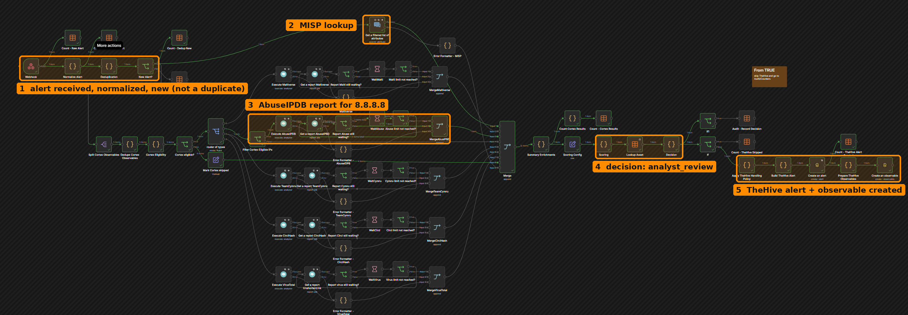
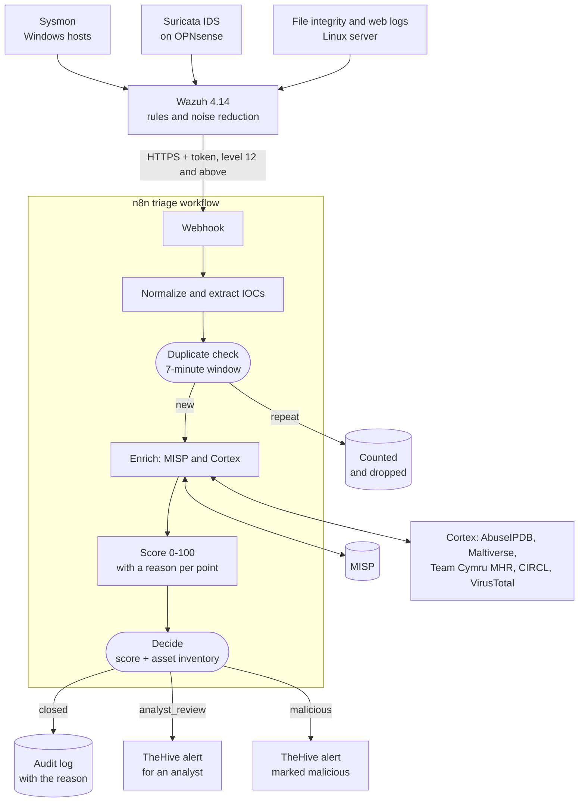
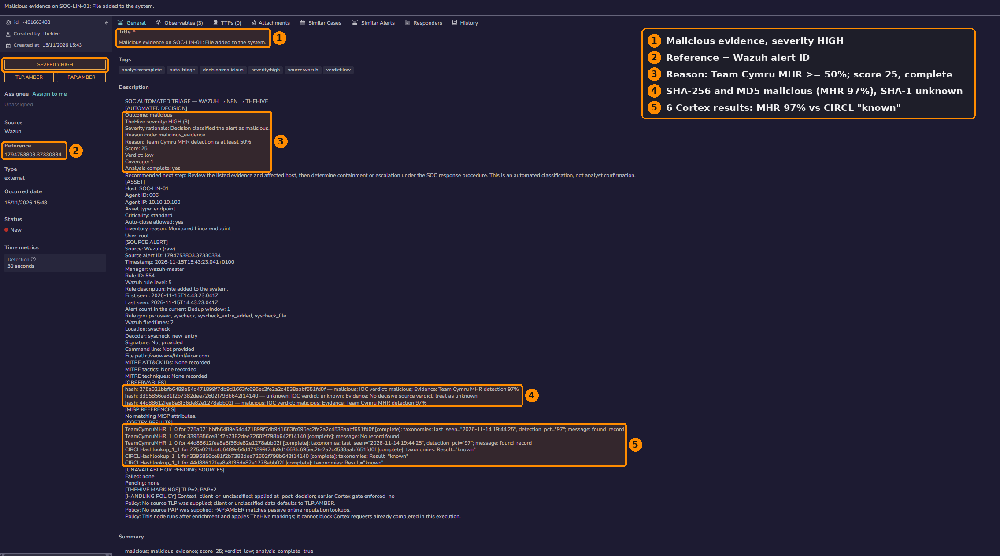
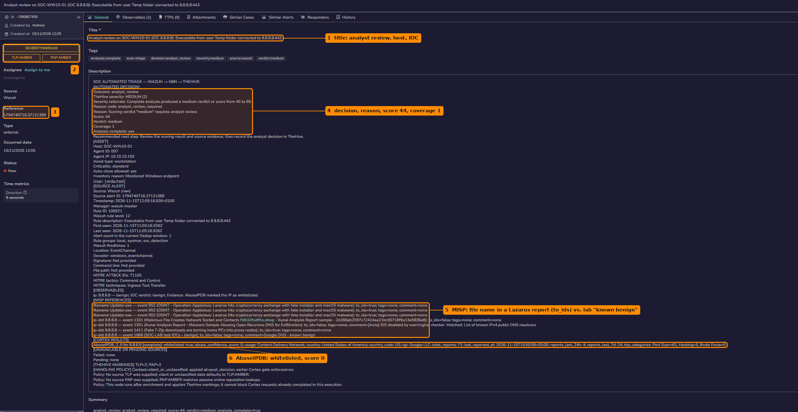

# SOC Alert Triage Automation Lab

**An open-source SOC pipeline that checks every high-severity alert against threat intelligence, scores it, and decides whether to close it with a written reason or hand it to an analyst. A human makes the final call.**

One live alert going through the workflow (proof of concept, scenario 2). The alert is received and checked for duplicates (1), looked up in MISP (2) and AbuseIPDB (3), then scored and routed to an analyst (4). It ends up in TheHive with all the evidence attached (5).

**In short**

- **Detects:** Wazuh with Sysmon on Windows hosts, Suricata IDS on the firewall, and file integrity and web logs on Linux.
- **Triages:** an n8n workflow normalizes the alert and drops duplicates. It looks up the indicators in MISP and sends external IPs, domains, URLs and hashes to five Cortex analyzers. Then it scores the result from 0 to 100 and records a reason for every point.
- **Decides:** each alert gets one of three outcomes: `closed` (with an audit record), `analyst_review` or `malicious`. The last two open an alert in TheHive with the evidence already attached.
- **Runs on a real lab:** a segmented home lab on Proxmox with an AD domain, Windows and Linux endpoints, an attacker VLAN and a separate SOC VLAN.

<!-- Results: add the measured alert funnel here once the measurement is done (see metrics/README.md). -->

---

## The problem

A hospital emergency room cannot let every patient see a doctor in order of arrival. A triage nurse checks each one first and sends the urgent cases ahead. A SOC has the same problem with alerts. A SIEM produces far more alerts than analysts can check, and most of them are repeats, known-good activity or low-value noise. When analysts are buried in noise, they start to miss the alerts that matter. This is called **alert fatigue**.

This project automates the triage step. Every alert is enriched and scored before a person sees it. Alerts that are clearly harmless are closed with a written reason, and an analyst gets fewer alerts, each one with its evidence already attached.

## How it works

| Stage | What happens | Where |
|---|---|---|
| **Detect** | Sysmon, Suricata and Linux agents send events to Wazuh. 28 noise-reduction rules drop known-benign events before they become alerts. Custom rules cover gaps in the default ruleset. | [`detection/`](detection/wazuh/rules/) |
| **Forward** | The `custom-n8n` integration sends alerts of level 12 and above over HTTPS, with a token in a request header. | [`detection/wazuh/integrations/`](detection/wazuh/integrations/) |
| **Normalize** | The Wazuh alert is converted to one [common schema](soar/schema/normalized-alert.schema.json) and the observables are extracted: IPs, domains, URLs, hashes and file names. | [`normalize.js`](soar/n8n/nodes/normalize.js) |
| **Deduplicate** | The same rule, host, source and indicator within 7 minutes count as one alert. Repeats are counted and dropped. | [`dedup.js`](soar/n8n/nodes/dedup.js) |
| **Enrich** | All observables are looked up in MISP. External ones go to the matching Cortex analyzer: IP to AbuseIPDB, domain to Maltiverse, hash to Team Cymru MHR and CIRCL Hashlookup, URL to VirusTotal. Internal addresses, host names and users stay in the lab. | [`enrichment/`](enrichment/) |
| **Score** | Configurable weights add up to a score from 0 to 100, a verdict and *coverage* (the share of sources that answered). Every point has a written reason. | [`score.js`](soar/n8n/nodes/score.js), [`score-config.json`](soar/n8n/nodes/score-config.json) |
| **Decide** | The score is combined with an asset inventory, and the alert gets one of three outcomes: `closed`, `analyst_review` or `malicious`. | [`decision.js`](soar/n8n/nodes/decision.js) |
| **Hand over** | `analyst_review` and `malicious` become TheHive alerts with a title, severity, TLP/PAP markings, every MISP and Cortex result and the external observables attached. `closed` alerts are recorded in an audit table with their reason. | [`case-management/thehive/`](case-management/thehive/) |

The workflow is exported in [`soar/n8n/workflows/`](soar/n8n/workflows/) and can be imported into any n8n instance. The reasons behind each stage are recorded in [ADR 0003](docs/decisions/0003-n8n-triage-workflow.md).

## One alert, three outcomes

To test the whole chain, we caused three real events on lab machines on 14–15 November 2026, one for each outcome. Wazuh raised the alerts and the live workflow handled them. The [full report](docs/validation/poc-live-workflow.md) has every alert, execution and decision with screenshots.

| | Event on a lab machine | What the threat intelligence said | Outcome |
|---|---|---|---|
| **1** | Admin copied jQuery from the Ubuntu package to the web root rule 554, file added, level 5 | CIRCL Hashlookup: a known file, trust 100. MISP: no match. | **`closed`**, score 0. Recorded with its reason in the audit log; nothing reached the analyst. |
| **2** | A renamed `curl.exe` ran from a user's Temp folder and connected to 8.8.8.8 custom rule 100921, level 12, T1105 | MISP: the file name appears in a report on Lazarus. AbuseIPDB: 8.8.8.8 is whitelisted. | **`analyst_review`**, score 44. TheHive alert, severity Medium, with both findings listed. |
| **3** | The EICAR test file was written to the web root rule 554, file added, level 5 | Team Cymru MHR: 97% antivirus detection. CIRCL: a known file. | **`malicious`**, score 25. TheHive alert, severity High, with the three hashes attached. |

**Scenarios 1 and 3 had the same rule, host and asset policy, but opposite outcomes.** The only difference was what the threat intelligence said about the file. In scenario 3 the score was only 25, but the workflow checks for malicious signals before it looks at the score, so a strong detection cannot get lost in a low total.

Scenario 3 in TheHive: severity High, the reason for the decision, each hash with its verdict, and all six Cortex results. The analyst does not need to open n8n.

Scenario 2 in TheHive: conflicting evidence goes to an analyst

The MISP match on the file name points one way and the AbuseIPDB whitelist points the other. The workflow does not try to resolve the conflict. It lists both results and leaves the decision to the analyst.

Rule 554 is level 5, below the default level-12 filter, so for scenarios 1 and 3 a second integration block forwarded that one rule ([details](docs/validation/poc-live-workflow.md#wazuh-integration-for-the-poc)). Each run also showed something to fix. The fixes and their re-tests are in [`regression-after-bug-fixes.md`](docs/validation/regression-after-bug-fixes.md).

## Design principles

- **An alert is closed automatically only when the evidence is clear.** All of these must be true: every source answered; at least one external indicator was checked; no source reported a malicious signal or conflicting evidence; the verdict is `likely_false_positive`; and the host matches exactly one entry in the asset inventory that allows automatic closure. In every other case the alert goes to an analyst.
- **Critical assets are never closed automatically.** In this lab that means the domain controller and the firewall.
- **A single strong signal is enough to escalate.** A `soc-lab:malicious` tag in MISP, a malicious Maltiverse classification, at least 50% detection in Team Cymru or at least 10 VirusTotal detections makes the alert `malicious`, whatever the score.
- **Every automatic closure has a reason.** It is stored in an audit table: outcome, reason code, score and execution ID.
- **A failed service does not hide an alert.** Calls are retried and failures go to an error branch, so the other sources keep running. A missing result lowers coverage, and an alert without full coverage cannot be closed.
- **Only external indicators leave the lab.** Internal addresses, host names, user names and file names are not sent to Cortex.
- **Automation does not take action on its own.** The workflow sorts alerts and gathers evidence. Response is the analyst's decision.

## What this project demonstrates

| Skill | Evidence in this repository |
|---|---|
| Detection engineering | A custom Sysmon rule for a common dropper pattern (Temp executable connecting out, T1105) and 28 narrowly scoped noise-reduction rules, each documented with how to test it: [`detection/wazuh/rules/`](detection/wazuh/rules/) |
| SOAR engineering | A 10-stage n8n workflow with 17 JavaScript Code nodes, deployed in queue mode (main, worker, task runner, PostgreSQL, Redis) behind Caddy: [`soar/n8n/`](soar/n8n/) |
| Threat intelligence | MISP and five Cortex analyzers, with explicit rules for weak indicators (a file name counts less than a hash) and for sources that disagree: [`enrichment/`](enrichment/) |
| Explainable decisions | Scoring with configurable weights and a reason for every point, plus a decision policy based on asset criticality: [`score.js`](soar/n8n/nodes/score.js), [`decision.js`](soar/n8n/nodes/decision.js) |
| Testing and validation | A live proof of concept, regression tests after the fixes, unit tests and a test suite for the scoring logic: [`docs/validation/`](docs/validation/), [`tests/`](tests/) |
| Secure development | Secret scanning of the full history (gitleaks), a check for personal data in every commit, OCR scanning of every screenshot, pre-commit hooks and sanitized workflow exports: [`.github/workflows/checks.yml`](.github/workflows/checks.yml), [`scripts/`](scripts/), [`SECURITY.md`](SECURITY.md) |
| Engineering judgement | Architecture decision records and a comparison of four SOAR engines (Shuffle, n8n, Tracecat, StackStorm): [`docs/decisions/`](docs/decisions/), [`soar-engine-comparison.md`](docs/research/soar-engine-comparison.md) |
| Teamwork | Issue → branch → pull request with review, one owner per workflow stage, [`CONTRIBUTING.md`](CONTRIBUTING.md) |

## Tech stack

| Layer | Tools |
|---|---|
| Virtualization | Proxmox VE 9.2, single host |
| Network and security | OPNsense (VLANs, firewall, NTP, WireGuard), Suricata IDS |
| SIEM and telemetry | Wazuh 4.14.9 (manager, indexer, dashboard), Sysmon 15 with sysmon-modular |
| SOAR | n8n 2.44.6 in queue mode, PostgreSQL 17, Redis 7.4, Caddy 2.11 (Docker Compose) |
| Threat intelligence | MISP (misp-docker), Cortex 4.1.0 |
| Case management | TheHive 5.8.0 |
| Endpoints | Windows Server 2022 (AD DS, DNS), Windows 10 and 11, Ubuntu 24.04 with nginx and DVWA |
| Attack simulation | Kali Linux |
| Repository tooling | GitHub Actions, gitleaks, pre-commit, Python and Node.js test scripts |

## Lab environment

The lab runs on one Proxmox host. OPNsense routes and filters traffic between the network segments:

| Segment | Role |
|---|---|
| Management | Proxmox and OPNsense administration |
| VICTIM | AD domain, Windows and Linux endpoints, an intentionally vulnerable web app |
| SOC | Wazuh, n8n, MISP, Cortex and TheHive |
| ATTACK | Kali Linux. It can reach VICTIM, but not the SOC or management networks. |
| VPN | WireGuard access for the team |

All addresses are private lab ranges. The lab setup is in [`infrastructure/lab-setup.md`](infrastructure/lab-setup.md), and the connections between components are in [`docs/architecture/architecture.md`](docs/architecture/architecture.md).

## Where to start

| If you want to... | Start with |
|---|---|
| See the pipeline working | [Live proof of concept](docs/validation/poc-live-workflow.md) |
| Understand the design | [ADR 0003: triage workflow](docs/decisions/0003-n8n-triage-workflow.md), then [architecture](docs/architecture/architecture.md) |
| Know why n8n and not Shuffle | [SOAR engine comparison](docs/research/soar-engine-comparison.md#72-findings) |
| Read the code | [`soar/n8n/nodes/`](soar/n8n/nodes/), starting with [`score.js`](soar/n8n/nodes/score.js) and [`decision.js`](soar/n8n/nodes/decision.js) |
| Run the workflow yourself | [Deploy n8n](docs/runbooks/n8n-deploy.md) → [import the workflow](soar/n8n/README.md#import-the-triage-workflow) → [build and test each node](docs/runbooks/n8n-triage.md) |
| Rebuild the lab | [Lab setup](infrastructure/lab-setup.md) and the [runbooks](docs/runbooks/) |

## Repository map

| Folder | Contents |
|---|---|
| [`detection/`](detection/) | Wazuh rules and integration, Sysmon and Suricata notes |
| [`soar/`](soar/) | n8n deployment, workflow export, Code node sources and the shared alert schema. Shuffle v0.1 is kept as an archive. |
| [`enrichment/`](enrichment/) | MISP and Cortex configuration and analyzer notes |
| [`case-management/`](case-management/) | TheHive configuration and alert format |
| [`infrastructure/`](infrastructure/) | Proxmox host, VLANs, virtual machines |
| [`docs/`](docs/) | Architecture, decision records, research, runbooks, validation reports, screenshots |
| [`samples/`](samples/) | Anonymized sample alerts and enrichment results |
| [`metrics/`](metrics/) | Alert-volume measurements and collection scripts |
| [`scripts/`](scripts/), [`tests/`](tests/) | Repository checks: secret and personal-data scanner, screenshot OCR check, syntax validation, unit tests |

## Project history

| When | Milestone |
|---|---|
| October 2026 | Lab built: network segmentation, Wazuh agents on every host, Sysmon, Suricata, TheHive and Cortex, MISP. |
| October 2026 | **v0.1:** the first pipeline on Shuffle. It is frozen under the tag [`v0.1`](https://github.com/Solivagantaeon/soc-automation-lab/tree/v0.1) and archived in [`soar/shuffle/`](soar/shuffle/). |
| 22 October 2026 | Switched to n8n. Shuffle's on-premises run limit counts workflow steps, not alerts, so a pipeline with several enrichment calls per alert used it up quickly ([findings](docs/research/soar-engine-comparison.md#72-findings)). |
| 31 October 2026 | First complete run: a web attack from Kali raised a Wazuh alert that went through MISP and Cortex into TheHive ([report](docs/validation/e2e-first-run.md)). |
| November 2026 | The team built the workflow stage by stage, one owner per stage ([ADR 0003](docs/decisions/0003-n8n-triage-workflow.md)). |
| 14–15 November 2026 | Live proof of concept with all three outcomes, followed by fixes and regression tests. |

## Next steps

Planned:
- Wazuh Active Response with a timeout, used only after an analyst approves it.
- A local LLM (Ollama) to help the analyst with alerts sent for review.
- Grouping related alerts into cases in TheHive.

## Team

We’re a group of friends who all want to get better at cybersecurity.

It is a side project, separate from our jobs. We built it on our own hardware, in our own time, and it uses no employer systems or data.

We run it like a real team. Work starts as an issue, every change goes through a pull request and a review, and each workflow stage has its own owner (listed in [ADR 0003](docs/decisions/0003-n8n-triage-workflow.md#decision)). Everyone who contributed is on the [contributors page](https://github.com/Solivagantaeon/soc-automation-lab/graphs/contributors).

## Disclaimer

This is a non-commercial learning project in an isolated home lab. Attacks were simulated only against machines we own, and DVWA is intentionally vulnerable and never exposed outside the lab. Review the configurations before using them anywhere else. To report a security issue, see [`SECURITY.md`](SECURITY.md).

## License

[MIT](LICENSE)