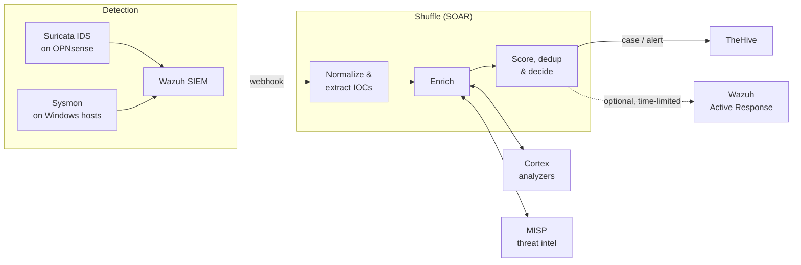

# SOC Alert Triage Automation Lab

> Reducing alert fatigue in a Security Operations Center: from **~1000 raw alerts to ~10 incidents** an analyst actually needs to look at — with open-source tooling and a human always making the final call.

<!-- After going public, add badges here (e.g. secret-scan workflow status, license). -->


---

## The problem

A SOC analyst can meaningfully investigate a few dozen alerts per shift, but a typical SIEM produces hundreds or thousands. Most are duplicates, known-benign activity or low-value noise. The result is **alert fatigue**: real attacks get missed because they drown in the noise.

## Our approach

An automated triage pipeline that enriches, scores and groups alerts before a human sees them:

```
1000 alerts ──dedup──▶ ~250 ──grouping──▶ ~80 ──enrichment──▶ ~30 ──scoring──▶ ~10 incidents
```

| Verdict | What happens |
|---|---|
| Benign / false positive | Closed automatically **with a written justification** |
| Uncertain | Opened as a case for an analyst |
| Confirmed malicious | Prioritised; optional automated response only when safe and time-limited |

**Design principle:** automation prepares the decision, a human makes it.

## Architecture



More detail: [`docs/architecture.md`](docs/architecture.md).

## Tech stack

| Area | Tools |
|---|---|
| Virtualisation & network | Proxmox VE, OPNsense (VLAN segmentation, WireGuard) |
| Detection | Wazuh 4.14, Suricata, Sysmon (sysmon-modular) |
| Orchestration (SOAR) | Shuffle |
| Enrichment & threat intel | Cortex, MISP |
| Case management | TheHive (DFIR-IRIS evaluated as an alternative) |
| Adversary simulation | Kali Linux, Active Directory lab |

## Repository layout

```
detection/        Wazuh rules, decoders, integration config, Sysmon & Suricata config
soar/shuffle/     Exported (sanitised) Shuffle workflows
enrichment/       Cortex analyzers and MISP configuration notes
case-management/  TheHive templates and configuration notes
scripts/          Helper tooling (e.g. secret sanitiser for exports)
samples/alerts/   Synthetic sample alerts used for testing the pipeline
metrics/          Alert-reduction measurements (before / after)
docs/             Architecture, lab setup, decision records, runbooks
```

## Results

_To be filled in at the end of the project:_ alert volume before vs after each pipeline stage, mean time to triage, examples of auto-closed vs escalated alerts, screenshots / demo GIF.

## Reproducing the lab

See [`docs/lab-setup.md`](docs/lab-setup.md). The lab runs on a single Proxmox host; all addresses are private lab ranges.

## Team

<!-- Name — role — GitHub/LinkedIn. Each person describes their own contribution. -->
| Name | Role / contribution |
|---|---|
| _TBD_ | Lab infrastructure, network & integration |
| _TBD_ | SOAR workflows |
| _TBD_ | Detection engineering |

## Disclaimer

Educational, non-commercial project built in an isolated home lab. Attack simulations target only machines we own. Do not use the included configurations in production without review.

## License

[MIT](LICENSE)
