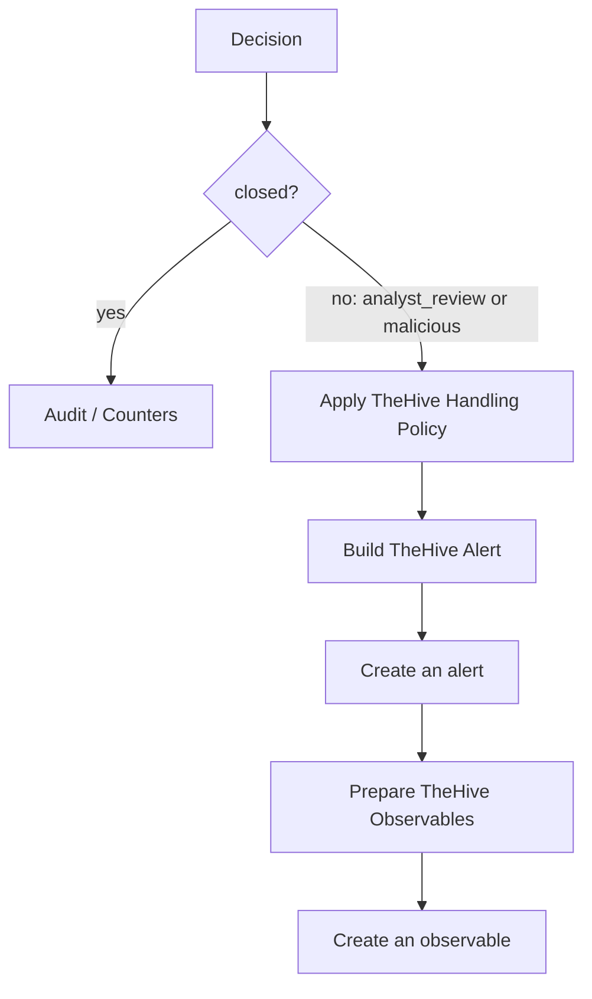
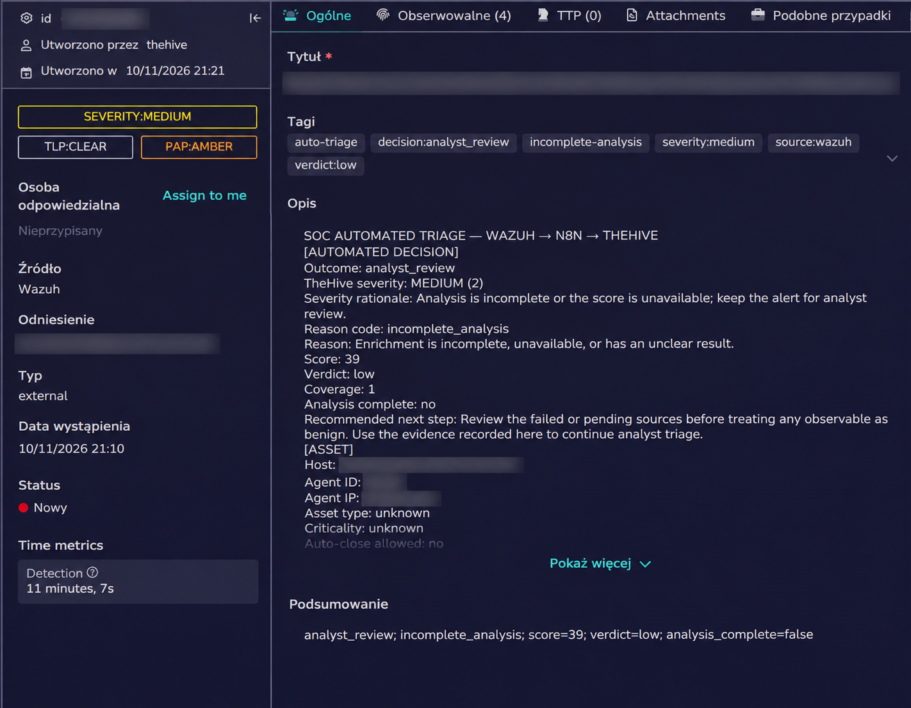
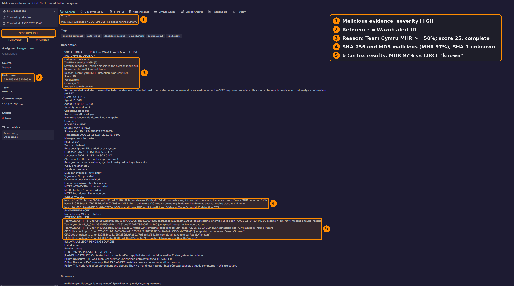
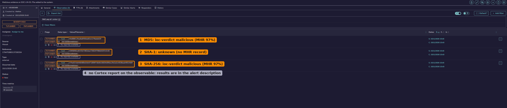
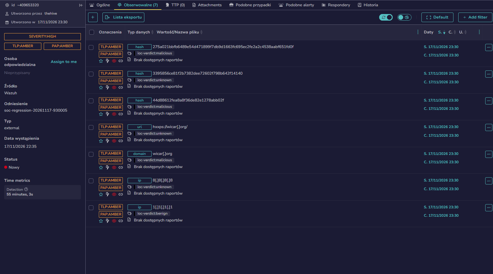

# TheHive – alert and case management

## Role in the pipeline

TheHive is the analyst-facing end of the pipeline. The n8n triage workflow creates a TheHive alert only for alerts that need a human – decisions `analyst_review` and `malicious` – and attaches the external IOCs as observables. Alerts that the workflow closes automatically (`closed`) never reach TheHive; they are recorded in the n8n audit table instead. Analysts make the final judgment and can run Cortex analyzers on the observables from TheHive.

Wazuh → n8n (enrichment, scoring, decision) → **TheHive**

In v0.1, Shuffle created the TheHive alerts and updated an existing alert on repeats; that integration (issue #11) is archived in [`soar/shuffle/docs/thehive-alerts.md`](../../soar/shuffle/docs/thehive-alerts.md).

## What is in this folder

| File | Purpose |
|---|---|
| `README.md` | Deployment, how n8n creates alerts, verification and evidence |

The code that builds the alert lives with the workflow:

| Path | Content |
|---|---|
| [`soar/n8n/nodes/thehive-handling-policy-v0.1.js`](../../soar/n8n/nodes/thehive-handling-policy-v0.1.js) | Sets TLP and PAP for the alert |
| [`soar/n8n/nodes/thehive-alert-v0.3.js`](../../soar/n8n/nodes/thehive-alert-v0.3.js) | Builds the alert fields, description, tags and the list of eligible observables |
| [`soar/n8n/nodes/prepare-thehive-observables-v0.1.js`](../../soar/n8n/nodes/prepare-thehive-observables-v0.1.js) | Emits one item per observable with the created alert ID |

## Deployment in the lab

| Property | Configuration |
|---|---|
| Version | TheHive **5.8.0** (UI build `5.8.0-1`) |
| Installation | StrangeBee Docker deployment, `testing` profile |
| VM | Proxmox VM **207** (`thehive-cortex`), shared with Cortex |
| Private IP | `10.10.20.247` (VLAN 20, SOC) |
| Access | HTTPS `443/TCP`, path `/thehive` (self-signed certificate, CN `thehive-cortex`); the application itself listens on `9000/TCP` |
| API | TheHive REST API (`/api/v1/`) for alerts, cases and observables |
| Authentication | Authenticated UI sessions; scoped API keys for integrations |
| Analyst organization | `soclab` (renamed from `demo` on 2026-10-31) |
| Integrations | n8n (alerts and observables), Cortex (analyzers), MISP (event import) |

**Licence and accounts.** The lab runs the TheHive Community licence: one organization and two paid seats. Only unlocked *Normal* accounts with a licensed profile (for example analyst or org-admin) take a seat. The n8n integration uses a **Service** account with the analyst profile in `soclab`, so it does not consume a seat. Account names and API keys are not documented here.

A deployment runbook for TheHive and Cortex is not written yet (see the [runbook index](../../docs/runbooks/README.md)).

## Configuration

### How n8n creates an alert



The native **TheHive 5** node in n8n creates the alert with automatic field mapping, then a second TheHive 5 node attaches each observable to the created alert by its `_id`. Step-by-step node configuration: [n8n triage runbook §8](../../docs/runbooks/n8n-triage.md#8-thehive).

### Alert fields

| Field | Value |
|---|---|
| `type` / `source` | `external` / `Wazuh` |
| `sourceRef` | Wazuh alert ID. TheHive rejects a second alert with the same `(type, source, sourceRef)` in one organization. |
| `title` | `Analyst review` or `Malicious evidence` + host, source IP or sample IOC, and the Wazuh rule description |
| `description` | Decision outcome and reason, score, verdict, coverage, analysis status, asset and source context, per-IOC verdicts, enrichment summaries, unavailable or pending sources, MISP references |
| `severity` | From the decision, score and asset criticality (rules below) |
| `tlp` / `pap` | From the handling policy (below) |
| `tags` | `auto-triage`, `source:wazuh`, `decision:<outcome>`, `verdict:<verdict>`, `severity:<level>`, `analysis:complete` or `incomplete-analysis`, and `asset:critical` for critical assets |

**Severity** (in `thehive-alert-v0.3.js`):

| Condition | Severity |
|---|---|
| `malicious` with complete analysis and score ≥ 90 | Critical |
| other `malicious` decisions | High |
| `analyst_review` on a critical asset | High |
| incomplete analysis or no score | Medium |
| complete analysis, verdict `high` or score ≥ 70 | High |
| complete analysis, verdict `medium` or score 40–69 | Medium |
| complete analysis, verdict `low` / `likely_false_positive` and score < 40 | Low |

The rationale is in [ADR 0003 §8](../../docs/decisions/0003-n8n-triage-workflow.md#8-thehive).

**TLP and PAP.** The most restrictive explicit source marking wins. Without source markings, the rule group `soc-lab-test` gets TLP CLEAR (`0`) and everything else TLP AMBER (`2`). PAP defaults to AMBER (`2`). Neither value is derived from severity. The policy runs after enrichment, so it does not control which data was already sent to Cortex.

### Observables

Only external IPs, domains, URLs and hashes become observables; internal IPs and hostnames are excluded. Each observable carries an `ioc-verdict:<verdict>` tag and a message with the evidence: a MISP attribute with `to_ids: true` counts as adverse evidence, a whitelist as benign evidence, and when both apply the verdict is `unknown` with both reasons recorded.

### Repeated alerts

n8n drops a repeated Wazuh alert before enrichment (the `Dedup` node, 7-minute window – [runbook §3](../../docs/runbooks/n8n-triage.md#3-dedup)). Unlike v0.1, the workflow does not update an existing TheHive alert; a repeat is counted and stopped.

## Verify it works

**1. Containers are running.** On VM 207:

```bash
sudo docker ps --format 'table {{.Names}}\t{{.Image}}\t{{.Status}}\t{{.Ports}}'
# Use the actual TheHive container name from docker ps:
sudo docker logs --tail 50 <THEHIVE_CONTAINER>
```

**2. The API answers** (no key needed for the status endpoint):

```bash
curl -sk https://10.10.20.247/thehive/api/status
```

Expected: HTTP 200 with the TheHive version (`5.8.0-1`).

**3. Alerts are visible.** Sign in, select the `soclab` organization and open **Alerts**. Expected: the alert list loads; alerts created by n8n carry the tags `auto-triage` and `source:wazuh`. This works without new Wazuh events, n8n executions or Cortex runs.

**4. End to end.** Send a test alert through the workflow with a fresh Wazuh alert ID (see [runbook §8, live verification](../../docs/runbooks/n8n-triage.md#live-verification)). Expected: one new alert with the expected severity, TLP/PAP and observables.

## Troubleshooting

| Symptom | Cause / check |
|---|---|
| TheHive rejects the alert as a duplicate | The same `sourceRef` was already used in the organization. Use a fresh Wazuh alert ID for every test run. |
| Alert has no observables | Inspect `thehive_observables` in `Build TheHive Alert`, the alert `_id` from `Create an alert`, and the items from `Prepare TheHive Observables`. |
| Observable cannot be attached | `alertId` must be the `_id` from `Create an alert`, and **Create in** must be set to **Alert**. |
| `Build TheHive Alert` rejects the outcome | Only the false (not `closed`) output of the `If` node may reach the policy and builder nodes. |
| Policy reports `client_or_unclassified` for a synthetic test | The `Webhook` node must keep `rule.groups` with the exact `soc-lab-test` group; do not rename the node. |
| Alert counts or API key tests do not match | Check that the `soclab` organization is selected. |
| Cortex analyzers stop working from TheHive | The Cortex API key was renewed; see the [Cortex README](../../enrichment/cortex/README.md#troubleshooting). |

## Decisions and evidence

**Live verification of the TheHive branch (issue #73).** Synthetic run `soc-hive73-fasttest-20261110-05`: Decision `analyst_review` / `incomplete_analysis`, score `39`. TheHive created an alert with severity Medium, TLP CLEAR, PAP AMBER and four observables.



**Proof of concept with live Wazuh alerts (issue #92, 2026-11-15).** Three scenarios, one per decision: the benign alert was closed automatically and nothing reached TheHive; the unclear alert reached TheHive for analyst review with `8.8.8.8` attached; the EICAR alert reached TheHive as malicious with three hashes, two marked malicious. Full write-up: [`docs/validation/poc-live-workflow.md`](../../docs/validation/poc-live-workflow.md).





**Regression checks (issues #93–#98).** One alert per Wazuh event after the Cortex loop fix, and conflicting evidence for one IP kept visible on the observable: [`docs/validation/regression-after-bug-fixes.md`](../../docs/validation/regression-after-bug-fixes.md).



**Related:**

- ADR: [0003 – n8n triage workflow](../../docs/decisions/0003-n8n-triage-workflow.md)
- v0.1 integration and its end-to-end test: [`soar/shuffle/docs/thehive-alerts.md`](../../soar/shuffle/docs/thehive-alerts.md)
- MISP event import into TheHive: [MISP README](../../enrichment/misp/README.md#thehive-import-filter)
