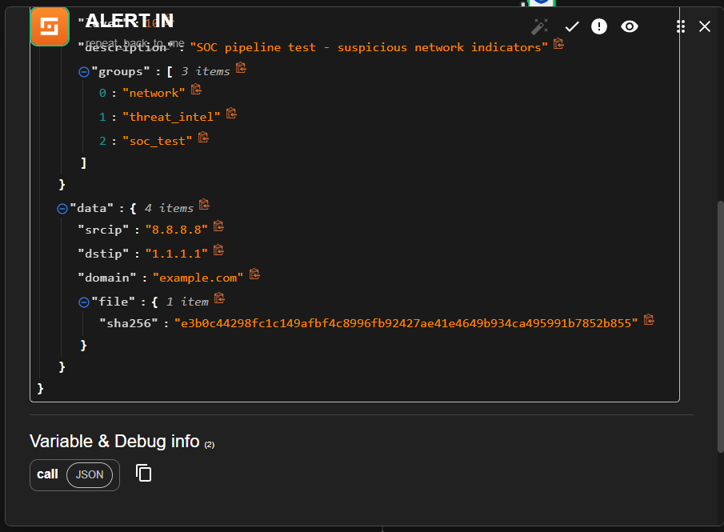
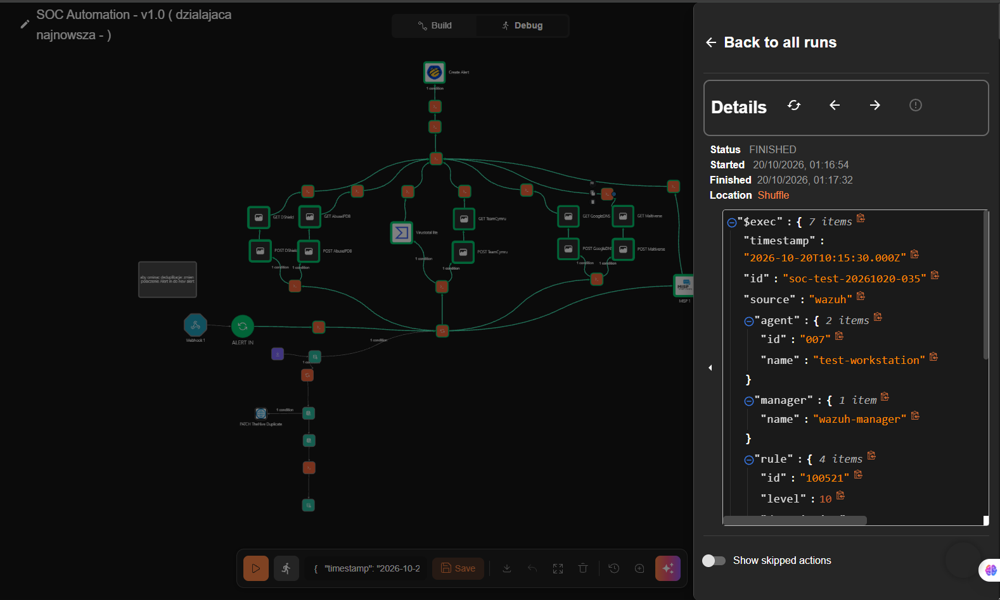
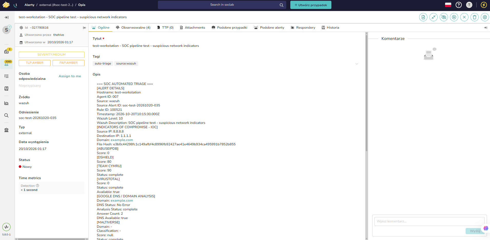
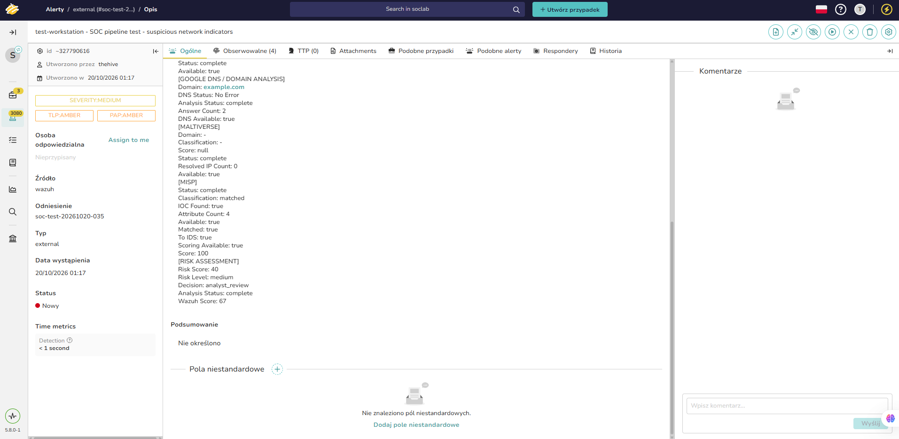
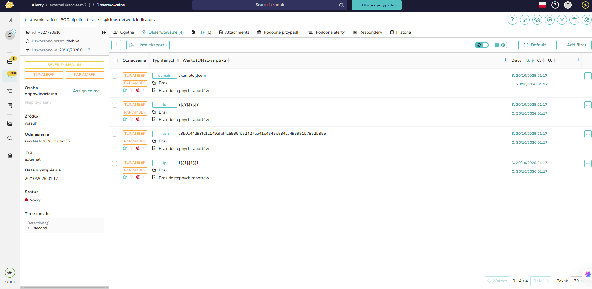

# TheHive — Alert Integration

**Platform:** TheHive 5.8  
**Integration:** Shuffle SOAR → TheHive  
**Organisation:** `demo`  
**Source:** Wazuh

## 1. Purpose

This integration sends normalized Wazuh alerts from Shuffle to TheHive for analyst review.

Before creating an alert, the workflow normalizes the source event, enriches available indicators, evaluates a simple decision condition and prepares an alert containing the source context, observable indicators and enrichment summary.

The current implementation is the thin end-to-end flow. Full scoring and classification are tracked in [issue #15](https://github.com/Solivagantaeon/soc-automation-lab/issues/15).

## 2. Alert fields

The workflow sends the following fields to TheHive. The full request template is in [`alert-request.json`](alert-request.json).

| Field | Description |
|---|---|
| `title` | Descriptive title built from the hostname and Wazuh alert description. |
| `description` | Human-readable SOC triage report containing source details, IOC values, enrichment results and risk assessment. |
| `type` | `external`, identifying the alert as externally generated. |
| `source` | `wazuh`, identifying the originating system. |
| `sourceRef` | Original Wazuh source alert ID. Used to identify the source event and support duplicate handling. |
| `severity` | Severity selected by the Shuffle decision step. |
| `tlp` | Traffic Light Protocol marking. The current workflow uses `2`. |
| `pap` | Permissible Actions Protocol marking. The current workflow uses `2`. |
| `tags` | Labels identifying automated triage and the alert source. |
| `observables` | Available IP addresses, domains and file hashes attached to the alert as TheHive observables. |

### Source traceability

The alert description includes the normalized source context:

- Hostname and agent ID
- Original Wazuh alert ID
- Wazuh rule ID
- Event timestamp
- Original alert description

The `sourceRef` field is populated from the normalized source alert ID. The rule ID is included in the description so an analyst can trace the alert back to its originating detection rule.

## 3. Tags

The workflow applies the following tags:

| Tag | Purpose |
|---|---|
| `auto-triage` | Marks alerts created or processed by automated triage. |
| `source:wazuh` | Identifies Wazuh as the alert source. |

These tags help analysts distinguish automated alerts and filter alerts by their originating system.

Additional tags may be introduced as classification logic evolves. Tags such as `auto-closed` and `verdict:benign` should only be applied when the corresponding automated closure and verdict behavior is implemented and verified.

## 4. Observables

The workflow extracts indicators from the normalized event and attaches available values to the TheHive alert.

| Observable | Purpose |
|---|---|
| IP address | Source or destination network address. |
| Domain | Normalized domain name. |
| File hash | Validated file hash, such as SHA-256. |

Only present and valid IOC values should be submitted as observables. Missing values must not produce empty observable entries.

After a workflow execution, verify the observable values in the alert's **Observables** tab in TheHive.

## 5. Enrichment summary

The alert description contains a structured summary of the available enrichment results:

- AbuseIPDB
- DShield
- Team Cymru
- VirusTotal
- Google DNS and domain analysis
- Maltiverse
- MISP

The summary records the fields returned by the relevant workflow steps, such as score, status, classification, availability and IOC match information.

Unavailable enrichment data must be distinguished from a negative result. An unavailable service or missing response does not establish that an indicator is benign.

## 6. Duplicate handling

A repeated source event updates the existing TheHive alert instead of creating a new one. Shuffle keeps the mapping between the source event and the TheHive alert ID in its Datastore.

Two identifiers must not be confused:

- **Source alert ID:** the original identifier from Wazuh, used in `sourceRef` and for source-event traceability.
- **TheHive alert ID:** the identifier returned by TheHive after alert creation, used to update that alert.

The deduplication flow (fingerprint, Datastore categories, TheHive `Update Alert` action and duplicate counter) is documented in [PR #49](https://github.com/Solivagantaeon/soc-automation-lab/pull/49). Correlation keys, time windows, first-seen/last-seen timestamps and large volumes of repeated events are tracked in [issue #16](https://github.com/Solivagantaeon/soc-automation-lab/issues/16).

## 7. Evidence

The end-to-end test used a synthetic Wazuh-format alert (`test-workstation`, rule `100521`) sent to the Shuffle webhook.

*Figure 1. The test alert received by the Shuffle `ALERT_IN` node.*

*Figure 2. Source IP, destination IP, domain and file hash in the test alert.*

*Figure 3. Finished Shuffle execution: enrichment branches, decision step and Create Alert.*

*Figure 4. The resulting TheHive alert: title, tags, source reference, severity and the beginning of the triage report.*

*Figure 5. Enrichment results from all sources and the risk assessment with the routing decision.*

*Figure 6. Four observables attached to the alert: two IP addresses, a domain and a file hash.*
