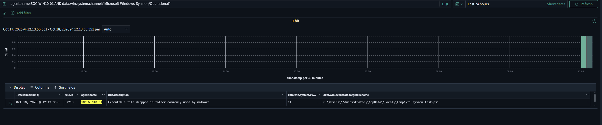

# Sysmon

Sysmon runs on all Windows hosts in VLAN 10 (VICTIM). Events are collected by the
Wazuh agent from the `Microsoft-Windows-Sysmon/Operational` channel.

## Hosts

| Host (= Wazuh agent name) | Agent ID | Sysmon | Config | Schema | Config SHA256 | Deployment |
|---|---|---|---|---|---|---|
| SOC-DC01 (Server 2022) | 008 | 15.22 | sysmon-modular Balanced | 4.91 | `F115AAC5770DAE468E5CFB48C58A8B6E37588208A31F1B746812C534577A244B` | manual, `Sysmon64.exe -accepteula -i sysmonconfig.xml` |
| SOC-WIN10-01 (Win 10) | 007 | 15.15 | sysmon-modular (`C:\sysmon_install\sysmonconfig.xml`) | 4.90 | `D0DB1CBBE634373762E5B3217C975AFA7439FAFBDBB77C99F3C89CF40200E1D3` | manual |
| SOC-WIN11-AI (Win 11) | 004 | 15.21 | sysmon-modular Balanced | 4.91 | `F115AAC5770DAE468E5CFB48C58A8B6E37588208A31F1B746812C534577A244B` | manual |

sysmon-modular commit: not recorded at deployment time (all hosts use the Balanced variant).

Hashing algorithms (all hosts): `SHA1,MD5,SHA256,IMPHASH`
(registry `SysmonDrv\Parameters\HashingAlgorithm` = `2147483663`).

SOC-DC01 and SOC-WIN11-AI use the **same** config file (identical SHA256).
SOC-WIN10-01 runs an older Sysmon (15.15) with a different config — aligning it
with DC/WIN11 is a follow-up.

### How to check a host

```powershell
(Get-Item C:\Windows\Sysmon64.exe).VersionInfo.FileVersion
Get-ItemProperty HKLM:\SYSTEM\CurrentControlSet\Services\SysmonDrv\Parameters |
  Select-Object ConfigFile, ConfigHash, HashingAlgorithm
```

`Sysmon64.exe -c` shows the same data, but on some hosts (e.g. SOC-DC01) its output
cannot be filtered with `Select-String`; the registry is the reliable source.

## Collection in Wazuh

The channel is configured **centrally** in the `default` group
(`detection/wazuh/agent-config/agent.conf`), only for Windows agents:

```xml
<agent_config os="Windows">
  <localfile>
    <location>Microsoft-Windows-Sysmon/Operational</location>
    <log_format>eventchannel</log_format>
  </localfile>
</agent_config>
```

Local `<localfile>` entries for Sysmon were removed from `ossec.conf` on SOC-DC01
and SOC-WIN11-AI (2026-10-18) to avoid warning `(1958) Log file ... is duplicated`.

Check on a host:

```powershell
Select-String 'C:\Program Files (x86)\ossec-agent\ossec.log' -Pattern 'Sysmon' | Select -Last 2
# expected: (1951): Analyzing event log: 'Microsoft-Windows-Sysmon/Operational'
```


## Verification (2026-10-18)

Test on SOC-WIN10-01: a `.ps1` file created in `%TEMP%` produced Sysmon EID 11 →
Wazuh rule **92213** "Executable file dropped in folder commonly used by malware"
(level 15, MITRE T1105).



Full alert (anonymised): [`samples/alerts/wazuh/sysmon-92213-exe-in-temp.json`](../../samples/alerts/wazuh/sysmon-92213-exe-in-temp.json)

## Known errors

### Event ID 255 – `IMAGE_LOAD: Failed to find process image name`

Seen on SOC-WIN11-AI (~78 per 7 days) and SOC-DC01 (Wazuh: "Windows Sysmon error event").
Benign Sysmon race: the process exits before Sysmon resolves its image name for an
image-load (DLL) event. No impact on detection. Optional suppression: a local Wazuh
rule with level 0 matching `win.eventdata.description` = "Failed to find process image name".

## Known issues

- **Clock on SOC-WIN10-01 and SOC-WIN11-AI is +6 h (UTC)**; SOC-DC01 is correct.
  Sysmon fields `utcTime` / `systemTime` are therefore wrong on those hosts.
  For correlation use the Wazuh `timestamp` (manager time), not host time fields.
