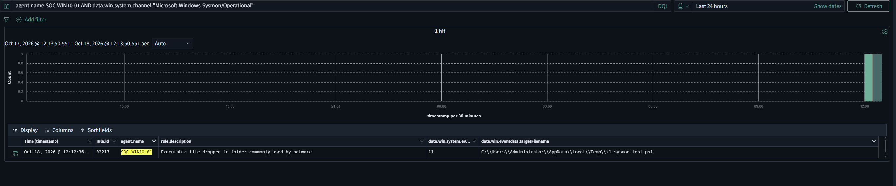

# Sysmon – Windows endpoint telemetry

## Role in the pipeline

Sysmon records detailed Windows activity – process creation, process access, image loading, file creation and registry operations – on the Windows hosts in VLAN 10 (VICTIM). It runs as a Windows service and writes to the `Microsoft-Windows-Sysmon/Operational` event channel. The Wazuh agent on each host reads that channel and forwards the events to the Wazuh manager, which applies the Windows/Sysmon rules.

**Sysmon** → Wazuh agent → Wazuh manager → n8n (alerts of level 12 and above) → TheHive

Sysmon only produces telemetry. Detection happens in the Wazuh rules (see [`../wazuh/`](../wazuh/)).

## What is in this folder

| File | Purpose |
|---|---|
| `README.md` | Deployment record, collection settings, verification and known issues |

The Sysmon configuration file is not stored in this repository. All hosts use the upstream sysmon-modular **Balanced** configuration (see [Configuration](#configuration)).

## Deployment in the lab

| Host (= Wazuh agent name) | VM ID | Private IP | OS | Wazuh agent ID | Wazuh agent | Sysmon |
|---|---|---|---|---|---|---|
| `SOC-DC01` | `101` | `10.10.10.200` | Windows Server 2022 | `008` | `4.14.9` | `15.22` |
| `SOC-WIN10-01` | `102` | `10.10.10.150` | Windows 10 | `007` | `4.14.9` | `15.15` |
| `SOC-WIN11-AI` | `103` | `10.10.10.171` | Windows 11 | `004` | `4.14.9` | `15.21` |

**Installation:** native Sysmon Windows service, deployed manually on each host with the sysmon-modular Balanced configuration. Command used on SOC-DC01:

```powershell
Sysmon64.exe -accepteula -i sysmonconfig.xml
```

A deployment runbook is not written yet (planned in the [runbook index](../../docs/runbooks/README.md)).

**Ports, authentication and APIs:**

- Sysmon logs locally. It needs no inbound network port, has no REST API and uses no API key.
- The Wazuh agent forwards the events to the manager at `10.10.20.243:1514/TCP` using its enrolled agent key.
- Managing the service or its configuration requires local Windows administrator rights.

## Configuration

### Sysmon configuration per host

| Host | Config | Schema | Config SHA256 |
|---|---|---|---|
| `SOC-DC01` | sysmon-modular Balanced | 4.91 | `F115AAC5770DAE468E5CFB48C58A8B6E37588208A31F1B746812C534577A244B` |
| `SOC-WIN10-01` | sysmon-modular (`C:\sysmon_install\sysmonconfig.xml`) | 4.90 | `D0DB1CBBE634373762E5B3217C975AFA7439FAFBDBB77C99F3C89CF40200E1D3` |
| `SOC-WIN11-AI` | sysmon-modular Balanced | 4.91 | `F115AAC5770DAE468E5CFB48C58A8B6E37588208A31F1B746812C534577A244B` |

- sysmon-modular commit: not recorded at deployment time (all hosts use the Balanced variant).
- SOC-DC01 and SOC-WIN11-AI use the **same** config file (identical SHA256). SOC-WIN10-01 runs an older Sysmon (15.15) with a different config – aligning it with DC/WIN11 is a follow-up.
- Hashing algorithms (all hosts): `SHA1,MD5,SHA256,IMPHASH` (registry `SysmonDrv\Parameters\HashingAlgorithm` = `2147483663`).

To check a host:

```powershell
(Get-Item C:\Windows\Sysmon64.exe).VersionInfo.FileVersion
Get-ItemProperty HKLM:\SYSTEM\CurrentControlSet\Services\SysmonDrv\Parameters |
  Select-Object ConfigFile, ConfigHash, HashingAlgorithm
```

`Sysmon64.exe -c` shows the same data, but on some hosts (e.g. SOC-DC01) its output cannot be filtered with `Select-String`; the registry is the reliable source. `Sysmon64.exe -s` displays the installed event schema.

### Collection in Wazuh

The channel is configured **centrally** in the `default` agent group ([`../wazuh/agent-config/agent.conf`](../wazuh/agent-config/agent.conf)), only for Windows agents:

```xml
<agent_config os="Windows">
  <localfile>
    <location>Microsoft-Windows-Sysmon/Operational</location>
    <log_format>eventchannel</log_format>
  </localfile>
</agent_config>
```

Do not add a local `<localfile>` entry for Sysmon to `ossec.conf` on the hosts (see [Troubleshooting](#duplicated-log-file-warning-1958)).

## Verify it works

**1. Sysmon on the host** (independent of Wazuh). In an administrator PowerShell session:

```powershell
Get-Service Sysmon,Sysmon64 -ErrorAction SilentlyContinue
Get-WinEvent -ListLog 'Microsoft-Windows-Sysmon/Operational' |
    Select-Object LogName, IsEnabled, RecordCount
Get-WinEvent -FilterHashtable @{
    LogName = 'Microsoft-Windows-Sysmon/Operational'
    Id = 1
} -MaxEvents 3 | Select-Object TimeCreated, Id, ProviderName
```

Expected: the service is running and the Operational channel contains fresh Event ID 1 (process creation) records, whether or not the Wazuh manager is available. To restart the service, use `Restart-Service` with the installed service name.

**2. The Wazuh agent reads the channel:**

```powershell
Select-String 'C:\Program Files (x86)\ossec-agent\ossec.log' -Pattern 'Sysmon' | Select -Last 2
# expected: (1951): Analyzing event log: 'Microsoft-Windows-Sysmon/Operational'
```

**3. Events reach Wazuh.** In the Wazuh dashboard, search the alerts:

```text
agent.name: "SOC-WIN10-01" AND data.win.system.channel: "Microsoft-Windows-Sysmon/Operational"
agent.name: "SOC-WIN11-AI" AND data.win.system.channel: "Microsoft-Windows-Sysmon/Operational"
```

Expected: Sysmon-channel alerts for each host (results from 2026-10-18 are under [Decisions and evidence](#decisions-and-evidence)).

**4. Detection test.** Create a `.ps1` file in `%TEMP%` on a Windows host. Expected: Sysmon Event ID 11 (file create) → Wazuh rule **92213** "Executable file dropped in folder commonly used by malware" (level 15, MITRE T1105). Level 15 is above the integration threshold, so the alert is also sent to n8n.

## Troubleshooting

### Event ID 255 – Sysmon error events

Wazuh shows these as "Windows Sysmon error event". A seven-day search on 2026-10-18 matched **73** alerts: **72** from SOC-WIN11-AI and **1** from SOC-WIN10-01. The error is also seen on SOC-DC01. Two kinds were observed:

- **`IMAGE_LOAD: Failed to find process image name`** – a benign Sysmon race: the process exits before Sysmon resolves its image name for an image-load (DLL) event. No impact on detection. Optional suppression: a local Wazuh rule with level 0 matching `win.eventdata.description` = "Failed to find process image name".
- **`QUEUE`** – the driver queue reported dropped events (including registry events and image loads). Dropped events are an observability gap, even if other alerts are still collected normally. Correction: review the active sysmon-modular configuration, reduce particularly noisy event selections where appropriate, review endpoint resource use and Sysmon diagnostic logs, then repeat Event ID 255 monitoring after the changes.

Event ID 255 is a diagnostic, not a malware verdict. To reproduce the search:

```text
data.win.system.eventID: "255" AND (agent.name: "SOC-WIN10-01" OR agent.name: "SOC-WIN11-AI")
```

### Duplicated log file warning (1958)

- **Problem:** the agent logs `(1958) Log file ... is duplicated`.
- **Cause:** the Sysmon channel was defined both centrally in `agent.conf` and locally in `ossec.conf`.
- **Fix:** the local `<localfile>` entries for Sysmon were removed from `ossec.conf` on SOC-DC01 and SOC-WIN11-AI (2026-10-18). The central `agent.conf` is the only source.

### Host timestamps 6 h ahead (data before 2026-10-18)

Windows events collected before 2026-10-18 13:28 CEST carry host timestamps that are 6 hours ahead in UTC (Sysmon `utcTime`, `data.win.system.systemTime`) on SOC-DC01, SOC-WIN10-01 and SOC-WIN11-AI. The clocks were fixed by the NTP change in the [time synchronisation runbook](../../docs/runbooks/time-sync.md). For correlation of older data, use the Wazuh `timestamp` (manager time), not the host time fields.

### Rule 92910 – possible process injection

The process-access rule `92910` (Sysmon Event ID 10) classified `OneDrive.exe` accessing `Explorer.EXE` as possible process injection. It is a detection that requires triage, not proof of malicious process injection.

## Decisions and evidence

**Detection test (2026-10-18, SOC-WIN10-01)** – rule 92213 from Sysmon Event ID 11:



Full alert (anonymised): [`samples/alerts/wazuh/sysmon-92213-exe-in-temp.json`](../../samples/alerts/wazuh/sysmon-92213-exe-in-temp.json)

**Wazuh ingestion (2026-10-18)** – alerts matching the queries from [Verify it works](#verify-it-works), 90-day search window:

| Host | Alert matches | Observed example |
|---|---:|---|
| `SOC-WIN10-01` | **63** | Sysmon Event ID 10, process access; Wazuh rule `92910` |
| `SOC-WIN11-AI` | **3,127** | Sysmon Event ID 1, process creation; Wazuh rule `92052` |

These are Wazuh alerts matching the filter, not total Sysmon event counts.

**Related:**

- Agent configuration: [`../wazuh/agent-config/agent.conf`](../wazuh/agent-config/agent.conf)
- Time synchronisation: [`docs/runbooks/time-sync.md`](../../docs/runbooks/time-sync.md)
- Issue [#4 – Wazuh agents, Sysmon and Suricata](https://github.com/Solivagantaeon/soc-automation-lab/issues/4)
