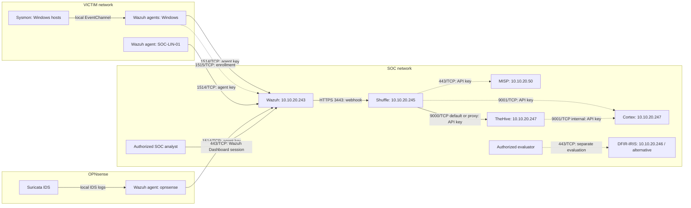
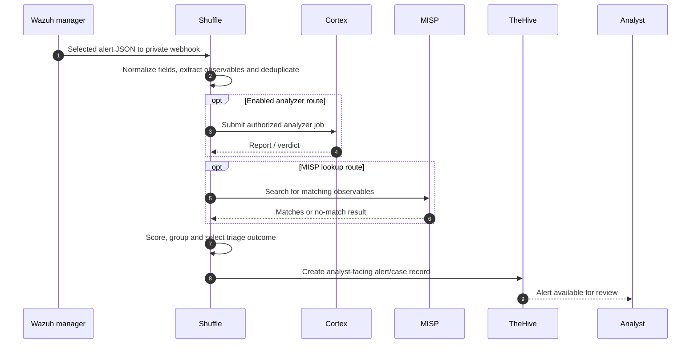

# Architecture

> Documentation baseline: 18 October 2026. The diagram and [communication matrix](components.md#10-communication-matrix) use the same component names and transport assumptions. Solid lines indicate observed ingestion or implemented/tested paths; dashed lines represent architecture/integration paths whose individual results are validated separately.

## Network segmentation

| Segment | Subnet | Role |
|---|---|---|
| Management | `10.10.99.0/24` | Proxmox and OPNsense administration |
| VICTIM | `10.10.10.0/24` | AD domain and Windows endpoints |
| SOC | `10.10.20.0/24` | SIEM, SOAR, enrichment, case management |
| ATTACK | `10.10.30.0/24` | Kali attack simulation |
| VPN | `10.10.250.0/24` | WireGuard access for administrators |

Refer to [lab setup](lab-setup.md) for segmentation and policies. The lab is isolated from the home network.

## Component communication diagram

**Matrix scope:** endpoints may also use `1515/TCP` during registration; Wazuh Dashboard is exposed via `443/TCP`, Manager REST API via `55000/TCP`. The default Cortex/TheHive service ports are private service conventions, not substitutes for inspecting Docker's actual published ports. DFIR-IRIS is a separate evaluated alternative and is not wired into the main triage flow.

## Triage workflow

Workflow overview screenshot: [Shuffle editor](images/shuffle/06-shuffle-running.png). TheHive output screenshot: [test alerts](images/thehive/06-thehive-running.png). Successful operation of specific enrichment providers requires validation of their corresponding workflow executions.

## Key design decisions

1. **Alert routing:** filter on relevant Wazuh `rule_id` values rather than only Wazuh severity because useful Suricata events may be classified at lower levels (e.g. rule `86601`).
2. **Human-in-the-loop:** enrich, group and prioritize automatically; a human decides on response and escalation.
3. **Case management:** use TheHive as the integration target; DFIR-IRIS remains an evaluated alternative.
4. **Security:** do not store tokens, webhook URLs, API keys, private credentials or public IPs in the repository.
5. **Clock alignment:** OPNsense NTP, DC and domain-member synchronization, and Linux time synchronization provide correlated event timestamps (see [Issue #5](https://github.com/Solivagantaeon/soc-automation-lab/issues/5)).

## Component reference

Complete deployment, independent health checks, troubleshooting, and ports are documented in [`components.md`](components.md).
