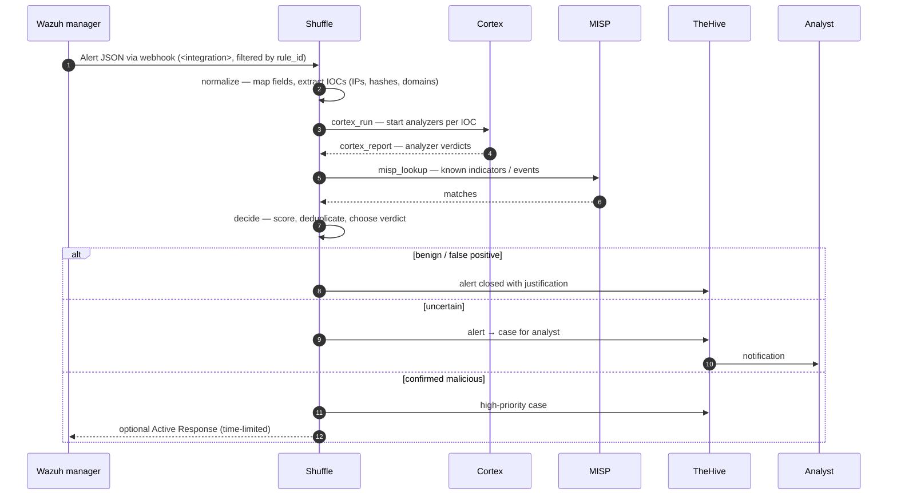

# Architecture

## Data flow

## Shuffle workflow (target)

`Webhook → normalize → cortex_run → cortex_report → misp_lookup → decide → thehive_alert`

Built iteratively:

1. **Thin slice** — one alert end-to-end with a simple `if` instead of scoring.
2. **Scoring** — weighted score from rule level, enrichment verdicts and MISP hits.
3. **Deduplication & grouping** — same rule + same source/destination within a time window.
4. **Error handling** — timeouts and fallbacks when an analyzer or MISP is unavailable (alert still reaches TheHive, marked "not enriched").
5. **Response** — optional Wazuh Active Response, only for high-confidence verdicts and always with a timeout.

## Key design decisions

See [`decisions/`](decisions/). Highlights:

- Wazuh integration filtered by `rule_id`, not by `level` (Suricata alerts arrive at level 3). — ADR 0001
- TheHive as the case-management system, DFIR-IRIS evaluated as an alternative. — ADR 0002

## Network segmentation

| Segment | Purpose |
|---|---|
| Management | Hypervisor and firewall administration |
| VICTIM | Active Directory domain and Windows endpoints (attack targets) |
| SOC | SIEM, SOAR, enrichment and case-management tools |
| ATTACK | Kali Linux; allowed to reach VICTIM only |
| VPN | WireGuard access for team members (SOC dashboards only) |

No lab segment can reach the home network. Details: [`lab-setup.md`](lab-setup.md).
