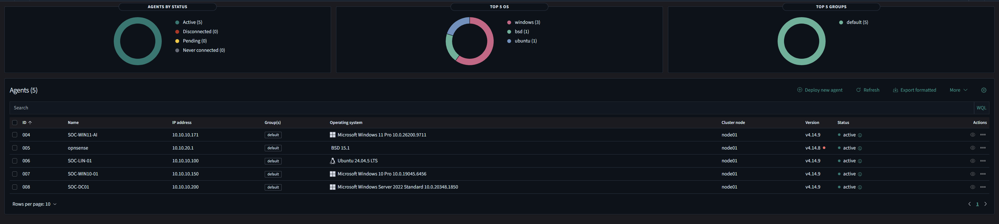
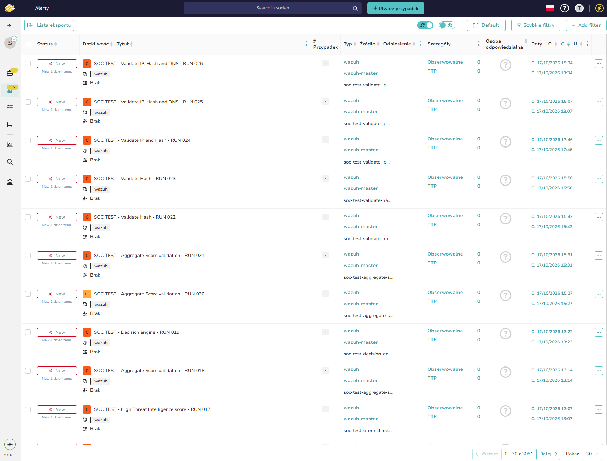

# SOC Automation Lab — Component Documentation

> **Related:** [#6 ](https://github.com/Solivagantaeon/soc-automation-lab/issues/6)  
> **Environment baseline:** 18 October 2026  
> **Scope:** Components, deployment, interfaces, standalone checks, troubleshooting, and communication paths (final report sections 21.2–21.3)

## 1. Purpose and scope

This document describes the deployed components of the isolated SOC Automation Lab and how each can be started, accessed, checked, and integrated. Wazuh collects endpoint and IDS alerts; Shuffle processes selected alerts through the triage workflow; Cortex and MISP provide enrichment; TheHive is used for analyst-facing alert and case management. DFIR-IRIS was evaluated as an alternative case-management platform.

**Evidence notation:** Commands, screenshots and logged events dated 18 October 2026 represent observed operation. Product-standard endpoints and ports identify how a component is normally accessed; local network exposure is governed by the actual service and firewall configuration. A visible workflow node is not by itself proof of successful execution of that connector.

**Security:** Only private lab addresses are reproduced. Do not commit passwords, API keys, full webhook URLs, access tokens, cookies, public IPs, real user identifiers from alerts, or unredacted configurations. All examples below use placeholders or credential-free checks.

### 1.1 Lab segments and component locations

| Network / role | Address or network | Component |
|---|---|---|
| Management | `10.10.99.0/24` | Proxmox and firewall administration |
| VICTIM / Windows | `10.10.10.0/24` | Domain controller and Windows endpoints |
| SOC / tooling | `10.10.20.0/24` | Wazuh, Shuffle, Cortex, MISP, TheHive, DFIR-IRIS |
| ATTACK | `10.10.30.0/24` | Kali test host |
| VPN | `10.10.250.0/24` | Administrative access via WireGuard |

Detailed network isolation and the build order are described in [lab setup](lab-setup.md). The [architecture diagram](architecture.md) and [communication matrix](#10-communication-matrix) follow the same component names and pathways.

---

## 2. Wazuh — SIEM and event collector

### 2.1 Purpose and deployment

Wazuh acts as the central security-event collection and detection platform. It receives events from Windows and Linux agents and an OPNsense-hosted agent that forwards Suricata events. The manager applies rules and produces alerts used by the SOAR workflow.

| Property | Configuration |
|---|---|
| Version | `4.14.9` — manager, indexer and dashboard |
| Supporting shipper | Filebeat `7.10.2-2` |
| VM | Proxmox VM **203** (`wazuh-master`) |
| Host operating system | Ubuntu 24.04.4 LTS |
| Private IP | `10.10.20.243` |
| Installation | Native packages managed through `dpkg`/APT; all-in-one manager, indexer, dashboard and Filebeat; no Docker containers on this VM |
| Role | SIEM, agent enrollment, event collection, alert indexing and dashboard |

### 2.2 Ports, authentication and APIs

| Interface | Port / protocol | Authentication / purpose |
|---|---|---|
| Dashboard | `443/TCP` (HTTPS) | Authenticated analyst session |
| Agent event ingestion | `1514/TCP` | Wazuh agent-to-manager encrypted/authenticated transport |
| Agent enrollment | `1515/TCP` | Agent registration / key provisioning |
| Manager API | `55000/TCP` (HTTPS) | User authentication followed by JWT bearer authorization; status and agent APIs |
| Indexer API | `9200/TCP` (HTTP(S) as configured) | Authenticated index/search API; restrict to the SOC network |
| Indexer transport | `9300/TCP` | Local transport observed bound to `127.0.0.1` |
| Administrative SSH | `22/TCP` | Host administration via SSH credentials/keys |

The Wazuh REST API supports `POST /security/user/authenticate` and `GET /manager/status`; after login, authorized callers use JWT bearer tokens. Do not paste tokens into PR comments or screenshots.

### 2.3 Installation and startup procedure

The running system is a package-based all-in-one deployment. To inspect and start individual services on VM 203:

```bash
# Installed versions
dpkg-query -W wazuh-manager wazuh-indexer wazuh-dashboard filebeat

# Start existing services if stopped
sudo systemctl start wazuh-indexer wazuh-manager filebeat wazuh-dashboard

# Enable start on boot (administrative configuration action)
sudo systemctl enable wazuh-indexer wazuh-manager filebeat wazuh-dashboard
```

Configuration entry points include `/var/ossec/etc/ossec.conf` and the sanitized agent-group configuration in [`../detection/wazuh/agent-config/agent.conf`](../detection/wazuh/agent-config/agent.conf). The runbook index and operational instructions are described in [`runbooks/README.md`](runbooks/README.md).

### 2.4 Standalone verification

These checks verify Wazuh's own services without Shuffle or TheHive:

```bash
sudo systemctl is-active wazuh-manager wazuh-indexer wazuh-dashboard filebeat
sudo /var/ossec/bin/wazuh-control status
sudo /var/ossec/bin/agent_control -l
sudo ss -lntup
```

**Observed:** all four systemd services were active. Core Wazuh daemons, including `wazuh-analysisd`, `wazuh-remoted`, `wazuh-apid` and `wazuh-db`, were running. Five external agents were active and none disconnected. The local manager appears as agent `000`. The intentionally unused `wazuh-clusterd`, `wazuh-agentlessd`, `wazuh-maild` and `wazuh-csyslogd` daemons were not running, consistent with the reported single-node setup.

Alternatively, open **Wazuh Dashboard → Server management → Dev Tools** and submit:

```http
GET /manager/status
```

Expected result: a JSON response listing manager daemon statuses (authenticated API request).

| Agent ID | Host | Private IP | OS | Agent version | Status |
|---|---|---|---|---|---|
| `004` | `SOC-WIN11-AI` | `10.10.10.171` | Windows 11 | `4.14.9` | Active |
| `005` | `opnsense` | `10.10.20.1` | BSD / OPNsense | `4.14.8` | Active |
| `006` | `SOC-LIN-01` | `10.10.10.100` | Ubuntu 24.04.5 LTS | `4.14.9` | Active |
| `007` | `SOC-WIN10-01` | `10.10.10.150` | Windows 10 | `4.14.9` | Active |
| `008` | `SOC-DC01` | `10.10.10.200` | Windows Server 2022 | `4.14.9` | Active |

### 2.5 Problems, resolutions and operational notes

- **Time synchronization:** a domain-controller time-zone/clock offset was addressed by making OPNsense the NTP source, synchronizing the DC and its domain members, and updating Linux time sources. See [Issue #5](https://github.com/Solivagantaeon/soc-automation-lab/issues/5) and its runbook. Correct timestamps are required for reliable cross-platform correlation.
- **Indexer/API troubleshooting:** previous test environments exhibited indexer authorization/shard and dashboard-API connectivity symptoms. The documented operational baseline is the clean single-node installation on VM 203, with its services active.
- **Rule-based forwarding:** Wazuh-to-Shuffle filtering uses rule IDs rather than severity alone; this preserves low-level Suricata alerts such as rule `86601` for the intended workflows. See the [architecture decisions](architecture.md#key-design-decisions).

### 2.6 Evidence and related files

- 
- Agent configuration: [`../detection/wazuh/agent-config/agent.conf`](../detection/wazuh/agent-config/agent.conf)
- Related ingestion issue: [#4 — Wazuh agents, Sysmon and Suricata](https://github.com/Solivagantaeon/soc-automation-lab/issues/4)

---

## 3. Suricata — network intrusion detection on OPNsense

### 3.1 Purpose and deployment

Suricata provides network IDS telemetry on the OPNsense firewall (Proxmox VM **901**). The firewall serves VLAN-segmented lab networks, including the VICTIM and SOC segments. IDS alerts are forwarded into Wazuh by the **Wazuh agent installed on OPNsense**; Suricata does not transmit alerts directly to the manager over its own listening service.

| Property | Configuration |
|---|---|
| Software | Suricata IDS integrated with OPNsense |
| Host | OPNsense, VM 901; agent hostname `opnsense` |
| Private SOC address | `10.10.20.1` |
| Installation method | OPNsense package/IDS service, managed using the firewall UI |
| Data source | Suricata IDS alert output read by the OPNsense Wazuh agent |
| Target platform | Wazuh manager `10.10.20.243` |

### 3.2 Ports, authentication and APIs

- **IDS inspection:** traffic is inspected on the configured interfaces; Suricata is not an API server requiring a dedicated inbound port for this integration.
- **Alert forwarding:** the OPNsense Wazuh agent communicates to `10.10.20.243:1514/TCP` with Wazuh agent authentication.
- **Firewall management:** OPNsense HTTPS management interface is administratively authenticated; access is limited to authorized lab networks.
- **API usage:** this collection path uses log/agent forwarding, not an application-specific Suricata REST API.

### 3.3 Startup and standalone verification

1. In OPNsense, open **Services → Intrusion Detection → Administration**.
2. Review the enabled IDS service and its selected interfaces, rule policies, and logging configuration.
3. Start or restart the IDS service only if operational maintenance requires it.
4. Open **Services → Intrusion Detection → Alerts** and inspect locally generated IDS alert records. This is the standalone test; it does not depend on Wazuh, Shuffle or TheHive.
5. As a separate integration test, check Wazuh Threat Hunting for Suricata-related alert rule `86601` and source agent `opnsense`.

### 3.4 Problems and resolution

- **Low-severity alert forwarding:** Suricata alert rule `86601` may be assigned a lower Wazuh level than host detections. Integration routing is based on relevant `rule_id` values rather than a simple global level threshold.
- **Separation of responsibilities:** OPNsense/Suricata produces the IDS events; the Wazuh agent delivers them; the Wazuh manager performs alert correlation. Each stage should be checked independently during troubleshooting.

### 3.5 Evidence and references

- Existing screenshot: [`images/suricata/04-suricata-alert.png`](images/suricata/04-suricata-alert.png)
- Suricata collection notes: [`../detection/suricata/README.md`](../detection/suricata/README.md)
- Network details: [lab setup](lab-setup.md)

---

## 4. Sysmon — Windows endpoint telemetry

### 4.1 Purpose and deployment

Sysmon provides detailed Windows activity records, including process creation, process access, image loading, file creation and registry operations. Sysmon runs on the Windows hosts as a Windows service and writes to the `Microsoft-Windows-Sysmon/Operational` event channel. Wazuh agents collect matching Windows Event Channel records and forward them to Wazuh.

| Host | VM ID | Private IP | OS | Sysmon version | Wazuh agent |
|---|---|---|---|---|---|
| `SOC-DC01` | `101` | `10.10.10.200` | Windows Server 2022 | `15.22` | `4.14.9` |
| `SOC-WIN10-01` | `102` | `10.10.10.150` | Windows 10 | `15.15` | `4.14.9` |
| `SOC-WIN11-AI` | `103` | `10.10.10.171` | Windows 11 | `15.21` | `4.14.9` |

**Installation method:** native Sysmon Windows service, manually deployed with the `sysmon-modular` Balanced configuration. The Windows 10 host uses Sysmon schema 4.90; the domain controller and Windows 11 use schema 4.91. The deployment record, configuration hashes, and inspection commands are in [`../detection/sysmon/README.md`](../detection/sysmon/README.md).

### 4.2 Ports, authentication and APIs

- Sysmon itself logs locally and does **not** require an inbound network port or external REST API.
- The Event Log collection interface is `Microsoft-Windows-Sysmon/Operational` on each host.
- The Wazuh agent forwards selected events to `10.10.20.243:1514/TCP` using its enrolled agent identity/key.
- Managing the service or configuration requires appropriate Windows administrative privileges; a Sysmon application API key is not involved.

### 4.3 Startup and standalone verification

On an endpoint with an authorized PowerShell session:

```powershell
Get-Service Sysmon,Sysmon64 -ErrorAction SilentlyContinue
Get-WinEvent -ListLog 'Microsoft-Windows-Sysmon/Operational' |
    Select-Object LogName, IsEnabled, RecordCount
Get-WinEvent -FilterHashtable @{
    LogName = 'Microsoft-Windows-Sysmon/Operational'
    Id = 1
} -MaxEvents 3 | Select-Object TimeCreated, Id, ProviderName
```

Service administration uses Windows Services / PowerShell (`Start-Service` or `Restart-Service` on the installed service name). The Sysmon executable's `-s` option displays its installed event schema; use the endpoint's installation/runbook record for version-specific deployment and configuration commands.

**Independent check:** the local Sysmon Operational channel contains freshly generated Event ID 1 process-creation records, regardless of whether the Wazuh manager is available.

**Wazuh ingestion verification (18 October 2026):** the following queries returned Sysmon-channel Wazuh alerts in a 90-day search window:

```text
agent.name: "SOC-WIN10-01" AND data.win.system.channel: "Microsoft-Windows-Sysmon/Operational"
agent.name: "SOC-WIN11-AI" AND data.win.system.channel: "Microsoft-Windows-Sysmon/Operational"
```

| Host | Alert matches in 90-day window | Observed example |
|---|---:|---|
| `SOC-WIN10-01` | **63** | Sysmon Event ID 10, process access; Wazuh rule `92910` |
| `SOC-WIN11-AI` | **3,127** | Sysmon Event ID 1, process creation; Wazuh rule `92052` |

These are **Wazuh alerts matching the filter**, not total Sysmon event counts. The windows-to-Wazuh collection path is established by the event provider, channel, agent name and timestamp fields.

### 4.4 Problems and corrective procedures

**Sysmon Event ID 255 — telemetry reliability:** a seven-day Wazuh search on 18 October 2026 matched **73** Sysmon error alerts: **72** from `SOC-WIN11-AI` and **1** from `SOC-WIN10-01`.

- `QUEUE`: driver queue reported dropped events (including registry events and image loads). Dropped events are an observability gap, even if some other alerts are being collected normally.
- `IMAGE_LOAD`: Sysmon reported `Failed to find process image name` on Windows 11.
- **Investigation/correction:** review the active sysmon-modular configuration, reduce particularly noisy event selections where appropriate, review endpoint resource utilization and Sysmon diagnostic logs, then repeat Event ID 255 monitoring after changes. Do not treat this diagnostic as a malware verdict.

To reproduce the Wazuh-side error search:

```text
data.win.system.eventID: "255" AND (agent.name: "SOC-WIN10-01" OR agent.name: "SOC-WIN11-AI")
```

For process-access detection rule `92910`, a sample involving `OneDrive.exe` accessing `Explorer.EXE` was classified by the rule as possible process injection. It is a detection requiring triage, not proof of malicious process injection.

### 4.5 Evidence and related files

- Sysmon deployment notes: [`../detection/sysmon/README.md`](../detection/sysmon/README.md)
- Agent configuration: [`../detection/wazuh/agent-config/agent.conf`](../detection/wazuh/agent-config/agent.conf)
- Sanitized sample record: [`../samples/alerts/sysmon-windows-example.json`](../samples/alerts/sysmon-windows-example.json)

---

## 5. Shuffle — security orchestration and triage

### 5.1 Purpose and deployment

Shuffle receives selected Wazuh alert JSON payloads through a webhook and orchestrates normalisation, IOC extraction, deduplication, external enrichment, scoring and creation of analyst-facing records in TheHive. Its active workflow is labelled **SOC Automation v1.0** in the captured editor.

| Property | Configuration |
|---|---|
| Role | SOAR and triage workflow engine |
| VM | Proxmox VM **205** (`shuffle-soar`) |
| SOC address | `10.10.20.245` |
| Installation | Self-hosted Docker Compose deployment |
| UI | HTTPS `3443/TCP` |
| Typical backend API | `5001/TCP` in the Shuffle deployment, kept within the private environment |
| Workflow access | Authenticated Shuffle user and API/application credentials stored in the platform |

### 5.2 Ports, authentication and APIs

- **Inbound:** authenticated Shuffle UI uses HTTPS on port `3443`; the Wazuh integration targets a protected workflow webhook through the Shuffle endpoint. The full webhook URL is a secret and is never committed.
- **Backend:** Shuffle provides an HTTP REST API on its backend service (commonly port `5001` internally).
- **Outbound integrations:** Cortex analyzer/report API, MISP lookup API and TheHive alert/case API use component-specific credentials managed in Shuffle. API keys and session secrets are kept out of repository exports.
- **Runtime execution:** an enabled/runtime-running location schedules the workflow and its apps.

### 5.3 Startup and standalone verification

On the Shuffle Docker host, from the deployment directory:

```bash
sudo docker compose ps
sudo docker compose up -d
```

Open the Shuffle UI over HTTPS and inspect the workflow editor and **Runtime Location** state. A running runtime and accessible authenticated UI establish basic Shuffle service health without triggering Wazuh, Cortex, MISP or TheHive. To test the orchestration engine in isolation, use a synthetic manual runtime argument in an otherwise non-integrated test workflow. Do not store the webhook URL in the example.

### 5.4 Problems and solutions

- **Webhook handoff:** the Wazuh-to-Shuffle link was established with test alert payloads; the workflow receives alerts through its webhook trigger. Use `rule_id`-based filtering rather than a severity-only condition.
- **Repeated test alerts:** workflow development uses unique synthetic alert/rule/agent identifiers for successive tests, preventing deduplication from masking expected outputs.
- **Enrichment availability:** the workflow separates observable extraction, scoring and downstream enrichment paths. External analyzer failures should be handled independently, without presenting an enrichment API timeout as proof of malicious activity.

### 5.5 Evidence and references

- 
- Shuffle workflow documentation: [`../soar/shuffle/README.md`](../soar/shuffle/README.md)
- Architecture workflow: [architecture](architecture.md)

---

## 6. Cortex — observable analysis and enrichment

### 6.1 Purpose and deployment

Cortex provides analyzers that enrich extracted observables such as IP addresses, hashes and domains. Results can support Shuffle scoring and analyst triage in TheHive; external intelligence lookups depend on each analyzer's own provider connection.

| Property | Configuration |
|---|---|
| Version | **4.1.0** |
| Host | Shared TheHive/Cortex host |
| Private IP | `10.10.20.247` |
| Installation | Docker deployment using the StrangeBee `testing` profile described in the lab baseline |
| Service convention | Cortex HTTP application and REST API on `9001/TCP` inside the trusted network |
| Authentication | Cortex users/organizations and API keys for authorized analyzers/API consumers |

### 6.2 APIs and ports

- Cortex exposes an authenticated API for listing analyzers and submitting analysis jobs.
- API path used during lab testing: `GET /api/analyzer?range=0-30`, with an API key header.
- TheHive/Shuffle integration uses configured API credentials; credentials are never stored in Markdown or screenshots.

### 6.3 Startup and standalone verification

On the shared Docker host:

```bash
sudo docker ps --format 'table {{.Names}}\t{{.Image}}\t{{.Status}}\t{{.Ports}}'
# Use the actual Cortex container name reported by the command:
sudo docker logs --tail 50 <CORTEX_CONTAINER>
```

An authenticated Cortex session can list available analyzers without Wazuh, Shuffle, MISP or TheHive. During lab analyzer testing on 16 October 2026, `GET /api/analyzer?range=0-30` returned **15 enabled analyzers**, including AbuseIPDB and VirusTotal report integrations. Successful analyzer listing demonstrates the Cortex API and organization configuration; completion of a particular enrichment job additionally depends on the external provider.

### 6.4 Problems and solutions

- **Analyzer enablement:** after deployment, analyzers must be configured and enabled for their organization. The test configuration enabled analyzer definitions and verified them with the API listing.
- **Provider configuration:** analyzers that depend on external services must have authorized credentials and network access; API listings are tested separately from provider verdicts so troubleshooting can isolate a failing dependency.

### 6.5 Evidence and references

- Cortex configuration notes: [`../enrichment/cortex/README.md`](../enrichment/cortex/README.md)
- Cortex and TheHive host: [lab setup](lab-setup.md)
- Workflow connection: [architecture](architecture.md)

---

## 7. MISP — threat-intelligence repository

### 7.1 Purpose and deployment

MISP stores and exposes threat-intelligence events and observable attributes for enrichment. The automation architecture allows extracted observables to be looked up against MISP data before the final analyst decision.

| Property | Configuration |
|---|---|
| Host private IP | `10.10.20.50` |
| Operating system | Ubuntu 24.04 |
| Installation | `misp-docker` self-hosted stack (Docker Compose) |
| User interface | Web application, normally exposed over HTTPS `443/TCP` |
| API authentication | Authorization API key, associated with an authorized MISP user |
| Relevant REST operations | `POST /attributes/restSearch`, `POST /events/restSearch` |

### 7.2 Startup and standalone verification

On the MISP Docker host, from the deployed Compose project:

```bash
sudo docker compose ps
sudo docker compose up -d
```

Open the MISP UI and sign in locally; verify that the administration/status interface loads and that an attribute lookup can be performed against a known local test indicator. This verifies MISP independently of the SOAR workflow. An authenticated REST search can exercise `POST /attributes/restSearch`; keep the key in a protected runtime secret store, not in a committed command or output.

### 7.3 Problems and solutions

- **Separation between installation and integration:** running MISP containers and adding a Shuffle MISP node are distinct steps from successfully returning enrichment results. Test a MISP search within MISP before interpreting downstream workflow scores.
- **Lookup scope:** a no-match result is not a network failure. Distinguish authentication errors, provider connectivity, empty datasets and legitimate zero-hit intelligence responses.

### 7.4 Evidence and references

- MISP configuration notes: [`../enrichment/misp/README.md`](../enrichment/misp/README.md)
- Host inventory: [lab setup](lab-setup.md)
- API reference: [MISP OpenAPI](https://www.misp.software/openapi/)

---

## 8. TheHive — alert and case management

### 8.1 Purpose and deployment

TheHive is the analyst-facing case-management component selected for the lab. Shuffle's workflow can create or update alerts and cases based on the triage outcome; human analysts retain responsibility for the final judgment.

| Property | Configuration |
|---|---|
| Version | **5.8.0** (UI build `5.8.0-1`) |
| Private IP | `10.10.20.247` |
| Deployment | Docker, shared host with Cortex; StrangeBee `testing` profile |
| Lab organization | `demo` |
| Application convention | TheHive internal HTTP application on `9000/TCP`, with HTTPS/reverse-proxy exposure as configured |
| Authentication | TheHive authenticated UI sessions and scoped API keys for integrations |
| API | TheHive REST API (`/api/v1/` namespace) for alerts and case operations |

### 8.2 Startup and standalone verification

On the shared Docker host:

```bash
sudo docker ps --format 'table {{.Names}}\t{{.Image}}\t{{.Status}}\t{{.Ports}}'
# Use the actual TheHive container name from docker ps:
sudo docker logs --tail 50 <THEHIVE_CONTAINER>
```

Log into TheHive, select the lab organization, then open **Alerts**. A successful authenticated login and readable alert listing demonstrate local application availability without requiring new Wazuh events, Shuffle workflow executions or Cortex analyzer runs.

### 8.3 Observed result and troubleshooting

On **17 October 2026**, the TheHive UI displayed numerous test records with the `wazuh` type and `wazuh-master` source, including synthetic tests for IP/hash/DNS validation and scoring. These records demonstrate that the lab's case-management interface stores and displays the test alerts. They do not by themselves confirm that every separate enrichment integration completed successfully.

- **Case/alert mapping:** preserve the Wazuh source and a useful triage title in each TheHive record.
- **Duplicate handling:** use unique synthetic identifiers in repeated functional tests and inspect Shuffle deduplication behaviour separately.
- **Organization consistency:** check the selected TheHive organization before comparing alert counts or testing an API key.

### 8.4 Evidence and references

- 
- TheHive configuration notes: [`../case-management/thehive/README.md`](../case-management/thehive/README.md)
- Decision: TheHive was selected in place of DFIR-IRIS; see [architecture decisions](architecture.md#key-design-decisions).

---

## 9. DFIR-IRIS — evaluated case-management alternative

### 9.1 Purpose and deployment

DFIR-IRIS was included for comparison with TheHive as an incident/alert management and investigative workspace. The project selected TheHive as the primary destination in the automated triage pipeline; DFIR-IRIS is therefore documented as an **evaluated alternative**, not a downstream production integration.

| Property | Configuration |
|---|---|
| Evaluated release | **2.4.29** |
| Private IP | `10.10.20.246` |
| Deployment approach | Self-hosted Docker Compose application stack |
| Standard web endpoint | HTTPS `443/TCP` |
| Authentication | Authenticated user sessions and scoped bearer API keys |
| API examples | `GET /api/versions` and authenticated `GET /api/ping` |

### 9.2 Startup and standalone verification

For the Docker Compose evaluation deployment, from its deployment directory:

```bash
sudo docker compose ps
sudo docker compose up -d
```

An independent check consists of loading the HTTPS sign-in page and using the API's authenticated `GET /api/ping` (expected API message: `pong`). The API version endpoint `GET /api/versions` reports supported versions. No connection to Wazuh or Shuffle is needed for these checks.

### 9.3 Evaluation outcome and troubleshooting

The evaluation boundary was architectural rather than a failed pipeline dependency: maintaining two parallel case-management backends would complicate assignment and correlation. TheHive remains the main alert/case destination while DFIR-IRIS is retained as a comparison option. When checking the IRIS evaluation stack, inspect web proxy, application, worker and database containers independently to isolate frontend/backend problems.

### 9.4 Evidence and references

- Host inventory: [lab setup](lab-setup.md)
- Architecture decision: [architecture](architecture.md#key-design-decisions)
- API reference: [DFIR-IRIS API](https://docs.dfir-iris.org/latest/_static/iris_api_reference_v2.0.4.html)

---

## 10. Communication matrix

The matrix deliberately separates **observed collection** from **workflow/integration routes**. Product-standard service ports are indicated where the host's container exposure was not part of the captured Wazuh port inventory. The same edges appear in [architecture.md](architecture.md).

| Source | Destination | Port / protocol | Authentication | Purpose / status |
|---|---|---|---|---|
| Windows Sysmon | Windows Operational Event Log | Local Event Log (no network port) | Windows service permissions | Local telemetry generation; records observed via Wazuh |
| Windows Wazuh agents (`10.10.10.150`, `.171`, `.200`) | Wazuh `10.10.20.243` | `1514/TCP` | Enrolled Wazuh agent identity/key | Endpoint event shipping; observed active |
| Linux agent (`10.10.10.100`) | Wazuh `10.10.20.243` | `1514/TCP` | Enrolled agent identity/key | Host event shipping; observed active |
| Suricata | OPNsense local Wazuh agent | Local IDS logs (no network port) | Local log access | IDS record collection |
| OPNsense `10.10.20.1` | Wazuh `10.10.20.243` | `1514/TCP` | Enrolled agent identity/key | Suricata alert shipping; agent active |
| Endpoints / OPNsense | Wazuh `10.10.20.243` | `1515/TCP` | Wazuh enrollment controls | Enrollment/registration as needed |
| SOC analyst | Wazuh Dashboard `10.10.20.243` | `443/TCP` (HTTPS) | Authenticated UI session | Threat Hunting and investigations |
| Wazuh Dashboard | Wazuh Manager API (same VM) | `55000/TCP` (HTTPS) | API credentials → JWT | Manager status and agent queries |
| Wazuh | Shuffle `10.10.20.245` | `3443/TCP` (HTTPS entry point) | Secret workflow webhook endpoint | Selected Wazuh alerts to triage workflow |
| Shuffle | Cortex `10.10.20.247` | `9001/TCP` (service default / private HTTP) | Cortex API key | Analyzer submission and verdict lookup; workflow route |
| Shuffle | MISP `10.10.20.50` | `443/TCP` (HTTPS, standard) | MISP API key | Threat-intelligence lookup; workflow route |
| Shuffle | TheHive `10.10.20.247` | `9000/TCP` (service default; or configured proxy) | TheHive API key | Alert/case creation; test records visible |
| TheHive | Cortex (same Docker host) | `9001/TCP` (internal service default) | Cortex API key | Case-management analyzer integration / architecture route |
| Authorized evaluator | DFIR-IRIS `10.10.20.246` | `443/TCP` (HTTPS, standard) | UI session / API bearer key | Separate evaluation only — not in main triage flow |

**Protocol notes:** `1514/TCP` and `1515/TCP` are the observed listener sockets on VM 203. HTTPS `3443` for Shuffle matches the lab UI access used in configuration testing; the internal Cortex/TheHive and MISP/IRIS ports follow product deployment conventions rather than a full audited firewall ruleset. Connectivity within Docker networks should be checked against the actual Compose service names and proxy mappings before building an allowlist.
