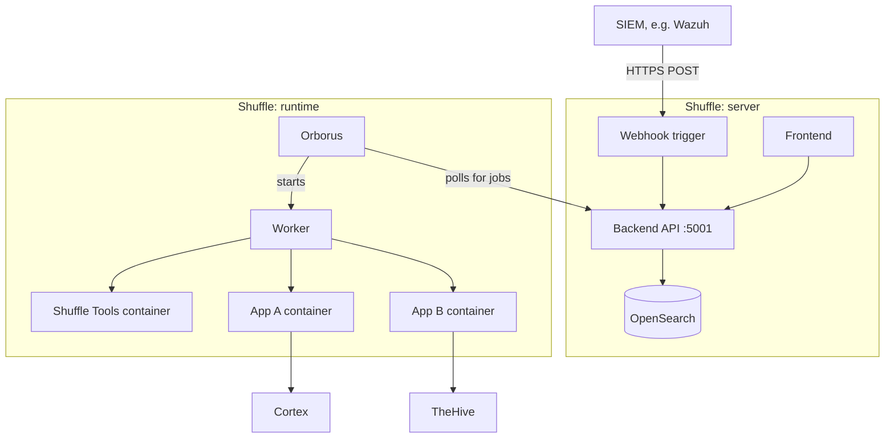

# ADR 0002 – Choosing the SOAR engine for v0.2

- **Status:** Proposed
- **Date:** 2026-10-23
- **Authors:** @login
- **Issue:** #NN

## 1. Context

<!-- Dopiszcie, jeśli czegoś brakuje w wymaganiach. -->

The SOAR engine is the core of our pipeline: it receives Wazuh alerts, deduplicates and enriches them (MISP, Cortex), scores them and decides what reaches TheHive. v0.1 used Shuffle (tag [`v0.1`](https://github.com/Solivagantaeon/soc-automation-lab/tree/v0.1)). For v0.2 we want to compare the available options before choosing.

**Requirements:** self-hosted, free for a university project, works with Wazuh / TheHive / Cortex / MISP, handles thousands of alerts, workflows exportable to Git, ready before 10 Nov 2026.

## 2. Options considered

The comparison focuses on free self-hosted editions. 

| Tool | Type | License |
|---|---|---|
| Shuffle Open Source | Security automation / SOAR | AGPL-3.0 core |
| n8n Community | Workflow automation | Sustainable Use License |
| Tracecat Open Source | Security automation / SOAR | AGPL-3.0 core |
| StackStorm | Event-driven automation | Apache-2.0 |

Paid n8n plans are included to explain differences in collaboration, security and cost.

## 3. Comparison

**Legend:** 
 - Yes = available
 - No = not included
 - External = requires another component
 - TBD = requires clarification.

Feature availability does not mean enabled by default. Detailed mechanisms, limitations and deployment findings belong in **Section 4**.

### 3.1 Workflow capabilities

| Capability | Shuffle OSS | n8n Community | Tracecat OSS | StackStorm |
|---|---|---|---|---|
| Free self-hosting | Yes | Yes | Yes | Yes |
| Workflow automation | Yes | Yes | Yes | Yes |
| Custom code / actions | Yes | Yes | Yes | Yes |
| Outbound API requests | Yes | Yes | Yes | Yes |
| Webhook triggers | Yes | Yes | Yes | Yes |
| Storage for deduplication logic | Yes | Yes | Yes | Yes |
| Workflow export / source format | JSON | JSON | YAML | YAML + code |
| Built-in Git sync | TBD | No | No | External tooling |
| Shared workflow access | Yes | Creator + owner only | Yes | Yes |

### 3.2 Security stack integrations

**Legend:** 
 - Node = built-in n8n integration
 - Integration = documented product integration
 - API = HTTP requests or custom actions
 - Existing = used in our v0.1 pipeline

| Integration / operation | Shuffle | n8n Community | Tracecat OSS | StackStorm |
|---|---|---|---|---|
| Wazuh alert ingestion | Existing webhook | Webhook + forwarding | Webhook + forwarding | Webhook + forwarding |
| MISP IOC lookup | Existing | MISP node / API | API | API / Python |
| Cortex analyzer execution and results | Existing | API | API | API / Python |
| TheHive alerts and cases | Existing | TheHive / TheHive 5 node | API | API / Python |
| VirusTotal enrichment | Via Cortex | Cortex API / direct API | Integration / Cortex API | API / Python |
| AbuseIPDB enrichment | Via Cortex | Cortex API / direct API | Integration / Cortex API | API / Python |
| Other Cortex analyzers | Via Cortex | Cortex API | Cortex API | Cortex API |

### 3.3 Cybersecurity capabilities

| Capability | Shuffle OSS | n8n Community | Tracecat OSS | StackStorm |
|---|---|---|---|---|
| Local user authentication | Yes | Yes | Yes | Yes |
| Centralised authentication | SAML | No | SAML / OIDC | LDAP / proxy |
| MFA approach | Built-in | Built-in user 2FA | External IdP | External setup |
| Role-based permissions | Tenant roles | Limited | Built-in roles | Configurable RBAC |
| Webhook authentication | Required headers | Basic / Header / JWT | URL secret; additional controls* | API key / token |
| Encrypted credential storage | Yes | Yes | Yes | Yes |
| Audit evidence | Audit logging | Execution/application logs | Organisation audit logs | Action audit logs |
| External secret-store integration | TBD | No | No | Custom integration |

**Main security considerations:**

- **Shuffle:** restrict tenant permissions and explicitly configure webhook authentication.
- **n8n:** Community lacks ordinary-user workflow/credential sharing. Restrict unnecessary command and file-access nodes.
- **Tracecat:** protect secret-bearing URLs and select the appropriate executor isolation. Advanced roles and management API capabilities are edition-dependent.
- **StackStorm:** enable RBAC, configure encryption and mark secret parameters/outputs correctly. API keys do not expire automatically.

All platforms require HTTPS, restricted network access, least-privilege credentials and sanitised exports.

### 3.4 n8n self-hosted editions

| Capability | Community | Business | Enterprise |
|---|---|---|---|
| Software price | Free | €667/month, billed annually* | Custom quote |
| Execution allowance | No paid quota specified | 40,000/month* | Custom |
| User-enabled 2FA | Yes | Yes | Yes |
| SSO / LDAP | No | Yes | Yes |
| Shared projects | No | 6 | Unlimited |
| Credential encryption | Yes | Yes | Yes |
| External secret stores | No | No | Yes |
| Built-in log streaming | No | No | Yes |
| JSON export/import | Yes | Yes | Yes |
| Built-in Git integration | No | Yes | Yes |
| Managed environments | No | Yes | Yes |
| Queue mode / workers | Yes | Yes | Yes |
| LLM integration | Yes | Yes | Yes |
| Dedicated support with SLA | No | No | Contract-dependent |

### 3.5 LLM integration

| Capability | Shuffle | n8n | Tracecat | StackStorm |
|---|---|---|---|---|
| Integration approach | App / HTTP | Dedicated nodes / HTTP | Provider configuration | Python / REST action |
| Local inference approach | Local endpoint | Ollama node | OpenAI-compatible endpoint | Custom API call |

## Sources for Sections 2–3 

- **Shuffle:** [Licensing](https://github.com/shuffle/Shuffle/blob/master/.github/CONTRIBUTING.md), [Architecture](https://shuffler.io/docs/architecture), [Workflows](https://shuffler.io/docs/workflows), [Pricing](https://shuffler.io/pricing?env=Self-Hosted), [Usage restrictions](https://github.com/orgs/Shuffle/discussions/1958), [AI](https://shuffler.io/docs/AI).
- **n8n:** [Editions](https://docs.n8n.io/hosting/community-edition-features/), [Pricing](https://n8n.io/pricing/), [Export/import](https://docs.n8n.io/workflows/export-import/), [MISP](https://docs.n8n.io/integrations/builtin/app-nodes/n8n-nodes-base.misp/), [TheHive 5](https://docs.n8n.io/integrations/builtin/app-nodes/n8n-nodes-base.thehive5), [Webhook authentication](https://github.com/n8n-io/n8n-docs/blob/main/docs/integrations/builtin/credentials/webhook.md), [Ollama](https://docs.n8n.io/integrations/builtin/cluster-nodes/sub-nodes/n8n-nodes-langchain.lmchatollama).
- **Tracecat:** [Repository](https://github.com/TracecatHQ/tracecat), [Pricing](https://www.tracecat.com/pricing), [Workflows](https://docs.tracecat.com/automations/workflows), [Webhooks](https://docs.tracecat.com/automations/triggers/webhooks), [Security](https://github.com/TracecatHQ/tracecat/blob/main/SECURITY.md), [VirusTotal](https://docs.tracecat.com/tools/virustotal), [AbuseIPDB](https://docs.tracecat.com/tools/abuseipdb), [LLM providers](https://docs.tracecat.com/agents/custom-llm-providers).
- **StackStorm:** [License](https://github.com/StackStorm/st2/blob/master/LICENSE), [Overview](https://docs.stackstorm.com/overview.html), [Authentication](https://docs.stackstorm.com/authentication.html), [RBAC](https://docs.stackstorm.com/rbac.html), [Datastore](https://docs.stackstorm.com/datastore.html), [Secret masking](https://docs.stackstorm.com/reference/secrets_masking.html).
- **Supporting services:** [Cortex](https://github.com/TheHive-Project/Cortex), [Ollama authentication](https://docs.ollama.com/api/authentication).

- done by @MKonrad-afk (blame on me ;); Status- proposed

## 4. Research notes

<!-- Jedna podsekcja na temat: co sprawdzałeś, jak (docs / test w labie), co wyszło, linki. Reasercherujemy pod kątem odpowiadania na poniższe pytania -->

### 4.1 Shuffle 

#### Overview
Shuffle is an open-source SOAR platform, written mainly in Go and released under the AGPL-3.0 licence and designed specifically for security teams. Its app catalogue, example workflows and integrations focus on SIEM alert handling, threat intelligence and incident response. The platform enables users to connect security tools and automate tasks through visual workflows. In September 2025, Shuffle and Wazuh announced an official technology partnership.

#### Architecture

A Shuffle installation consists of two layers: the server and the runtime. The server layer comprises the frontend, the backend API (a Go service on port 5001) and an OpenSearch database that stores user accounts, workflows, apps and execution results. The actual processing takes place in the runtime layer. The **Orborus** component periodically polls the backend for new jobs and starts a separate **worker** for each workflow execution. The worker in turn starts every workflow step (every "app") as a separate, short-lived Docker container.



*Figure 1. Alert flow through Shuffle's components.*

Running steps in containers limits the propagation of some failures, because a crash of an app process stays within its container. It does not eliminate mutual impact, however: a failed step stops the steps that depend on it, and exhaustion of shared host resources (CPU, memory, the Docker daemon) affects other executions. Starting a separate container for every step adds container start-up time and resource usage to each executed action. The documentation also distinguishes two execution modes. Workflows started manually from the editor run with a live view, while workflows started by a trigger, such as a webhook, run in an optimised mode in which the full results appear in the interface only after the execution has finished.

The minimum requirements for a test environment are 2 vCPU, 4 GB RAM and 30 GB of disk space, with OpenSearch being the most memory-intensive component. The number of parallel executions is controlled by `SHUFFLE_ORBORUS_EXECUTION_CONCURRENCY`. The documentation gives inconsistent defaults for this parameter: 10 in the configuration reference and 5 in the installation guide, so the effective value should be read from the configuration of the given deployment. Larger deployments can move the runtime layer to Docker Swarm or Kubernetes. From a security perspective, in the basic deployment Orborus uses the host's Docker socket (`/var/run/docker.sock`), which in practice amounts to root-level privileges. The Shuffle host should therefore be isolated from the rest of the infrastructure.

#### Alert ingestion

Wazuh includes a built-in `shuffle` integration, so basic alert forwarding requires no custom code. The configuration consists of three steps:

1. Add a webhook trigger to the workflow, connect it to the first action, and save the workflow. Activate the webhook with the *Start* button and copy the address from the *Webhook URI* field.
2. Add an `<integration>` block inside the `<ossec_config>` element in `/var/ossec/etc/ossec.conf` on the Wazuh manager. Replace the example URL below with the webhook URI copied from Shuffle:

```xml
<integration>
  <name>shuffle</name>
  <hook_url>https://shuffle.example.local/api/v1/hooks/WEBHOOK_ID</hook_url>
  <level>3</level>
  <alert_format>json</alert_format>
</integration>
```

3. Restart the Wazuh manager: `systemctl restart wazuh-manager`.

The `level`, `rule_id` and `group` filters determine which alerts are forwarded. In the example above, `<level>3</level>` selects alerts with severity level 3 or higher. Without integration filters, no additional filtering is applied to the alerts generated by Wazuh; this does not mean that all collected events are forwarded. On the Shuffle side, the body of the POST request becomes the execution argument of the workflow. The webhook can require specific HTTP headers: every configured header must be present with the expected value. This requires corresponding support on the sending side; the basic Wazuh configuration shown above does not configure additional authentication headers. Other alert sources can use the same mechanism by sending HTTP POST requests to the webhook URL.

#### Building logic

A Shuffle workflow is a graph of actions connected by branches. Input data is available as the execution argument (`$exec`), and the results of previous steps are referenced by their names (e.g. `$step_name`), including JSON fields (e.g. `$exec.rule.level`). Liquid templates are additionally used to format and transform values. Auxiliary logic is provided by the built-in **Shuffle Tools** app, which can, among other things, set variables, filter and merge lists, parse data and execute Python code. Iteration over lists is done directly in action parameters with the `.#` syntax. For nested loops and large lists, the documentation recommends subflows, with each item passed to a separate execution of a child workflow. Branches can carry conditions, and a *user input* trigger can pause an execution until an analyst approves an action, which is useful wherever automated response requires human control.

#### Deduplication and state

Data is persisted between executions in the **Datastore**, a persistent key-value store shared across workflows within a tenant; entries remain until they are deleted. It is accessed through the *Set / Get / Delete / List cache* actions in Shuffle Tools and through the API. The documentation describes a basic deduplication pattern: the workflow builds a key for an incoming item, checks whether it exists in the Datastore and, if it does not, processes the same alert. The documentation does not describe an atomic check-and-set operation for the Datastore. The key must be deterministic: items considered duplicates must produce the same key. An alert ID can identify repeated deliveries of the same alert, while grouping similar alerts requires a key derived from selected alert fields. The same store can hold counters for event correlation or a local cache of known IOCs.

Three issues should be considered when designing deduplication:

- **Time window.** A window such as "the same alert within 15 minutes" can be implemented by storing a timestamp as the key's value and comparing it when the next alert arrives. The workflow must define whether the window is measured from the last successful processing or the last occurrence, and update the timestamp accordingly. A periodic clean-up workflow can keep the store tidy but is not required for the deduplication decision itself.
- **Concurrency.** A sequence of separate read and write actions does not itself provide an atomic check-and-reserve operation. Two simultaneous executions may both find the key absent and process the same alert.
- **Failure handling.** Writing the key before processing finishes may cause a retried alert to be skipped if the first execution fails. Writing it afterwards avoids that particular failure mode, but an execution that fails after performing an external action and before storing the key may repeat the action on retry. The workflow should therefore account for partial failures and, where possible, make response actions idempotent, so that repeating them does not produce additional effects.

#### Integrations

Shuffle provides integrations with tools and services commonly used in SOC environments.[^apps] The table below distinguishes incoming alert forwarding from actions performed through external APIs.

| Component | Integration mechanism | Purpose |
|---|---|---|
| Wazuh — alert forwarding | Built-in `shuffle` integration on the Wazuh manager, sending alerts to a Shuffle webhook | Start workflows from Wazuh alerts |
| Wazuh — API access | Wazuh app | Query or manage Wazuh resources through the actions exposed by the app |
| Cortex | Cortex app | Submit observables for analysis and retrieve results |
| MISP | MISP app | Query and manage threat intelligence data |
| TheHive | TheHive app | Create and update alerts, cases and observables |
| VirusTotal | VirusTotal app | Retrieve threat intelligence and analysis reports |
| AbuseIPDB | AbuseIPDB app | Check IP reputation and report abusive activity |
| Other systems | HTTP app or a custom app | Interact with APIs not covered by an existing app |

*Table 1. Integration mechanisms and example uses for SOC tools and services.*

Shuffle supports apps written in Python and apps generated from OpenAPI specifications. Available actions and API compatibility depend on the selected app and its version; the presence of an integration does not imply support for every operation exposed by the external system.

Systems without a suitable ready-made app can be accessed through the generic HTTP app or by creating an app from an OpenAPI specification in the App Creator. When the **App Authentication** mechanism is used, credentials are stored separately from the workflow definition and can be reused within the tenant. Workflow actions reference the selected authentication configuration by its identifier, rather than embedding the secret values directly in the workflow definition.

#### Version control

Workflows can be exported as JSON files and imported into another Shuffle instance. After import, app authentication may need to be configured or reassigned. Exported definitions should be checked before committing them to a repository: secrets entered directly into action parameters, variables or code may remain in the exported file.

Shuffle provides workflow revisions that allow earlier versions to be restored from the interface. It also supports automatic workflow backups to a configured GitHub or Azure DevOps repository when changes are saved or workflows are executed. These mechanisms support change tracking and recovery of workflow definitions; they do not replace backups of the complete Shuffle installation.

#### Security

Access is organised by tenant, with three documented roles: **admin**, **user** and **reader**. Administrators have access to all tenant information; users can read and modify workflows, apps, files, Datastore entries and triggers, while readers have read-only access to those resources. Shuffle supports MFA and SAML-based SSO, and administrators can require MFA for tenant members.

User passwords are hashed with bcrypt. The architecture documentation describes AES-256 encryption for app authentication data, protected Datastore entries and files. For self-hosted deployments, app credential encryption must be configured using `SHUFFLE_ENCRYPTION_MODIFIER`; it should not be assumed to be enabled merely because encryption is supported. This secret should be set before storing production credentials and backed up securely. Losing or changing it prevents existing app authentications from being decrypted unless the original secret is restored; otherwise, the credentials must be entered again.

Each workflow execution receives a temporary token that, according to the documentation, remains valid while the execution is running and grants access to a limited set of Shuffle APIs used by apps.This scope restriction applies to Shuffle API access; permissions in external systems depend on the credentials assigned to each app.

The documented minimum password length for local installations is eight characters. Deployment policies should require stronger passwords and enable MFA rather than relying solely on this minimum.

#### Licence and usage limits

The vendor’s documentation specifies a default allowance of **25,000 app runs per month** for an on-premises installation without an additional licence. Other documented limits include three sub-tenants, one environment and no branding customisation. The vendor also states that a valid on-premises licence is required for production use or scaling beyond the default limits. These deployment terms should be distinguished from the AGPL-3.0 licence covering the open-source code.

The allowance is expressed in app runs rather than incoming alerts. Processing a single alert may require multiple actions, so the number of alerts that can be handled within the allowance depends on the workflow design. Deduplication checks and additional processing steps also need to be included when estimating usage.

## 5. Questions to answer before the decision

<!-- Odpowiadamy w ramach researchu, zanim wybierzemy narzędzie. Można dopisywać pytania. -->

1. How does each tool handle deduplication and updating an existing TheHive alert?
2. What can we reuse from v0.1, and what must be rebuilt?
3. How does each tool handle security measures

## 6. Decision

<!-- Wspólnie, w dyskusji pod PR-em, z odwołaniem do §3 i §5. -->

- **Chosen engine:**
- **Why:**
- **Rejected options:**

## 7. Consequences

<!-- "What we lose" jest wstępnie opisane – rozbudujcie po researchu. -->

**What we gain:**

**What we lose:**
- the working Shuffle v1.0 workflow (must be rebuilt and retested),
- the built-in Wazuh → Shuffle integration and Shuffle's ready-made apps,
- deduplication behaviour from v1.0 (unless re-implemented),
- team know-how and time before the deadline.

**Risks:**

## 8. Feature parity (v0.1 vs v0.2)

<!-- Uzupełniamy dopiero po postawieniu i udokumentowaniu wybranego narzędzia. -->

_To be completed after deployment._
