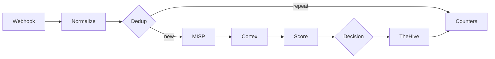

# ADR 0003: n8n triage workflow

## Context

Wazuh sends us far more alerts than one person can check. We want a workflow in n8n that takes each alert, checks it against MISP and Cortex, gives it a score and then either closes it with a written reason or sends it to an analyst in TheHive.

We start from `SOC - n8n E2E Skeleton`. It has five nodes (Webhook, MISP, two Cortex nodes, TheHive) and on 31 October it moved one real alert from Wazuh to TheHive. It works, but it only checks one IP and does not decide anything.

## Decision

We extend the Skeleton with the stages below. Each stage has one owner, who builds it and fills in its section in this document while working on it.

| # | Stage | What it does | Owner |
|---|---|---|---|
| 1 | Webhook | Receives the alert from Wazuh and checks that it really comes from Wazuh | @MKonrad-afk |
| 2 | Normalize | Turns the Wazuh alert into one common format and pulls out IPs, domains, hashes and file names | @ |
| 3 | Dedup | Recognises the same alert sent again within a short time | @ |
| 4 | MISP and Cortex | Checks the observables against threat intelligence | @MKonrad-afk |
| 5 | Score | Gives the alert points and keeps the reason for each one | @ |
| 6 | Decision | Picks one of three outcomes: close, review, malicious | @ |
| 7 | Failure handling | Makes sure a broken service does not stop the workflow or hide an alert | @ |
| 8 | TheHive | Creates the alert the analyst works on | @ |
| 9 | Audit | Keeps the reason for every alert closed automatically | @ |
| 10 | Counters | Counts alerts at every stage, so we can show the reduction | @ |

### 1. Webhook

**Owner:** @Mkonrad-afk

#### Context

The goal of this stage is to send selected Wazuh alerts to the n8n Webhook. The initial design uses individual alerts so the integration can be tested without adding batch handling.

#### Decision

The Wazuh `custom-n8n` integration sends alerts in JSON format when their rule level is **12 or higher**. The setting `<level>12</level>` is a minimum threshold: it includes levels 12, 13, and above, rather than matching only alerts at level 12.

The n8n Webhook is configured to accept `POST` requests, authenticate using `Header Auth` with the credential named `Wazuh webhook token`, and respond using **Immediately** mode. The workflow was published so Wazuh could call its production Webhook endpoint.

The endpoint URL and authentication value are stored in the relevant system configuration and are not included in this ADR.

#### Rationale

The level 12 threshold defines a manageable first scope for individual alert forwarding. It focuses this integration on higher-level Wazuh alerts while the end-to-end Webhook path is validated.

Header Auth requires the configured credential for a request to be accepted. Immediate response mode acknowledges the incoming request without making Wazuh wait for the workflow to finish. The n8n execution history is used to verify that processing completed successfully.

#### Verification

A test request from Kali generated Wazuh rule `31115` at level `13`. Wazuh forwarded the alert, and n8n recorded a successful execution on 2026-11-02 at 23:36:30. The execution completed in 4.066 seconds.

The Webhook settings and test evidence are shown in the [n8n triage runbook](../runbooks/n8n-triage.md#wazuh-webhook).

#### Follow-up

Alerts below level 12 are not included in this stage. A follow-up should evaluate forwarding them in batches to control volume. That work will need to define the grouping interval, batch size, and whether a batch should create one or multiple TheHive alerts.

### 2. Normalize

**Owner:** @

### 3. Dedup

**Owner:** @

### 4. MISP and Cortex

**Owner:** @

### 5. Score

**Owner:** @

### 6. Decision

**Owner:** @

### 7. Failure handling

**Owner:** @

### 8. TheHive

**Owner:** @

### 9. Audit

**Owner:** @

### 10. Counters

**Owner:** @
