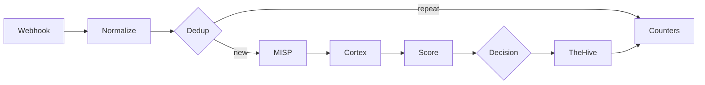
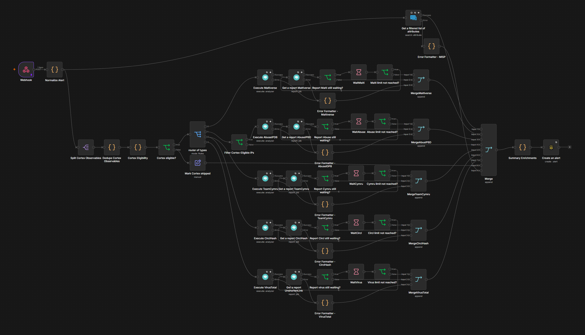
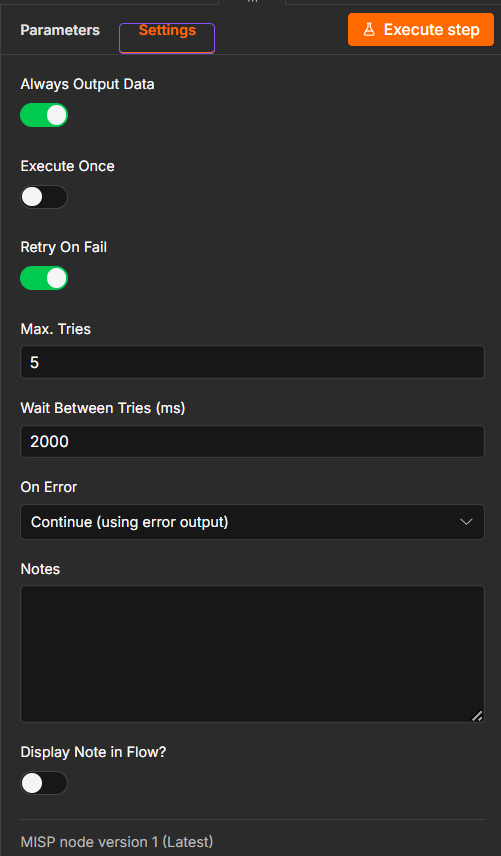
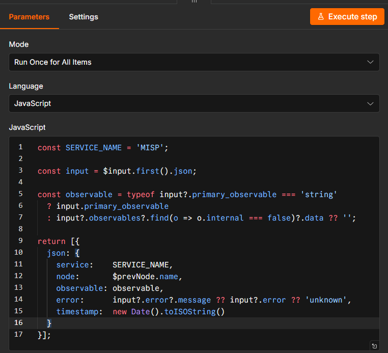
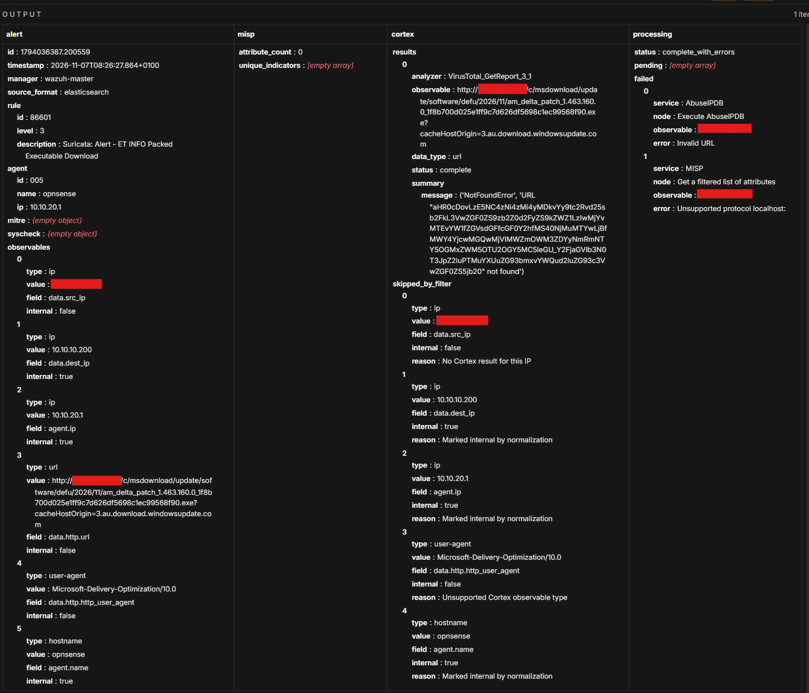

# ADR 0003: n8n triage workflow

## Context

Wazuh sends us far more alerts than one person can check. We want a workflow in n8n that takes each alert, checks it against MISP and Cortex, gives it a score and then either closes it with a written reason or sends it to an analyst in TheHive.

We start from `SOC - n8n E2E Skeleton`. It has five nodes (Webhook, MISP, two Cortex nodes, TheHive) and on 31 October it moved one real alert from Wazuh to TheHive. It works, but it only checks one IP and does not decide anything.

## Decision

We extend the Skeleton with the stages below. Each stage has one owner, who builds it and fills in its section in this document while working on it.

| # | Stage | What it does | Owner |
|---|---|---|---|
| 1 | Webhook | Receives the alert from Wazuh and checks that it really comes from Wazuh | @MKonrad-afk |
| 2 | Normalize | Turns the Wazuh alert into one common format and pulls out IPs, domains, hashes and file names | @84rtek |
| 3 | Dedup | Recognises the same alert sent again within a short time | @arturesturemkuros |
| 4 | MISP and Cortex | Checks the observables against threat intelligence | @MKonrad-afk |
| 5 | Score | Gives the alert points and keeps the reason for each one | @arturesturemkuros |
| 6 | Decision | Picks one of three outcomes: close, review, malicious | @arturesturemkuros |
| 7 | Failure handling | Makes sure a broken service does not stop the workflow or hide an alert | @p4chatek |
| 8 | TheHive | Creates the alert the analyst works on | @Solivagantaeon |
| 9 | Audit | Keeps the reason for every alert closed automatically | @Maartini22 |
| 10 | Counters | Counts alerts at every stage, so we can show the reduction | @arturesturemkuros |

### 1. Webhook

**Owner:** @MKonrad-afk

#### Context

This stage forwards selected Wazuh alerts to the n8n Webhook. The initial implementation sends alerts individually so the end-to-end integration can be validated before adding batch processing.

#### Decision

The Wazuh `custom-n8n` integration forwards alerts in JSON format when their rule level is **12 or higher**. The `<level>12</level>` setting is a minimum threshold, so it includes alerts at levels 12, 13, and above.

The n8n Webhook accepts `POST` requests, uses `Header Auth` with the `Wazuh webhook token` credential, and responds using **Immediately** mode.

The sanitized [Wazuh integration template](../../detection/wazuh/integrations/n8n-integration.xml) is maintained in the repository. Deployment and verification steps are documented in the [n8n triage runbook](../runbooks/n8n-triage.md#1-webhook). The production Webhook URL and authentication value remain in the relevant system configuration and are not stored in the repository.

The manager-side script, configuration, installation, and delivery checks are documented in the [Wazuh integrations README](../../detection/wazuh/integrations/README.md).

#### Rationale

A level 12 threshold keeps the initial scope focused on higher-level alerts while the end-to-end Webhook path is validated. Sending alerts individually keeps the first implementation simple to verify.

Header Auth requires the configured credential for a request to be accepted. Immediate response mode acknowledges receipt without making Wazuh wait for the workflow to finish. The n8n execution history is used to verify that processing completed successfully.

#### Verification

A test request from Kali generated Wazuh rule `31115` at level `13`. Wazuh forwarded the alert, and n8n recorded a successful execution on 2026-11-02 at 23:36:30. The execution completed in 4.066 seconds.

The Webhook configuration and test evidence are shown in the [n8n triage runbook](../runbooks/n8n-triage.md#1-webhook).

#### Follow-up

Alerts below level 12 are outside this stage. [Issue #76](https://github.com/Solivagantaeon/soc-automation-lab/issues/76) tracks evaluating batch forwarding for those alerts, including the grouping interval, maximum batch size, and how batches should be represented in TheHive.

### 2. Normalize

**Owner:** @84rtek

#### Context

Wazuh alerts can reach n8n in different JSON structures, depending on whether the payload is a raw Wazuh alert, an Elasticsearch document, or a Shuffle-style wrapper. Downstream workflow stages need a consistent representation of the alert and its observables.

The Normalize stage was added to the separate `SOC - n8n E2E Skeleton` workflow directly after the Webhook. Version 1.2 of the JavaScript Code node was tested with six synthetic lab scenarios.

#### Decision

A JavaScript Code node normalizes all incoming items using **Run Once for All Items** mode. It recognizes these input formats:

- raw Wazuh alerts;
- Elasticsearch documents containing `_source`;
- Shuffle-style payloads containing `all_fields`.

The node produces a common alert object containing alert metadata, rule details, agent information, event context, observables, a primary observable, and a deduplication key.

The observable extraction covers IP addresses, domains, URLs, URI paths, MD5/SHA1/SHA256 hashes, filenames, Windows registry keys, users, hostnames, and User-Agent values. Each observable retains its source field and an `internal` flag where applicable.

An agent's internal IP is retained as context and marked `internal: true`; it is not automatically selected as the primary IOC. If no eligible primary observable is present, `primary_observable` is set to `-`.

The node generates a `dedup_key` from the rule, signature, agent, and primary observable fields. This stage only creates the key; actual duplicate detection is handled by the separate Dedup stage.

#### Rationale

A common output structure allows later workflow stages to consume alert data without depending on the original payload layout. Keeping the source field and internal/external distinction helps downstream logic interpret observables correctly.

The primary observable fallback of `-` prevents an endpoint's own internal IP from being mistaken for an external IOC when an alert contains no IOC. Keeping the agent IP in the observables list preserves useful endpoint context.

Separating key generation from duplicate detection keeps Normalize focused on data preparation and Dedup responsible for duplicate handling.

#### Verification

Normalize v1.2 passed six functional tests using synthetic lab data:

| Test | Input scenario | Verified result |
|---|---|---|
| 1 | Network / DNS / HTTP | Extracted IP, domain, URL, filename, user, and User-Agent |
| 2 | Sysmon / hashes | Extracted MD5, SHA1, SHA256, file path, command line, and user |
| 3 | Syscheck / Windows Registry | Classified the registry path as `registry_key` |
| 4 | Raw Wazuh | Recognized raw input and extracted the external IP |
| 5 | Shuffle wrapper | Recognized `all_fields` and extracted SHA256 and filename |
| 6 | Alert without IOC | Preserved agent context and returned `primary_observable: "-"` |

The Code node was also verified to use **Run Once for All Items** mode.

These tests validate the normalization logic with the supplied test data. They do not, by themselves, validate Webhook authentication, live Wazuh delivery, downstream MISP/Cortex enrichment, or end-to-end deduplication. [Normalize v1.2 Code node](../../soar/n8n/nodes/normalize-v1.2.js)
Detailed build and test instructions are recorded in the [n8n triage runbook](../runbooks/n8n-triage.md#2-normalize).

#### Follow-up

The current hash extraction test confirms that all three hash types are collected. The test selected MD5 as the primary hash because of the current extraction/selection order; a SHA256-first preference can be considered separately if required by downstream analyzer routing.

The generated `dedup_key` must be consumed and tested by the Dedup stage.

### 3. Dedup

**Owner:** @arturesturemkuros

### 4. MISP and Cortex

**Owner:** @MKonrad-afk

#### Context

The workflow checks Wazuh alert observables against MISP and Cortex. MISP looks for matching attributes in local threat-intelligence data. Cortex runs analyzers for supported observables.

#### Decision

MISP searches the normalized observables and returns matching attributes with their event context.

Before sending observables to Cortex, the workflow splits them into individual items, removes duplicates, and checks whether each item can be analyzed. Eligible items go to the matching analyzer. Skipped items are kept with a reason.

| Observable | Cortex analyzer |
|---|---|
| Public IP | AbuseIPDB |
| Domain | Maltiverse |
| Hash | Team Cymru MHR and CIRCL Hashlookup |
| URL | VirusTotal GetReport |

The workflow does not send file contents or filenames to Cortex. It can send a file hash.

Each analyzer starts once and returns an ID for its analysis. `Get a report` uses that same ID to check the result. If the analysis is still running, n8n waits two seconds and checks again. It tries up to five times. If no result is ready, the summary marks the analysis as pending.

`Summary Enrichments` combines the MISP matches, Cortex results, skipped observables, and job status.

#### Rationale

MISP and Cortex provide different information. MISP shows whether an observable matches a local attribute. Cortex returns results from external analyzers.

The eligibility check keeps internal or unsupported observables out of the analyzer branches. Removing duplicates avoids starting the same analysis more than once for an observable in the same alert. Reusing the analysis ID lets n8n check for a result without starting another analysis.

#### Verification

The raw Wazuh test alert for rule `100723` exercised all four Cortex routes and returned five results:

| Observable | Result |
|---|---|
| `soc-lab-postdns.example.org` | Maltiverse returned `neutral` |
| `1.1.1.1` | AbuseIPDB returned `whitelisted: true` and confidence score `0` |
| Test SHA-256 | Team Cymru returned `No record found`. CIRCL Hashlookup returned `Non existing SHA-256` |
| Test URL | VirusTotal completed the lookup but returned `NotFoundError` |

The workflow finished with no pending or failed jobs. VirusTotal did not find that URL. This does not confirm that the URL is safe. The internal source IP, agent IP, and hostname were kept in `skipped_by_filter`.

MISP returned two attributes for `1.1.1.1`. Both had `to_ids: false`. One included a warninglist comment identifying it as a known public DNS resolver. These attributes provide context, not a standalone verdict.

The [n8n triage runbook](../runbooks/n8n-triage.md#4-misp-and-cortex) documents the node settings and test steps. The [MISP README](../../enrichment/misp/README.md#n8n-lab-context--issue-69) and [Cortex README](../../enrichment/cortex/README.md#n8n-cortex-workflow--issue-69) describe the lab context.

### 5. Score

**Owner:** @arturesturemkuros

### 6. Decision

**Owner:** @arturesturemkuros

### 7. Failure handling

**Owner:** @p4chatek

#### Context

External services (Cortex analyzers, MISP, TheHive) can be temporarily unavailable. Without error handling, a single failed node stops the entire workflow and the alert disappears without trace. The enrichment result looks complete even when a service was down.

#### Decision

**Retry On Fail** is enabled on all nodes that call external services.

| Node | Max Tries | Wait Between Tries |
|---|---|---|
| Execute Maltiverse | 3 | 2 000 ms |
| Get a report Maltiverse | 3 | 3 000 ms |
| Execute AbuseIPDB | 3 | 2 000 ms |
| Get a report AbuseIPDB | 3 | 3 000 ms |
| Execute TeamCymru | 3 | 2 000 ms |
| Get a report TeamCymru | 3 | 3 000 ms |
| Execute CirclHash | 3 | 2 000 ms |
| Get a report CirclHash | 3 | 3 000 ms |
| Execute VirusTotal | 3 | 2 000 ms |
| Get a report UnshortenLink | 3 | 3 000 ms |
| Get a filtered list of attributes (MISP) | 5 | 2 000 ms |
| Create an alert (TheHive) | 5 | 5 000 ms |

**On Error → Continue (using error output)** is enabled on all Cortex and MISP nodes. When all retries are exhausted, the error port routes to an **Error Formatter** Code node instead of stopping the workflow. Each Error Formatter produces `{service, node, observable, error, timestamp}` and sends it to the final Merge node.

`Summary Enrichments` reads all items arriving at the main Merge. Items that contain a `service` and `error` field are appended to `processing.failed`. The `processing.status` field is set to `complete_with_errors` when at least one service failed.

**TheHive** (`Create an alert`) uses Retry On Fail (5×, 5 000 ms) and **Stop and Error**. A retry queue was considered and rejected - it would hide failures from the n8n execution dashboard.

#### Rationale

Routing errors to Merge instead of stopping the workflow ensures that a broken service produces a visible record rather than a silent gap. `processing.failed` gives downstream stages (Score, Decision) the information they need to avoid closing an alert as benign when enrichment was incomplete.

Stop and Error for TheHive was chosen over a retry queue because every undelivered alert must be visible in the n8n execution log. A queue would make the workflow appear healthy while alerts were lost.

#### Verification

Tested with dedicated broken credentials (`TEST FAILED`) on AbuseIPDB and MISP simultaneously. Both services failed, the workflow completed, and `processing.failed` contained two records - one for AbuseIPDB (`Invalid URL`) and one for MISP (`Unsupported protocol`). `processing.status` was `complete_with_errors`. The workflow did not stop.

### 8. TheHive

**Owner:** @Solivagantaeon

### 9. Audit

**Owner:** @Maartini22

### 10. Counters

**Owner:** @arturesturemkuros
