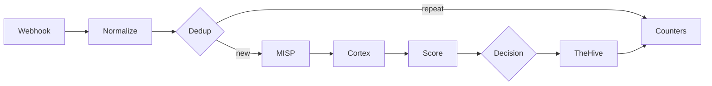

# ADR 0003: n8n triage workflow

## Context

Wazuh sends us far more alerts than one person can check. We want a workflow in n8n that takes each alert, checks it against MISP and Cortex, gives it a score and then either closes it with a written reason or sends it to an analyst in TheHive.

We start from `SOC - n8n E2E Skeleton`. It has five nodes (Webhook, MISP, two Cortex nodes, TheHive) and on 31 October it moved one real alert from Wazuh to TheHive. It works, but it only checks one IP and does not decide anything.

## Decision

We extend the Skeleton with the stages below. Each stage has one owner, who builds it and fills in its section in this document while working on it.

| # | Stage | What it does | Owner |
|---|---|---|---|
| 1 | Webhook | Receives the alert from Wazuh and checks that it really comes from Wazuh | @MKonrad-afk |
| 2 | Normalize | Turns the Wazuh alert into one common format and pulls out IPs, domains, hashes and file names | @84rtek |
| 3 | Dedup | Recognises the same alert sent again within a short time | @arturesturemkuros |
| 4 | MISP and Cortex | Checks the observables against threat intelligence | @MKonrad-afk |
| 5 | Score | Gives the alert points and keeps the reason for each one | @arturesturemkuros |
| 6 | Decision | Picks one of three outcomes: close, review, malicious | @arturesturemkuros |
| 7 | Failure handling | Makes sure a broken service does not stop the workflow or hide an alert | @p4chatek |
| 8 | TheHive | Creates the alert the analyst works on | @Solivagantaeon |
| 9 | Audit | Keeps the reason for every alert closed automatically | @Maartini22 |
| 10 | Counters | Counts alerts at every stage, so we can show the reduction | @arturesturemkuros |

### 1. Webhook

**Owner:** @MKonrad-afk

#### Context

This stage forwards selected Wazuh alerts to the n8n Webhook. The initial implementation sends alerts individually so the end-to-end integration can be validated before adding batch processing.

#### Decision

The Wazuh `custom-n8n` integration forwards alerts in JSON format when their rule level is **12 or higher**. The `<level>12</level>` setting is a minimum threshold, so it includes alerts at levels 12, 13, and above.

The n8n Webhook accepts `POST` requests, uses `Header Auth` with the `Wazuh webhook token` credential, and responds using **Immediately** mode.

The sanitized [Wazuh integration template](../../detection/wazuh/integrations/n8n-integration.xml) is maintained in the repository. Deployment and verification steps are documented in the [n8n triage runbook](../runbooks/n8n-triage.md#1-webhook). The production Webhook URL and authentication value remain in the relevant system configuration and are not stored in the repository.

The manager-side script, configuration, installation, and delivery checks are documented in the [Wazuh integrations README](../../detection/wazuh/integrations/README.md).

#### Rationale

A level 12 threshold keeps the initial scope focused on higher-level alerts while the end-to-end Webhook path is validated. Sending alerts individually keeps the first implementation simple to verify.

Header Auth requires the configured credential for a request to be accepted. Immediate response mode acknowledges receipt without making Wazuh wait for the workflow to finish. The n8n execution history is used to verify that processing completed successfully.

#### Verification

A test request from Kali generated Wazuh rule `31115` at level `13`. Wazuh forwarded the alert, and n8n recorded a successful execution on 2026-11-02 at 23:36:30. The execution completed in 4.066 seconds.

The Webhook configuration and test evidence are shown in the [n8n triage runbook](../runbooks/n8n-triage.md#1-webhook).

#### Follow-up

Alerts below level 12 are outside this stage. [Issue #76](https://github.com/Solivagantaeon/soc-automation-lab/issues/76) tracks evaluating batch forwarding for those alerts, including the grouping interval, maximum batch size, and how batches should be represented in TheHive.

### 2. Normalize

**Owner:** @84rtek

#### Context

Wazuh alerts can reach n8n in different JSON structures, depending on whether the payload is a raw Wazuh alert, an Elasticsearch document, or a Shuffle-style wrapper. Downstream workflow stages need a consistent representation of the alert and its observables.

The Normalize stage was added to the separate `SOC - n8n E2E Skeleton` workflow directly after the Webhook. Version 1.2 of the JavaScript Code node was tested with six synthetic lab scenarios.

#### Decision

A JavaScript Code node normalizes all incoming items using **Run Once for All Items** mode. It recognizes these input formats:

- raw Wazuh alerts;
- Elasticsearch documents containing `_source`;
- Shuffle-style payloads containing `all_fields`.

The node produces a common alert object containing alert metadata, rule details, agent information, event context, observables, a primary observable, and a deduplication key.

The observable extraction covers IP addresses, domains, URLs, URI paths, MD5/SHA1/SHA256 hashes, filenames, Windows registry keys, users, hostnames, and User-Agent values. Each observable retains its source field and an `internal` flag where applicable.

An agent's internal IP is retained as context and marked `internal: true`; it is not automatically selected as the primary IOC. If no eligible primary observable is present, `primary_observable` is set to `-`.

The node generates a `dedup_key` from the rule, signature, agent, and primary observable fields. This stage only creates the key; actual duplicate detection is handled by the separate Dedup stage.

#### Rationale

A common output structure allows later workflow stages to consume alert data without depending on the original payload layout. Keeping the source field and internal/external distinction helps downstream logic interpret observables correctly.

The primary observable fallback of `-` prevents an endpoint's own internal IP from being mistaken for an external IOC when an alert contains no IOC. Keeping the agent IP in the observables list preserves useful endpoint context.

Separating key generation from duplicate detection keeps Normalize focused on data preparation and Dedup responsible for duplicate handling.

#### Verification

Normalize v1.2 passed six functional tests using synthetic lab data:

| Test | Input scenario | Verified result |
|---|---|---|
| 1 | Network / DNS / HTTP | Extracted IP, domain, URL, filename, user, and User-Agent |
| 2 | Sysmon / hashes | Extracted MD5, SHA1, SHA256, file path, command line, and user |
| 3 | Syscheck / Windows Registry | Classified the registry path as `registry_key` |
| 4 | Raw Wazuh | Recognized raw input and extracted the external IP |
| 5 | Shuffle wrapper | Recognized `all_fields` and extracted SHA256 and filename |
| 6 | Alert without IOC | Preserved agent context and returned `primary_observable: "-"` |

The Code node was also verified to use **Run Once for All Items** mode.

These tests validate the normalization logic with the supplied test data. They do not, by themselves, validate Webhook authentication, live Wazuh delivery, downstream MISP/Cortex enrichment, or end-to-end deduplication. [Normalize v1.2 Code node](../../soar/n8n/nodes/normalize-v1.2.js)
Detailed build and test instructions are recorded in the [n8n triage runbook](../runbooks/n8n-triage.md#2-normalize).

#### Follow-up

The current hash extraction test confirms that all three hash types are collected. The test selected MD5 as the primary hash because of the current extraction/selection order; a SHA256-first preference can be considered separately if required by downstream analyzer routing.

The generated `dedup_key` must be consumed and tested by the Dedup stage.

### 3. Dedup

**Owner:** @arturesturemkuros

### 4. MISP and Cortex

**Owner:** @MKonrad-afk

#### Context

MISP is the local threat-intelligence lookup, while Cortex runs analyzer jobs for supported observables. The initial graph checked a limited set of values and returned asynchronous Cortex jobs. Repeated hashes could create repeated analyzer jobs, and a finished workflow could still contain a pending report.

#### Decision

MISP Attribute Search receives the normalized observable values in one search request. Cortex observables are split into one item per observable, deduplicated within the alert by type plus normalized value, and routed by type to AbuseIPDB (IP), Maltiverse (domain), Team Cymru MHR and CIRCL Hashlookup (hash), or VirusTotal GetReport (URL). The current graph does not route file bytes, but it checks file hashes. To avoid duplication of the same Hashes and domain in one alert we use [dedup Cortex Observadables](../../soar/n8n/node/dedupe-cortex-observadables.js) node.

The internal-IP eligibility IF sits on the IP route before AbuseIPDB. Tested private IPs were skipped and preserved in the summary. The graph does prove the equivalent rule for local domains and URLs. See the runbook section for the exact route evidence [n8n triage runbook](../runbooks/n8n-triage.md#4-misp-and-cortex).

Each analyzer is submitted once. If its report is still Waiting or InProgress, the workflow waits two seconds and retries Get a report using the same job ID. The configured wait/retry counts are 5 for eeach analyzer. The earlier MaxMind branch used 2 and is no longer present. Each branch and the final result use Append Merge. Summary Enrichments groups MISP rows, Cortex reports, skipped IPs, pending jobs, and failures. Details in the Script use in the Code Node named [Summary Enrichements](../../soar/n8n/nodes/summary-enrichments.js).

Since Cortex itself can reuse a prior job according to each analyzer's `jobCache` configuration, the workflow has no additional cache. MISP has no separate workflow cache because its local lookup did not show repeated polling or a measured need for one.
During testing, we found that MISP responds quickly enough that an additional caching layer is not needed, the situation was worse in the case of Cortex - some tests took close to 1 minute to finish. Therefore, we decided to not use analyzers like: UnshortenLink or MaxMindGeo to optimize time and lower wait/retry time.

#### Rationale

One MISP search keeps local threat-intelligence matching separate from external analysis. Type-specific routes avoid asking analyzers to process unsupported data. Deduplication reduces repeated work within a single alert, while Cortex-native caching may cover identical jobs across alerts if the analyzer configuration enables it.

Report polling prevents unnecessary analyzer resubmissions and gives slow jobs a bounded opportunity to finish. A finite wait limit lets the workflow proceed with an explicit `partial` status instead of presenting an unfinished job as a clean result. Append is used to collect variable counts of MISP and Cortex rows; the JavaScript summary performs grouping after collection.

#### Verification

IP, domain, URL, hash, nested Sysmon IP, SSH authentication, and no-external-IOC tests are documented with observed outputs and runtimes in the [n8n triage runbook](../runbooks/n8n-triage.md#4-misp-and-cortex). Tests show that MISP preserves attribute/event context, supported observable types reach their configured analyzers, private IPs are skipped, and a no-IOC alert completes without a Cortex job.

Timings varied from about 1.18 seconds to more than 50 seconds. They are whole-workflow observations with different inputs and pending states, not controlled analyzer benchmarks. Removing MaxMind and shortening Wait intervals coincided with faster runs, but the tests do not isolate either change as the sole cause.

#### Follow-up
 MISP deployment details remain in [Lab Setup](../lab-setup.md), [Components](../components.md), and the [MISP README](../../enrichment/misp/README.md).

### 5. Score

**Owner:** @arturesturemkuros

### 6. Decision

**Owner:** @arturesturemkuros

### 7. Failure handling

**Owner:** @p4chatek

### 8. TheHive

**Owner:** @Solivagantaeon

### 9. Audit

**Owner:** @Maartini22

### 10. Counters

**Owner:** @arturesturemkuros
