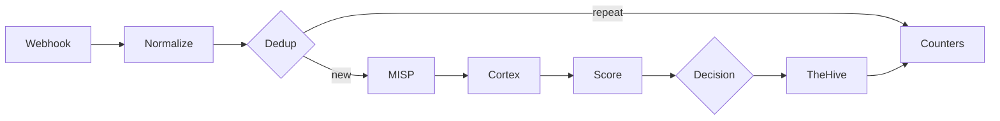

# ADR 0003: n8n triage workflow

## Context

Wazuh sends us far more alerts than one person can check. We want a workflow in n8n that takes each alert, checks it against MISP and Cortex, gives it a score and then either closes it with a written reason or sends it to an analyst in TheHive.

We start from `SOC - n8n E2E Skeleton`. It has five nodes (Webhook, MISP, two Cortex nodes, TheHive) and on 31 October it moved one real alert from Wazuh to TheHive. It works, but it only checks one IP and does not decide anything.

## Decision

We extend the Skeleton with the stages below. Each stage has one owner, who builds it and fills in its section in this document while working on it.

| # | Stage | What it does | Owner |
|---|---|---|---|
| 1 | Webhook | Receives the alert from Wazuh and checks that it really comes from Wazuh | @MKonrad-afk |
| 2 | Normalize | Turns the Wazuh alert into one common format and pulls out IPs, domains, hashes and file names | @84rtek |
| 3 | Dedup | Recognises the same alert sent again within a short time | @arturesturemkuros |
| 4 | MISP and Cortex | Checks the observables against threat intelligence | @MKonrad-afk |
| 5 | Score | Gives the alert points and keeps the reason for each one | @arturesturemkuros |
| 6 | Decision | Picks one of three outcomes: close, review, malicious | @arturesturemkuros |
| 7 | Failure handling | Makes sure a broken service does not stop the workflow or hide an alert | @p4chatek |
| 8 | TheHive | Creates the alert the analyst works on | @Solivagantaeon |
| 9 | Audit | Keeps the reason for every alert closed automatically | @Maartini22 |
| 10 | Counters | Counts alerts at every stage, so we can show the reduction | @arturesturemkuros |

### 1. Webhook

**Owner:** @MKonrad-afk

#### Context

This stage forwards selected Wazuh alerts to the n8n Webhook. The initial implementation sends alerts individually so the end-to-end integration can be validated before adding batch processing.

#### Decision

The Wazuh `custom-n8n` integration forwards alerts in JSON format when their rule level is **12 or higher**. The `<level>12</level>` setting is a minimum threshold, so it includes alerts at levels 12, 13, and above.

The n8n Webhook accepts `POST` requests, uses `Header Auth` with the `Wazuh webhook token` credential, and responds using **Immediately** mode.

The sanitized [Wazuh integration template](../../detection/wazuh/integrations/n8n-integration.xml) is maintained in the repository. Deployment and verification steps are documented in the [n8n triage runbook](../runbooks/n8n-triage.md#1-webhook). The production Webhook URL and authentication value remain in the relevant system configuration and are not stored in the repository.

The manager-side script, configuration, installation, and delivery checks are documented in the [Wazuh integrations README](../../detection/wazuh/integrations/README.md).

#### Rationale

A level 12 threshold keeps the initial scope focused on higher-level alerts while the end-to-end Webhook path is validated. Sending alerts individually keeps the first implementation simple to verify.

Header Auth requires the configured credential for a request to be accepted. Immediate response mode acknowledges receipt without making Wazuh wait for the workflow to finish. The n8n execution history is used to verify that processing completed successfully.

#### Verification

A test request from Kali generated Wazuh rule `31115` at level `13`. Wazuh forwarded the alert, and n8n recorded a successful execution on 2026-11-02 at 23:36:30. The execution completed in 4.066 seconds.

The Webhook configuration and test evidence are shown in the [n8n triage runbook](../runbooks/n8n-triage.md#1-webhook).

#### Follow-up

Alerts below level 12 are outside this stage. [Issue #76](https://github.com/Solivagantaeon/soc-automation-lab/issues/76) tracks evaluating batch forwarding for those alerts, including the grouping interval, maximum batch size, and how batches should be represented in TheHive.

### 2. Normalize

**Owner:** @84rtek

### 3. Dedup

**Owner:** @arturesturemkuros

### 4. MISP and Cortex

**Owner:** @MKonrad-afk

### 5. Score

**Owner:** @arturesturemkuros

### 6. Decision

**Owner:** @arturesturemkuros

### 7. Failure handling

**Owner:** @p4chatek

### 8. TheHive

**Owner:** @Solivagantaeon

### 9. Audit

**Owner:** @Maartini22

### 10. Counters

**Owner:** @arturesturemkuros
