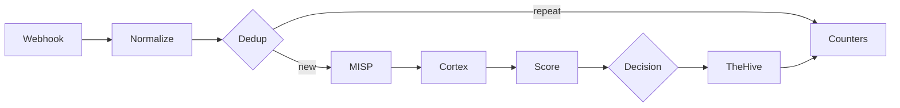

# ADR 0003: n8n triage workflow

## Context

Wazuh sends us far more alerts than one person can check. We want a workflow in n8n that takes each alert, checks it against MISP and Cortex, gives it a score and then either closes it with a written reason or sends it to an analyst in TheHive.

We start from `SOC - n8n E2E Skeleton`. It has five nodes (Webhook, MISP, two Cortex nodes, TheHive) and on 31 October it moved one real alert from Wazuh to TheHive. It works, but it only checks one IP and does not decide anything.

## Decision

We extend the Skeleton with the stages below. Each stage has one owner, who builds it and fills in its section in this document while working on it.

| # | Stage | What it does | Owner |
|---|---|---|---|
| 1 | Webhook | Receives the alert from Wazuh and checks that it really comes from Wazuh | @MKonrad-afk |
| 2 | Normalize | Turns the Wazuh alert into one common format and pulls out IPs, domains, hashes and file names | @84rtek |
| 3 | Dedup | Recognises the same alert sent again within a short time | @arturesturemkuros |
| 4 | MISP and Cortex | Checks the observables against threat intelligence | @MKonrad-afk |
| 5 | Score | Gives the alert points and keeps the reason for each one | @arturesturemkuros |
| 6 | Decision | Picks one of three outcomes: close, review, malicious | @arturesturemkuros |
| 7 | Failure handling | Makes sure a broken service does not stop the workflow or hide an alert | @p4chatek |
| 8 | TheHive | Creates the alert the analyst works on | @Solivagantaeon |
| 9 | Audit | Keeps the reason for every alert closed automatically | @Maartini22 |
| 10 | Counters | Counts alerts at every stage, so we can show the reduction | @arturesturemkuros |

### 1. Webhook

**Owner:** @MKonrad-afk

#### Context

This stage forwards selected Wazuh alerts to the n8n Webhook. The initial implementation sends alerts individually so the end-to-end integration can be validated before adding batch processing.

#### Decision

The Wazuh `custom-n8n` integration forwards alerts in JSON format when their rule level is **12 or higher**. The `<level>12</level>` setting is a minimum threshold, so it includes alerts at levels 12, 13, and above.

The n8n Webhook accepts `POST` requests, uses `Header Auth` with the `Wazuh webhook token` credential, and responds using **Immediately** mode.

The sanitized [Wazuh integration template](../../detection/wazuh/integrations/n8n-integration.xml) is maintained in the repository. Deployment and verification steps are documented in the [n8n triage runbook](../runbooks/n8n-triage.md#1-webhook). The production Webhook URL and authentication value remain in the relevant system configuration and are not stored in the repository.

The manager-side script, configuration, installation, and delivery checks are documented in the [Wazuh integrations README](../../detection/wazuh/integrations/README.md).

#### Rationale

A level 12 threshold keeps the initial scope focused on higher-level alerts while the end-to-end Webhook path is validated. Sending alerts individually keeps the first implementation simple to verify.

Header Auth requires the configured credential for a request to be accepted. Immediate response mode acknowledges receipt without making Wazuh wait for the workflow to finish. The n8n execution history is used to verify that processing completed successfully.

#### Verification

A test request from Kali generated Wazuh rule `31115` at level `13`. Wazuh forwarded the alert, and n8n recorded a successful execution on 2026-11-02 at 23:36:30. The execution completed in 4.066 seconds.

The Webhook configuration and test evidence are shown in the [n8n triage runbook](../runbooks/n8n-triage.md#1-webhook).

#### Follow-up

Alerts below level 12 are outside this stage. [Issue #76](https://github.com/Solivagantaeon/soc-automation-lab/issues/76) tracks evaluating batch forwarding for those alerts, including the grouping interval, maximum batch size, and how batches should be represented in TheHive.

### 2. Normalize

**Owner:** @84rtek

#### Context

Wazuh alerts can reach n8n in different JSON structures, depending on whether the payload is a raw Wazuh alert, an Elasticsearch document, or a Shuffle-style wrapper. Downstream workflow stages need a consistent representation of the alert and its observables.

The Normalize stage was added to the separate `SOC - n8n E2E Skeleton` workflow directly after the Webhook. Version 1.2 of the JavaScript Code node was tested with six synthetic lab scenarios.

#### Decision

A JavaScript Code node normalizes all incoming items using **Run Once for All Items** mode. It recognizes these input formats:

- raw Wazuh alerts;
- Elasticsearch documents containing `_source`;
- Shuffle-style payloads containing `all_fields`.

The node produces a common alert object containing alert metadata, rule details, agent information, event context, observables, a primary observable, and a deduplication key.

The observable extraction covers IP addresses, domains, URLs, URI paths, MD5/SHA1/SHA256 hashes, filenames, Windows registry keys, users, hostnames, and User-Agent values. Each observable retains its source field and an `internal` flag where applicable.

An agent's internal IP is retained as context and marked `internal: true`; it is not automatically selected as the primary IOC. If no eligible primary observable is present, `primary_observable` is set to `-`.

The node generates a `dedup_key` from the rule, signature, agent, and primary observable fields. This stage only creates the key; actual duplicate detection is handled by the separate Dedup stage.

#### Rationale

A common output structure allows later workflow stages to consume alert data without depending on the original payload layout. Keeping the source field and internal/external distinction helps downstream logic interpret observables correctly.

The primary observable fallback of `-` prevents an endpoint's own internal IP from being mistaken for an external IOC when an alert contains no IOC. Keeping the agent IP in the observables list preserves useful endpoint context.

Separating key generation from duplicate detection keeps Normalize focused on data preparation and Dedup responsible for duplicate handling.

#### Verification

Normalize v1.2 passed six functional tests using synthetic lab data:

| Test | Input scenario | Verified result |
|---|---|---|
| 1 | Network / DNS / HTTP | Extracted IP, domain, URL, filename, user, and User-Agent |
| 2 | Sysmon / hashes | Extracted MD5, SHA1, SHA256, file path, command line, and user |
| 3 | Syscheck / Windows Registry | Classified the registry path as `registry_key` |
| 4 | Raw Wazuh | Recognized raw input and extracted the external IP |
| 5 | Shuffle wrapper | Recognized `all_fields` and extracted SHA256 and filename |
| 6 | Alert without IOC | Preserved agent context and returned `primary_observable: "-"` |

The Code node was also verified to use **Run Once for All Items** mode.

These tests validate the normalization logic with the supplied test data. They do not, by themselves, validate Webhook authentication, live Wazuh delivery, downstream MISP/Cortex enrichment, or end-to-end deduplication. [Normalize v1.2 Code node](../../soar/n8n/nodes/normalize-v1.2.js)
Detailed build and test instructions are recorded in the [n8n triage runbook](../runbooks/n8n-triage.md#2-normalize).

#### Follow-up

The current hash extraction test confirms that all three hash types are collected. The test selected MD5 as the primary hash because of the current extraction/selection order; a SHA256-first preference can be considered separately if required by downstream analyzer routing.

The generated `dedup_key` must be consumed and tested by the Dedup stage.

### 3. Dedup

**Owner:** @arturesturemkuros

### 4. MISP and Cortex

**Owner:** @MKonrad-afk

#### Context

The workflow checks Wazuh alert observables against MISP and Cortex. MISP looks for matching attributes in local threat-intelligence data. Cortex runs analyzers for supported observables.

#### Decision

MISP searches the normalized observables and returns matching attributes with their event context.

Before sending observables to Cortex, the workflow splits them into individual items, removes duplicates, and checks whether each item can be analyzed. Eligible items go to the matching analyzer. Skipped items are kept with a reason.

| Observable | Cortex analyzer |
|---|---|
| Public IP | AbuseIPDB |
| Domain | Maltiverse |
| Hash | Team Cymru MHR and CIRCL Hashlookup |
| URL | VirusTotal GetReport |

The workflow does not send file contents or filenames to Cortex. It can send a file hash.

Each analyzer starts once and returns an ID for its analysis. `Get a report` uses that same ID to check the result. If the analysis is still running, n8n waits two seconds and checks again. It tries up to five times. If no result is ready, the summary marks the analysis as pending.

`Summary Enrichments` combines the MISP matches, Cortex results, skipped observables, and job status.

#### Rationale

MISP and Cortex provide different information. MISP shows whether an observable matches a local attribute. Cortex returns results from external analyzers.

The eligibility check keeps internal or unsupported observables out of the analyzer branches. Removing duplicates avoids starting the same analysis more than once for an observable in the same alert. Reusing the analysis ID lets n8n check for a result without starting another analysis.

#### Verification

The raw Wazuh test alert for rule `100723` exercised all four Cortex routes and returned five results:

| Observable | Result |
|---|---|
| `soc-lab-postdns.example.org` | Maltiverse returned `neutral` |
| `1.1.1.1` | AbuseIPDB returned `whitelisted: true` and confidence score `0` |
| Test SHA-256 | Team Cymru returned `No record found`. CIRCL Hashlookup returned `Non existing SHA-256` |
| Test URL | VirusTotal completed the lookup but returned `NotFoundError` |

The workflow finished with no pending or failed jobs. VirusTotal did not find that URL. This does not confirm that the URL is safe. The internal source IP, agent IP, and hostname were kept in `skipped_by_filter`.

MISP returned two attributes for `1.1.1.1`. Both had `to_ids: false`. One included a warninglist comment identifying it as a known public DNS resolver. These attributes provide context, not a standalone verdict.

The [n8n triage runbook](../runbooks/n8n-triage.md#4-misp-and-cortex) documents the node settings and test steps. The [MISP README](../../enrichment/misp/README.md#n8n-lab-context--issue-69) and [Cortex README](../../enrichment/cortex/README.md#n8n-cortex-workflow--issue-69) describe the lab context.

### 5. Score

**Owner:** @arturesturemkuros

#### Context

Stage 4 returns separate facts about an alert: the Wazuh rule level, MISP matches, and analyzer results. No single fact says how risky the alert is, and some of them mislead. In the first lab tests, Team Cymru MHR reported a 37% detection rate for the SHA-256 of an empty file, a hash that CIRCL Hashlookup lists as known. A source that fails returns nothing at all, which is easy to mistake for a clean result.

The Decision stage needs one comparable number, a verdict, and the reasons behind them.

#### Decision

The Score stage runs after `Summary Enrichments` and has two nodes: `Scoring Config`, an Edit Fields node that holds the rules as JSON, and `Scoring`, a JavaScript Code node that applies them.

The score is a sum of points limited to 0-100:

| Part | Default points |
|---|---|
| Wazuh rule level | Level x 2, at most 30 |
| MISP | 30 for an attribute with `to_ids: true`, otherwise 15 for any match |
| AbuseIPDB | 25 from confidence 75, 12 from 25, -10 if whitelisted |
| Maltiverse | `malicious` 20, `suspicious` 10, `whitelist` -5, historical matches only 5 |
| VirusTotal | 25 from 10 detections, 15 from 3, 8 from 1 |
| Team Cymru MHR | 15 from 50% detection, 8 from 20% |
| CIRCL Hashlookup | -10 for a known hash, unless its MHR detection is 50% or more |

The stage follows these rules:

- Each source gives one entry. When it returned results for several observables, the entry with the most points is used.
- A hash known in CIRCL makes the Team Cymru MHR detections for that hash count as 0, unless the MHR detection is 50% or more. A strong MHR detection overrides the CIRCL status, and the CIRCL discount is not applied to that hash.
- The score gives a verdict: `high` from 70, `medium` from 40, `low` from 20, otherwise `likely_false_positive`.
- Coverage is the share of sources that answered. A source with both a result and an error counts as half, a pending analyzer counts as not answered, and a disabled source is left out.
- When the verdict would be `low` or `likely_false_positive` but coverage is below 0.6, the verdict is `needs_review`.
- An item that lacks `alert.rule.level`, `cortex.results`, or `processing` is never scored as clean: its verdict is `needs_review`, coverage is 0, and `scoring.input_problems` lists what is missing.
- Weights, thresholds, and on/off switches are read from `scoring_config`. The node checks them. A wrong value is replaced by the default and reported in `scoring.config_warnings`.
- The stage only produces the `scoring` object (score, verdict, coverage, sources, and a breakdown with a reason for every point). It does not close or escalate an alert.

The [Scoring v0.2 Code node](../../soar/n8n/nodes/score-v0.2.js) and the [default config](../../soar/n8n/nodes/score-config.json) are kept in the repository. Build and test steps are in the [n8n triage runbook](../runbooks/n8n-triage.md#5-score).

#### Rationale

Adding points with a stated reason for each one makes the result easy to explain to an analyst, and the same reasons can be reused as the closing reason in the Audit stage. A single trained model would not give this.

One entry per source keeps an alert with many observables of the same type from collecting the same points many times.

A source that failed says nothing about the alert. Counting it as 0 points would make a broken service look like a clean alert, and the alert could be closed by mistake. Coverage keeps this visible, and `needs_review` stops a low score from being treated as a false positive without evidence. The same applies to broken wiring. In the first n8n test, `Scoring` received only its config, because the input fields were not passed on. Without the input check it returned `likely_false_positive` for every alert.

The CIRCL rule comes from the lab data. An empty file is harmless, but MHR reports a detection rate for its hash (37%). Without the rule, such a hash would add points. CIRCL "known" only says that a file is in a reference collection, not that it is harmless: in the n8n test both hashes of the EICAR test file were known in CIRCL, while MHR reported 93% detections for them. For this reason a strong MHR detection (50% or more, configurable) overrides the CIRCL status.

With the default weights, the rule level alone (at most 30) stays below the `medium` band (40). A `medium` or `high` verdict needs at least one enrichment signal.

The rules are in a separate node because the weights are expected to change after the first replay of real alerts, and the person who tunes them should not have to edit code. Checking the config matters for the same reason: a typo in a key would otherwise change decisions without anyone noticing.

The starting values are not calibrated. They were chosen by hand from two lab alerts and a few synthetic cases.

#### Verification

The scoring logic was run outside n8n on the `Summary Enrichments` output of two lab test alerts from 2026-11-09 (rules `5710` and `92213`) and on synthetic cases:

| Test | Input scenario | Verified result |
|---|---|---|
| 1 | Rule `5710`, level 5, hash known in CIRCL, MHR 37%, AbuseIPDB and MISP failed | Score 0, `needs_review`, coverage 0.5. MHR ignored |
| 2 | Rule `92213`, level 12, Maltiverse `malicious`, VirusTotal 2/91, three sources failed | Score 52, `medium`, coverage 0.4 |
| 3 | Test 1 with AbuseIPDB and MISP answering | Score 0, `likely_false_positive`, coverage 1 |
| 4 | Level 12, MISP match with `to_ids: true`, AbuseIPDB confidence 100 | Score 79, `high`, coverage 1 |
| 5 | MHR 80%, no CIRCL record | Score 25, `low`, coverage 1 |
| 6 | Item that contains only `scoring_config`, without alert data | Score 0, `needs_review`, coverage 0, `input_problems` lists the three missing parts |
| 7 | Level 12, Maltiverse `malicious`, VirusTotal 2/91, two hashes known in CIRCL with MHR 93% (the EICAR test file in the lab), MISP failed | Score 67, `medium`, coverage 0.8. The CIRCL discount is not applied and the MHR detection counts |

All seven cases gave the stated results on v0.2.2. In addition, 34 automated checks passed: the default config, overriding one weight, switching a source off, the config checks (unknown key, wrong type, wrong bands, unsorted and invalid tiers), the input check (an item without alert data), and the CIRCL exception (weak, strong, and mixed hashes, and the exception switched off).

These tests validate the scoring logic. They do not validate a full workflow run in which every enrichment source answers, and the live weights have not been compared with real alerts.

The [n8n triage runbook](../runbooks/n8n-triage.md#5-score) documents the node settings and test steps.

#### Follow-up

- The first test runs showed enrichment errors that lower coverage until they are fixed: MISP `Unsupported protocol localhost:`, AbuseIPDB `Invalid URL`, and Team Cymru and CIRCL `Paired item data ... is unavailable` when an alert has two hashes. These belong to the MISP and Cortex stage.
- Hashes are currently not sent to VirusTotal, so a hash gets signals only from Team Cymru MHR and CIRCL.
- The CIRCL discount applies once per alert, not per hash. An alert with one known and one unknown hash gets -10 for both.
- Coverage counts only sources that returned a result or an error. A branch that returns nothing at all does not lower it, so every node must report its failures.
- With the default weights, an alert at rule level 15 with clean enrichment gets only `low`. The team should decide whether high rule levels need a minimum verdict.
- The Decision stage must map the verdicts (`high`, `medium`, `low`, `likely_false_positive`, `needs_review`) to its three outcomes.

### 6. Decision

**Owner:** @arturesturemkuros

### 7. Failure handling

**Owner:** @p4chatek

### 8. TheHive

**Owner:** @Solivagantaeon

### 9. Audit

**Owner:** @Maartini22

### 10. Counters

**Owner:** @arturesturemkuros
