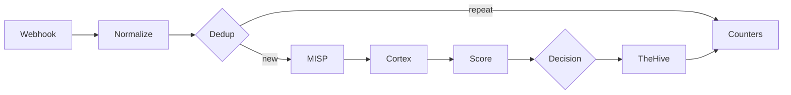

# ADR 0003: n8n triage workflow

## Context

Wazuh sends us far more alerts than one person can check. We want a workflow in n8n that takes each alert, checks it against MISP and Cortex, gives it a score and then either closes it with a written reason or sends it to an analyst in TheHive.

We start from `SOC - n8n E2E Skeleton`. It has five nodes (Webhook, MISP, two Cortex nodes, TheHive) and on 31 October it moved one real alert from Wazuh to TheHive. It works, but it only checks one IP and does not decide anything.

## Decision

We extend the Skeleton with the stages below. Each stage has one owner, who builds it and fills in its section in this document while working on it.

| # | Stage | What it does | Owner |
|---|---|---|---|
| 1 | Webhook | Receives the alert from Wazuh and checks that it really comes from Wazuh | @ |
| 2 | Normalize | Turns the Wazuh alert into one common format and pulls out IPs, domains, hashes and file names | @ |
| 3 | Dedup | Recognises the same alert sent again within a short time | @ |
| 4 | MISP and Cortex | Checks the observables against threat intelligence | @ |
| 5 | Score | Gives the alert points and keeps the reason for each one | @ |
| 6 | Decision | Picks one of three outcomes: close, review, malicious | @ |
| 7 | Failure handling | Makes sure a broken service does not stop the workflow or hide an alert | @ |
| 8 | TheHive | Creates the alert the analyst works on | @ |
| 9 | Audit | Keeps the reason for every alert closed automatically | @ |
| 10 | Counters | Counts alerts at every stage, so we can show the reduction | @ |

### 1. Webhook

**Owner:** @

### 2. Normalize

**Owner:** @

### 3. Dedup

**Owner:** @

### 4. MISP and Cortex

**Owner:** @

### 5. Score

**Owner:** @

### 6. Decision

**Owner:** @

### 7. Failure handling

**Owner:** @

### 8. TheHive

**Owner:** @

### 9. Audit

**Owner:** @

### 10. Counters

**Owner:** @
