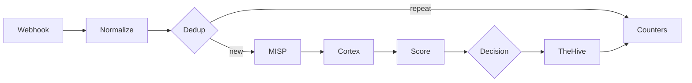

# ADR 0003: n8n triage workflow


## Context

Wazuh sends us far more alerts than one person can check. We want a workflow in n8n that takes each alert, checks it against MISP and Cortex, gives it a score and then either closes it with a written reason or sends it to an analyst in TheHive.

We start from `SOC - n8n E2E Skeleton`. It has five nodes (Webhook, MISP, two Cortex nodes, TheHive) and on 31 October it moved one real alert from Wazuh to TheHive. It works, but it only checks one IP and does not decide anything.


## Decision

We extend the Skeleton with the stages below. Each stage has one owner, who builds it and fills in its section in this document while working on it.



| # | Stage | What it does | Owner |
|---|---|---|---|
| 1 | Webhook | Receives the alert from Wazuh and checks that it really comes from Wazuh | @MKonrad-afk |
| 2 | Normalize | Turns the Wazuh alert into one common format and pulls out IPs, domains, hashes and file names | @84rtek |
| 3 | Dedup | Recognises the same alert sent again within a short time | @arturesturemkuros |
| 4 | MISP and Cortex | Checks the observables against threat intelligence | @MKonrad-afk |
| 5 | Score | Gives the alert points and keeps the reason for each one | @arturesturemkuros |
| 6 | Decision | Picks one of three outcomes: close, review, malicious | @MKonrad-afk |
| 7 | Failure handling | Makes sure a broken service does not stop the workflow or hide an alert | @p4chatek |
| 8 | TheHive | Creates the alert the analyst works on | @MKonrad-afk |
| 9 | Audit | Keeps the reason for every alert closed automatically | @Maartini22 |
| 10 | Counters | Counts alerts at every stage, so we can show the reduction | @arturesturemkuros |


### 1. Webhook

**Owner:** @MKonrad-afk

#### Context

This stage forwards selected Wazuh alerts to the n8n Webhook. The initial implementation sends alerts individually so the end-to-end integration can be validated before adding batch processing.

#### Decision

The Wazuh `custom-n8n` integration forwards alerts in JSON format when their rule level is **12 or higher**. The `<level>12</level>` setting is a minimum threshold, so it includes alerts at levels 12, 13, and above.

The n8n Webhook accepts `POST` requests, uses `Header Auth` with the `Wazuh webhook token` credential, and responds using **Immediately** mode.

The sanitized [Wazuh integration template](../../detection/wazuh/integrations/n8n-integration.xml) is maintained in the repository. Deployment and verification steps are documented in the [n8n triage runbook](../runbooks/n8n-triage.md#1-webhook). The production Webhook URL and authentication value remain in the relevant system configuration and are not stored in the repository.

The manager-side script, configuration, installation, and delivery checks are documented in the [Wazuh integrations README](../../detection/wazuh/integrations/README.md).

#### Rationale

A level 12 threshold keeps the initial scope focused on higher-level alerts while the end-to-end Webhook path is validated. Sending alerts individually keeps the first implementation simple to verify.

Header Auth requires the configured credential for a request to be accepted. Immediate response mode acknowledges receipt without making Wazuh wait for the workflow to finish. The n8n execution history is used to verify that processing completed successfully.

#### Verification

A test request from Kali generated Wazuh rule `31115` at level `13`. Wazuh forwarded the alert, and n8n recorded a successful execution on 2026-11-02 at 23:36:30. The execution completed in 4.066 seconds.

The Webhook configuration and test evidence are shown in the [n8n triage runbook](../runbooks/n8n-triage.md#1-webhook).

#### Follow-up

Alerts below level 12 are outside this stage. [Issue #76](https://github.com/Solivagantaeon/soc-automation-lab/issues/76) tracks evaluating batch forwarding for those alerts, including the grouping interval, maximum batch size, and how batches should be represented in TheHive.

### 2. Normalize

**Owner:** @84rtek

#### Context

Wazuh alerts can reach n8n in different JSON structures, depending on whether the payload is a raw Wazuh alert, an Elasticsearch document, or a Shuffle-style wrapper. Downstream workflow stages need a consistent representation of the alert and its observables.

The Normalize stage was added to the separate `SOC - n8n E2E Skeleton` workflow directly after the Webhook. Version 1.2 of the JavaScript Code node was tested with six synthetic lab scenarios.

#### Decision

A JavaScript Code node normalizes all incoming items using **Run Once for All Items** mode. It recognizes these input formats:

- raw Wazuh alerts;
- Elasticsearch documents containing `_source`;
- Shuffle-style payloads containing `all_fields`.

The node produces a common alert object containing alert metadata, rule details, agent information, event context, observables, a primary observable, and a deduplication key.

The observable extraction covers IP addresses, domains, URLs, URI paths, MD5/SHA1/SHA256 hashes, filenames, Windows registry keys, users, hostnames, and User-Agent values. Each observable retains its source field and an `internal` flag where applicable.

An agent's internal IP is retained as context and marked `internal: true`; it is not automatically selected as the primary IOC. If no eligible primary observable is present, `primary_observable` is set to `-`.

The node generates `dedup_key` from the `rule ID`, `signature ID`, `agent ID`, `source IP`, and `primary observable`. If no source IP is available, the key uses `-`. For web rules in the web, accesslog, or web_scan groups with a `source IP`, the final key component is `*`, so different paths from the same `source IP` to the same agent share a key. The output also includes `source_ip` and `dedup_mode` (web-source or default). This stage only creates the key, duplicate detection is handled by the separate Dedup stage.

#### Rationale

A common output structure allows later workflow stages to consume alert data without depending on the original payload layout. Keeping the source field and internal/external distinction helps downstream logic interpret observables correctly.

The primary observable fallback of `-` prevents an endpoint's own internal IP from being mistaken for an external IOC when an alert contains no IOC. Keeping the agent IP in the observables list preserves useful endpoint context.

Separating key generation from duplicate detection keeps Normalize focused on data preparation and Dedup responsible for duplicate handling.

#### Verification

Normalize v1.2 passed six functional tests using synthetic lab data:

| Test | Input scenario | Verified result |
|---|---|---|
| 1 | Network / DNS / HTTP | Extracted IP, domain, URL, filename, user, and User-Agent |
| 2 | Sysmon / hashes | Extracted MD5, SHA1, SHA256, file path, command line, and user |
| 3 | Syscheck / Windows Registry | Classified the registry path as `registry_key` |
| 4 | Raw Wazuh | Recognized raw input and extracted the external IP |
| 5 | Shuffle wrapper | Recognized `all_fields` and extracted SHA256 and filename |
| 6 | Alert without IOC | Preserved agent context and returned `primary_observable: "-"` |

The Code node was also verified to use **Run Once for All Items** mode.

These tests validate the normalization logic with the supplied test data. They do not, by themselves, validate Webhook authentication, live Wazuh delivery, downstream MISP/Cortex enrichment, or end-to-end deduplication. [Normalize v1.2 Code node](../../soar/n8n/nodes/normalize-v1.2.js)
Detailed build and test instructions are recorded in the [n8n triage runbook](../runbooks/n8n-triage.md#2-normalize).

#### Follow-up

The current hash extraction test confirms that all three hash types are collected. The test selected MD5 as the primary hash because of the current extraction/selection order; a SHA256-first preference can be considered separately if required by downstream analyzer routing.

The generated `dedup_key` must be consumed and tested by the Dedup stage.

### 3. Dedup

**Owner:** @arturesturemkuros

#### Context

Wazuh can send the same alert many times in a short period, for example when a scan or a repeated login attempt keeps triggering one rule. Every copy that reaches the enrichment stages costs a MISP query and up to five Cortex analyzer runs, some of which have API rate limits (Maltiverse, AbuseIPDB, TeamCymru, CirclHash, VirusTotal).

The Dedup stage was added to the `SOC - n8n E2E Skeleton` workflow directly after Normalize, as early as possible, so a duplicate is stopped before any enrichment. It depends on the `dedup_key` produced by the Normalize stage.

#### Decision

Two nodes are added after Normalize:

1. A JavaScript Code node, **Dedup**, in **Run Once for All Items** mode. It keeps a map of `dedup_key -> {first_seen, count}` in n8n workflow static data. If the key is already in the map and younger than the window, the alert is marked `is_duplicate: true` and its `duplicate_count` is increased. Otherwise the key is stored and the alert is marked `is_duplicate: false`. Entries older than the window are removed on every run.
2. An If node, **New Alert?**, which tests `{{ $json.is_duplicate }}` is false. The true branch continues to the MISP lookup and to Split Cortex Observables. The false branch is empty, so the execution ends there.

**Window.** 7 minutes, counted from the first occurrence (a fixed window, not a sliding one).

**Key.** Normalize builds the key as:

`soc:dedup:<rule.id>:<signature_id>:<agent.id>:<source_ip>:<primary_observable>`

- The source IP is taken from `data.srcip`, `data.src_ip`, `data.win.eventdata.sourceIp` or `data.win.eventdata.ipAddress`. Private addresses are kept, so two internal attackers do not share a key.
- For web rules (rule groups `web`, `accesslog` or `web_scan`) that have a source IP, the last element is `*` instead of the primary observable. The path is ignored, so a scan from one IP against one agent is one key. Without a source IP the default key is used.
- Normalize also outputs `source_ip` and `dedup_mode` (`default` or `web-source`).

#### Rationale

**Early position.** A duplicate that is stopped right after Normalize never reaches MISP or Cortex, which protects the rate-limited APIs. Putting the stage later would only save work on the nodes after it.

**Code node and static data instead of Remove Duplicates.** The built-in Remove Duplicates node compares against earlier executions and has no time window, so it cannot express "the same alert within a short time". Static data with a timestamp can.

**Short fixed window.** A short window absorbs bursts of the same event, while a problem that keeps recurring is reported again after the window ends. The cost is that a continuous flood produces one alert per window, not one in total. A fixed window was chosen over a sliding one because a sliding window would suppress a never-ending flood forever.

**Source IP in the key.** Without it, two different internal attackers triggering the same rule on the same agent, with no public IOC, would share one key and the second would be dropped.

**Path ignored for web rules.** Tools such as gobuster try hundreds of paths. If the path were part of the key, every path would be a new alert and the flood would not be reduced. The price is that one interesting hit inside a scan can be dropped as a duplicate of the first alert.

**Considered, not implemented.**
- Adding the HTTP status code to the key for web rules, so that 404 and 200 responses from one IP stay separate.
- Never deduplicating alerts above a chosen rule level.
- Updating the existing TheHive alert with the repeat count when a duplicate arrives.

#### Verification

The stage was tested on 2026-11-08 with seven synthetic alerts pinned in the Webhook node and executed once:

| Test | Scenario | Verified result |
|---|---|---|
| 1 | New alert, public source IP | `is_duplicate: false`, `dedup_mode: default` |
| 2 | Same alert again | `is_duplicate: true`, `duplicate_count: 2` |
| 3 | Web rule, private source IP, path `/dvwa/admin` | `is_duplicate: false`, `dedup_mode: web-source` |
| 4 | Same web rule, same source IP, other path `/dvwa/backup` | `is_duplicate: true`, same key as test 3 |
| 5 | Same web rule, different source IP | `is_duplicate: false`, different key |
| 6 | No observables, no source IP | `is_duplicate: false`, `primary_observable: "-"` |
| 7 | Same alert as test 6 again | `is_duplicate: true` (known limitation below) |

New Alert? sent 4 items to the true branch and 3 items to the false branch, as expected.

Normal alerts with a public IOC continued through Split Cortex Observables, Dedupe Cortex Observables and Cortex Eligibility. The synthetic public IP in test 1 is in a documentation range, so Cortex Eligibility correctly rejected it and no analyzer was started.

These tests do not cover: expiry of the window, because static data is not persisted on manual runs; delivery through the live Webhook; or real web-scan alerts, whose `rule.groups` and `data.url` fields were assumed from the synthetic data.

Build and test instructions are in the [n8n triage runbook](../runbooks/n8n-triage.md#3-dedup).

#### Follow-up

- Verify window expiry on the active workflow: send the same alert, wait longer than the window and send it again. It should pass as new.
- Check a real gobuster alert against the DVWA host to confirm that its `rule.groups` contain a web group and that `source_ip` is filled.
- Known limitations: alerts with no observables and no source IP differ only by rule and agent, so different events from one rule and agent merge within the window; duplicates are dropped silently and nothing is updated in TheHive; the window uses processing time, not the alert `timestamp`, so replaying baseline alerts through the pipeline deduplicates by replay speed; the entry is stored before enrichment, so if a later stage fails the key stays blocked until the window ends.
- The Counters stage can use `duplicate_count`. Updating the existing TheHive alert on duplicates, with a `sourceRef` that includes `first_seen` so a new window can create a new alert, is a possible follow-up.
  
### 4. MISP and Cortex

**Owner:** @MKonrad-afk

#### Context

The workflow checks Wazuh alert observables against MISP and Cortex. MISP looks for matching attributes in local threat-intelligence data. Cortex runs analyzers for supported observables.

#### Decision

MISP searches the normalized observables and returns matching attributes with their event context.

Before sending observables to Cortex, the workflow splits them into individual items, removes duplicates, and checks whether each item can be analyzed. Eligible items go to the matching analyzer. Skipped items are kept with a reason.

| Observable | Cortex analyzer |
|---|---|
| Public IP | AbuseIPDB |
| Domain | Maltiverse |
| Hash | Team Cymru MHR and CIRCL Hashlookup |
| URL | VirusTotal GetReport |

The workflow does not send file contents or filenames to Cortex. It can send a file hash.

Each analyzer starts once and returns an ID for its analysis. `Get a report` uses that same ID to check the result. If the analysis is still running, n8n waits two seconds and checks again. It tries up to five times. If no result is ready, the summary marks the analysis as pending.

`Summary Enrichments` combines the MISP matches, Cortex results, skipped observables, and job status.

#### Rationale

MISP and Cortex provide different information. MISP shows whether an observable matches a local attribute. Cortex returns results from external analyzers.

The eligibility check keeps internal or unsupported observables out of the analyzer branches. Removing duplicates avoids starting the same analysis more than once for an observable in the same alert. Reusing the analysis ID lets n8n check for a result without starting another analysis.

#### Verification

The raw Wazuh test alert for rule `100723` exercised all four Cortex routes and returned five results:

| Observable | Result |
|---|---|
| `soc-lab-postdns.example.org` | Maltiverse returned `neutral` |
| `1.1.1.1` | AbuseIPDB returned `whitelisted: true` and confidence score `0` |
| Test SHA-256 | Team Cymru returned `No record found`. CIRCL Hashlookup returned `Non existing SHA-256` |
| Test URL | VirusTotal completed the lookup but returned `NotFoundError` |

The workflow finished with no pending or failed jobs. VirusTotal did not find that URL. This does not confirm that the URL is safe. The internal source IP, agent IP, and hostname were kept in `skipped_by_filter`.

MISP returned two attributes for `1.1.1.1`. Both had `to_ids: false`. One included a warninglist comment identifying it as a known public DNS resolver. These attributes provide context, not a standalone verdict.

The [n8n triage runbook](../runbooks/n8n-triage.md#4-misp-and-cortex) documents the node settings and test steps. The [MISP README](../../enrichment/misp/README.md#n8n-lab-context--issue-69) and [Cortex README](../../enrichment/cortex/README.md#n8n-cortex-workflow--issue-69) describe the lab context.


### 5. Score

**Owner:** @arturesturemkuros

#### Context

Stage 4 returns separate facts about an alert: the Wazuh rule level, MISP matches, and analyzer results. No single fact says how risky the alert is, and some of them mislead. In the first lab tests, Team Cymru MHR reported a 37% detection rate for the SHA-256 of an empty file, a hash that CIRCL Hashlookup lists as known. A source that fails returns nothing at all, which is easy to mistake for a clean result.

The Decision stage needs one comparable number, a verdict, and the reasons behind them.

#### Decision

The Score stage runs after `Summary Enrichments` and has two nodes: `Scoring Config`, an Edit Fields node that holds the rules as JSON, and `Scoring`, a JavaScript Code node that applies them.

The score is a sum of points limited to 0-100:

| Part | Default points |
|---|---|
| Wazuh rule level | Level x 2, at most 30 |
| MISP | 30 for an attribute with `to_ids: true`, otherwise 15 for any match |
| AbuseIPDB | 25 from confidence 75, 12 from 25, -10 if whitelisted |
| Maltiverse | `malicious` 20, `suspicious` 10, `whitelist` -5, historical matches only 5 |
| VirusTotal | 25 from 10 detections, 15 from 3, 8 from 1 |
| Team Cymru MHR | 15 from 50% detection, 8 from 20% |
| CIRCL Hashlookup | -10 for a known hash, unless its MHR detection is 50% or more |

The stage follows these rules:

- Each source gives one entry. When it returned results for several observables, the entry with the most points is used.
- A hash known in CIRCL makes the Team Cymru MHR detections for that hash count as 0, unless the MHR detection is 50% or more. A strong MHR detection overrides the CIRCL status, and the CIRCL discount is not applied to that hash.
- The score gives a verdict: `high` from 70, `medium` from 40, `low` from 20, otherwise `likely_false_positive`.
- Coverage is the share of sources that answered. A source with both a result and an error counts as half, a pending analyzer counts as not answered, and a disabled source is left out.
- When the verdict would be `low` or `likely_false_positive` but coverage is below 0.6, the verdict is `needs_review`.
- An item that lacks `alert.rule.level`, `cortex.results`, or `processing` is never scored as clean: its verdict is `needs_review`, coverage is 0, and `scoring.input_problems` lists what is missing.
- Weights, thresholds, and on/off switches are read from `scoring_config`. The node checks them. A wrong value is replaced by the default and reported in `scoring.config_warnings`.
- The stage only produces the `scoring` object (score, verdict, coverage, sources, and a breakdown with a reason for every point). It does not close or escalate an alert.

The [Scoring v0.2 Code node](../../soar/n8n/nodes/score-v0.2.js) and the [default config](../../soar/n8n/nodes/score-config.json) are kept in the repository. Build and test steps are in the [n8n triage runbook](../runbooks/n8n-triage.md#5-score).

#### Rationale

Adding points with a stated reason for each one makes the result easy to explain to an analyst, and the same reasons can be reused as the closing reason in the Audit stage. A single trained model would not give this.

One entry per source keeps an alert with many observables of the same type from collecting the same points many times.

A source that failed says nothing about the alert. Counting it as 0 points would make a broken service look like a clean alert, and the alert could be closed by mistake. Coverage keeps this visible, and `needs_review` stops a low score from being treated as a false positive without evidence. The same applies to broken wiring. In the first n8n test, `Scoring` received only its config, because the input fields were not passed on. Without the input check it returned `likely_false_positive` for every alert.

The CIRCL rule comes from the lab data. An empty file is harmless, but MHR reports a detection rate for its hash (37%). Without the rule, such a hash would add points. CIRCL "known" only says that a file is in a reference collection, not that it is harmless: in the n8n test both hashes of the EICAR test file were known in CIRCL, while MHR reported 93% detections for them. For this reason a strong MHR detection (50% or more, configurable) overrides the CIRCL status.

With the default weights, the rule level alone (at most 30) stays below the `medium` band (40). A `medium` or `high` verdict needs at least one enrichment signal.

The rules are in a separate node because the weights are expected to change after the first replay of real alerts, and the person who tunes them should not have to edit code. Checking the config matters for the same reason: a typo in a key would otherwise change decisions without anyone noticing.

The starting values are not calibrated. They were chosen by hand from two lab alerts and a few synthetic cases.

#### Verification

The scoring logic was run outside n8n on the `Summary Enrichments` output of two lab test alerts from 2026-11-09 (rules `5710` and `92213`) and on synthetic cases:

| Test | Input scenario | Verified result |
|---|---|---|
| 1 | Rule `5710`, level 5, hash known in CIRCL, MHR 37%, AbuseIPDB and MISP failed | Score 0, `needs_review`, coverage 0.5. MHR ignored |
| 2 | Rule `92213`, level 12, Maltiverse `malicious`, VirusTotal 2/91, three sources failed | Score 52, `medium`, coverage 0.4 |
| 3 | Test 1 with AbuseIPDB and MISP answering | Score 0, `likely_false_positive`, coverage 1 |
| 4 | Level 12, MISP match with `to_ids: true`, AbuseIPDB confidence 100 | Score 79, `high`, coverage 1 |
| 5 | MHR 80%, no CIRCL record | Score 25, `low`, coverage 1 |
| 6 | Item that contains only `scoring_config`, without alert data | Score 0, `needs_review`, coverage 0, `input_problems` lists the three missing parts |
| 7 | Level 12, Maltiverse `malicious`, VirusTotal 2/91, two hashes known in CIRCL with MHR 93% (the EICAR test file in the lab), MISP failed | Score 67, `medium`, coverage 0.8. The CIRCL discount is not applied and the MHR detection counts |

All seven cases gave the stated results on v0.2.2. In addition, 34 automated checks passed: the default config, overriding one weight, switching a source off, the config checks (unknown key, wrong type, wrong bands, unsorted and invalid tiers), the input check (an item without alert data), and the CIRCL exception (weak, strong, and mixed hashes, and the exception switched off).

These tests validate the scoring logic. They do not validate a full workflow run in which every enrichment source answers, and the live weights have not been compared with real alerts.

The [n8n triage runbook](../runbooks/n8n-triage.md#5-score) documents the node settings and test steps.

#### Follow-up

- The first test runs showed enrichment errors that lower coverage until they are fixed: MISP `Unsupported protocol localhost:`, AbuseIPDB `Invalid URL`, and Team Cymru and CIRCL `Paired item data ... is unavailable` when an alert has two hashes. These belong to the MISP and Cortex stage.
- Hashes are currently not sent to VirusTotal, so a hash gets signals only from Team Cymru MHR and CIRCL.
- The CIRCL discount applies once per alert, not per hash. An alert with one known and one unknown hash gets -10 for both.
- Coverage counts only sources that returned a result or an error. A branch that returns nothing at all does not lower it, so every node must report its failures.
- With the default weights, an alert at rule level 15 with clean enrichment gets only `low`. The team should decide whether high rule levels need a minimum verdict.
- The Decision stage must map the verdicts (`high`, `medium`, `low`, `likely_false_positive`, `needs_review`) to its three outcomes.


### 6. Decision

**Owner:** @MKonrad-afk

#### Context

The Score stage returns a score, verdict, coverage, and enrichment results. A low score alone does not prove that an alert is safe to close: enrichment can be incomplete, the asset can be critical, or the inventory can lack a reliable match. Decision combines the analysis with an explicit asset policy.

#### Decision

The `soc_asset_inventory` Data Table contains one row per known Wazuh agent. `Lookup Asset` queries it using both `agent_id` and `agent_name`. The Decision code validates the returned rows again and accepts only one matching ID and normalized name. A missing or ambiguous match cannot authorize automatic closure.

The JavaScript Code node reads the scored item from `Scoring` and inventory rows from its input. It adds `asset_inventory` and `decision` objects.

| Outcome | Rule |
|---|---|
| `closed` | Analysis is complete; an eligible external observable exists; there is no conflicting evidence or malicious signal; verdict is `likely_false_positive`; exactly one asset matches; the asset is not critical; and `auto_close_allowed` is true. |
| `analyst_review` | Default when data is missing, incomplete, ambiguous, or conflicting, or when the safe-close conditions are not met. |
| `malicious` | Analysis is complete and a configured malicious signal exists, or the verdict is `high`. This is automated routing, not analyst confirmation. |

`analysis_complete` requires valid scoring, coverage exactly 1, `processing.status` equal to `complete`, no failed or pending jobs, no partial or failed sources, no scoring input problems or config warnings, and no unclear VirusTotal result.

An eligible observable is a non-empty external IP, domain, URL, or hash. A `soc-lab:benign` tag combined with a malicious signal or score of 40 or higher is conflicting evidence and goes to review.

Malicious signals are: MISP tag `soc-lab:malicious`; Maltiverse classification `malicious`; Team Cymru MHR detection at least 50%; or VirusTotal with at least 10 detections.

An asset with `critical` criticality is never auto-closed, even if `auto_close_allowed` is true. The current inventory marks SOC-DC01 and OPNsense as critical; the list can grow as the lab changes.

The implementation is kept in [`decision-v0.1.js`](../../soar/n8n/nodes/decision-v0.1.js). Build steps and test results are in the [n8n triage runbook](../runbooks/n8n-triage.md#6-decision).

Decision returns an outcome in the workflow item. It does not change Wazuh alert status.

#### Rationale

A failed or incomplete source means the workflow does not know enough to call an alert safe. Such alerts go to `analyst_review`, with any collected malicious signals preserved. The editable inventory keeps closure policy visible and prevents unknown, ambiguous, or critical assets from being auto-closed.

#### Verification

The stage was exercised in n8n with these lab alerts:

| Test alert | Verified result |
|---|---|
| `decision71-20261110-critical-lookup-004` | SOC-DC01 matched as `008` / `server` / `critical`. Analysis complete; score 7, verdict `likely_false_positive`. Outcome `analyst_review`, reason `critical_asset`. |
| `decision71-20261110-closed-retry-007` | SOC-WIN10-01 matched as `007` / `workstation` / `standard`; auto-close allowed. Analysis complete; score 7, verdict `likely_false_positive`. AbuseIPDB was whitelisted; MISP returned two attributes with `to_ids: false` and no `soc-lab:benign` tag. Outcome `closed`, reason `complete_low_risk_analysis`. |
| `decision71-20261110-malicious-wicar-008` | Maltiverse classified `wicar.org` as malicious. Analysis complete; score 22 and verdict `low`. Outcome `malicious`, reason `malicious_evidence`. |
| `decision71-20261110-malicious-003` | MISP failed, coverage was 0.8, and Maltiverse/Team Cymru signals remained in output. Outcome `analyst_review`, reason `incomplete_analysis`; `analysis_complete` was false. |

These lab results verify all three outcomes and the incomplete-analysis fallback. 

#### Follow-up

- Keep inventory rows and `last_reviewed` current as agents change.
- The Audit stage must retain a durable record of a `closed` outcome and its reason.

### 7. Failure handling

**Owner:** @p4chatek

#### Context

The MISP and Cortex stage calls six external services: MISP and five Cortex analyzers (Maltiverse, AbuseIPDB, Team Cymru MHR, CIRCL Hashlookup and VirusTotal). Any of them can be down, slow or misconfigured. By default, a failed n8n node stops the whole execution, so one broken service would stop the alert from reaching the analyst.

Simply skipping the failed node is not enough either. The summary would then contain fewer results, with nothing saying why, and an alert whose lookups failed would look the same as an alert whose lookups found nothing.

The stage was added to the `SOC - n8n E2E Skeleton` workflow on top of the MISP and Cortex branches from stage 4.

#### Decision

**Retry before failing.** Every node that calls MISP or Cortex has **Retry On Fail** enabled:

| Node | Max. Tries | Wait Between Tries |
|---|---|---|
| Execute Maltiverse, Execute AbuseIPDB, Execute TeamCymru, Execute CirclHash, Execute VirusTotal | 3 | 2 000 ms |
| Get a report Maltiverse, Get a report AbuseIPDB, Get a report TeamCymru, Get a report CirclHash, Get a report UnshortenLink | 3 | 3 000 ms |
| Get a filtered list of attributes (MISP) | 5 | 2 000 ms |

**A failure goes to an error output.** The same nodes use **On Error → Continue (using error output)**. When the last retry fails, the failed items leave through the error output instead of stopping the workflow. The other services keep running and the alert still reaches the summary.

**One Error Formatter per service.** The error outputs of the `Execute …` and `Get a report …` nodes of one service go to one Code node, `Error Formatter - <service>`, in **Run Once for All Items** mode. It writes one record per failed observable:

```json
{ "service": "CirclHash", "node": "Execute CirclHash", "observable": "44d88612fea8a8f36de82e1278abb02f", "error": "Invalid URL", "timestamp": "2026-11-10T10:00:00.000Z" }
```

An error output item contains only the error message, not the observable. The formatter therefore works out which observables failed by comparing values:

- an error from `Execute …`: the observables of the service's type that were sent to it, minus the observables for which Cortex created a job;
- an error from `Get a report …`: the jobs created by `Execute …`, minus the jobs whose report was already finished or that are still in the current polling round;
- MISP searches all observables of an alert in one query, so its single record lists all of them.

The formatter reads the sent observables from `Normalize Alert` and `Dedupe Cortex Observables`. For AbuseIPDB it reads `Filter Cortex-Eligible IPs`, because only IPs that pass that filter are sent. The code is in [`error-formatter-cortex.js`](../../soar/n8n/nodes/error-formatter-cortex.js) and [`error-formatter-misp.js`](../../soar/n8n/nodes/error-formatter-misp.js).

**Get a report reads the job ID from the incoming item.** The Job ID field of every `Get a report …` node is `{{ $json._id ?? $json.id }}` instead of `{{ $('Execute …').item.json._id }}`.

**The summary records the failure.** `Summary Enrichments` adds every Error Formatter record to `processing.failed` and sets `processing.status` to `complete_with_errors`. An observable whose lookup failed is not listed in `cortex.skipped_by_filter`. The code is in [`summary-enrichments.js`](../../soar/n8n/nodes/summary-enrichments.js).

**Score treats a failure as missing data.** The Score stage counts every service in `processing.failed` as a service that did not answer. This lowers `scoring.coverage`, and below `min_coverage_for_fp` a low score becomes `needs_review` instead of a likely false positive. The scoring rules are recorded in stage 5.

#### Rationale

**Retry first.** Short outages, such as a restarting container or a single timeout, are common and usually clear within seconds. A few short retries fix them without creating a failure record. The waits are kept short so that a service that is really down does not hold the alert for long.

**Error output instead of Stop Workflow.** A failed analyzer does not make the results of the other services useless. Continuing keeps the alert moving and records the gap in the alert itself, where the analyst and the Score stage can see it.

**One record per observable.** An alert can carry several observables of the same type, and one of them can fail while another succeeds. The analyst and the Score stage need to know exactly which indicator was not checked.

**Comparing values instead of n8n item linking.** n8n's item linking (`$('node').item`, `itemMatching()`) could not find the original observable. The Cortex node does not keep item links when it processes more than one item, and the polling loop through the Wait node loses them as well. With one observable the lookup worked by chance. With two hashes it returned `unknown`, or the wrong observable. Comparing sent observables with created and finished jobs works for any number of observables and any number of polling rounds.

**Job ID from `$json`.** The `.item` lookup failed for the same reason. On the second polling round, or with more than one observable, `Get a report` stopped with `Paired item data for item from node 'Get a report …' is unavailable`. The incoming item is always a Cortex job object that contains its `_id`, on the first round and on every later one.

**A failed lookup is never listed as skipped.** Before this change, an IP whose AbuseIPDB lookup failed was also listed in `skipped_by_filter` with the reason `No Cortex result for this IP`. That reads as "checked, nothing found", which is exactly the false impression this stage has to prevent.

**One formatter per service instead of one shared node.** Each formatter needs its own node names and observable types. Separate nodes also keep every error path visible on the canvas next to the service it belongs to.

#### Verification

The stage was tested on 2026-11-10 with one synthetic alert, `100002`. It contains two documentation-range IPs, two domains, one URL and two hashes. All Cortex `Execute …` nodes and the MISP node used a test credential, `TEST FAILED`, with an invalid URL, so every lookup failed.

| Check | Verified result |
|---|---|
| Workflow | The execution completed and did not stop at any failed node |
| `processing.failed` | Eight records, one per failed observable: Maltiverse for both domains, Team Cymru and CIRCL for both hashes, VirusTotal for the URL, and one MISP record listing all seven external observables. Each record had the correct observable value |
| `processing.status` | `complete_with_errors` |
| `cortex.results` | Empty, because no analyzer answered |
| `cortex.skipped_by_filter` | Only observables that were deliberately not sent to Cortex: the two documentation-range IPs (`Non-public IPv4 address`) and the internal agent IP and hostname (`Marked internal by normalization`). No failed observable was listed there |

This test does not cover: a failure in a `Get a report …` node, because no job was created. AbuseIPDB, because the documentation-range IPs are correctly filtered out before it; a real outage, because an invalid URL fails immediately instead of timing out, and the Score stage output for a failed run.

Build and test instructions, screenshots and the test alert are in the [n8n triage runbook](../runbooks/n8n-triage.md#7-failure-handling).

#### Follow-up

- **Real outage:** repeat the test with a credential that points to an address where nothing listens, for example `http://127.0.0.1:9999`. The error should be a refused connection or a timeout, and the retries should add the configured delay before the record appears.
- **Report step:** run the test with the real credential on `Execute TeamCymru` and `TEST FAILED` on `Get a report TeamCymru`. Expect two records with node `Get a report TeamCymru`, one for each hash.
- **AbuseIPDB:** run the test with two real public IPs and `TEST FAILED` on `Execute AbuseIPDB`. Expect one record per IP, and neither IP in `skipped_by_filter`. Redact the IPs in any screenshot.
- **Score:** run the test alert through the Score stage and confirm that every failed service is listed under `scoring.sources.failed`, `coverage` is below `min_coverage_for_fp` and the verdict is `needs_review`.
- **Known issue, slow reports:** in one run, the Team Cymru result for one of two hashes appeared in neither `cortex.results` nor `processing.failed`. The likely cause is that its report needed another polling round and the final `Merge` had already passed its data on. This has to be investigated, because a lost result also makes an alert look cleaner than it is.
- **Node names:** the Error Formatters find their nodes by name, so renaming a node requires updating the constants in the formatter. The VirusTotal report node is still named `Get a report UnshortenLink`. Renaming it to `Get a report VirusTotal` would match the analyzer it polls.

### 8. TheHive

**Owner:** @MKonrad-afk

#### Context

The [Decision stage](https://github.com/Solivagantaeon/soc-automation-lab/issues/71) returns `closed`, `analyst_review`, or `malicious`. An alert that needs analyst attention must provide the decision, reason, source event, asset context, evidence, enrichment status, and eligible observables in TheHive. A `closed` result bypasses TheHive and continues to Audit/Counters.

#### Decision

The final branch is:

| Node | Responsibility |
|---|---|
| `If` | The true output represents `closed` and bypasses TheHive. The false output continues to alert creation. |
| [`Apply TheHive Handling Policy`](../../soar/n8n/nodes/thehive-handling-policy-v0.1.js) | Adds TheHive TLP/PAP markings. It reads the original Wazuh payload from `Webhook` because `Normalize Alert` does not retain `rule.groups`. |
| [`Build TheHive Alert`](../../soar/n8n/nodes/thehive-alert-v0.3.js) | Builds top-level TheHive alert fields and a separate `thehive_observables` array from Decision, the normalized event, MISP, Cortex, processing status, and asset inventory. |
| `Create an alert`| Uses TheHive 5 `Alert → Create` with the saved credential and automatic field mapping. |
| [`Prepare TheHive Observables`](../../soar/n8n/nodes/prepare-thehive-observables-v0.1.js) | Reads the created alert ID and the eligible observable list, then emits one item per observable for the TheHive Observable node. |
| [`Create an observable`](https://docs.n8n.io/integrations/builtin/app-nodes/n8n-nodes-base.thehive5/) | Uses TheHive 5 `Observable → Create in Alert` to attach each item to the created alert. |

The `If` node condition is `{{ $json.decision.outcome === 'closed' }}`. Its true output bypasses TheHive. Its false output reaches `Apply TheHive Handling Policy` and the builder. The builder accepts only `analyst_review` and `malicious` and fails visibly for other outcomes.

The policy selects the most restrictive explicit TLP and PAP markings found on the source alert or its observables. With no source markings, the exact Wazuh rule group `soc-lab-test` receives TLP `0` (CLEAR). Other or unclassified alerts receive TLP `2` (AMBER). PAP defaults independently to `2` (AMBER) in the current implementation. The SOC owner must approve this default for the intended environment. Neither value is derived from severity. The policy is applied after enrichment and only sets the markings recorded in TheHive. It does not gate Cortex requests already performed earlier in the execution.

The builder uses the original Wazuh alert ID as `sourceRef`, with type `external` and source `Wazuh`. It validates that `sourceRef` is present and no longer than 128 characters. TheHive rejects a repeated `(type, source, sourceRef)` combination in the same organization, so a rerun must use a fresh source alert ID or handle the existing alert explicitly.

The alert description includes the Decision outcome and rationale, score, verdict, coverage, analysis status, asset and user context, source alert and rule details, MITRE ATT&CK data, IOC verdicts, MISP references, Cortex summaries, and unavailable or pending sources. Only eligible external IP, domain, URL, and hash observables are attached. Internal addresses and hostnames are excluded. Each observable carries its own IOC verdict, evidence message, and the alert's TLP/PAP markings.

TheHive severity is calculated after Decision by `Build TheHive Alert`:

| Value | Label | Rule |
|---:|---|---|
| 4 | Critical | Malicious outcome on a critical asset, or complete malicious analysis with score at least 90 |
| 3 | High | Other malicious outcomes, analyst-review outcome on a critical asset, or complete high verdict/score at least 70 |
| 2 | Medium | Incomplete analysis, missing score, medium verdict/score 40–69, or an unmapped result |
| 1 | Low | Complete non-critical low/likely-false-positive verdict with score below 40 |

#### Rationale

Incomplete or ambiguous enrichment remains `analyst_review`. An unavailable or unclear result is not treated as benign. The alert is created before its observables so the response ID can be used to attach each observable to the correct alert. Closed outcomes remain outside the analyst alert queue and continue to Audit/Counters.

#### Verification

The live synthetic run completed successfully. TheHive displayed four observables, TLP CLEAR, PAP AMBER, and severity MEDIUM. The Decision output was `analyst_review`, reason `incomplete_analysis`, score `39`, verdict `low`, coverage `1`, and `analysis_complete=false`. This verifies the analyst-review route, alert creation, observable creation, and synthetic-data markings.


### 9. Audit

**Owner:** @


### 10. Counters

**Owner:** @84rtek

#### Context

The SOC workflow needs to record how many alerts reach each processing stage. This makes it possible to understand alert flow and determine how many alerts reach the analyst-facing stage.

The implementation must not change the existing triage, scoring, deduplication, enrichment, or decision logic.

#### Decision

Use a dedicated n8n Data Table named `SOC_Counters` to persist counter events.

Each counter is implemented as a separate Data Table Insert node. Counter nodes use parallel branches so that their output does not replace or modify the data passed through the original workflow.

A Code node named `Count Cortex Results` calculates aggregate Cortex execution statistics. A separate Data Table node persists the Cortex counter record.

#### Counter schema

The `SOC_Counters` table contains:

| Column | Type | Purpose |
|:---|:---|:---|
| `execution_id` | String | Identifies the n8n execution |
| `alert_id` | String | Identifies the alert |
| `stage` | String | Identifies the workflow stage |
| `outcome` | String | Records the stage outcome |
| `counted_at` | Date | Records when the counter event occurred |

#### Counter stages

The following stages and outcomes are recorded:

| Stage | Outcome |
|:---|:---|
| `raw` | `received` |
| `normalized` | `success` |
| `deduplication` | `new` or `duplicate` |
| `cortex` | `completed`, `partial`, `failed`, `pending`, or `skipped` |
| `thehive_alert_created` | `created` |
| `thehive_skipped` | `skipped` |

Cortex outcomes describe analyzer execution status, not the threat verdict of an observable.

#### Implementation decisions

1. Use one shared Data Table instead of multiple tables.
2. Store one record per counter event.
3. Use `$execution.id` to associate counter records with an execution.
4. Use the normalized alert ID wherever available.
5. Keep counter nodes on parallel branches.
6. Do not connect counter-node outputs back into the original processing path.
7. Keep existing workflow decision logic unchanged.

#### Consequences

**Benefits**

- Counter events can be queried centrally.
- Alert progression can be correlated using `execution_id` and `alert_id`.
- Counter persistence does not replace the original workflow payload.
- The implementation is easy to extend with additional stages.

**Limitations**

- A counter record represents a workflow-stage event, not necessarily a completed analyst investigation.
- `thehive_alert_created` means an alert was created in TheHive; it does not prove that an analyst opened or reviewed it.
- `thehive_skipped` means the workflow followed the branch that skips TheHive; it does not mean the alert was classified as benign.
- Cortex completion does not imply that the returned intelligence verdict is malicious or benign.

#### Testing

A synthetic alert was processed:

` soc-n8n-countertest-20261111-08 `

The observed execution ID was `13629`.

The following records were visible in `SOC_Counters`:

| Stage | Outcome |
|:---|:---|
| `raw` | `received` |
| `normalized` | `success` |
| `deduplication` | `new` |
| `cortex` | `completed` |
| `thehive_alert_created` | `created` |

The duplicate and TheHive-skipped paths are treated as PASS for this task based on the assumed test results. Separate captured execution evidence is still required before describing those paths as independently evidenced tests.

#### Scope boundaries

This ADR covers only counter instrumentation and its persistence.

It does not authorize changes to scoring, decision rules, enrichment integrations, deduplication behavior, or TheHive handling policy.

