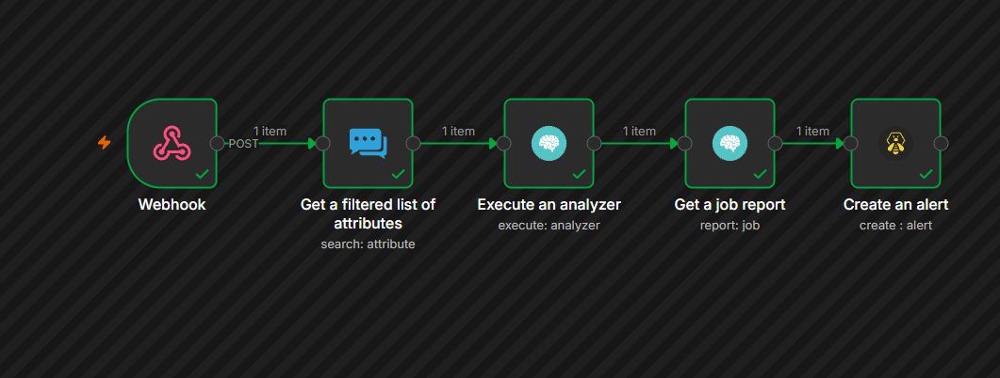
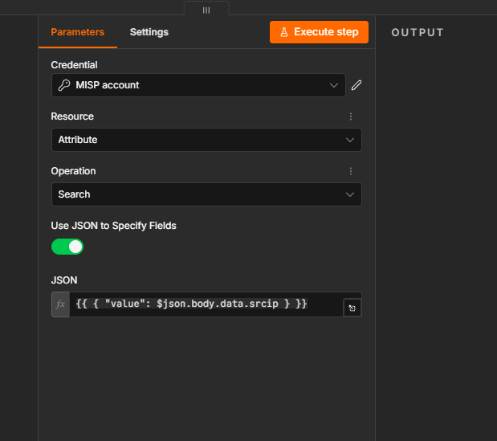
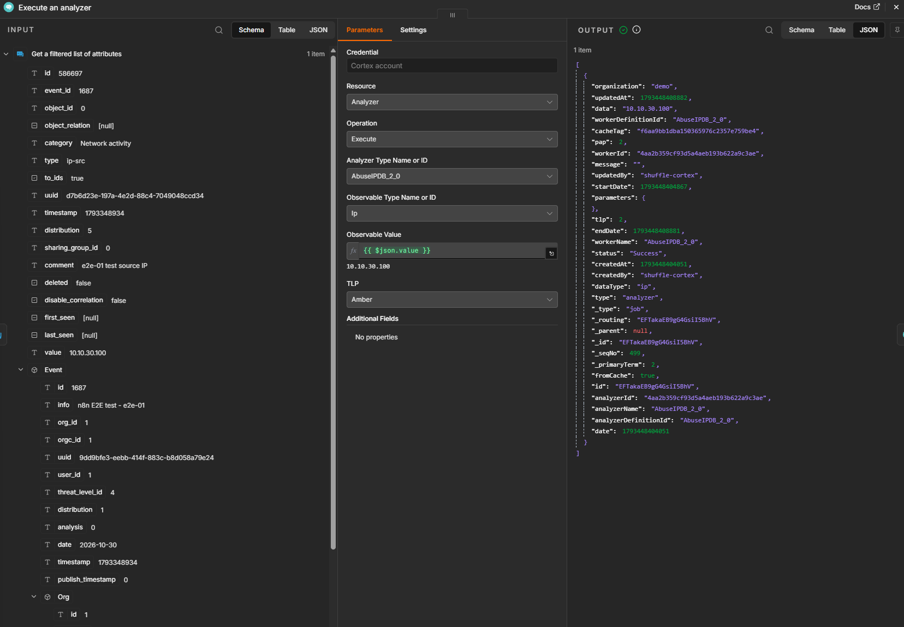
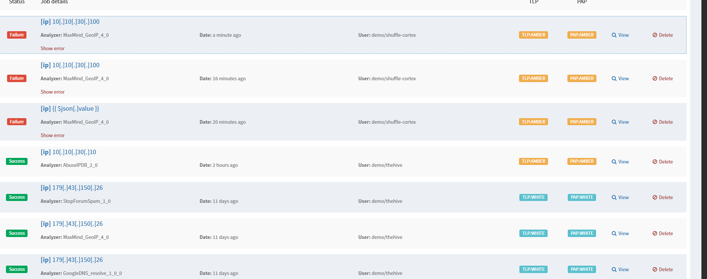
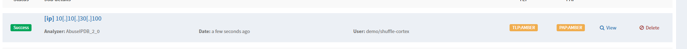
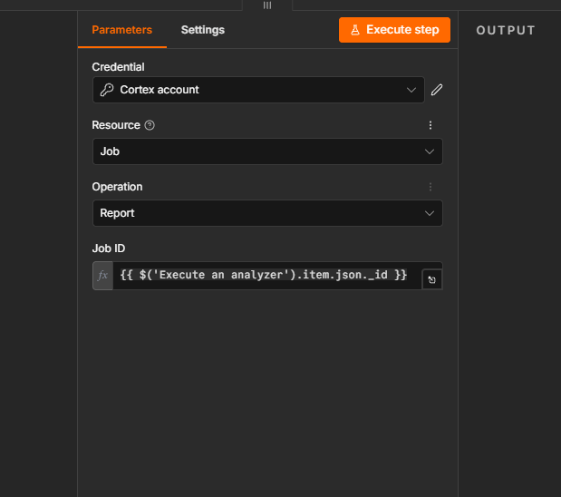
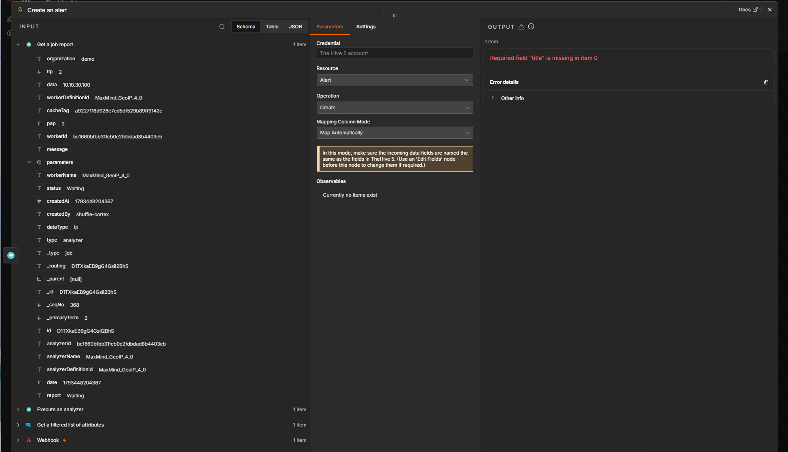
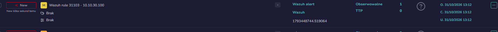
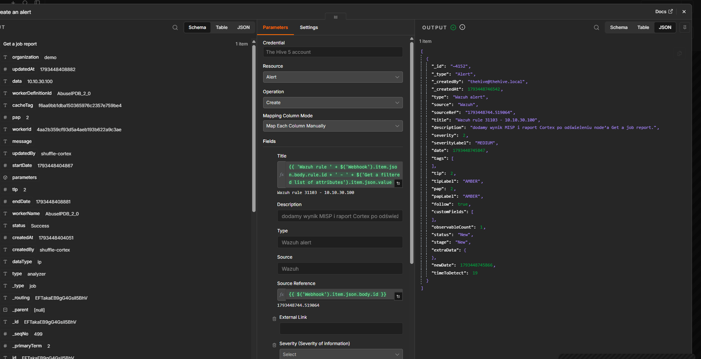

# Issue #55 — Wazuh to TheHive end-to-end test

This runbook records the first working version of the lab flow tested on 31 October 2026. It is written so anybody can follow the same steps.

One controlled web request from Kali raised Wazuh rule 31103. Wazuh sent one alert to n8n. n8n found the IP in the MISP test event, submitted it to a Cortex analyzer, collected the job, and created a TheHive alert with the IP as an observable.

The final n8n execution shows one item passing through all five nodes. TheHive returned a new alert with ID 4152 and the Wazuh alert ID as its source reference.

This is the first working version of the pipeline, focused on proving that one alert can travel from Wazuh to TheHive.

## What each node does

| n8n node | In plain language |
|---|---|
| Webhook | Receives the Wazuh alert over HTTPS. |
| Get a filtered list of attributes | Looks for the alert's IP address in the MISP test data. |
| Execute an analyzer | Asks Cortex to check the IP. |
| Get a job report | Waits for the Cortex job and reads its result. |
| Create an alert | Creates a case in TheHive and adds the IP as an observable. |

An **observable** is a value an analyst may want to investigate, such as an IP address, domain, or file hash.

## Test setup

The addresses below are private lab addresses. The API keys, webhook token, and private certificate keys are intentionally not included.

| System | Lab address | Role in this test |
|---|---|---|
| Kali | 10.10.30.100 | Sends the test request. |
| SOC-LIN-01 | 10.10.10.100 | Test web server. |
| Wazuh manager | 10.10.20.243 | Detects the request and sends its alert to n8n. |
| n8n | 10.10.20.249 | Runs the five-node workflow. |
| MISP | 10.10.20.50 | Holds the test IP attribute. |
| Cortex and TheHive | 10.10.20.247 | Runs the analyzer and stores the alert. |

Before starting, make sure the Wazuh integration and n8n workflow are enabled, and that the n8n credentials for MISP, Cortex, and TheHive work. The actual keys belong in each product's credential store, never in this repository or a screenshot.

## Repeat the test

### 1. Send the request from Kali

Run this against the lab test web server:

~~~bash
curl -i --max-time 10 'http://10.10.10.100/index.php?id=1%27%20UNION%20SELECT%201,2,3--&marker=e2e-01'
~~~

This is a controlled SQL injection test request. It should create a Wazuh alert for rule **31103**, described as **SQL injection attempt**. In the alert, check that **data.srcip** is **10.10.30.100**.

The successful run recorded here used the marker **e2e-01**. The issue text currently says **e2e=01**; use one spelling consistently when capturing the final acceptance evidence.

### 2. Confirm Wazuh sent one alert to n8n

Open n8n's **Executions** page and select the run that matches the request time. Open the Webhook node and confirm the body contains:

- rule ID **31103**,
- source IP **10.10.30.100**,
- the test request details.

The captured run had one incoming item. If there is no execution, check Wazuh's integration log and the webhook URL and token configuration on the Wazuh manager. Do not paste the real webhook URL or token into screenshots or this repository.

### 3. Find the IP in MISP

The **Get a filtered list of attributes** node searches MISP's Attribute resource. It uses the source IP from the webhook body as the attribute value:

~~~text
{{ { "value": $json.body.data.srcip } }}
~~~

For this run, MISP returned the test attribute **586697** in event **1687**. Its type is **ip-src**, its value is **10.10.30.100**, and **to_ids** is true. In simple terms, MISP found the test IP and marked it as useful for detection.

If the node returns no items, check that the MISP test event is available to the account used by n8n, and that the incoming field is **body.data.srcip**. A missing or differently named field means the search is sent without the IP.

### 4. Run the Cortex analyzer and read its report

The final workflow uses **AbuseIPDB_2_0**, with observable type **ip** and value:

~~~text
{{ $json.value }}
~~~

The workflow passes the IP returned by the MISP node into Cortex. The test IP is a private lab address, so an analyzer may have little public reputation data for it. A completed job with an empty result can still prove that the integration works.

Earlier tests used **MaxMind_GeoIP_4_0**. Those jobs failed with **Unknown IP address** for the private test IP. Switching to AbuseIPDB produced a successful analyzer job. The analyzer history below shows the earlier failures and the successful choice used for the test.

Cortex jobs run in the background. The **Get a job report** node uses the job ID returned by **Execute an analyzer**:

~~~text
{{ $('Execute an analyzer').item.json._id }}
~~~

If a report still says **Waiting**, allow the analyzer to finish and run the report step again. Do not treat a queued job as a completed report.

### 5. Create the TheHive alert

The first attempt used automatic field mapping and failed because TheHive requires a **title**. The working version maps the alert fields manually. The title is built from the Wazuh rule and the IP; the source reference is the Wazuh alert ID.

The created alert shown in the final run has:

- title **Wazuh rule 31103 - 10.10.30.100**,
- source **Wazuh**,
- source reference **1793448744.519064**,
- one IP observable: **10.10.30.100**.

In the current first version, the alert description is still a temporary note. The next small improvement is to put the MISP match and the finished Cortex report into that description.

## How we fixed the connection and mapping problems

These are the main issues encountered while bringing up the first end-to-end run.

| What appeared | What fixed it |
|---|---|
| n8n could not load the Cortex analyzer list. | The Cortex API credential had the wrong key during an early attempt. After replacing it with the correct key, the connection test succeeded and the analyzer list could load. The key itself is never recorded here. |
| The analyzer dropdown showed no options, or an analyzer value was marked unsupported. | Refresh the available options after the Cortex connection works, then select the analyzer by its displayed name. A raw internal ID copied from an API response was not accepted in the field during testing. |
| MaxMind returned **Unknown IP address**. | The tested value was a private lab IP. Use an analyzer suited to the test or use a public test IP that you are allowed to query. This run used AbuseIPDB and completed successfully. |
| A Cortex job was still **Waiting**. | Analyzer execution is asynchronous. Pass its returned job ID into **Get a job report** after the job finishes. |
| TheHive returned **Required field title is missing**. | Automatic mapping did not provide TheHive's required title. Switch to manual field mapping and set the title, source, source reference, and observable explicitly. |
| curl reported certificate error 77, followed by a JSON parsing error. | The CA file's host path was used from inside a container, where that path did not exist. Mount the CA file into the container and use its container path. Check curl's exit status before sending its output to a JSON parser; an empty error response is not JSON. |
| curl reported error 23 while writing output. | The output destination or a downstream command stopped accepting data. Inspect the curl response on its own first; do not interpret this message as a MISP or Cortex parsing result. |

## TLS certificates used by this flow

### Why we needed new certificates

MISP and Cortex/TheHive used self-signed certificates. n8n could reach their HTTPS ports, but its Node.js process did not trust those certificates. Trusting a certificate on the VM host or in a browser does not automatically make it trusted inside the n8n containers.

We created one private lab root CA and used it to sign a separate server certificate for MISP and for Cortex/TheHive. Each server certificate includes the IP address and DNS name used by clients. This lets clients verify both who signed the certificate and whether it belongs to the server they contacted.

The Caddy certificate for the n8n website is a separate certificate chain. The lab root CA described here is for n8n's connections **from n8n to MISP and Cortex/TheHive**.

### Certificate record

A fingerprint is a public checksum used to confirm that a copied certificate is the expected one. It is not a private key.

| Certificate | Subject and names | SHA-256 fingerprint | Validity |
|---|---|---|---|
| Lab root CA | CN=SOC Lab Internal Root CA | 2E:39:11:E7:90:4B:1D:03:42:88:F8:38:E4:15:FF:1B:B9:9B:AB:D5:24:BC:9F:86:DC:C2:3A:0F:2B:43:B9:F3 | 10 years |
| Cortex/TheHive server | CN=thehive-cortex; IP 10.10.20.247; DNS thehive-cortex | C3:04:F9:7A:E2:7E:E0:2F:07:FD:7B:33:D4:21:7A:CC:5A:E2:3D:30:C7:68:98:26:8C:A3:4D:E0:74:B0:8A:35 | 31 Oct 2026 to 2 Feb 2029 |
| MISP server | CN=10.10.20.50; IP 10.10.20.50; DNS misp | B2:D5:F1:FC:63:D5:2B:20:05:17:07:EA:0F:2F:BA:CC:30:08:D7:2A:6B:D4:96:45:B3:15:CE:16:19:6A:6E:73 | 31 Oct 2026 to 2 Feb 2029 |

The previous Cortex/TheHive certificate was self-signed and had no subject alternative name (SAN). Its recorded fingerprint was **7C:1B:23:29:40:25:A6:1E:92:8B:96:9E:E7:BB:86:F3:E6:26:62:EB:4F:94:3F:0C:67:F6:FB:7E:82:FF:74:44**. The previous MISP self-signed certificate had fingerprint **B5:FD:49:69:D4:C7:4C:68:F9:49:2D:95:B2:A5:04:26:06:5B:F6:2E:79:D8:6E:D0:0B:E6:62:65:B1:D7:11:F6**. We replaced those certificates with the CA-signed certificates in the table.

### How the certificates were made

The root CA private key was generated on the CA host and kept there in a root-only directory. It was never copied to MISP, Cortex, TheHive, n8n, or this repository.

For each service, the private key and certificate request (CSR) were created on that service's host. Only the CSR was sent to the CA host for signing; the private key stayed on the service host. In this lab, an SSH copy of the CSR did not work, so the CSR text was transferred manually. The certificate request is not a private key.

The root CA was RSA 4096, with CA signing permissions, and was valid for 10 years. Each server certificate was RSA 2048 and valid for about 825 days. Its certificate extensions limited it to a server certificate and listed the correct IP and DNS names.

For reference, these are the root CA creation commands used on the CA host. Keep **ca.key** there with root-only permissions; provide only **ca.crt** and signed server certificates to the systems that need them.

~~~bash
umask 077
openssl genrsa -out ca.key 4096
openssl req -x509 -new -sha256 -days 3650 \
  -key ca.key -out ca.crt \
  -subj "/CN=SOC Lab Internal Root CA" \
  -addext "basicConstraints=critical,CA:TRUE" \
  -addext "keyUsage=critical,keyCertSign,cRLSign" \
  -addext "subjectKeyIdentifier=hash"
chmod 600 ca.key
chmod 644 ca.crt
~~~

Example for the Cortex/TheHive server; use the equivalent MISP names on the MISP host:

~~~bash
# On the Cortex/TheHive host. Keep server.key on this host.
umask 077
openssl req -new -newkey rsa:2048 -nodes \
  -keyout server.key -out server.csr \
  -subj "/CN=thehive-cortex" \
  -addext "subjectAltName=IP:10.10.20.247,DNS:thehive-cortex"
chmod 600 server.key
~~~

The CA host signed the CSR with a server-only certificate profile. For Cortex/TheHive, the profile included:

~~~text
basicConstraints=critical,CA:FALSE
keyUsage=critical,digitalSignature,keyEncipherment
extendedKeyUsage=serverAuth
subjectAltName=IP:10.10.20.247,DNS:thehive-cortex
~~~

The MISP profile used **IP:10.10.20.50,DNS:misp**. After signing, the server certificate and the public root CA certificate were installed on the relevant hosts. The private root CA key was not transferred.

The CA host signed a request with this command after creating the matching **server.ext** file above:

~~~bash
openssl x509 -req -in server.csr -CA ca.crt -CAkey ca.key \
  -CAcreateserial -out server.crt -days 825 -sha256 -extfile server.ext
~~~

The certificates were installed as follows. Nginx could read each certificate; only its service account needed access to the corresponding private key.

| Service | Certificate path | Private key path | Key access |
|---|---|---|---|
| Cortex/TheHive Nginx | /opt/strangebee-docker/testing/nginx/certs/server.crt | /opt/strangebee-docker/testing/nginx/certs/server.key | certificate mode 644; key root-only, mode 600 |
| MISP Nginx | misp-docker/ssl/cert.pem | misp-docker/ssl/key.pem | certificate mode 644; key root:101, mode 640 |

For both services, Nginx configuration was checked with **nginx -t** before restarting the Nginx container.

### Let n8n trust the lab CA

The public root CA certificate was installed on the n8n host at **/opt/n8n/certs/soc-lab-root-ca.crt**. In the containers it was available at **/run/certs/soc-lab-root-ca.crt**. Both n8n containers need it: **n8n-main** receives requests, while **n8n-worker** runs the workflow and calls MISP and Cortex.

The public CA certificate is not included in this patch. Provision it on the lab hosts from a trusted copy; do not copy the CA private key.

The relevant Compose settings were applied to both **n8n-main** and **n8n-worker**:

~~~yaml
environment:
  NODE_EXTRA_CA_CERTS: /run/certs/soc-lab-root-ca.crt
volumes:
  - ./certs/soc-lab-root-ca.crt:/run/certs/soc-lab-root-ca.crt:ro
~~~

The host-side CA certificate was readable by the containers. The private CA key was not mounted into n8n.

Check the certificate chain from a client that has the public CA certificate:

~~~bash
openssl s_client -connect 10.10.20.247:443 \
  -CAfile /path/to/soc-lab-root-ca.crt -verify_ip 10.10.20.247 -brief </dev/null

openssl s_client -connect 10.10.20.50:443 \
  -CAfile /path/to/soc-lab-root-ca.crt -verify_ip 10.10.20.50 -brief </dev/null
~~~

Both checks returned **Verification: OK**. The same CA file was mounted read-only into n8n-main and n8n-worker, then the containers were restarted. Use the container path **/run/certs/soc-lab-root-ca.crt** inside Docker; the host path **/opt/n8n/certs/soc-lab-root-ca.crt** is not visible inside a container unless it is mounted there.

## Evidence and next small steps

The screenshots in this folder show the MISP lookup, Cortex job, the first TheHive mapping error, the successful n8n run, and the created TheHive alert. They contain no API keys, webhook tokens, or private certificate keys.

This first run proves the working path from the controlled request through alert creation. Before marking every issue acceptance item complete, capture a repeat using the issue's exact **e2e=01** marker and confirm the TheHive organisation. The workflow export and the Wazuh integration script should also be added as separate sanitized artifacts; they were not present in the repository checkout used to prepare this patch. The first-version description follow-up is noted above.

For a new screenshot or export, run the repository checks before uploading:

~~~bash
python3 scripts/sanitize_export.py --check PATH
python3 scripts/check_images.py --ocr PATH
~~~

Never include an API key, webhook URL or token, private certificate key, browser cookie, or personal/home address. Public certificates and certificate fingerprints do not reveal the private key.
