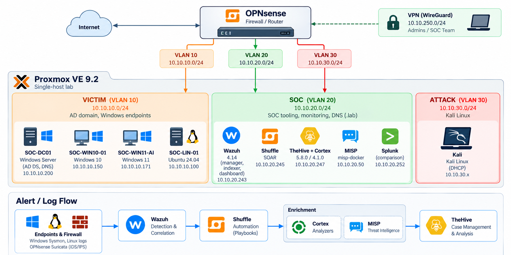

# Lab setup

Single-host lab on **Proxmox VE 9.2**. Firewall/router: **OPNsense** with VLAN-aware bridge. All addresses below are private lab ranges.

## Networks

| Segment | VLAN | Subnet | Role |
|---|---|---|---|
| Management | — | 10.10.99.0/24 | Proxmox & OPNsense admin |
| VICTIM | 10 | 10.10.10.0/24 | AD domain, Windows endpoints |
| SOC | 20 | 10.10.20.0/24 | SOC tooling, internal DNS (`.lab`) |
| ATTACK | 30 | 10.10.30.0/24 | Kali Linux |
| VPN | — | 10.10.250.0/24 | WireGuard (admins / SOC team) |

## Hosts

| Host | Address | Software |
|---|---|---|
| SOC-DC01 | 10.10.10.200 | Windows Server (AD DS, DNS), Sysmon + sysmon-modular, Wazuh agent |
| SOC-WIN10-01 | 10.10.10.150 | Windows 10, Sysmon, Wazuh agent |
| SOC-WIN11-AI | 10.10.10.171 | Windows 11, Sysmon, Wazuh agent |
| SOC-LIN-01 | 10.10.10.100 | Ubuntu 24.04 (Linux endpoint), Wazuh agent — see [runbook](runbooks/linux-agent.md) |
| Kali | VLAN 30 | Kali Linux |
| Wazuh | 10.10.20.243 | Wazuh 4.14 (manager, indexer, dashboard) |
| MISP | 10.10.20.50 | MISP (misp-docker) on Ubuntu 24.04 |
| Shuffle | 10.10.20.245 | Shuffle SOAR |
| TheHive + Cortex | 10.10.20.247 | TheHive 5.8.0, Cortex 4.1.0 (StrangeBee docker, `testing` profile) |
| Splunk | 10.10.20.252 | Splunk (comparison) |

Suricata runs on OPNsense; its alerts are shipped to Wazuh by a Wazuh agent on the firewall.

## Build order

1. Proxmox host, bridges (`vmbr0` uplink, `vmbr1` VLAN-aware trunk).
2. OPNsense: interfaces per VLAN, DHCP/DNS (Unbound), firewall rules, WireGuard.
3. AD domain controller + Windows endpoints, Sysmon.
4. Wazuh all-in-one, agents on endpoints and OPNsense; Suricata on OPNsense.
5. TheHive + Cortex, MISP; connect Cortex and MISP to TheHive.
6. Shuffle; Wazuh `<integration>` webhook → Shuffle.

Step-by-step notes for each component live in [`runbooks/`](runbooks/).

## Infrastructure Overview
The infrastructure is divided into isolated network segments to simulate a realistic enterprise environment. Windows and Linux endpoints generate security events, while dedicated SOC services handle detection, enrichment, automation, and incident investigation.

### Security Monitoring and Alert Flow

1. **Event Collection:** Windows Sysmon, Linux system logs, and OPNsense Suricata generate security telemetry.
2. **Detection:** Wazuh collects, analyzes, and correlates security events.
3. **Automation:** Shuffle receives Wazuh alerts through a webhook and executes automated workflows.
4. **Enrichment:** Cortex analyzers and MISP provide threat intelligence and additional context for detected observables.
5. **Incident Management:** TheHive supports alert triage, investigation, and case management.

The ATTACK network hosts Kali Linux for controlled security testing, while the VICTIM network contains monitored endpoints. SOC services operate in a separate VLAN, with administrative access available through WireGuard VPN.
