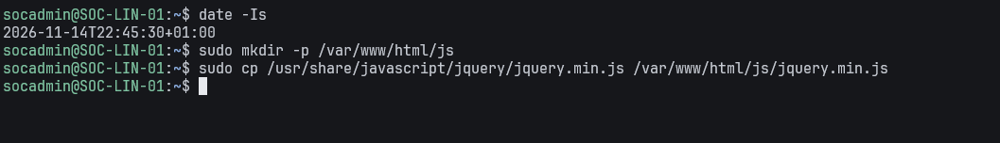
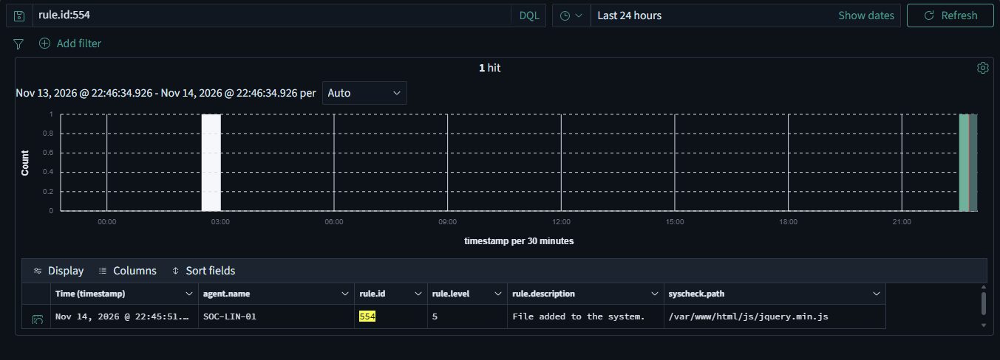
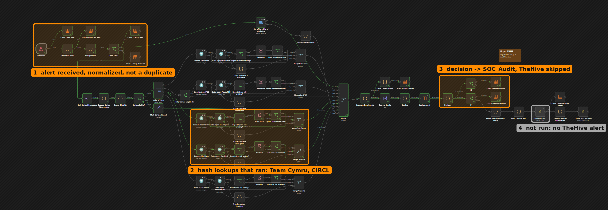
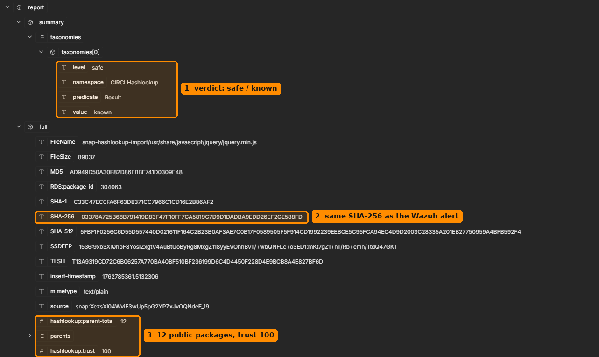
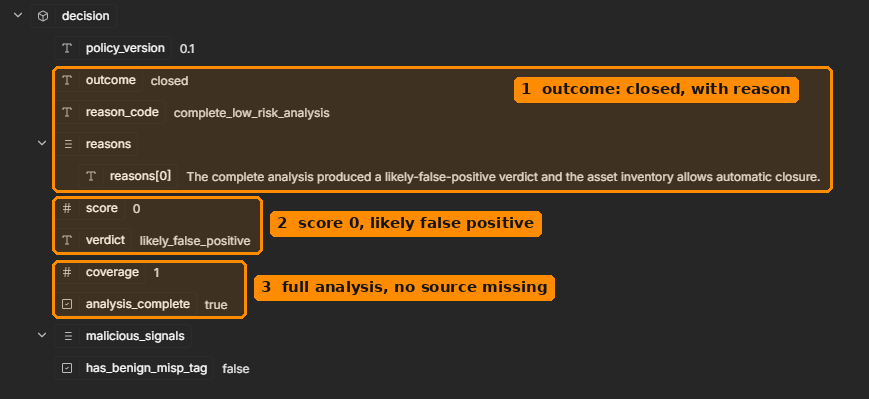
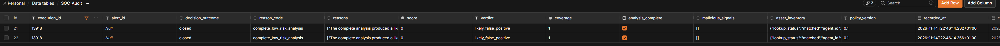

# Proof of concept: three alerts through the live workflow

Issue: #92 · Run on: 15.11.2026 · Run by: @Solivagantaeon

Every stage of the n8n triage workflow was built and tested on its own, mostly with pinned test data in the Webhook node. This page shows the whole chain working at once. Something happens on a lab machine, Wazuh raises an alert, n8n enriches and scores it, and the alert either lands in TheHive or is closed automatically with a written reason.

We ran three alerts, one for each outcome the Decision node can return.

## Results

| # | What we did | Wazuh rule | Expected | Actual | Result |
|---|---|---|---|---|---|
| 1 | Deployed jQuery from the Ubuntu package to the web root on SOC-LIN-01 | 554, File added to the system (level 5) | `closed`, a row in `SOC_Audit`, nothing in TheHive | `closed` (`complete_low_risk_analysis`, score 0), **two** rows in `SOC_Audit`, nothing in TheHive |  PASS |
| 2 | TODO | TODO | `analyst_review`, alert in TheHive | TODO | TODO |
| 3 | TODO | TODO | `malicious`, alert in TheHive with the IOCs attached | TODO | TODO |

TODO: two or three sentences on what the table shows. Say it plainly if something did not go as planned.
<!--First scenario summary -->
Scenario 1 reached the expected outcome: the benign file was closed automatically with a written reason and nothing reached TheHive. The run also showed that enrichment results can reach the decision in separate batches, which recorded the same alert twice in `SOC_Audit` (see [Issues found](#issues-found)).

## What was running

| Item | Value |
|---|---|
| n8n workflow | `SOC - Wazuh alert triage` (ID `JqM02cALddRCz3a4`), published on 2026-11-13 12:07 (+01:00), version `5cb075fd` |
| Node code | `normalize-v1.2.js`, `score-v0.2.js`, `decision-v0.1.js`, `thehive-alert-v0.3.js` from [`soar/n8n/nodes/`](../soar/n8n/nodes/) <!-- confirm these are the versions in the live workflow --> |
| Scoring config | [`score-config.json`](../soar/n8n/nodes/score-config.json) |
| Wazuh integration | `custom-n8n`, two `<integration>` blocks: one forwards alerts at level 12 and above, one forwards selected rules by `rule_id` (added for this PoC, see below) |
| Cortex analyzers used | Hashes: `TeamCymruMHR_1_0`, `CIRCLHashlookup_1_1`, `VirusTotal_GetReport_3_1`. IPs: `AbuseIPDB_2_0`. Several types: `Maltiverse_Report_1_0`. |
| MISP | Attribute search on the lab instance (10.10.20.50) for every observable from the alert. |

Lab machines that take part:

| System | Lab address | Role here |
|---|---|---|
| Kali | 10.10.30.100 | Sends the test requests |
| SOC-LIN-01 (agent `006`) | 10.10.10.100 | Linux endpoint and test web server |
| SOC-WIN10-01 (agent `007`) | 10.10.10.150 | Windows endpoint <!-- delete the row if not used --> |
| Wazuh manager | 10.10.20.243 | Detects and forwards alerts to n8n |
| n8n | TODO | Runs the triage workflow |
| MISP | 10.10.20.50 | Threat intelligence lookup |
| Cortex and TheHive | 10.10.20.247 | Analyzers and the alert queue for the analyst |

All addresses are private lab ranges. API keys, the webhook token and the webhook URL are not on this page or in any screenshot.

### Wazuh integration for the PoC

The default integration forwards only alerts at level 12 and above. Scenario 1 uses rule 554 (level 5), so a second `<integration>` block was added to `ossec.conf` on the Wazuh manager. It forwards rule 554 regardless of its level:

~~~xml
<!-- Second block: forwards selected rules regardless of their level (added for the PoC) -->
<integration>
  <name>custom-n8n</name>
  <hook_url>https://<N8N_HOST>/webhook/<WEBHOOK_PATH></hook_url>
  <api_key><WEBHOOK_TOKEN></api_key>
  <rule_id>554</rule_id>
  <alert_format>json</alert_format>
</integration>
~~~

`<N8N_HOST>`, `<WEBHOOK_PATH>` and `<WEBHOOK_TOKEN>` are placeholders. The real values are kept only on the Wazuh manager.

Without this block the alert from scenario 1 would stay in Wazuh and never reach n8n.

## Before a run

A run only makes sense if these are true:

- The workflow is published and active. Runs from the editor with pinned data do not count here.
- The trigger raises a Wazuh alert that the integration forwards: **level 12 or higher**, or a rule listed in the `rule_id` block (rule 554 for scenario 1). Anything else never reaches n8n.
- The agent is in `soc_asset_inventory`. Without exactly one matching row the alert cannot be closed automatically.
- The alert carries at least one external IP, domain, URL or hash. With nothing to enrich, the decision is always `analyst_review`.
- Each run produces a new Wazuh alert ID. TheHive rejects a second alert with the same `sourceRef`.

For every run we wrote down the same four things: the Wazuh alert, the n8n execution, the Decision output, and where the alert ended up.

## Scenario 1: benign alert, closed automatically

**Why this one:** this is the path that takes work off the analyst.

### What we did

On SOC-LIN-01, the admin deployed the jQuery library from the official Ubuntu package to the web root. This is a routine change: the file comes from a signed distribution package and its hash is publicly known as legitimate. The package was installed a few minutes earlier, so only the copy into the monitored directory triggered the alert

~~~bash
date -Is 
sudo mkdir -p /var/www/html/js
sudo cp /usr/share/javascript/jquery/jquery.min.js /var/www/html/js/jquery.min.js
~~~

Screenshot: commands run on SOC-LIN-01

*Figure 1. Terminal on SOC-LIN-01: start time recorded with `date -Is` (22:45:30), then the file copied to the web root.*

### Wazuh alert

| Field | Value |
|---|---|
| Rule | 554, File added to the system. |
| Level | 5 |
| Agent | SOC-LIN-01 |
| Alert ID | 1794692751.963227 |
| Time | 2026-11-14T22:45:51.315+01:00 |

*Figure 2. Wazuh Discover: rule 554 on SOC-LIN-01 at 22:45:51, 21 s after the file was copied to the web root.*

### n8n execution

Execution 13918, 2026-11-14 22:45:52 (+01:00), took 21.5 s.

*Figure 3. n8n execution 13918: the alert passes normalization, deduplication and enrichment (MISP, Team Cymru, CIRCL), then ends at* Count - TheHive Skipped*;* Create an alert *did not run.*

### Enrichment

| Source | Observable | What came back |
|---|---|---|
| MISP | observables extracted from the alert | no matching attributes (`attribute_count: 0`) |
| Cortex: TeamCymruMHR_1_0 | SHA-256, SHA-1, MD5 of the file | No record found` (not in the malware hash registry) |
| Cortex: CIRCLHashlookup_1_1 | SHA-256 `03378a72…588fd | known file `jquery.min.js` (89 037 B), `hashlookup:trust: 100`, 12 parent packages |

*Figure 4. CIRCL Hashlookup in Cortex knows the file: same SHA-256 as in the Wazuh alert, `hashlookup:trust: 100`, found in 12 public packages.*

### Score and decision

| Field | Value |
|---|---|
| `decision.score` | 0 |
| `decision.verdict` | `likely_false_positive` |
| `decision.coverage` | 1 |
| `decision.analysis_complete` | true |
| `decision.outcome` | closed |
| `decision.reason_code` | omplete_low_risk_analysis |
| Asset | 006 SOC-LIN-01, criticality `standard`, auto-close allowed `true`|

Reason recorded by the workflow: *"The complete analysis produced a likely-false-positive verdict and the asset inventory allows automatic closure."*

*Figure 5. Decision node output: the workflow closed the alert as a likely false positive and recorded why.*

### Where it ended up

`SOC_Audit` has the decision for execution 13918: outcome `closed`, reason `complete_low_risk_analysis`, score 0, recorded at 2026-11-14T22:46:14+01:00. The workflow took the `TheHive skipped` branch (`Count - TheHive Skipped`), and TheHive (organisation `soclab`) has no new alert after 22:45 for alert ID `1794692751.963227`.

*Figure 6. SOC_Audit for execution 13918: the decision is recorded correctly* 

### Issues found

- **Duplicate items after enrichment.** `Summary Enrichments` emits 2 items for one alert, which then go through Scoring and Decision. Result: two `SOC_Audit` rows (id 21 and 22) and two `thehive_skipped` counters for one alert. The decision is correct, but the funnel counters are inflated, and for a non-closed outcome this could create two TheHive alerts. TODO issue #
- **`alert_id` is `null` in `SOC_Audit`**, while the counter table has the correct ID (`1794692751.963227`). TODO issue #

## Scenario 2: unclear alert, sent to the analyst

**Why this one:** the workflow must not guess. When the evidence is incomplete or mixed, a person decides.

### What we did

TODO

~~~bash
TODO command
~~~

### Wazuh alert

| Field | Value |
|---|---|
| Rule | TODO |
| Level | TODO |
| Agent | TODO |
| Alert ID | TODO |
| Time | TODO |

<!--  -->

### n8n execution

Execution TODO id, started TODO, took TODO s.

<!--  -->

### Enrichment

| Source | Observable | What came back |
|---|---|---|
| MISP | TODO | TODO |
| Cortex: TODO analyzer | TODO | TODO |

### Score and decision

| Field | Value |
|---|---|
| `decision.score` | TODO |
| `decision.verdict` | TODO |
| `decision.coverage` | TODO |
| `decision.analysis_complete` | TODO |
| `decision.outcome` | TODO |
| `decision.reason_code` | TODO |
| Asset | TODO |

<!--  -->

### Where it ended up

TODO: the TheHive alert (title, severity, TLP/PAP, `sourceRef` equal to the Wazuh alert ID, observables).

<!--  -->

### Notes

TODO

## Scenario 3: confirmed malicious, prioritised in TheHive

**Why this one:** a real hit from threat intelligence has to reach the analyst with the evidence already attached.

### What we did

TODO. We used a public test artefact (WICAR / EICAR), not real malware.

~~~bash
TODO command
~~~

### Wazuh alert

| Field | Value |
|---|---|
| Rule | TODO |
| Level | TODO |
| Agent | TODO |
| Alert ID | TODO |
| Time | TODO |

<!--  -->

### n8n execution

Execution TODO id, started TODO, took TODO s.

<!--  -->

### Enrichment

| Source | Observable | What came back |
|---|---|---|
| MISP | TODO | TODO |
| Cortex: TODO analyzer | TODO | TODO |

### Score and decision

| Field | Value |
|---|---|
| `decision.score` | TODO |
| `decision.verdict` | TODO |
| `decision.coverage` | TODO |
| `decision.analysis_complete` | TODO |
| `decision.outcome` | TODO |
| `decision.reason_code` | TODO |
| `decision.malicious_signals` | TODO |
| Asset | TODO |

<!--  -->

### Where it ended up

TODO: the TheHive alert (title, severity, observables, which of them are marked as IOC).

<!--  -->

### Notes

TODO

## How long it took

Time from the event on the machine to the final effect. Clocks in the lab are not perfectly in sync, so treat differences of a few seconds as noise.

| # | Event | Wazuh alert | n8n started | n8n finished | Total |
|---|---|---|---|---|---|
| 1 | TODO | TODO | TODO | TODO | TODO |
| 2 | TODO | TODO | TODO | TODO | TODO |
| 3 | TODO | TODO | TODO | TODO | TODO |

## What this does not prove

<!-- Keep what is true, delete the rest, add your own. -->

- These are three hand-picked alerts, not a load test. Alert volumes over a full day are in [`metrics/`](../metrics/README.md).
- The scoring thresholds are lab values and were not calibrated on real traffic.
- `closed` is recorded in `SOC_Audit` only. The workflow does not change the alert status in Wazuh.
- TODO

## Run it again

1. Check the list in [Before a run](#before-a-run).
2. Run the command from the scenario.
3. In n8n open **Executions** and pick the run that matches the time.
4. Compare the Decision output with the table in that scenario.
5. Check TheHive (scenarios 2 and 3) or the `SOC_Audit` table (scenario 1).

If no execution shows up, start with the integration log on the Wazuh manager. The usual suspects are in the troubleshooting tables of the [triage runbook](runbooks/n8n-triage.md).

## Related

- [n8n triage runbook](runbooks/n8n-triage.md): how every node is built and tested
- [ADR 0003](decisions/0003-n8n-triage-workflow.md): why the workflow looks the way it does
- [First end-to-end test](e2e-test.md): the five-node version from 31 October 2026 (#55)