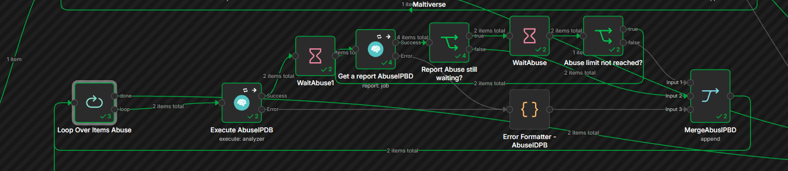
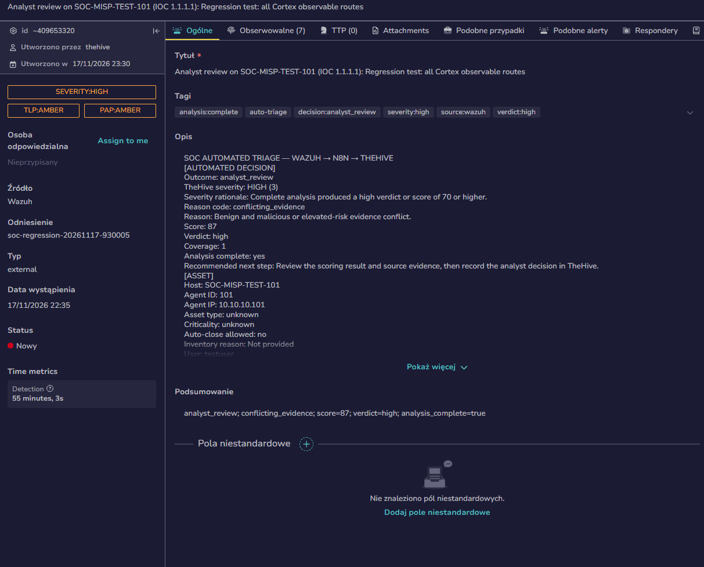
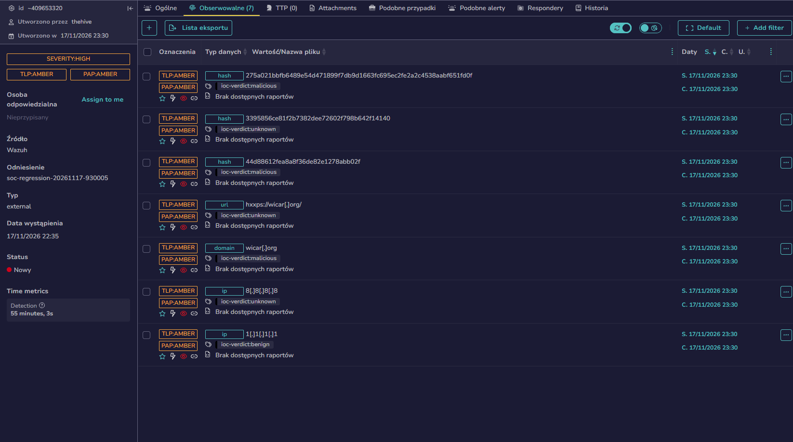

# Regression checks for the live triage workflow

A regression check repeats the condition that exposed a bug and inspects the output that went wrong. The [original live PoC](../poc-live-workflow.md#results) records three alerts sent by Wazuh.

## 93. One decision per alert

**Before.** A late Cortex report started a second decision for the same Wazuh alert. In [scenario 1](../poc-live-workflow.md#issues-found1), execution `13918` wrote two audit rows. In [scenario 3](../poc-live-workflow.md#issues-found-in-the-first-run), execution `16669` created an alert before the MD5 reports arrived. TheHive rejected the second create request for the same `sourceRef`. [Issue #93](https://github.com/Solivagantaeon/soc-automation-lab/issues/93)

**Change.** Each Cortex branch processes one observable at a time and sends its collected results to the final `Merge` through the loop’s `done` output. [Runbook §4](../runbooks/n8n-triage.md#cortex-analyzer-execution-and-report-polling) · [ADR §4](../decisions/0003-n8n-triage-workflow.md#4-misp-and-cortex)

**Check.** For one alert, count the runs of `Merge`, `Summary Enrichments`, `Scoring`, `Decision` and `Create an alert`. Each should run once on the analyst-review path, even when a report needs another poll.

| Manual execution | Runs of each of the five nodes | Completed Cortex jobs | TheHive result |
|---|---:|---:|---|
| `16684` (earlier version `57f015c5`) | 2 | — | Second create request rejected |
| `16685` | 1 | 8 | 1 alert, 5 observables |
| `16686` | 1 | 9 | 1 alert, 6 observables |
| `16687` | 1 | 10 | 1 alert, 7 observables |

**Result.** All five analyzers returned `InProgress` at least once in `16687`. The final summary contained 1 Maltiverse, 2 AbuseIPDB, 3 Team Cymru, 3 CIRCL and 1 VirusTotal result.

Execution 16687 in n8n and TheHive

**Used**
workflow version: 
 -   `0aa15417`
related:
 - [execution data](../../samples/results/n8n/enrichment-regression.json)
 - [example alert](../../samples/alerts/wazuh/n8n-enrichment-regression.json)

## 96. MISP event tags reach Decision

**Before.** In [scenario 2](../poc-live-workflow.md#scenario-2-enrichment-findings), event `1686` tagged `8.8.8.8` as `soc-lab:benign`, but execution `16668` recorded `has_benign_misp_tag: false`. [Issue #96](https://github.com/Solivagantaeon/soc-automation-lab/issues/96)

**Change.** The MISP search requests `includeEventTags: true`. `Summary Enrichments` collects tags from `Tag`, `Event.Tag` and `Event.Tags`. [MISP node settings](../runbooks/n8n-triage.md#misp-branch)

**Check.** Find the `8.8.8.8` match in `misp.unique_indicators`, then inspect `decision.has_benign_misp_tag` in `Decision`.

**Result.** Event `1686` supplied `soc-lab:benign`. The Decision flag was `true` in all three editor runs. [MISP request in n8n](../images/n8n/96-misp-event-tags-search.png) · [Recorded Decision fields](../../samples/results/n8n/enrichment-regression.json)

**Used**
workflow version: 
 -   `0aa15417`
related:
 - [execution data](../../samples/results/n8n/enrichment-regression.json)
 - [example alert](../../samples/alerts/wazuh/n8n-enrichment-regression.json)

## 97. TheHive shows conflicting evidence for an IP

**Before.** The [scenario 2 alert](../poc-live-workflow.md#scenario-2-enrichment-findings) labelled `8.8.8.8` benign. AbuseIPDB whitelisted the IP, but MISP event `1411` also had a matching attribute with `to_ids: true`. [Issue #97](https://github.com/Solivagantaeon/soc-automation-lab/issues/97)

**Change.** `Build TheHive Alert` now counts an IDS-enabled MISP match as adverse evidence for the matching observable. [Runbook §8](../runbooks/n8n-triage.md#8-thehive) · [ADR §8](../decisions/0003-n8n-triage-workflow.md#8-thehive)

**Check.** In TheHive, open `8.8.8.8` on the alert’s **Observables** tab. Read its tag and the evidence in its message.

**Result.** In `16687` the tag was `ioc-verdict:unknown`. The message named the IDS match, the benign MISP tag and the AbuseIPDB whitelist. The whole alert went to `analyst_review` with score `87`.

Per-observable verdicts in the saved TheHive alert

**Used**
workflow version: 
 -   `0aa15417`
related:
 - [execution data](../../samples/results/n8n/enrichment-regression.json)
 - [example alert](../../samples/alerts/wazuh/n8n-enrichment-regression.json)

## 98. MISP references keep distinct attributes

**Before.** The [scenario 2 description](../poc-live-workflow.md#scenario-2-enrichment-findings) showed three identical-looking references to `Updater.exe`. [Issue #98](https://github.com/Solivagantaeon/soc-automation-lab/issues/98)

**Change.** `Summary Enrichments` identifies an attribute by UUID, then by attribute ID. If both are missing, it uses the event ID, type and value when available. The alert builder groups references for one indicator when the event, IDS flag, tags and comment match, and lists their IDs on that line.

**Check.** Compare the distinct attribute IDs with `misp.attribute_count`, then inspect the filename line in `[MISP REFERENCES]`.

| Where we checked | What we observed |
|---|---|
| Saved lab execution `16687` | Nine MISP rows had nine different UUIDs. Event `952` contained three distinct `Updater.exe` attributes. The stored alert still displayed three identical-looking lines. |
| Local replay of the `16687` input with the revised JavaScript | Adding a second copy of attribute `167686` produced ten input rows. `misp.attribute_count` stayed at nine. The builder produced one filename reference listing `167686`, `167695` and `167701`. |

**Result.** The grouped line is verified in the local replay. Its appearance in a newly created TheHive alert still needs lab confirmation. [Attribute IDs in n8n](../images/n8n/98-misp-distinct-attributes.png) · [Saved and replayed results](../../samples/results/n8n/enrichment-regression.json)

**Used** 
workflow version: 
 -   `0aa15417`
related:
 - [execution data](../../samples/results/n8n/enrichment-regression.json)
 - [example alert](../../samples/alerts/wazuh/n8n-enrichment-regression.json)

