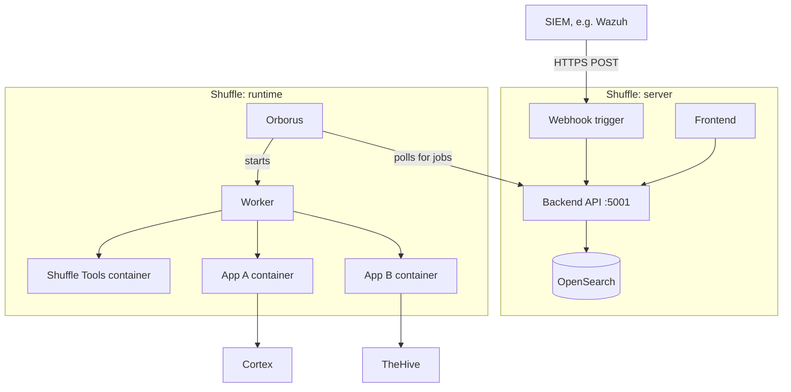
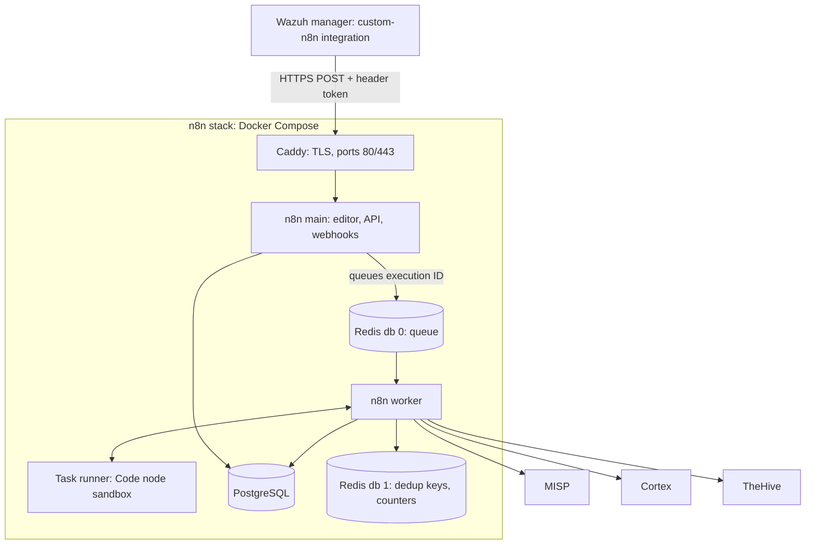
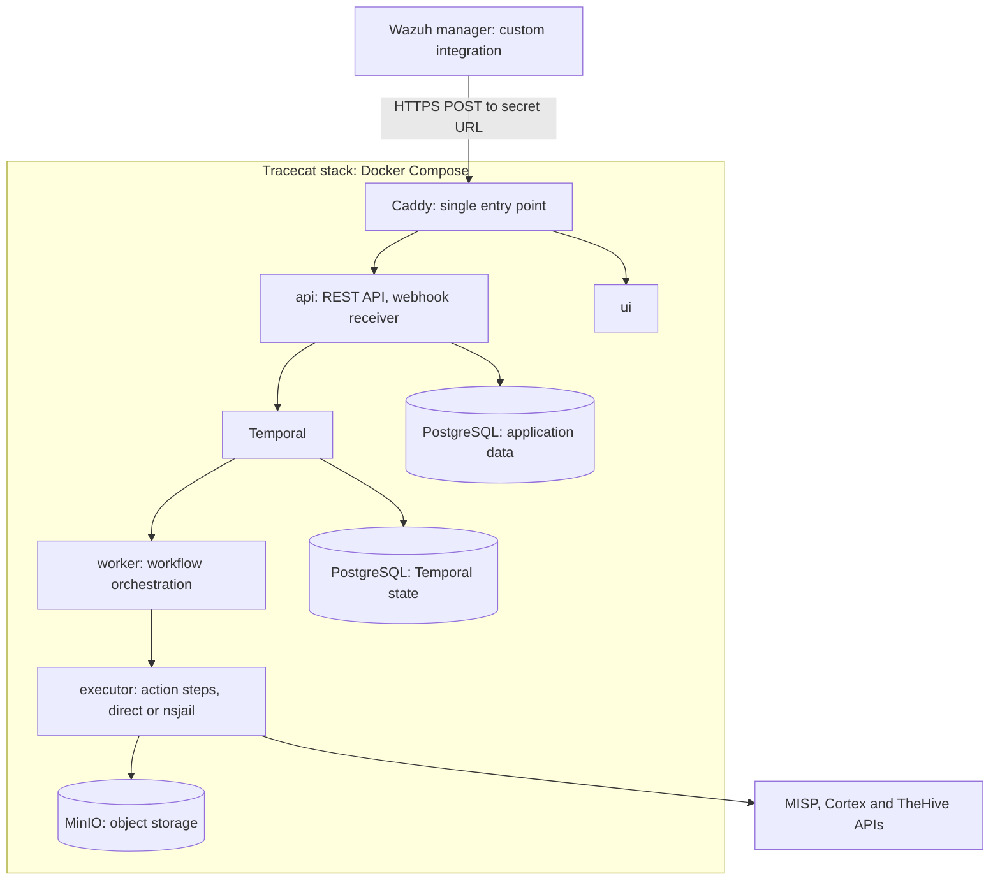
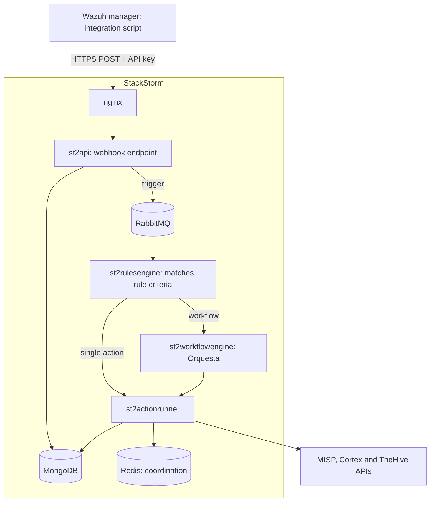

# SOAR engine comparison (research note)

- **Type:** Research note
- **Date:** 2026-10-23
- **Issue:** #56

## 1. Purpose and scope

The SOAR engine is the core of our pipeline: it receives Wazuh alerts, deduplicates and enriches them (MISP, Cortex), scores them and decides what reaches TheHive. This note compares the available engines against the same criteria, so that the trade-offs of our setup are documented.


## 2. Options considered

The comparison focuses on free self-hosted editions. 

| Tool | Type | License |
|---|---|---|
| Shuffle Open Source | Security automation / SOAR | AGPL-3.0 core |
| n8n Community | Workflow automation | Sustainable Use License |
| Tracecat Open Source | Security automation / SOAR | AGPL-3.0 core |
| StackStorm | Event-driven automation | Apache-2.0 |

Paid n8n plans are included to explain differences in collaboration, security and cost.

## 3. Comparison

**Legend:** 
 - Yes = available
 - No = not included
 - External = requires another component
 - TBD = requires clarification.

Feature availability does not mean enabled by default. Detailed mechanisms, limitations and deployment findings belong in **Section 4**.

### 3.1 Workflow capabilities

| Capability | Shuffle OSS | n8n Community | Tracecat OSS | StackStorm |
|---|---|---|---|---|
| Free self-hosting | Yes | Yes | Yes | Yes |
| Workflow automation | Yes | Yes | Yes | Yes |
| Custom code / actions | Yes | Yes | Yes | Yes |
| Outbound API requests | Yes | Yes | Yes | Yes |
| Webhook triggers | Yes | Yes | Yes | Yes |
| Storage for deduplication logic | Yes | Yes | Yes | Yes |
| Workflow export / source format | JSON | JSON | YAML | YAML + code |
| Built-in Git sync | One-way backup to Git | No (paid plans) | No (paid plans) | Packs installed from Git |
| Shared workflow access | Yes | Creator + owner only | Yes | Yes |

### 3.2 Security stack integrations

**Legend:** 
 - Node = built-in n8n integration
 - Integration = documented product integration
 - API = HTTP requests or custom actions
 - Existing = used in our v0.1 pipeline

| Integration / operation | Shuffle | n8n Community | Tracecat OSS | StackStorm |
|---|---|---|---|---|
| Wazuh alert ingestion | Existing webhook | Webhook + forwarding | Webhook + forwarding | Webhook + forwarding |
| MISP IOC lookup | Existing | MISP node / API | Integration / API | API / Python |
| Cortex analyzer execution and results | Existing | Cortex node / API | API | API / Python |
| TheHive alerts and cases | Existing | TheHive / TheHive 5 node | API | API / Python |
| VirusTotal enrichment | Via Cortex | Cortex API / direct API | Integration / Cortex API | API / Python |
| AbuseIPDB enrichment | Via Cortex | Cortex API / direct API | Integration / Cortex API | API / Python |
| Other Cortex analyzers | Via Cortex | Cortex API | Cortex API | Cortex API |

### 3.3 Cybersecurity capabilities

| Capability | Shuffle OSS | n8n Community | Tracecat OSS | StackStorm |
|---|---|---|---|---|
| Local user authentication | Yes | Yes | Yes | Yes |
| Centralised authentication | SAML | No | SAML / OIDC | LDAP / proxy |
| MFA approach | Built-in | Built-in user 2FA | Passkeys / external IdP | External setup |
| Role-based permissions | Tenant roles | Limited | Built-in roles | Configurable RBAC |
| Webhook authentication | Required headers | Basic / Header / JWT | URL secret; additional controls* | API key / token |
| Encrypted credential storage | Yes | Yes | Yes | Yes |
| Audit evidence | Audit logging | Execution/application logs | Organisation audit logs | Action audit logs |
| External secret-store integration | TBD† | No | No | Custom integration |

\* Tracecat: an API key header (`x-tracecat-api-key`) and an IPv4 allowlist can be added to the secret URL (Section 4.3).

† Shuffle: not confirmed. The Shuffle GitHub organisation contains a KMS wrapper for HashiCorp Vault and GCP KMS ([kms-go](https://github.com/Shuffle/kms-go)), but its use for app authentication in a self-hosted installation was not found in the documentation.

**Main security considerations:**

- **Shuffle:** restrict tenant permissions and explicitly configure webhook authentication.
- **n8n:** Community lacks ordinary-user workflow/credential sharing. Restrict unnecessary command and file-access nodes.
- **Tracecat:** protect secret-bearing URLs and select the appropriate executor isolation. Advanced roles and management API capabilities are edition-dependent.
- **StackStorm:** enable RBAC, configure encryption and mark secret parameters/outputs correctly. API keys do not expire automatically.

All platforms require HTTPS, restricted network access, least-privilege credentials and sanitised exports.

### 3.4 n8n self-hosted editions

| Capability | Community | Business | Enterprise |
|---|---|---|---|
| Software price | Free | €667/month, billed annually* | Custom quote |
| Execution allowance | No paid quota specified | 40,000/month* | Custom |
| User-enabled 2FA | Yes | Yes | Yes |
| SSO / LDAP | No | Yes | Yes |
| Shared projects | No | 6 | Unlimited |
| Credential encryption | Yes | Yes | Yes |
| External secret stores | No | No | Yes |
| Built-in log streaming | No | No | Yes |
| JSON export/import | Yes | Yes | Yes |
| Built-in Git integration | No | Yes | Yes |
| Managed environments | No | Yes | Yes |
| Queue mode / workers | Yes | Yes | Yes |
| LLM integration | Yes | Yes | Yes |
| Dedicated support with SLA | No | No | Contract-dependent |

\* Vendor pricing page, checked 2026-11-16. A Startup plan offers 50% off Business for companies with fewer than 20 employees.

### 3.5 LLM integration

| Capability | Shuffle | n8n | Tracecat | StackStorm |
|---|---|---|---|---|
| Integration approach | App / HTTP | Dedicated nodes / HTTP | Provider configuration | Python / REST action |
| Local inference approach | Local endpoint | Ollama node | OpenAI-compatible endpoint | Custom API call |

## Sources for Sections 2–3 

- **Shuffle:** [Licensing](https://github.com/shuffle/Shuffle/blob/master/.github/CONTRIBUTING.md), [Architecture](https://shuffler.io/docs/architecture), [Workflows](https://shuffler.io/docs/workflows), [Pricing](https://shuffler.io/pricing?env=Self-Hosted), [Usage restrictions](https://github.com/orgs/Shuffle/discussions/1958), [AI](https://shuffler.io/docs/AI).
- **n8n:** [Editions](https://docs.n8n.io/hosting/community-edition-features/), [Pricing](https://n8n.io/pricing/), [Export/import](https://docs.n8n.io/workflows/export-import/), [MISP](https://docs.n8n.io/integrations/builtin/app-nodes/n8n-nodes-base.misp/), [TheHive 5](https://docs.n8n.io/integrations/builtin/app-nodes/n8n-nodes-base.thehive5), [Webhook authentication](https://github.com/n8n-io/n8n-docs/blob/main/docs/integrations/builtin/credentials/webhook.md), [Ollama](https://docs.n8n.io/integrations/builtin/cluster-nodes/sub-nodes/n8n-nodes-langchain.lmchatollama).
- **Tracecat:** [Repository](https://github.com/TracecatHQ/tracecat), [Pricing](https://www.tracecat.com/pricing), [Workflows](https://docs.tracecat.com/automations/workflows), [Webhooks](https://docs.tracecat.com/automations/triggers/webhooks), [Security](https://github.com/TracecatHQ/tracecat/blob/main/SECURITY.md), [VirusTotal](https://docs.tracecat.com/tools/virustotal), [AbuseIPDB](https://docs.tracecat.com/tools/abuseipdb), [LLM providers](https://docs.tracecat.com/agents/custom-llm-providers).
- **StackStorm:** [License](https://github.com/StackStorm/st2/blob/master/LICENSE), [Overview](https://docs.stackstorm.com/overview.html), [Authentication](https://docs.stackstorm.com/authentication.html), [RBAC](https://docs.stackstorm.com/rbac.html), [Datastore](https://docs.stackstorm.com/datastore.html), [Secret masking](https://docs.stackstorm.com/reference/secrets_masking.html).
- **Supporting services:** [Cortex](https://github.com/TheHive-Project/Cortex), [Ollama authentication](https://docs.ollama.com/api/authentication).

- done by @MKonrad-afk (blame on me ;); Status- proposed

## 4. Research notes

<!-- Jedna podsekcja na temat: co sprawdzałeś, jak (docs / test w labie), co wyszło, linki. Reasercherujemy pod kątem odpowiadania na poniższe pytania -->

### 4.1 Shuffle 

#### Overview
Shuffle is an open-source SOAR platform, written mainly in Go and released under the AGPL-3.0 licence and designed specifically for security teams. Its app catalogue, example workflows and integrations focus on SIEM alert handling, threat intelligence and incident response. The platform enables users to connect security tools and automate tasks through visual workflows. In September 2025, Shuffle and Wazuh announced an official technology partnership.

#### Architecture

A Shuffle installation consists of two layers: the server and the runtime. The server layer comprises the frontend, the backend API (a Go service on port 5001) and an OpenSearch database that stores user accounts, workflows, apps and execution results. The actual processing takes place in the runtime layer. The **Orborus** component periodically polls the backend for new jobs and starts a separate **worker** for each workflow execution. The worker in turn starts every workflow step (every "app") as a separate, short-lived Docker container.



*Figure 1. Alert flow through Shuffle's components.*

Running steps in containers limits the propagation of some failures, because a crash of an app process stays within its container. It does not eliminate mutual impact, however: a failed step stops the steps that depend on it, and exhaustion of shared host resources (CPU, memory, the Docker daemon) affects other executions. Starting a separate container for every step adds container start-up time and resource usage to each executed action. The documentation also distinguishes two execution modes. Workflows started manually from the editor run with a live view, while workflows started by a trigger, such as a webhook, run in an optimised mode in which the full results appear in the interface only after the execution has finished.

The minimum requirements for a test environment are 2 vCPU, 4 GB RAM and 30 GB of disk space, with OpenSearch being the most memory-intensive component. The number of parallel executions is controlled by `SHUFFLE_ORBORUS_EXECUTION_CONCURRENCY`. The documentation gives inconsistent defaults for this parameter: 10 in the configuration reference and 5 in the installation guide, so the effective value should be read from the configuration of the given deployment. Larger deployments can move the runtime layer to Docker Swarm or Kubernetes. From a security perspective, in the basic deployment Orborus uses the host's Docker socket (`/var/run/docker.sock`), which in practice amounts to root-level privileges. The Shuffle host should therefore be isolated from the rest of the infrastructure.

#### Alert ingestion

Wazuh includes a built-in `shuffle` integration, so basic alert forwarding requires no custom code. The configuration consists of three steps:

1. Add a webhook trigger to the workflow, connect it to the first action, and save the workflow. Activate the webhook with the *Start* button and copy the address from the *Webhook URI* field.
2. Add an `<integration>` block inside the `<ossec_config>` element in `/var/ossec/etc/ossec.conf` on the Wazuh manager. Replace the example URL below with the webhook URI copied from Shuffle:

```xml
<integration>
  <name>shuffle</name>
  <hook_url>__SHUFFLE_WEBHOOK_URI__</hook_url>
  <level>3</level>
  <alert_format>json</alert_format>
</integration>
```

3. Restart the Wazuh manager: `systemctl restart wazuh-manager`.

The `level`, `rule_id` and `group` filters determine which alerts are forwarded. In the example above, `<level>3</level>` selects alerts with severity level 3 or higher. Without integration filters, no additional filtering is applied to the alerts generated by Wazuh; this does not mean that all collected events are forwarded. On the Shuffle side, the body of the POST request becomes the execution argument of the workflow. The webhook can require specific HTTP headers: every configured header must be present with the expected value. This requires corresponding support on the sending side; the basic Wazuh configuration shown above does not configure additional authentication headers. Other alert sources can use the same mechanism by sending HTTP POST requests to the webhook URL.

#### Building logic

A Shuffle workflow is a graph of actions connected by branches. Input data is available as the execution argument (`$exec`), and the results of previous steps are referenced by their names (e.g. `$step_name`), including JSON fields (e.g. `$exec.rule.level`). Liquid templates are additionally used to format and transform values. Auxiliary logic is provided by the built-in **Shuffle Tools** app, which can, among other things, set variables, filter and merge lists, parse data and execute Python code. Iteration over lists is done directly in action parameters with the `.#` syntax. For nested loops and large lists, the documentation recommends subflows, with each item passed to a separate execution of a child workflow. Branches can carry conditions, and a *user input* trigger can pause an execution until an analyst approves an action, which is useful wherever automated response requires human control.

#### Deduplication and state

Data is persisted between executions in the **Datastore**, a persistent key-value store shared across workflows within a tenant; entries remain until they are deleted. It is accessed through the *Set / Get / Delete / List cache* actions in Shuffle Tools and through the API. The documentation describes a basic deduplication pattern: the workflow builds a key for an incoming item, checks whether it exists in the Datastore and, if it does not, processes the same alert. The documentation does not describe an atomic check-and-set operation for the Datastore. The key must be deterministic: items considered duplicates must produce the same key. An alert ID can identify repeated deliveries of the same alert, while grouping similar alerts requires a key derived from selected alert fields. The same store can hold counters for event correlation or a local cache of known IOCs.

Three issues should be considered when designing deduplication:

- **Time window.** A window such as "the same alert within 15 minutes" can be implemented by storing a timestamp as the key's value and comparing it when the next alert arrives. The workflow must define whether the window is measured from the last successful processing or the last occurrence, and update the timestamp accordingly. A periodic clean-up workflow can keep the store tidy but is not required for the deduplication decision itself.
- **Concurrency.** A sequence of separate read and write actions does not itself provide an atomic check-and-reserve operation. Two simultaneous executions may both find the key absent and process the same alert.
- **Failure handling.** Writing the key before processing finishes may cause a retried alert to be skipped if the first execution fails. Writing it afterwards avoids that particular failure mode, but an execution that fails after performing an external action and before storing the key may repeat the action on retry. The workflow should therefore account for partial failures and, where possible, make response actions idempotent, so that repeating them does not produce additional effects.

#### Integrations

Shuffle provides integrations with tools and services commonly used in SOC environments.[^apps] The table below distinguishes incoming alert forwarding from actions performed through external APIs.

| Component | Integration mechanism | Purpose |
|---|---|---|
| Wazuh — alert forwarding | Built-in `shuffle` integration on the Wazuh manager, sending alerts to a Shuffle webhook | Start workflows from Wazuh alerts |
| Wazuh — API access | Wazuh app | Query or manage Wazuh resources through the actions exposed by the app |
| Cortex | Cortex app | Submit observables for analysis and retrieve results |
| MISP | MISP app | Query and manage threat intelligence data |
| TheHive | TheHive app | Create and update alerts, cases and observables |
| VirusTotal | VirusTotal app | Retrieve threat intelligence and analysis reports |
| AbuseIPDB | AbuseIPDB app | Check IP reputation and report abusive activity |
| Other systems | HTTP app or a custom app | Interact with APIs not covered by an existing app |

*Table 1. Integration mechanisms and example uses for SOC tools and services.*

Shuffle supports apps written in Python and apps generated from OpenAPI specifications. Available actions and API compatibility depend on the selected app and its version; the presence of an integration does not imply support for every operation exposed by the external system.

Systems without a suitable ready-made app can be accessed through the generic HTTP app or by creating an app from an OpenAPI specification in the App Creator. When the **App Authentication** mechanism is used, credentials are stored separately from the workflow definition and can be reused within the tenant. Workflow actions reference the selected authentication configuration by its identifier, rather than embedding the secret values directly in the workflow definition.

#### Version control

Workflows can be exported as JSON files and imported into another Shuffle instance. After import, app authentication may need to be configured or reassigned. Exported definitions should be checked before committing them to a repository: secrets entered directly into action parameters, variables or code may remain in the exported file.

Shuffle provides workflow revisions that allow earlier versions to be restored from the interface. It also supports automatic workflow backups to a configured GitHub or Azure DevOps repository when changes are saved or workflows are executed. These mechanisms support change tracking and recovery of workflow definitions; they do not replace backups of the complete Shuffle installation.

#### Security

Access is organised by tenant, with three documented roles: **admin**, **user** and **reader**. Administrators have access to all tenant information; users can read and modify workflows, apps, files, Datastore entries and triggers, while readers have read-only access to those resources. Shuffle supports MFA and SAML-based SSO, and administrators can require MFA for tenant members.

User passwords are hashed with bcrypt. The architecture documentation describes AES-256 encryption for app authentication data, protected Datastore entries and files. For self-hosted deployments, app credential encryption must be configured using `SHUFFLE_ENCRYPTION_MODIFIER`; it should not be assumed to be enabled merely because encryption is supported. This secret should be set before storing production credentials and backed up securely. Losing or changing it prevents existing app authentications from being decrypted unless the original secret is restored; otherwise, the credentials must be entered again.

Each workflow execution receives a temporary token that, according to the documentation, remains valid while the execution is running and grants access to a limited set of Shuffle APIs used by apps.This scope restriction applies to Shuffle API access; permissions in external systems depend on the credentials assigned to each app.

The documented minimum password length for local installations is eight characters. Deployment policies should require stronger passwords and enable MFA rather than relying solely on this minimum.

#### Licence and usage limits

The vendor’s documentation specifies a default allowance of **25,000 app runs per month** for an on-premises installation without an additional licence. Other documented limits include three sub-tenants, one environment and no branding customisation. The vendor also states that a valid on-premises licence is required for production use or scaling beyond the default limits. These deployment terms should be distinguished from the AGPL-3.0 licence covering the open-source code.

The allowance is expressed in app runs rather than incoming alerts. Processing a single alert may require multiple actions, so the number of alerts that can be handled within the allowance depends on the workflow design. Deduplication checks and additional processing steps also need to be included when estimating usage.

### 4.2 n8n

<!-- Engine currently used in the pipeline. Can be based on our deployment (soar/n8n/) and lab tests: architecture (queue mode), alert ingestion, building logic, deduplication and state, integrations, version control, security, licence. -->

**Method:** lab deployment and tests (2026-10-22 to 2026-11-13) and vendor documentation (checked 2026-11-16). Statements marked *(lab)* come from our deployment; everything else comes from documentation and was not re-tested.

#### Overview

n8n is a general-purpose workflow automation platform. It is not built specifically for security teams, and its source is available under the Sustainable Use License rather than an open-source licence. Its node catalogue nevertheless covers our stack: there are built-in nodes for TheHive (one for API v3/v4 and a separate TheHive 5 node), Cortex and MISP. n8n has been the engine of our pipeline since 2026-10-22, when it replaced Shuffle. The lab runs the self-hosted Community edition, version 2.44.6 *(lab)*.

#### Architecture

Our deployment uses **queue mode**, in which the roles of receiving and executing work are split between processes. The **main** instance serves the editor and the API, receives webhook calls and timers, creates an execution and puts its ID on a queue in **Redis**. A **worker** takes the ID from the queue, loads the workflow from **PostgreSQL**, runs it and writes the result back. Code written in Code nodes does not run inside the worker: it is handed to a separate **task runner** container. A Caddy reverse proxy terminates TLS and is the only container with published ports *(lab)*.



*Figure 2. Alert flow through the n8n queue-mode deployment used in the lab.*

Unlike Shuffle, n8n does not start a container for every step. All nodes of an execution run in the worker process, and only Code node scripts cross a process boundary. This removes the per-step start-up cost, at the price of weaker isolation between steps.

Observations from the lab *(lab)*:

- The stack runs on one VM with 4 vCPU and 8 GB RAM. After start-up the containers used about 610 MB of RAM in total (main about 300 MB, worker about 230 MB, PostgreSQL about 60 MB), and the whole VM about 1.5 GB.
- The first webhook request after a restart took 1.6 s because the task runner started cold; the next one took 0.06 s.
- A workflow imported and published from the command line kept running in its old version. In queue mode the published version is cached in Redis, and neither the CLI nor a container restart clears that cache. Publishing from the editor does. After a CLI deployment the cache keys have to be deleted by hand.

Scaling and limits from the documentation:

- A worker runs 10 executions in parallel by default (`--concurrency`). More capacity means more workers; in our Compose file each worker needs its own task runner.
- Webhook processors can be added to spread incoming requests. Running several main instances for high availability is limited to the self-hosted Enterprise edition, so in the Community edition the main instance is a single point of failure for receiving alerts.
- In queue mode binary data is stored in the database by default. Filesystem storage needs a volume shared by all processes.

#### Alert ingestion

Wazuh has no built-in n8n integration. Two approaches were tried *(lab)*:

1. **The built-in `shuffle` integration pointed at an n8n webhook.** It sends the alert as a JSON POST, so n8n can parse it, but it cannot send an authentication header and it does not verify the server certificate. In our lab it also failed with `UnicodeDecodeError` on Windows alerts containing bytes that are not valid UTF-8.
2. **A custom integration script, `custom-n8n` (our choice).** It runs under the Python interpreter shipped with Wazuh, sends the token from `<api_key>` in a request header, verifies the n8n certificate against the lab CA, replaces undecodable bytes instead of failing, and writes one line per alert to `integrations.log`.

```xml
<integration>
  <name>custom-n8n</name>
  <hook_url>__N8N_WEBHOOK_URL__</hook_url>
  <api_key>__N8N_WEBHOOK_TOKEN__</api_key>
  <level>12</level>
  <alert_format>json</alert_format>
</integration>
```

On the n8n side the entry point is a **Webhook** node. The documentation lists Basic, Header and JWT authentication and an optional IP allowlist; requests from other addresses are answered with 403. The default payload limit is 16 MB. A workflow has a test URL, used from the editor, and a production URL that exists only after the workflow is published. Our webhook uses Header authentication and the *Immediately* response mode, so Wazuh gets its answer before enrichment starts; this matters because one Cortex job may take up to a minute and the integration script times out after 10 seconds *(lab)*.

Test results *(lab)*: a request without the token or with a wrong token returned 403; a real alert (rule 31103) travelled from an agent through the manager to a finished n8n execution.

The integration filter decides what the engine sees. It was first a list of rule IDs, because Suricata alerts arrive at level 3 and a level filter would either drop them or let everything through. Since 2026-11-13 the filter is `level` 12 or higher, which excludes those Suricata alerts and several web and FIM rules. Whichever filter is used, n8n sees only part of the alerts, so the first stage of the alert funnel has to be counted in the Wazuh indexer, not in n8n.

#### Building logic

A workflow is a graph of nodes. Data moves between nodes as a list of items, and most nodes run once per item, so simple iteration needs no loop construct. Values are referenced with expressions such as `{{ $json.rule.level }}` or, for the output of a named node, `$('Normalize').first().json`. Branching uses IF and Switch nodes, explicit batching uses Loop Over Items, and a workflow can call another one as a sub-workflow. Wait nodes and the "send and wait for response" operations of messaging nodes pause an execution until a person responds, which covers response actions that need approval. Every node can be set to retry or to continue on error, and a separate error workflow can be attached to a workflow.

Custom logic goes into **Code** nodes (JavaScript; Python is available but was not tested in the lab). Two styles exist in our lab *(lab)*:

- The reference triage workflow keeps the code of each Code node in a separate file, builds the workflow JSON with a script and tests the same files offline with mocked Redis, MISP and Cortex responses. Calls to MISP, Cortex and TheHive are HTTP Request nodes with Header authentication, set to continue on error so that an unavailable service does not lose the alert.
- The team workflow (`SOC - n8n E2E Skeleton`) uses the built-in MISP, Cortex and TheHive nodes.

A `dry_run` switch in a configuration node lets the whole chain run without creating TheHive alerts. In n8n 2.x, edits in the editor are a draft until the workflow is published *(lab)*.

#### Deduplication and state

n8n offers several places to keep state between executions:

| Mechanism | What it gives | Limits |
|---|---|---|
| Remove Duplicates node, "items processed in previous executions" | Remembers values seen in earlier executions, per node or per workflow; default history of 10,000 items | The documentation describes no time window or expiry, and no behaviour under concurrent executions |
| Data tables | Tables stored inside n8n, available in all editions; usable as a key-value store | 50 MB by default on self-hosted instances; no expiry, so a window needs a timestamp column and clean-up |
| External store through a node (Redis, PostgreSQL) | Full control over keys, expiry and atomic operations | One more credential and dependency; Redis is already part of the queue-mode stack |

*Table 2. State mechanisms available for deduplication in n8n.*

Our workflow uses Redis *(lab)*. The Normalize step builds a deterministic key from the rule ID, the Suricata signature ID, the agent ID and the most specific observable (`soc:dedup:<rule>:<signature>:<agent>:<observable>`). A Redis node runs `INCR` on that key with a time-to-live of 600 seconds, in a database separate from the n8n queue. A result of 1 means the alert is new; anything higher means a duplicate.

How this design answers the three issues raised in Section 4.1:

- **Time window.** The window comes from the key's time-to-live, so no clean-up workflow is needed. One point is still open: if the Redis node renews the time-to-live on every increment, the window is measured from the last occurrence and a continuous stream of duplicates never produces a second alert. This has to be checked in the lab (send duplicates for longer than 10 minutes and watch `TTL` on the key).
- **Concurrency.** `INCR` is atomic. Two executions that start at the same moment cannot both receive 1, so the race described for separate read and write actions does not occur.
- **Failure handling.** The key is written before processing. If an execution fails after the increment, a retry of the same alert inside the window is treated as a duplicate and skipped. The workflow is fail-open in the other direction: when Redis is unreachable, the alert is processed.

**Gap compared with v0.1.** A duplicate is currently counted and dropped, and the existing TheHive alert is not touched, so an analyst cannot see that the activity continues. The Shuffle workflow from v0.1 updated the existing alert and its duplicate counter. Closing the gap in n8n needs two changes: store the TheHive alert ID next to the dedup key when the alert is created, and on a duplicate call the TheHive 5 node (Alert, Update) or `PATCH /api/v1/alert/{id}` to raise a counter and a last-seen time.

TheHive itself adds a second safety net. An alert is identified by `type`, `source` and `sourceRef`, and `sourceRef` is documented as a unique reference; the legacy API documentation states that creating a second alert with the same three values is refused. Our payload uses the Wazuh alert ID as `sourceRef`, so re-sending the same alert should not create a second TheHive alert. This should be confirmed on TheHive 5.8.

#### Integrations

| Component | Integration mechanism | Purpose and lab status |
|---|---|---|
| Wazuh, alert forwarding | Custom integration script on the manager, sending alerts to an n8n webhook | Start workflows from Wazuh alerts; working *(lab)* |
| Wazuh, API access | HTTP Request node | Not used yet; needed for Active Response |
| MISP | MISP node, or HTTP Request to `/attributes/restSearch` | IOC lookup for observables; API reachable *(lab)* |
| Cortex | Cortex node (execute analyzer, get job and job report, execute responder), or HTTP Request | Run analyzers and collect reports; API reachable *(lab)* |
| TheHive | TheHive 5 node (alerts: create, update, search, merge into case, promote, update status; cases, observables, comments, tasks), or HTTP Request to `/api/v1/alert` | Create alerts for analysts; alert creation verified end-to-end on 2026-10-22 *(lab)* |
| VirusTotal, AbuseIPDB | Through Cortex analyzers, or direct HTTP Request | Reputation of external observables only; internal addresses are not sent |
| Redis | Redis node | Deduplication keys and daily funnel counters *(lab)* |
| Local LLM | Ollama model node | Planned for `needs_review` alerts only |
| Other systems | HTTP Request node, or a community node | APIs without a built-in node |

*Table 3. Integration mechanisms for our stack in n8n. On 2026-10-22 the MISP and Cortex calls reached the APIs but their API keys were not yet configured; update this table when enrichment has been tested with keys.*

The built-in nodes save configuration work, while HTTP Request nodes give full control over the request, the response and error handling. A node covers the operations its author implemented, so each operation we need should be checked against the node, as with Shuffle apps.

#### Version control

Workflows are exported and imported as JSON, from the editor or with the CLI (`export:workflow`, `import:workflow`). An exported workflow refers to credentials by ID and name and does not contain their secret values; a credential export is a separate command and must never be committed. Before a workflow goes to the repository, pinned test data should be removed, because it can contain real alert content.

The built-in Git integration and environments belong to the Business and Enterprise plans. The Community edition keeps one day of workflow history after registration. Our process is therefore manual: export the JSON, review it in a pull request, import it on the instance. Keeping Code node scripts as separate files and generating the JSON from them makes the reviewed diff readable *(lab)*.

#### Security

- **Accounts and sharing.** The Community edition has an owner and members; admin accounts require a paid plan. Workflows and credentials cannot be shared: only their creator and the instance owner can open them. For team work this is the most limiting gap. Our team currently works on one shared account so that everyone sees all workflows and credentials, which removes per-user accountability *(lab)*.
- **Authentication.** Users can enable two-factor authentication for their own account. SSO, including SAML and LDAP, is a paid feature.
- **Credentials.** Stored credentials are encrypted with `N8N_ENCRYPTION_KEY`. The key must be identical on the main instance and all workers, and a database backup is useless without it. External secret stores are an Enterprise feature.
- **Code execution.** With an external task runner, Code node scripts run in a separate container that does not hold the encryption key *(lab)*. `NODES_EXCLUDE` removes nodes that give access to the host, such as Execute Command and Read/Write Files from Disk; the documentation suggests blocking them when users are not fully trusted.
- **Webhook.** Header token plus TLS from the internal CA; PostgreSQL, Redis and n8n itself are reachable only on the Docker network *(lab)*.
- **Known lab gap.** Calls from n8n to TheHive, Cortex and MISP run with certificate verification disabled because those services use self-signed certificates without the address in the SAN *(lab)*.
- **Audit.** The Community edition has execution history and application logs but no audit log of user actions; log streaming is an Enterprise feature. Execution history stores alert payloads, so its retention (14 days or 50,000 executions in the lab) is also a data-retention setting. A built-in security audit command reports risky settings.
- **Vulnerabilities.** Between December 2025 and March 2026 several critical remote code execution flaws were published for n8n, including CVE-2026-21858, which needed no authentication and was rated CVSS 10.0, CVE-2026-21877, CVE-2026-25049 and a group of fixes released on 2026-03-25. Most of them require an account that can edit workflows. The lab version is newer than the fixed releases named in those advisories, but the history shows that a self-hosted instance needs a routine for reading advisories and updating, and that the editor must not be reachable from untrusted networks.

#### Licence and usage limits

The Sustainable Use License allows use and modification for internal business purposes and for non-commercial or personal use, and allows redistribution only free of charge for non-commercial purposes. It is not an open-source licence. Our educational, non-commercial lab fits these terms. An MSSP could automate its own operations with n8n but could not offer n8n to customers as a hosted product without a commercial agreement.

The Community edition has no execution quota: capacity is limited by hardware and worker concurrency. This is the main practical difference from Shuffle's monthly app-run allowance. Paid self-hosted plans start with Business at €667 per month billed annually, with 40,000 executions per month (Section 3.4).

**Sources:** [Queue mode](https://docs.n8n.io/hosting/scaling/queue-mode/), [Task runners](https://docs.n8n.io/hosting/configuration/task-runners/), [Webhook node](https://docs.n8n.io/integrations/builtin/core-nodes/n8n-nodes-base.webhook/), [Remove Duplicates node](https://docs.n8n.io/integrations/builtin/core-nodes/n8n-nodes-base.removeduplicates/), [Data tables](https://docs.n8n.io/data/data-tables/), [TheHive 5 node](https://docs.n8n.io/integrations/builtin/app-nodes/n8n-nodes-base.thehive5), [Cortex node](https://docs.n8n.io/integrations/builtin/app-nodes/n8n-nodes-base.cortex/), [MISP node](https://docs.n8n.io/integrations/builtin/app-nodes/n8n-nodes-base.misp/), [Community edition features](https://docs.n8n.io/hosting/community-edition-features/), [Account types](https://docs.n8n.io/administer/manage-users-and-access/understand-account-types), [Securing n8n](https://docs.n8n.io/hosting/securing/overview/), [Blocking nodes](https://docs.n8n.io/hosting/securing/blocking-nodes), [Sustainable Use License](https://docs.n8n.io/n8n-community-license/sustainable-use-license), [Pricing](https://n8n.io/pricing/), [TheHive4py alert examples](https://thehive-project.github.io/TheHive4py/latest/examples/alert), [TheHive legacy alert API](https://docs.thehive-project.org/thehive/legacy/thehive3/api/alert/). Vulnerability reports: [The Register on CVE-2026-21858](https://www.theregister.com/2026/01/08/n8n_rce_bug/), [Indusface on CVE-2026-21858](https://www.indusface.com/blog/cve-2026-21858-ni8mare-n8n-remote-code-execution/), [Upwind on CVE-2026-21877](https://www.upwind.io/feed/cve-2026-21877-n8n-authenticated-rce), [SecureLayer7 on CVE-2026-25049](https://blog.securelayer7.net/cve-2026-25049/), [Geordie advisory, March 2026](https://www.geordie.ai/resources/technical-advisory-n8n---multiple-vulnerabilities---march-2026/).

### 4.3 Tracecat

**Method:** documentation review only (checked 2026-11-16). Tracecat was not deployed in the lab, so resource usage, stability and the exact behaviour of the features below are untested.

#### Overview

Tracecat is a security automation platform that combines workflows, case management, lookup tables and AI agents. The repository is licensed under AGPL-3.0, except for the `packages/tracecat-ee` directory and the code that gates Enterprise Edition features. It is written mainly in Python (FastAPI) with a Next.js frontend. Releases are still numbered as betas (1.0.0-beta.50 in the installation guide at the time of writing), and the project asks users to read the changelog before every update.

#### Architecture

Tracecat does not implement its own execution engine. Workflow runs are handled by **Temporal**, a durable workflow engine that persists the state of every run and replays it after a failure. The `worker` service orchestrates workflow runs, and the `executor` service runs individual action steps. Application data is stored in PostgreSQL, Temporal has its own PostgreSQL database, files go to an S3-compatible store (MinIO in the bundled stack), and Redis is used as a cache and message broker. Caddy is the only service exposed outside the stack.



*Figure 3. Simplified alert flow through Tracecat, based on the service list in the architecture documentation. Agent services, the LLM gateway, the MCP server and Redis are omitted.*

The architecture page lists 16 services for Docker Compose, including four that exist only for AI agents and LLM routing. That is considerably more than the six containers of our n8n stack. The documentation states Docker 26 and Docker Compose 2.29 as prerequisites but gives no minimum CPU or memory figures, so sizing would have to be measured.

The executor has two backends, and the choice is the main architectural decision:

- `direct` runs scripts and custom actions as ordinary subprocesses without a sandbox. It is the default for Docker Compose.
- `nsjail` runs each execution in a sandbox with filesystem isolation, resource limits and a separate user namespace. Every action then starts cold, which the documentation puts at about 4 seconds per action, and the executor container needs privileged mode or `CAP_SYS_ADMIN`.

For our pipeline this is a trade-off between isolation and latency: a triage run with ten actions would spend roughly 40 seconds on sandbox start-up alone.

#### Alert ingestion

A workflow is started by a **webhook** whose URL contains a secret. The workflow has to be published first. POST is the main method; the parsed JSON body becomes `TRIGGER`, so fields are read as `${{ TRIGGER.rule.level }}`. A body in NDJSON format starts one run per line. By default the webhook answers immediately with the workflow and execution IDs and does not wait for the run.

Two optional controls can be added to the secret URL: an API key that the sender must put in the `x-tracecat-api-key` header, and an allowlist of IPv4 addresses or ranges. Behind a proxy the allowlist depends on the original client address being forwarded correctly.

Wazuh has no built-in Tracecat integration. The built-in `shuffle` integration could post alerts to the secret URL but cannot send the API key header, so the options are the same as for n8n. Our `custom-n8n` script could be reused after changing the header name and the URL.

#### Building logic

A workflow is defined in YAML as a list of actions. Each action has a reference name, an action ID and arguments, and can declare dependencies (`depends_on`), a condition (`run_if`) and iteration (`for_each`). Expressions use the `${{ ... }}` syntax with contexts such as `TRIGGER`, `ACTIONS.<ref>.result`, `SECRETS.<name>.<key>` and built-in functions under `FN`. Core actions cover HTTP requests, Python scripts, table operations and case operations. The documentation also lists subflows, scatter-gather and while loops, and error workflows.

Custom Python code can be added in two ways: inline through a script action, or as functions in a Git repository that Tracecat syncs as a custom registry. The second option would fit our current practice of keeping node code in separate, reviewable files, although the JavaScript would have to be rewritten in Python.

Human approval of sensitive tool calls is listed as an Enterprise Edition feature. Tracecat also has built-in case management, which overlaps with TheHive; using both would need a decision about which system holds the cases.

#### Deduplication and state

State between runs is kept in **tables**, accessed with `core.table.*` actions. Two actions matter for deduplication: `core.table.lookup` (or `core.table.is_in`) checks whether a value exists in a column, and `core.table.insert_row` with `upsert: true` updates the existing row when the value collides with a unique index.

- **Concurrency.** With a unique index on the dedup key, uniqueness is enforced by the database, not by a read followed by a write. This is stronger than a plain key-value read and write, but whether a workflow can tell "inserted" from "updated" in one step should be tested before relying on it as a check-and-reserve operation.
- **Time window.** The documentation describes no expiry for rows. A window has to be built with a timestamp column (for example `last_seen`) compared in a `run_if` condition, plus a scheduled clean-up workflow.
- **Failure handling.** Temporal persists run state and can retry failed steps, which reduces lost runs. Repeating an external action on retry is still possible, so idempotent actions remain necessary, as in Section 4.1.

Updating an existing TheHive alert would work as in the other engines: keep the TheHive alert ID in the table row for the dedup key and send `PATCH /api/v1/alert/{id}` with the HTTP action. No TheHive integration is listed in the documentation index.

#### Integrations

| Component | Integration mechanism | Notes |
|---|---|---|
| Wazuh, alert forwarding | Custom integration script on the manager, sending alerts to a Tracecat webhook | No built-in Wazuh integration on the Wazuh side |
| Wazuh, API access | `tools.wazuh.*` actions | Documented integration |
| MISP | `tools.misp.*` actions, including `tools.misp.search_attributes` with a value filter | Documented integration; needs a `misp` secret |
| Cortex | HTTP action | No integration page found |
| TheHive | HTTP action | No integration page found |
| VirusTotal, AbuseIPDB | `tools.virustotal.*`, `tools.abuseipdb.*`, or through Cortex | Documented integrations |
| Other systems | HTTP action, or a custom Python action from a Git registry | |

*Table 4. Integration mechanisms for our stack in Tracecat, according to the integrations index in the documentation.*

Two of the three services at the centre of our pipeline, Cortex and TheHive, would be reached through generic HTTP calls. That is the same approach our reference n8n workflow already uses, so it is not a blocker, but it removes the advantage of a security-specific catalogue for this particular stack.

#### Version control

Workflow definitions are YAML, which is easier to review than exported JSON. The built-in mechanism for keeping them in Git, workspace Git sync, exports a workspace to a repository as a pull request and imports a reviewed commit back. It supports GitHub, GitLab and Bitbucket and excludes secret values and table rows. The documentation marks it as an Enterprise Edition feature, and the pricing page lists Git sync from the Team plan upwards, so it is not part of the open-source edition. The pricing page also lists service accounts, API keys and the REST API as unavailable in the open-source plan, which would limit scripted export. How definitions can be exported by hand in the open-source edition was not established and is an open question.

#### Security

- **Authentication.** Docker Compose starts with email and password sign-in. SAML and OIDC single sign-on are listed among the open-source features. The self-hosting security page mentions hardware keys and passkeys for MFA, which require HTTPS.
- **Roles.** The open-source edition has preset organisation and workspace roles (owner, admin, workspace admin, editor, viewer). Custom roles and groups require the Enterprise Edition. The open-source plan has one workspace, so development and production cannot be separated inside one instance.
- **Secrets.** Stored credentials are encrypted before they are written to PostgreSQL, by default with Fernet (AES-128-CBC with HMAC-SHA256), optionally with AES-256-GCM. The key is `TRACECAT__DB_ENCRYPTION_KEY`. A second secret, `TRACECAT__SIGNING_SECRET`, signs webhook URLs. Losing either breaks stored credentials or webhooks, so both need a backup. External secret stores are an Enterprise feature.
- **Code isolation.** The Docker Compose default (`direct`) does not sandbox actions. Production use with unreviewed code calls for `nsjail`, with the latency cost described above.
- **Audit.** Audit logs are included in the open-source edition.
- **Webhook.** The secret is part of the URL, so the URL must be treated as a credential: it appears in `ossec.conf` and may appear in proxy logs. The API key header and the IP allowlist should be enabled in addition.

#### Licence and usage limits

The open-source edition is free and self-hosted, with no SLA. The pricing page lists unlimited workflows, cases and users for it, and one workspace. It does not state a clear execution quota for the open-source plan; the paid Team plan costs $50,000 per year and includes 150,000 executions per month. AGPL-3.0 has no effect on internal use. It becomes relevant when a modified version is offered to others over a network, which is a consideration for an MSSP but not for our lab. Code under `packages/tracecat-ee` may not be used in production without a paid licence.

**Sources:** [Repository](https://github.com/TracecatHQ/tracecat), [Pricing](https://www.tracecat.com/pricing), [Self-hosting architecture](https://docs.tracecat.com/self-hosting/architecture), [Docker Compose](https://docs.tracecat.com/self-hosting/docker-compose), [Self-hosting security](https://docs.tracecat.com/self-hosting/security), [Webhooks](https://docs.tracecat.com/automations/triggers/webhooks), [Tables](https://docs.tracecat.com/automations/tables), [Secrets](https://docs.tracecat.com/automations/core-concepts/secrets.md), [RBAC](https://docs.tracecat.com/manage-platform/rbac.md), [Workspace Git sync](https://docs.tracecat.com/gitops/workspace-git-sync.md), [Custom registry](https://docs.tracecat.com/custom-actions/custom-registry.md), [Integrations index](https://docs.tracecat.com/_llms/integrations.txt), [MISP actions](https://docs.tracecat.com/tools/misp.md), [Wazuh actions](https://docs.tracecat.com/tools/wazuh.md).

### 4.4 StackStorm

**Method:** documentation review only (checked 2026-11-16). StackStorm was not deployed in the lab.

#### Overview

StackStorm is an event-driven automation platform licensed under Apache-2.0. It was designed for IT operations (auto-remediation, deployments, ChatOps), not specifically for SOC work, but its model of events, rules and actions maps directly onto alert handling. The current documentation is for version 3.9, whose changelog is dated 2025-10-10. The maintainers describe releases as dependent on volunteer time, without fixed dates, so updates arrive much less often than for the other three engines.

#### Architecture

The model has five building blocks. **Sensors** are Python plugins that receive or poll for external events and emit **triggers**. **Rules** match triggers against criteria and map the trigger payload to the inputs of an **action** or a **workflow**. Actions are Python plugins or ordinary scripts with a metadata file; workflows chain actions and are written in YAML for the Orquesta workflow engine. All of these are packaged in **packs**, which are the unit of deployment and sharing.

At runtime StackStorm is a set of separate services that communicate over a message bus. The dependencies are MongoDB for data, RabbitMQ as the message bus and Redis or ZooKeeper for coordination, with nginx in front of the API.



*Figure 4. Simplified alert flow through StackStorm. Authentication, scheduling, notification and stream services are omitted.*

StackStorm is supported only on Ubuntu and on RHEL or Rocky Linux, and version 3.9 runs on Python 3.8 to 3.11. Compared with our n8n stack, which needs PostgreSQL and Redis, it adds a second database technology and a message broker to operate, monitor and back up.

#### Alert ingestion

A webhook is created by a rule: a rule whose trigger type is `core.st2.webhook` with a `url` parameter registers the endpoint `/api/v1/webhooks/<url>`. The request body is available to the rule as `trigger.body` and the headers as `trigger.headers`.

Every webhook request must be authenticated, either with an API key (`St2-Api-Key` header or `st2-api-key` query parameter) or with a token (`X-Auth-Token`). API keys are recommended for integrations because they do not expire. Since the key can be passed as a query parameter, even the built-in Wazuh `shuffle` integration could deliver alerts without a custom script; the key would then be part of the URL, with the same exposure in configuration files and logs as Tracecat's secret URL. A custom script sending the header is the cleaner option.

Rule criteria filter before anything runs. A condition such as "`trigger.body.rule.level` is at least 7" is evaluated by the rules engine, and no action starts for alerts that do not match. In the other engines the same filter is the first step of a workflow and already counts as an execution. The documentation notes two limits: webhooks are one-way, so the sender does not learn the execution ID, and a request does not guarantee that an action runs, because that depends on the rule.

#### Building logic

Logic is written as files, not drawn:

- **Rules** (YAML) connect a trigger to an action and hold the filter criteria.
- **Actions** are Python classes or scripts. Each stage of our pipeline (normalise, dedup check, MISP lookup, Cortex run, score, TheHive alert) would naturally become one Python action.
- **Workflows** (Orquesta, YAML) define tasks, the transitions between them with conditions, published variables and iteration over lists.

There is no drag-and-drop editor comparable to Shuffle or n8n, which raises the entry barrier for analysts who do not program. In exchange, every part of the pipeline is plain text that can be unit-tested and reviewed in pull requests. For response actions that need a person's approval, StackStorm provides inquiries, which pause a workflow until someone responds.

#### Deduplication and state

The **datastore** is a key-value store available to sensors, rules, actions and workflows. Values are strings, and structured values are stored as JSON. A key can be given a time-to-live in seconds and is deleted automatically when it expires; the documentation suggests exactly this for throttling remediation workflows. System-scoped keys are visible to all users, and user-scoped keys are available only in manually started executions.

- **Time window.** Native: set the dedup key with a time-to-live equal to the window.
- **Concurrency.** The datastore documentation says nothing about locking or atomic operations, so a "get, then set" sequence has the same race as in Shuffle. StackStorm has a separate mechanism that can close it: the `action.concurrency.attr` policy limits how many executions of an action may run at once for the same value of chosen input parameters, and either delays or cancels the excess. With a threshold of 1 on the dedup key, two alerts with the same key cannot be processed in parallel. Concurrency policies are off by default and need the coordination backend.
- **Failure handling.** The `action.retry` policy re-runs failed or timed-out actions, but it does not apply to actions inside workflows, where the workflow engine handles retries. The idempotency requirement from Section 4.1 applies here too.

Updating an existing TheHive alert would be a Python action or a generic HTTP action sending `PATCH /api/v1/alert/{id}`, with the TheHive alert ID kept in the datastore under the dedup key. A Python action could also keep using Redis `INCR` exactly as our n8n workflow does, which would preserve the atomic check.

#### Integrations

| Component | Integration mechanism | Notes |
|---|---|---|
| Wazuh, alert forwarding | Integration script on the manager, sending alerts to a StackStorm webhook | API key in a header, or in the URL with the built-in `shuffle` integration |
| Wazuh, API access | Generic HTTP action or a Python action | No pack verified |
| MISP | Generic HTTP action or a Python action (for example with PyMISP) | No pack verified |
| Cortex | Generic HTTP action or a Python action | No pack verified |
| TheHive | Community pack on StackStorm Exchange, or a Python action | The pack was announced in 2019; compatibility with TheHive 5 was not verified |
| VirusTotal, AbuseIPDB | Through Cortex, or a Python action | |
| Other systems | Packs from StackStorm Exchange, or a custom pack | A third-party overview counts about 160 packs |

*Table 5. Integration mechanisms for our stack in StackStorm. Apart from the TheHive pack, no pack for our tools was confirmed, so the realistic assumption is custom Python actions.*

#### Version control

Version control is where StackStorm fits our process best. A pack is a Git repository, `st2 pack install <repository URL>` installs or upgrades it, and a specific tag or branch can be requested. Rules, actions, workflows and policies are all files in the pack, so the complete pipeline logic would live in our repository and pass through the normal pull request review, with no export step and no generated artefact. Secrets stay outside the pack: they are kept in the datastore or in pack configuration, where parameters can be marked as secret.

#### Security

- **Authentication.** The `st2auth` service issues tokens that expire after 24 hours by default. Back ends are a flat password file (the default), PAM and LDAP; LDAP has been part of the open-source project since version 3.4. In proxy mode, authentication is delegated to a front-end such as nginx or Apache, which is also the route to SSO and MFA, since the authentication documentation covers neither.
- **API keys.** Keys do not expire and are stored only as a hash. They can be disabled, so rotation is a manual procedure that has to be scheduled.
- **RBAC.** Role-based access control has been open source since version 3.4 but is disabled by default. Roles and assignments are YAML files; permissions are granted per resource type (for example viewing rules or executing actions) and can be scoped to a pack. LDAP groups can be mapped to roles.
- **Secrets.** Datastore values can be encrypted with AES-256 using a key file generated by an administrator. Administrators can decrypt all values, which the documentation presents as a deliberate trade-off. Action parameters and outputs have to be marked as secret to be masked in logs and the API.
- **Audit.** Every action execution, manual or automated, is recorded with its triggering context and result.

#### Licence and usage limits

Apache-2.0 places no restrictions on production or commercial use, and there is no paid edition and no execution quota. Features that used to be commercial (RBAC, LDAP) were donated to the open-source project. The cost of StackStorm is operational: more services and data stores to run than any other option here, Python development for nearly every integration in our stack, and a slow release cadence for security fixes.

**Sources:** [Overview](https://docs.stackstorm.com/overview.html), [Webhooks](https://docs.stackstorm.com/webhooks.html), [Datastore](https://docs.stackstorm.com/datastore.html), [Policies](https://docs.stackstorm.com/reference/policies.html), [Authentication](https://docs.stackstorm.com/authentication.html), [RBAC](https://docs.stackstorm.com/rbac.html), [System requirements](https://docs.stackstorm.com/install/system_requirements.html), [Packs](https://docs.stackstorm.com/reference/packs.html), [Release 3.9.0](https://newreleases.io/project/github/StackStorm/st2/release/v3.9.0), [Maintainer comment on release timing](https://github.com/StackStorm/st2/discussions/6163), [TheHive pack announcement](https://stackstorm.com/2019/06/20/st2-exchange-a-beertab-pack), [Awesome TheHive list](https://github.com/TheHive-Project/awesome), [AIMultiple overview of open-source SOAR](https://aimultiple.com/open-source-soar).

## 5. Industry and commercial benchmark (optional)

<!-- How our open-source pipeline compares with commercial platforms, and what SOCs and MSSPs actually use. Can be done at any time. -->

**Method:** desk research (checked 2026-11-16). Vendor facts come from vendor announcements where available; integration counts and pricing models come from one 2026 buyer's guide and were not verified against each vendor. No commercial platform was tested.

### 5.1 Commercial platforms

Commercial products fall into three groups.

| Group | Examples | Typical characteristics |
|---|---|---|
| Established SOAR suites | Palo Alto Cortex XSOAR, Splunk SOAR, Swimlane Turbine, IBM QRadar SOAR, Fortinet FortiSOAR | Large integration catalogues, playbooks built visually and extended in Python, built-in case management, multi-tenancy for MSSPs, SaaS or on-premises |
| Low-code automation platforms | Tines, Torq | SaaS first, generic HTTP actions next to a smaller catalogue, light or no case management, pricing by actions or executions |
| Automation bundled with a SIEM or XDR | Microsoft Sentinel playbooks, Google Security Operations SOAR | Automation as a feature of the detection platform, licensed with it |

*Table 6. Groups of commercial security automation products.*

The buyer's guide used here gives rough catalogue sizes as of May 2026: more than 900 integrations for Cortex XSOAR, about 600 for Swimlane, more than 350 for Splunk SOAR, about 300 for Torq and about 200 for Tines. Pricing is mostly quote-based. The same guide describes four models: per action or execution (Tines, Torq), per analyst, per module tied to a wider platform licence (XSOAR, Splunk SOAR), and bundled with a SIEM.

How our pipeline compares:

| Aspect | Commercial suites | Our pipeline (n8n, Cortex, MISP, TheHive) |
|---|---|---|
| Stages of triage | Ingest, deduplicate, enrich, score, open a case | The same stages, built from separate tools |
| Integrations | Maintained by the vendor, hundreds available | A handful, maintained by us; the tools in our stack are covered |
| Case management | Built in for most suites | TheHive, a separate product with its own licence limits |
| Team features (SSO, sharing, roles, audit log) | Included | Mostly paid features in n8n (Sections 3.3 and 4.2) |
| Multi-tenancy | Standard for MSSP editions | None |
| Support | Vendor support with an SLA | Community forums |
| Cost | Licence, usually by quote | Hardware and our time |
| Control over logic and data | Vendor formats; SaaS data leaves the network | Full; everything runs in the lab |

*Table 7. Commercial suites compared with our open-source pipeline.*

Two market developments put this comparison in context:

- **SOAR as a separate product category is being absorbed.** In its 2024 Hype Cycle for Security Operations, Gartner marked SOAR as "obsolete before plateau". Commentary on that decision points out that the capabilities are not disappearing: integration, orchestration and automated response are moving into SIEM, XDR and wider security operations platforms. In October 2025 Palo Alto Networks announced Cortex AgentiX as the next generation of Cortex XSOAR.
- **The main cost of SOAR is engineering, not licences.** In a SANS survey on automation in security operations published in June 2024, about 68% of respondents named the engineering effort to deploy and maintain automation as the most challenging attribute of SOAR, ahead of software cost (about 48%). The most commonly automated processes were phishing response (52%), vulnerability management (43%) and data enrichment (42%).

Both points apply to us in miniature. Our work so far went into integration and maintenance (the Wazuh integration script, normalisation, deduplication, API credentials), not into the engine itself, and the same effort would be needed on any of the four engines compared here.

### 5.2 Adoption in SOCs and MSSPs

Reliable public figures on how many SOCs run each open-source engine were not found. Vendors publish customer names, not market share, and GitHub stars do not measure production use. The points below are therefore indications, not statistics.

- **Automation is common, full automation is not.** The 2026 SANS SOC Survey reports that 79% of SOCs use AI or machine-learning tools, while only 36% have built them into defined workflows. A third-party summary of the 2026 SOC-CMM maturity report gives 74% of SOCs automating enrichment and 60% automating response, with SOAR tools named as the automation platform more often than SIEM (70% against 45%). Our design follows the cautious end of this range: enrichment and scoring are automated, the decision stays with an analyst, and an LLM is planned only as an aid for alerts that need review.
- **Shuffle is the default pairing for Wazuh-based stacks.** Wazuh ships a built-in `shuffle` integration, and the two projects announced a technology partnership in September 2025 (Section 4.1). Published open-source SOC designs often combine Wazuh, TheHive, Cortex, MISP and Shuffle, which is the stack our v0.1 followed.
- **n8n is adopted as a general automation tool.** Its community is much larger than that of the security-specific engines, which shows in the number of integrations and the release frequency. The same popularity makes it a target, and the vulnerabilities listed in Section 4.2 were widely reported.
- **StackStorm is used mainly outside the SOC.** It is cited for IT operations and auto-remediation at large engineering organisations (a third-party overview names Cisco, Target and Netflix), not as a SOC product.
- **Tracecat is the youngest of the four** and is positioned for security teams and AI agents; its releases are still betas (Section 4.3).

What an MSSP would need, and how the free editions meet it:

| Requirement | Shuffle OSS | n8n Community | Tracecat OSS | StackStorm |
|---|---|---|---|---|
| Separation of customers | Sub-tenants (three without a licence) | None; projects are paid | One workspace; multi-tenant workspaces are Enterprise | No tenant concept; RBAC per pack |
| Licence allows a service for customers | Vendor requires a licence for production use | Not as a hosted product for customers | AGPL-3.0 obligations; Enterprise code needs a licence | Yes (Apache-2.0) |
| Usage limit | 25,000 app runs per month | None | Not stated for the open-source plan | None |

*Table 8. MSSP requirements against the free editions, from Sections 3 and 4.*

For a commercial service, every option except StackStorm leads to a paid licence sooner or later. For a single internal SOC or a lab like ours, the free editions are sufficient, with the limitations described in Section 4.

**Sources:** [Dark Reading on Gartner and SOAR](https://darkreading.com/cybersecurity-operations/soar-is-dead-long-live-soar), [Gartner Hype Cycle for Security Operations, 2024 (abstract)](https://www.gartner.com/en/documents/5622491), [Palo Alto Networks announcement of Cortex AgentiX](https://investors.paloaltonetworks.com/news-releases/news-release-details/palo-alto-networks-unveils-cortex-agentix-build-deploy-and), [SANS, The State of Automation in Security Operations (2024)](https://www.sans.org/white-papers/state-automation-security-operations-sans-survey), [2026 SANS SOC Survey (Swimlane summary page)](https://swimlane.com/resources/reports/sans-soc-survey/), [SOC-CMM 2026 automation statistics (third-party summary)](https://primedefence.io/en/soc-cmm/statistics/soc-automation-statistics), [Automation Atlas, How to choose a SOAR platform in 2026](https://automationatlas.io/guides/how-to-choose-an-soar-platform-2026/), [AIMultiple overview of open-source SOAR](https://aimultiple.com/open-source-soar).

## 6. Research questions

<!-- Answered in Section 4. New questions can be added at any time. -->

1. How does each tool handle deduplication and updating an existing TheHive alert?
2. What would it take to move the current pipeline (`soar/n8n/`) to each tool: what could be reused and what would have to be rebuilt?
3. How does each tool handle security measures?

The answers below are short summaries. Details and sources are in Section 4.

### 6.1 Deduplication and updating an existing TheHive alert

| Engine | State store | Atomic check-and-reserve | Time window | Updating the existing TheHive alert |
|---|---|---|---|---|
| Shuffle | Datastore (key-value, shared in a tenant) | Not documented | Timestamp stored as the value and compared in the workflow | TheHive app; implemented in the v0.1 workflow |
| n8n | Redis through the Redis node (lab); alternatives are the Remove Duplicates node and data tables | Yes with Redis `INCR`; not documented for the built-in alternatives | Redis time-to-live (600 s in the lab); the built-in alternatives have no expiry | TheHive 5 node or HTTP request; **not implemented**, duplicates are counted and dropped |
| Tracecat | Tables (`core.table.*`) | Unique index with upsert, enforced by the database; to be tested | No expiry documented; timestamp column | HTTP action; no TheHive integration listed |
| StackStorm | Datastore (key-value) | Not documented for the datastore; a concurrency policy can serialise executions per key | Native time-to-live on keys | Python or HTTP action; community pack not verified |

*Table 9. Deduplication mechanisms per engine.*

In every engine, updating the existing alert follows the same pattern: when the first alert is created, store the TheHive alert ID next to the dedup key; on a duplicate, read the ID and update the alert (counter, last-seen time). No engine does this automatically. The engines differ in how safely the first step can be done under concurrency, and n8n with Redis is currently the only combination where this was tested in our lab. The open item is on our side: the n8n workflow does not yet perform the update (Section 4.2).

### 6.2 Moving the current pipeline to another engine

Parts that do not depend on the engine and could be reused as they are:

- the Wazuh integration script (only the URL and the header name change),
- the normalised alert schema, which is the contract between stages,
- the sample alerts and the expected results of the tests,
- the scoring rules, thresholds and the format of the TheHive alert,
- the service accounts and API calls for MISP, Cortex and TheHive.

Parts that would have to be rebuilt:

| Part | Shuffle | Tracecat | StackStorm |
|---|---|---|---|
| Workflow graph | Rebuild in the editor; the archived v0.1 workflow covers the same stages | Rewrite as a YAML definition | Rewrite as rules and an Orquesta workflow |
| Node code (JavaScript) | Port to Python in Shuffle Tools or a custom app | Port to Python scripts or a custom registry | Port to Python actions, one per stage |
| Deduplication | Datastore with a timestamp; atomicity is lost | Table with a unique index and timestamp column | Datastore with time-to-live plus a concurrency policy, or Redis from a Python action |
| MISP, Cortex, TheHive calls | Existing apps | MISP integration; HTTP action for Cortex and TheHive | HTTP or Python actions |
| Offline tests | Rewrite; the current harness imitates n8n node access | Rewrite for Python | Rewrite as Python unit tests |
| Deployment | The v0.1 Shuffle VM was switched off on 2026-10-22, not removed | New stack of 16 services | New stack with MongoDB, RabbitMQ and Redis |
| Known blocker | 25,000 app runs per month; one alert uses many runs | Beta releases; Git sync is paid | No pack verified for our tools |

*Table 10. What a migration from n8n would require.*

The largest single item is the same for all three targets: the logic in the Code nodes is JavaScript and would have to be ported to Python and re-tested. Because that logic is already kept in separate files with tests, the port is a bounded task, but it would repeat work finished in October without adding a capability the pipeline lacks.

### 6.3 Security measures

Section 3.3 compares the features. The points that matter most in practice:

| Engine | Strongest point | Weakest point for our use |
|---|---|---|
| Shuffle | MFA, SAML and tenant roles in the free edition | The runtime uses the host's Docker socket; credential encryption must be configured explicitly |
| n8n | Code nodes isolated in a task runner; mature webhook authentication | No sharing, SSO or audit log in the Community edition; frequent critical vulnerabilities in 2026 |
| Tracecat | SSO, audit logs and preset roles in the open-source edition; optional sandbox for actions | Sandbox is off by default on Docker Compose; the webhook secret is in the URL |
| StackStorm | RBAC and LDAP in the open-source project; full execution audit trail | RBAC is off by default; API keys never expire; SSO and MFA only through a proxy |

*Table 11. Security strengths and weaknesses per engine.*

Requirements that are the same for every engine: HTTPS on the webhook, an authentication secret that Wazuh can send, restricted network access to the editor and API, least-privilege service accounts in MISP, Cortex and TheHive, a backed-up encryption key for stored credentials, and exports checked for secrets before they are committed.

## 7. Summary of findings

<!-- Written when Sections 4–6 are reasonably complete. A summary of trade-offs with references to Sections 3 and 4. If a finding suggests changing the engine, open a separate ADR. -->

**Status of this summary:** draft for team review. Only Shuffle (v0.1) and n8n (current) were run in the lab; the findings for Tracecat and StackStorm rest on documentation.

### 7.1 Trade-offs

| Engine | In favour | Against | Evidence |
|---|---|---|---|
| Shuffle | Built for SOC work; built-in Wazuh integration; apps for every tool in our stack; MFA and SAML in the free edition | One container per step; monthly app-run allowance; runtime needs the Docker socket; no atomic operation documented for the Datastore | Lab (v0.1) and docs, Section 4.1 |
| n8n | Light stack; no execution quota; atomic deduplication with the Redis already in the stack; nodes for MISP, Cortex and TheHive; logic testable outside the engine | Team features are paid (sharing, SSO, Git, audit log); not open source; frequent critical vulnerabilities; duplicates do not yet update TheHive | Lab and docs, Section 4.2 |
| Tracecat | Security-specific; YAML definitions; durable execution on Temporal; tables with unique indexes; SSO and audit logs in the open-source edition | Beta releases; 16 services; no Cortex or TheHive integration; Git sync and the REST API are paid; sandbox off by default | Docs only, Section 4.3 |
| StackStorm | Apache-2.0 with no limits; all logic as files in Git; filtering in rules before execution; RBAC and LDAP included; native key expiry and concurrency policies | Not SOC-specific; no visual editor; heaviest to operate; slow release cadence; Python needed for nearly every integration | Docs only, Section 4.4 |

*Table 12. Summary of trade-offs.*

### 7.2 Findings

1. **No finding suggests changing the engine again.** Each alternative would require porting the node code to Python and rebuilding the workflow (Section 6.2), and none offers a capability that our pipeline needs and n8n cannot provide. No ADR is proposed.
2. **The move from Shuffle to n8n traded limits, not only tools.** Shuffle's limit is the app-run allowance: it counts steps, not alerts, so a pipeline with deduplication, several enrichment calls and scoring uses it up quickly (Section 4.1). n8n has no quota, but its Community edition lacks sharing, SSO, Git integration and an audit log (Sections 3.4 and 4.2).
3. **Deduplication is safer in n8n but less complete.** Redis `INCR` gives an atomic check and a time window, which the Shuffle Datastore does not document.
4. **The integration effort is nearly independent of the engine.** In all four engines Cortex and TheHive can be driven through plain HTTP calls, and Wazuh needs a small script or a URL-based secret to authenticate. A security-specific catalogue helps less than expected for this stack (Sections 3.2 and 4).
5. **Version control separates the engines more than features do.** StackStorm is Git-native, Tracecat has reviewable YAML but paid sync, Shuffle has one-way backup to Git, and n8n needs a manual export or a generator script (Section 3.1).
6. **Commercial platforms solve the team and support problems, not the engineering problem.** They add catalogues, case management, tenancy and support; the effort of building and maintaining the logic remains, which surveys name as the main difficulty of SOAR (Section 5.1).


