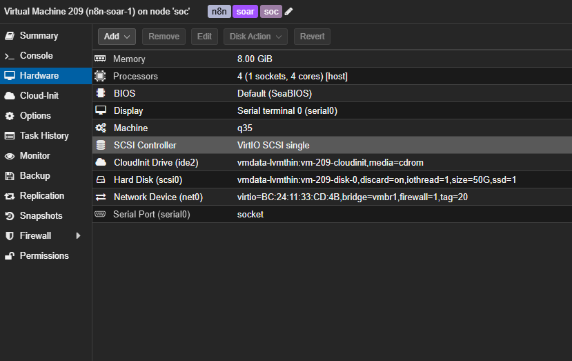
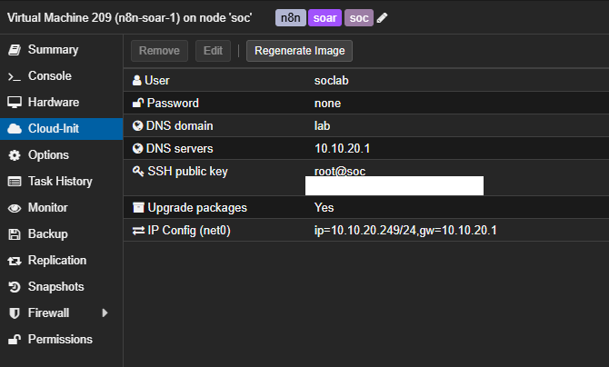
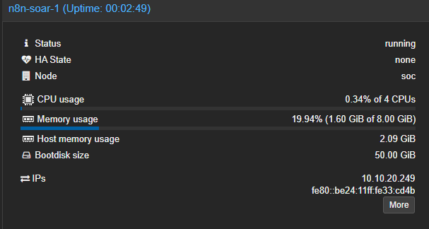
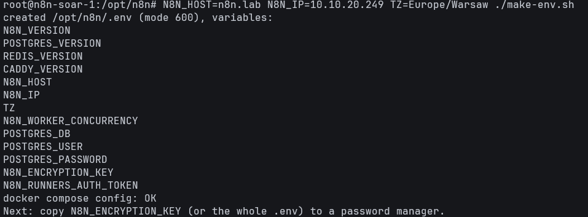
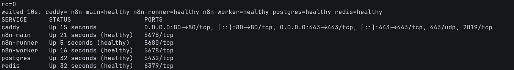
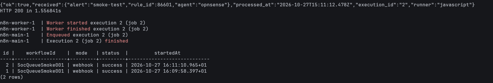

# Runbook: n8n SOAR VM on Proxmox (queue mode + HTTPS)

- **Status:** Tested
- **Related:** issue #58, [`soar/n8n/deploy/`](../../soar/n8n/deploy/)


## 0. Parameters

Only the values in this table are environment-specific - change them and the rest of the runbook applies unchanged.

| Parameter | Our lab | Notes for another environment |
|---|---|---|
| Hypervisor | Proxmox VE 9.2, single node `soc` | any Proxmox VE 8.2+ (disk import from `import` storage) |
| VM (VMID, name, tags) | `209`, `n8n-soar-1`, `soc;n8n;soar` | any free VMID; the VM name becomes the hostname |
| OS | Ubuntu 24.04.5 LTS, official cloud image `noble-server-cloudimg-amd64` | |
| Resources (vCPU, RAM, disk, storage) | 4 vCPU (`host`), 8 GB RAM, 50 GB disk on `vmdata-lvmthin` | minimum for a test: 2 vCPU / 4 GB |
| Network (bridge, VLAN, IP, gateway, DNS, domain) | `vmbr1`, VLAN 20 (SOC), `10.10.20.249/24`, gateway/DNS/NTP `10.10.20.1` (OPNsense), domain `lab` | static IP - Wazuh, DNS and the TLS certificate point to it |
| User | `soclab`, SSH key login only (keys from `/root/lab-ssh-keys.pub` on the Proxmox host) | |
| Stack (components + versions) | Docker + Compose: PostgreSQL 17, Redis 7, n8n 2.44.6 (main + worker + task runner), Caddy 2 | versions pinned in `/opt/n8n/.env` |
| Access (URL) | `https://n8n.lab` / `https://10.10.20.249` | |
| Stack directory | `/opt/n8n` | |

## 1. Prerequisites

1. **Free resources on the host** - node → *Summary* (RAM) and storage → *Summary* (free space).
2. **Ubuntu cloud image in a storage with content type `import`** - Proxmox imports VM disks only from such storage.
   *Datacenter → Storage → `local` → Edit → Content* → add **Import**, then *`local` → Import → Download from URL*:
   `https://cloud-images.ubuntu.com/noble/current/noble-server-cloudimg-amd64.img`, saved as **`noble-server-cloudimg-amd64.qcow2`**
   (the file is qcow2; the `.img` extension is rejected for import).
3. **A free static IP** in the SOC VLAN and network access from the admin PC to it (SSH 22, HTTPS 443).

**Commands** (Proxmox node → *Shell*)

```bash
qm status 209 2>&1 | head -1                       # VMID is free
ping -c 2 -W 1 10.10.20.249                        # IP is free
pvesm list local --content import | grep noble     # cloud image is present
```

**Expected**

- `Configuration file 'nodes/soc/qemu-server/209.conf' does not exist`
- `100% packet loss`
- `local:import/noble-server-cloudimg-amd64.qcow2`

**Result (our lab)**

- Host before the VM: ~13 GB RAM available (of 62 GB), ~114 GB free on `vmdata-lvmthin`.
- VMID 209 and IP `10.10.20.249` free, keys in `/root/lab-ssh-keys.pub` , cloud image present.


## 2. Create the VM

**Why**

The VM is created in one command from the Ubuntu cloud image. Cloud-init sets the network, the user and the SSH keys on
first boot, so no installer and no manual console work are needed.

**Commands** (Proxmox node → *Shell*)

```bash
qm create 209 --name n8n-soar-1 --tags 'soc;n8n;soar' \
  --memory 8192 --cores 4 --sockets 1 --cpu host --machine q35 --ostype l26 \
  --scsihw virtio-scsi-single \
  --scsi0 vmdata-lvmthin:0,import-from=local:import/noble-server-cloudimg-amd64.qcow2,discard=on,iothread=1,ssd=1 \
  --ide2 vmdata-lvmthin:cloudinit --boot order=scsi0 \
  --serial0 socket --vga serial0 \
  --net0 virtio,bridge=vmbr1,tag=20,firewall=1 \
  --ipconfig0 ip=10.10.20.249/24,gw=10.10.20.1 --nameserver 10.10.20.1 --searchdomain lab \
  --ciuser soclab --sshkeys /root/lab-ssh-keys.pub \
  --agent enabled=1 --onboot 1 \
  --description 'n8n SOAR (queue mode, Caddy HTTPS). Ubuntu 24.04 cloud image. Replaces VM 208.'

qm resize 209 scsi0 50G
qm start 209
```

What the options do:

- **Resources** - 8 GB RAM covers the memory limits of all containers in `compose.yml` (~6.8 GB) plus the OS;
  4 vCPU for the worker (10 parallel executions), main, task runner and PostgreSQL. `cpu host` exposes the real CPU
  (no live migration needed on a single node); `q35` is the modern PCIe chipset.
- **Disk** - `import-from` creates the system disk as a full copy of the cloud image (`0` = size of the image, ~3.5 GB);
  `qm resize` grows it to 50 GB **before the first start**, so cloud-init grows the partition on first boot.
  `virtio-scsi-single` + `iothread` give the disk its own controller and I/O thread; `discard` returns freed blocks to the
  thin pool; `ssd` tells the guest it is a non-rotational disk.
- **Cloud-init** - `ide2: …cloudinit` is a small virtual CD with the network config, the user `soclab` and the SSH keys.
  The cloud image allows SSH key login only, so the keys must be set before the first start.
- **Console** - `serial0` + `vga serial0`: cloud images print their console to the serial port; the GUI shows it as a
  text terminal (xterm.js) with copy and paste.
- **Network** - `vmbr1` is the VLAN-aware lab trunk, VLAN 20 is the SOC network shared with Wazuh, MISP and TheHive,
  so Wazuh reaches n8n without crossing the firewall. `firewall=1` only enables the Proxmox firewall hook on this NIC.
- **Behaviour** - `agent enabled=1` lets Proxmox use the QEMU guest agent (IP in the GUI, clean shutdown, commands in
  the guest); `onboot 1` starts the SOAR automatically after a host reboot.


**Result (our lab)**

`qmcreate`, `resize` and `qmstart` finished with `TASK OK` (disk import: 17 s, 3.5 GiB).




*VM 209 hardware: 4 vCPU (host), 8 GB RAM, 50 GB disk with discard/iothread/ssd, cloud-init drive, VLAN 20.*


*Cloud-init settings: user soclab, static IP 10.10.20.249/24, gateway and DNS 10.10.20.1, domain lab, two SSH public keys (key comments hidden).*

## 3. First boot and QEMU guest agent

**Why**

The Ubuntu cloud image does not include `qemu-guest-agent`. Without it Proxmox cannot show the VM's IP, shut it down
cleanly or run commands inside it, so it is the first package installed over SSH. On first boot cloud-init runs `apt`
itself; waiting for it avoids the `Could not get lock /var/lib/dpkg/lock-frontend` error.

**Commands** 

```bash
ssh soclab@10.10.20.249                 # about 1 minute after qm start
cloud-init status --wait                # wait until cloud-init (and its apt run) has finished
sudo apt-get -o DPkg::Lock::Timeout=600 install -y qemu-guest-agent \
  && sudo systemctl start qemu-guest-agent && systemctl is-active qemu-guest-agent
```
**Expected**

- `status: done`, then `active`;
- VM → *Summary* → *IPs* shows `10.10.20.249` (reported by the guest agent).

**Result (our lab)**



*VM running after first boot; the IP address 10.10.20.249 is reported by the QEMU guest agent.*

## 4. Base system


### 4.1 Time zone and NTP

**Why**

NTP from the lab to the internet is blocked, so the default `ntp.ubuntu.com` never answers and the clock drifts.
The VM uses the OPNsense gateway as its NTP server instead. n8n stamps every execution with the host clock -
a skewed clock breaks correlation with Wazuh alerts.

**Commands**

```bash
timedatectl set-timezone Europe/Warsaw
mkdir -p /etc/systemd/timesyncd.conf.d
cat > /etc/systemd/timesyncd.conf.d/10-lab.conf <<'EOF'
# Lab NTP: OPNsense gateway of VLAN 20; ntp.ubuntu.com is not reachable from the lab
[Time]
NTP=10.10.20.1
FallbackNTP=ntp.ubuntu.com
EOF
systemctl restart systemd-timesyncd
sleep 20; timedatectl timesync-status | head -6; timedatectl | grep -E 'Time zone|synchronized|NTP service'
```

**Expected**

`Server: 10.10.20.1`, `Stratum: 2`, `Time zone: Europe/Warsaw`, `System clock synchronized: yes`, `NTP service: active`.

**Result (our lab)**

```text
       Server: 10.10.20.1 (10.10.20.1)
Poll interval: 1min 4s (min: 32s; max 34min 8s)
         Leap: normal
      Version: 4
      Stratum: 2
                Time zone: Europe/Warsaw (CET, +0100)
System clock synchronized: yes
              NTP service: active
```

### 4.2 Kernel setting for Redis

**Why**

Redis (the n8n queue) saves its data in the background with `fork()`. With the default
`vm.overcommit_memory = 0` the kernel may refuse the fork, the save fails and Redis logs
`WARNING Memory overcommit must be enabled!`. Setting it to `1` is the value recommended by Redis.
It is set before Docker is installed, so Redis never starts without it.

**Commands**

```bash
cat > /etc/sysctl.d/99-redis.conf <<'EOF'
# Redis (n8n queue): allow background saves without fork failures
vm.overcommit_memory = 1
EOF
sysctl -p /etc/sysctl.d/99-redis.conf
```

The file in `/etc/sysctl.d/` applies the setting on every boot; `sysctl -p` applies it now, without a reboot.

**Expected**

`vm.overcommit_memory = 1`

**Result (our lab)**

```text
vm.overcommit_memory = 1
```


## 5. Docker

**Why**

Docker Engine and the Compose plugin are installed from Docker's official repository - Ubuntu's own `docker.io`
package is older and has no Compose v2 plugin. Container logs are rotated (the default `json-file` driver grows
without limit). The user `soclab` is intentionally **not** added to the `docker` group, because that is
root-equivalent; Docker commands run as root.

**Commands** (as root)

```bash
apt-get install -y ca-certificates curl
install -m 0755 -d /etc/apt/keyrings
curl -fsSL https://download.docker.com/linux/ubuntu/gpg -o /etc/apt/keyrings/docker.asc
nano /etc/apt/sources.list.d/docker.sources
```

`/etc/apt/sources.list.d/docker.sources`:

```text
Types: deb
URIs: https://download.docker.com/linux/ubuntu
Suites: noble
Components: stable
Architectures: amd64
Signed-By: /etc/apt/keyrings/docker.asc
```

`Suites` is the Ubuntu codename (`. /etc/os-release; echo $VERSION_CODENAME`) and `Architectures` the output of
`dpkg --print-architecture`.

```bash
apt-get update
apt-get install -y docker-ce docker-ce-cli containerd.io docker-buildx-plugin docker-compose-plugin
nano /etc/docker/daemon.json
```

`/etc/docker/daemon.json` - log rotation, at most 3 files of 10 MB per container:

```json
{
  "log-driver": "json-file",
  "log-opts": { "max-size": "10m", "max-file": "3" }
}
```

```bash
systemctl restart docker
```

**Test**

```bash
docker version --format 'engine {{.Server.Version}}'
docker compose version
docker info --format 'logging={{.LoggingDriver}} cgroup={{.CgroupVersion}} storage={{.Driver}}'
systemctl is-enabled docker containerd
docker run --rm hello-world | grep 'Hello from Docker'
```

**Expected**

`apt-get update` lists `download.docker.com … noble InRelease`; the engine and Compose versions print;
`logging=json-file cgroup=2 storage=overlayfs`; both services `enabled`; `Hello from Docker!`.

**Result (our lab)**

```text
Get:1 https://download.docker.com/linux/ubuntu noble InRelease [48.5 kB]
Get:5 https://download.docker.com/linux/ubuntu noble/stable amd64 Packages [72.1 kB]

The following NEW packages will be installed:
  containerd.io docker-buildx-plugin docker-ce docker-ce-cli docker-ce-rootless-extras docker-compose-plugin pigz
Need to get 102 MB of archives.          # downloaded in 9 s

engine 29.9.2
Docker Compose version v5.6.1
logging=json-file cgroup=2 storage=overlayfs
enabled
enabled
```

## 6. Stack files (`/opt/n8n`)

**Why**

The whole stack is described by three text files, so it can be rebuilt on any host with one `docker compose up`:

| File | Role |
|---|---|
| `compose.yml` | containers, pinned images, networks, volumes, health checks and memory limits |
| `Caddyfile` | HTTPS reverse proxy in front of n8n |
| `make-env.sh` | generates `.env` with random secrets on the VM itself |

Configuration and secrets are kept apart: `compose.yml` and `Caddyfile` only reference variables such as
`${POSTGRES_PASSWORD}` and are safe to keep in this repository, while the values live only in `/opt/n8n/.env`,
which never leaves the VM. The stack lives in `/opt/n8n` (the usual place for add-on software, separate from the
OS and from user home directories). The directory is `750 root:root` because `.env` holds `N8N_ENCRYPTION_KEY`,
which decrypts every credential stored in n8n - the unprivileged user `soclab` cannot even list it.

**Commands** (as root)

```bash
install -d -m 750 -o root -g root /opt/n8n
cd /opt/n8n
nano compose.yml      # paste soar/n8n/deploy/compose.yml
nano Caddyfile        # paste soar/n8n/deploy/Caddyfile
nano make-env.sh      # paste soar/n8n/deploy/make-env.sh
chmod 644 compose.yml Caddyfile
chmod 700 make-env.sh
```


**Test**

```bash
ls -la /opt/n8n
sha256sum compose.yml Caddyfile make-env.sh   # compare with soar/n8n/deploy/README.md
```

**Result (our lab)**

```text
361cb570ddb4a248092dbc9fa123d5c36b4e33e18668425ffc156969a0caed4d  compose.yml
c99466d3a5e7696404ccff99b724678c11baea5098fa780f78da629a177dc7ed  Caddyfile
cddf79baabd2dbea601cf377e5665bc02a57777f7350dbe0f2b5ef18e49823d5  make-env.sh
```

### 6.1 Design decisions in `compose.yml`

**Execution model**

- **Queue mode** - `n8n-main` only receives webhooks and serves the UI; it puts every execution into a Redis queue
  and `n8n-worker` runs it. A burst of Wazuh alerts cannot slow down the UI, and more workers can be added later.
- **Manual runs on the worker too** (`OFFLOAD_MANUAL_EXECUTIONS_TO_WORKERS`) - a test started in the editor goes
  through the same path as a real alert, so it tests the whole chain.
- **External task runner** - code from Code nodes runs in a separate `n8n-runner` container, not inside n8n,
  so a buggy or malicious script cannot read the encryption key or the stored credentials.
- **Binary data in the database** - the filesystem mode does not work in queue mode, because main and worker have
  separate disks.
- **Separate volumes for main and worker** - n8n does not support sharing its data directory between processes;
  they share only the database and `N8N_ENCRYPTION_KEY`.

**Network isolation** (three Docker networks)

| Network | Members | Internet / LAN access |
|---|---|---|
| `edge` | caddy, n8n-main, n8n-worker | yes - Caddy publishes 80/443, the worker calls MISP, Cortex and TheHive |
| `data` | n8n-main, n8n-worker, postgres, redis | no (`internal: true`) |
| `sandbox` | n8n-worker, n8n-runner | no (`internal: true`) - the runner can only reach the worker's task broker (:5679) |

- **Only Caddy publishes ports** - PostgreSQL, Redis and n8n are not reachable from the network at all.

**Reliability**

- **Start order with health checks** - postgres and redis → main → worker → runner; Caddy waits for a healthy main.
  Nothing starts before the service it depends on is ready.
- **Graceful stop** - containers get 75 s to stop (`stop_grace_period`), and n8n waits up to 60 s for running
  executions (`N8N_GRACEFUL_SHUTDOWN_TIMEOUT`), so an update or reboot does not kill a workflow halfway.
- **Redis persistence (AOF)** - every write is appended to disk once per second, so queued jobs, deduplication keys
  and daily counters survive a crash. `maxmemory 384mb` with `noeviction` keeps Redis below its 512 MB container
  limit and makes it refuse new writes instead of silently deleting queued jobs.
- **Restart policy** - `unless-stopped`: containers come back after a crash or a VM reboot.

**Resources and hardening**

- **Memory limits** - about 6.8 GB in total on an 8 GB VM, so one runaway container cannot take the whole host down.
- **`no-new-privileges`** on every container - processes cannot gain more privileges than they started with.
- **Runner without Linux capabilities** (`cap_drop: ALL`) and with a process limit (`pids_limit: 256`) - user code
  cannot use privileged kernel features or fork-bomb the VM.

**Upgrades and history**

- **Pinned versions** - exact image tags come from `.env`; `n8nio/n8n` and `n8nio/runners` always use the same version.
- **Future defaults pinned** - four settings that n8n announced to change are set explicitly, so an upgrade does
  not change behaviour silently.
- **Execution history** - kept for 14 days or 50 000 executions (the default 10 000 would last only 1-2 days at
  thousands of alerts per day).


### 6.2 `Caddyfile`

**Why**

Caddy is the only entry point to n8n. It terminates HTTPS on port 443 and forwards plain HTTP to `n8n-main:5678`
inside the Docker network.

- **`tls internal`** - the lab has no public DNS name, so a Let's Encrypt certificate is not possible. Caddy runs its
  own small CA: the root certificate is valid for 10 years, server certificates live 12 h and renew automatically.
  The root CA is trusted by hand in the browser and by the Wazuh integration (`/var/ossec/etc/n8n-ca.crt`), so
  every connection is verified instead of using "ignore certificate errors". The CA lives in the `caddy_data`
  volume - losing it means a new root CA and a broken Wazuh → n8n integration.
- **Two site addresses (`{$N8N_HOST}, {$N8N_IP}`)** - one certificate for the name `n8n.lab` and one for the IP,
  because Wazuh calls the webhook by IP and the browser by name.
- **`default_sni {$N8N_IP}`** - a client connecting by IP sends no SNI (the TLS field with the requested host name),
  so Caddy would not know which certificate to present. This tells it to use the IP certificate in that case.
- **`skip_install_trust`** - Caddy does not try to add its root CA to the container's own trust store
  (that only produced the warning `certutil is not available`).
- **`protocols h1 h2`** - HTTP/3 is disabled: it runs over UDP 443, which is not published, so clients would try a
  protocol that can never connect.
- **Access log to stdout** - visible in `docker compose logs caddy` and rotated by the Docker daemon. The webhook
  token (`X-Wazuh-Token`) and the n8n API key header are removed from the log; Caddy redacts `Cookie` and
  `Authorization` by default.
- **No HSTS on purpose** - with an internal CA it would lock out anyone who has not trusted the root yet.
  Other security headers (`X-Frame-Options`, `nosniff`, `Referrer-Policy`) are already set by n8n.
- Plain HTTP on port 80 only redirects to HTTPS (Caddy's default).


### 6.3 Generate `.env` and validate

**Why**

- **Secrets are generated on the VM** - the PostgreSQL password, `N8N_ENCRYPTION_KEY` and the task runner token are
  created with `openssl rand` directly on the host, so they never appear in the chat, the documentation, the
  repository or a terminal screenshot. The script prints only variable names.
- **`.env` is never overwritten** - `N8N_ENCRYPTION_KEY` encrypts every credential stored in n8n. Running the script
  again must not create a new key, otherwise all stored API keys become unreadable. If `.env` exists, the script
  exits without touching it.
- **Fail closed** - if a secret cannot be generated, the script stops without writing `.env` (v1 could report
  success with empty secrets). `.env` is written to a temporary file (mode 600) and linked into place atomically,
  so an interrupted run never leaves a half-written file.
- **Lab values are defaults** - `N8N_HOST`, `N8N_IP`, `TZ` and the image versions can be overridden from the
  environment, so the script does not have to be edited on another host.
- **`docker compose config -q`** validates `compose.yml` together with `.env` without printing anything -
  without `-q` it would print the full configuration, secrets included.

**Commands** (as root, in `/opt/n8n`)

```bash
cd /opt/n8n
# do the pinned image tags exist? (pull would fail later with "manifest unknown")
for i in n8nio/n8n:2.44.6 n8nio/runners:2.44.6 postgres:17.11 redis:7.4.11-alpine caddy:2.11.7-alpine; do
  docker manifest inspect "$i" >/dev/null 2>&1 && echo "OK      $i" || echo "MISSING $i"
done

N8N_HOST=n8n.lab N8N_IP=10.10.20.249 TZ=Europe/Warsaw ./make-env.sh
stat -c '%a %U:%G %n' .env
docker compose config --images
./make-env.sh                       # second run must refuse to touch .env
```

Then, in your own SSH session (never in a chat or a screenshot), copy the key to a password manager:
`grep ^N8N_ENCRYPTION_KEY= /opt/n8n/.env` - best the whole `.env`.

> Never run `docker compose config` without `-q` and never `cat .env` where the output could be copied or recorded.

**Expected**

- every image tag `OK`;
- `created /opt/n8n/.env (mode 600)`, 13 variable names, `docker compose config: OK`;
- `600 root:root /opt/n8n/.env`;
- six images: `n8nio/n8n:2.44.6` (×2), `n8nio/runners:2.44.6`, `postgres:17.11`, `redis:7.4.11-alpine`, `caddy:2.11.7-alpine`;
- second run: `/opt/n8n/.env already exists - not touching it`.

**Result (our lab)**


*make-env.sh output: only variable names are printed, `.env` is created with mode 600 and the compose configuration validates.*

## 7. Start the stack

**Why**

`docker compose pull` downloads all images first, so a missing or mistyped tag fails here and not halfway through
the start. `docker compose up -d` then starts the containers in the order defined by `depends_on` and the health
checks: Redis and PostgreSQL → n8n-main → n8n-worker and Caddy → n8n-runner. Long outputs go to `/root/n8n-setup/`
so the terminal shows only the result.

**Commands** (as root, in `/opt/n8n`)

```bash
mkdir -p /root/n8n-setup && chmod 700 /root/n8n-setup
cd /opt/n8n

# 1. download the images
docker compose pull > /root/n8n-setup/03-compose-pull.log 2>&1; echo "rc=$?"
docker image ls --format '{{.Repository}}:{{.Tag}} {{.Size}}'

# 2. start and wait until no container is "starting"
docker compose up -d > /root/n8n-setup/04-compose-up.log 2>&1; echo "rc=$?"
for i in $(seq 1 40); do
  st=$(docker compose ps --format '{{.Service}}={{.Health}}' | tr '\n' ' ')
  case "$st" in *starting*|*unhealthy*) sleep 5;; *) break;; esac
done; echo "waited $((i*5))s: $st"
docker compose ps --format 'table {{.Service}}\t{{.Status}}\t{{.Ports}}'

# 3. logs
docker compose logs n8n-main   | grep -E 'Version|Editor is now accessible'
docker compose logs n8n-worker | grep -E 'worker is now ready|Concurrency|Registered runner'
docker compose logs 2>&1 | grep -iE 'error|warn|deprecat' | grep -viE 'password|secret|token'

# 4. v2 checks: Caddyfile syntax, network membership, Redis persistence, memory
docker compose exec caddy caddy validate --config /etc/caddy/Caddyfile --adapter caddyfile
for n in edge data sandbox; do
  echo "$n: $(docker network inspect n8n_$n --format '{{range .Containers}}{{.Name}} {{end}}')"
done
docker compose exec redis redis-cli CONFIG GET appendonly
docker compose exec redis redis-cli CONFIG GET maxmemory-policy
docker stats --no-stream --format '{{.Name}} {{.MemUsage}}'
```

**Expected**

- `pull` and `up` end with `rc=0`; five images with the exact tags from `.env`;
- postgres, redis, n8n-main, n8n-worker and n8n-runner `healthy`, Caddy `Up` (no health check);
  ports published (`->`) only by Caddy: 80 and 443;
- main: `Version: 2.44.6`, `Editor is now accessible`; worker: `n8n worker is now ready`, `Concurrency: 10`,
  JavaScript and Python runners registered;
- no `There are deprecations`, no `Memory overcommit`, no `certutil` warning;
- `Valid configuration`; networks `edge` = caddy, main, worker / `data` = main, worker, postgres, redis /
  `sandbox` = worker, runner; Redis `appendonly yes`, `noeviction`.

**Result (our lab)**

```text
# 1. images (pull rc=0)
n8nio/n8n:2.44.6 1.82GB
n8nio/runners:2.44.6 879MB
postgres:17.11 646MB
caddy:2.11.7-alpine 93.1MB
redis:7.4.11-alpine 57.8MB

# 2. start (up rc=0)
waited 10s: caddy= n8n-main=healthy n8n-runner=healthy n8n-worker=healthy postgres=healthy redis=healthy
SERVICE      STATUS                    PORTS
caddy        Up 15 seconds             0.0.0.0:80->80/tcp, [::]:80->80/tcp, 0.0.0.0:443->443/tcp, [::]:443->443/tcp, 443/udp, 2019/tcp
n8n-main     Up 21 seconds (healthy)   5678/tcp
n8n-runner   Up 5 seconds (healthy)    5680/tcp
n8n-worker   Up 16 seconds (healthy)   5678/tcp
postgres     Up 32 seconds (healthy)   5432/tcp
redis        Up 32 seconds (healthy)   6379/tcp

# start order (container start times)
redis 14:30:21.9 -> postgres 14:30:22.1 -> n8n-main 14:30:32.8 -> n8n-worker 14:30:38.5, caddy 14:30:38.8 -> n8n-runner 14:30:49.2

# 3. logs
n8n-main-1    | Version: 2.44.6
n8n-main-1    | Editor is now accessible via:
n8n-worker-1  | n8n worker is now ready
n8n-worker-1  |  * Concurrency: 10
n8n-worker-1  | Registered runner "launcher-javascript"
n8n-worker-1  | Registered runner "launcher-python"

# 4. v2 checks
Valid configuration
edge: n8n-n8n-worker-1 n8n-caddy-1 n8n-n8n-main-1
data: n8n-postgres-1 n8n-n8n-worker-1 n8n-redis-1 n8n-n8n-main-1
sandbox: n8n-n8n-worker-1 n8n-n8n-runner-1
appendonly yes
maxmemory-policy noeviction        (maxmemory 402653184 = 384 MB)

n8n-n8n-main-1    303.7MiB / 2GiB
n8n-n8n-worker-1  229.1MiB / 2GiB
n8n-postgres-1     60.5MiB / 1GiB
n8n-caddy-1        11.3MiB / 256MiB
n8n-redis-1         3.7MiB / 512MiB
n8n-n8n-runner-1    3.5MiB / 1GiB
```

The whole stack was healthy about 30 s after `docker compose up -d` and uses ~610 MiB of RAM.
`443/udp` and `2019/tcp` (Caddy admin API) are ports declared in the Caddy image, not published - only
`80->80` and `443->443` are reachable from the network. All images together take ~3.5 GB of disk.


*All services up: five with a passing health check, Caddy without one. Only Caddy publishes ports (80 and 443, marked with →); the other ports are only exposed inside the Docker networks.*


## 8. Tests

### 8.1 HTTPS and certificates

**Why**

Wazuh and the browser reach n8n only through Caddy, so before any workflow runs we check that HTTPS works with
certificate verification (no `-k`), that both the IP and the host name get a valid certificate, that plain HTTP
only redirects, that nothing except Caddy and SSH listens on the network, and that the access log does not store
the webhook token. The root CA exported here is the file the browser and the Wazuh integration will trust.

**Commands** (as root, in `/opt/n8n`)

```bash
# Caddy root CA - for the browser and for the Wazuh integration
docker compose cp caddy:/data/caddy/pki/authorities/local/root.crt /opt/n8n/caddy-root.crt
chmod 644 caddy-root.crt
install -m 644 -o soclab -g soclab caddy-root.crt /home/soclab/n8n-lab-root.crt   # copy for scp (step 9.3)
openssl x509 -in caddy-root.crt -noout -subject -enddate -fingerprint -sha256

# certificate by IP (client without SNI) and by name
openssl s_client -connect 10.10.20.249:443 -noservername </dev/null 2>/dev/null | openssl x509 -noout -ext subjectAltName -enddate
openssl s_client -connect 10.10.20.249:443 -servername n8n.lab </dev/null 2>/dev/null | openssl x509 -noout -ext subjectAltName

# n8n answers over HTTPS with certificate verification
curl -sS --cacert caddy-root.crt https://10.10.20.249/healthz; echo
curl -sS --cacert caddy-root.crt --resolve n8n.lab:443:10.10.20.249 https://n8n.lab/healthz/readiness; echo

# HTTP only redirects to HTTPS
curl -sS -o /dev/null -w '%{http_code} -> %{redirect_url}\n' http://10.10.20.249/

# listening ports (TCP, then UDP)
ss -tlnH | awk '{print $4}' | sort -u
ss -ulnH | awk '{print $4}' | sort -u

# the access log must not contain the webhook token or the n8n API key
curl -sS -o /dev/null -w '%{http_code}\n' --cacert caddy-root.crt \
  -H 'X-Wazuh-Token: LOGTEST-1234567890' -H 'X-N8N-API-KEY: LOGTEST-APIKEY-0987' \
  https://10.10.20.249/healthz
sleep 2
docker compose logs --since 1m caddy | grep -c '"uri":"/healthz"'   # request is logged
docker compose logs --since 1m caddy | grep -c 'LOGTEST'            # secrets are not
docker stats --no-stream --format '{{.Name}} {{.MemUsage}}'
```

**Expected**

- root CA `Caddy Local Authority - <year> ECC Root`, valid for 10 years;
- by IP: SAN `IP Address:10.10.20.249`, by name: SAN `DNS:n8n.lab`; server certificates valid 12 h (renewed by Caddy);
- `/healthz` and `/healthz/readiness` → `{"status":"ok"}` with certificate verification;
- HTTP → `308 -> https://10.10.20.249/`;
- TCP: only 22, 80, 443 (+ the local DNS stub on 127.0.0.53/54); UDP: no 443 (HTTP/3 disabled);
- token test: `200`, the request is in the log (≥ 1), `LOGTEST` is not (0).

**Result (our lab)**

```text
subject=CN = Caddy Local Authority - 2026 ECC Root
notAfter=Sep  4 14:30:39 2036 GMT
sha256 Fingerprint=5C:CA:6C:9E:E9:70:31:40:E1:CD:5F:E3:4A:A4:13:A5:35:E4:CE:7E:72:C0:6B:42:24:F4:44:1D:04:22:68:21

X509v3 Subject Alternative Name: critical
    IP Address:10.10.20.249
notAfter=Oct 28 02:30:39 2026 GMT
X509v3 Subject Alternative Name: critical
    DNS:n8n.lab

{"status":"ok"}
{"status":"ok"}

308 -> https://10.10.20.249/

# TCP
0.0.0.0:22
0.0.0.0:443
0.0.0.0:80
127.0.0.53%lo:53
127.0.0.54:53
[::]:22
[::]:443
[::]:80
# UDP
127.0.0.53%lo:53
127.0.0.54:53

# token test
200
2        # /healthz requests in the Caddy log during the last minute
0        # occurrences of the test token and API key in the log

n8n-n8n-main-1    292.1MiB / 2GiB
n8n-n8n-worker-1  228.8MiB / 2GiB
n8n-postgres-1     60.6MiB / 1GiB
n8n-caddy-1        11.6MiB / 256MiB
n8n-redis-1         3.7MiB / 512MiB
n8n-n8n-runner-1    3.7MiB / 1GiB
```

The server certificate is valid for 12 hours (issued 14:30, expires 02:30) and Caddy renews it automatically.
The root CA fingerprint above is public - it is used in step 9.3 to verify the CA before trusting it.
PostgreSQL, Redis and n8n do not listen on the host at all; port 53 on 127.0.0.53/54 is Ubuntu's local DNS stub,
reachable only from the VM itself. The access log records the requests but neither the `X-Wazuh-Token` nor the
`X-N8N-API-KEY` header value. The whole stack uses about 600 MiB of RAM.

### 8.2 End-to-end queue test

**Why**

A container being `healthy` only means the process answers. This test proves that the whole path used by real
alerts works: Caddy → n8n-main (webhook) → Redis (queue) → n8n-worker → n8n-runner (Code node in the isolated
`sandbox` network) → response. It uses a tiny test workflow, `SOC - queue smoke test` (Webhook → Code → Respond to
Webhook), that only echoes the posted JSON with `"ok": true`. It is imported and published from the CLI, so no
owner account and no clicking in the UI are needed.

**Commands** (as root, in `/opt/n8n`)

```bash
# import and publish the test workflow
docker compose cp soc-queue-smoke-test.json n8n-main:/tmp/soc-queue-smoke-test.json
docker compose exec -T n8n-main n8n import:workflow --input=/tmp/soc-queue-smoke-test.json
docker compose exec -T n8n-main n8n publish:workflow --id=SocQueueSmoke001
docker compose restart n8n-main n8n-worker        # the running n8n does not see changes made by the CLI
docker compose exec -T -u root n8n-main rm -f /tmp/soc-queue-smoke-test.json   # copied file belongs to root
docker compose ps --format '{{.Service}}={{.Health}}'   # wait until main and worker are healthy again

# send a test alert
curl -sS --cacert caddy-root.crt -X POST -H 'Content-Type: application/json' \
  -d '{"alert":"smoke-test","rule_id":86601,"agent":"opnsense"}' \
  -w '\nHTTP %{http_code} in %{time_total}s\n' https://10.10.20.249/webhook/soc-queue-smoke

# proof that the execution went through the queue
docker compose logs --since 3m n8n-main n8n-worker | grep -E 'Enqueued|Worker (started|finished)|finished'
docker compose exec -T postgres sh -c 'psql -U "$POSTGRES_USER" -d "$POSTGRES_DB" -c \
  "select id, \"workflowId\", mode, status, \"startedAt\" from execution_entity order by id desc limit 3;"'
```

In n8n 2.x a workflow is **published** (`publish:workflow`); `update:workflow --active=true` is deprecated.
The CLI itself warns that a running n8n picks up the change only after a restart.

**Expected**

- `Successfully imported 1 workflow`, `Publishing workflow with ID: SocQueueSmoke001`;
- `HTTP 200` with `"ok":true`, the posted body under `"received"` and `"runner":"javascript"`;
  a call after an idle period takes ~1.5 s (the JavaScript runner is started on demand),
  calls a few seconds apart are much faster;
- main: `Enqueued execution N` → worker: `Worker started execution N` / `Worker finished execution N` →
  main: `Execution N … finished`;
- PostgreSQL: rows with `mode = webhook`, `status = success`.

**Result (our lab)**

Both calls took about 1.6 s because they were more than a minute apart: the task runner launcher stops the idle
JavaScript runner and starts it again on demand (`Registered runner "JS Task Runner"` appears in the worker log
when the Code node runs). The runner container reconnected to the worker by itself after the worker restart.


*Smoke test: the webhook returns HTTP 200, n8n-main enqueues the execution, n8n-worker runs it and both executions are stored with status success.*

