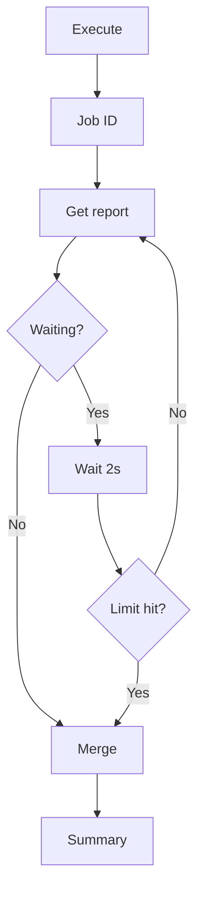
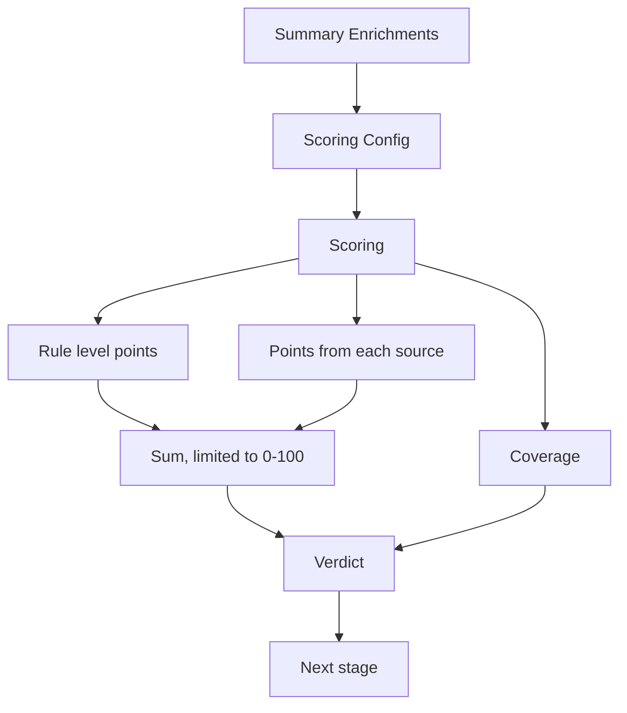

# Runbook: n8n triage workflow

How to build, test and fix every node of the  workflow. The reasons behind each choice are in ADR 0003.


<!--
How to fill in your stage:
- One subsection per node, in the order the nodes run. Copy the node template below.
- Screenshot every node's settings and one successful test. Save them as
  docs/images/n8n/<issue>-<node-name>.png and check them with scripts/check_images.py --ocr.
  No keys, tokens, webhook URLs or real usernames on screenshots.
- Settings table: write the value you typed or selected. For credentials, write only the credential name.
- "If it does not work": every problem you hit while building, with what fixed it.

Node template:

#### Node: <name in n8n>

**What it does:** one sentence.

**How to build it:**
1. ...
2. ...


| Setting | Value |
|---|---|
| | |

**How to test it:** what you send, what you should see.


**If it does not work:**

| What you see | Cause | Fix |
|---|---|---|
| | | |
-->

## 1. Webhook
**What it does:** Receives Wazuh alerts as JSON over an authenticated HTTP POST request and immediately acknowledges receipt.

**How to build it:**

1. Add a Webhook node to the n8n workflow.
2. Set **HTTP Method** to `POST`.
3. Set **Authentication** to `Header Auth` and select the existing `Wazuh webhook token` credential.
4. Set **Respond** to `Immediately`.
5. Publish the workflow and configure the Wazuh `custom-n8n` integration to send JSON alerts to the production Webhook URL.
6. Set the Wazuh integration threshold to level 12. This forwards alerts at level 12 and above.

**Wazuh manager integration:**

The Wazuh manager applies the alert-level filter before sending alerts to n8n. Its `custom-n8n` integration block selects JSON alerts at level 12 and above, then invokes the custom script to forward them to the Webhook. The n8n Webhook handles the incoming request; it does not set this threshold.

The sanitized [Wazuh integration template](../../detection/wazuh/integrations/n8n-integration.xml) shows the manager-side configuration. For the script installation, CA setup, and delivery verification steps, see the [Wazuh integrations README](../../detection/wazuh/integrations/README.md).

**Webhook node settings:**
| Setting | Value |
|---|---|
| HTTP Method | `POST` |
| Authentication | `Header Auth` |
| Credential | `Wazuh webhook token` |
| Respond | `Immediately` |
| Wazuh alert format | JSON |
| Wazuh minimum level | `12` |


**How to test it:** Generate a long-URL test request from Kali to the lab web server. Wazuh should create rule `31115` at level `13`, and n8n should record a successful execution after receiving the alert.

To generate such test - Run this on Kali with `python3`:

```python
python3 - <<'PY'
from urllib.request import urlopen

url = "http://10.10.10.100/?probe=" + "A" * 8000

with urlopen(url, timeout=10) as response:
    print(f"HTTP {response.status}")
PY
```


The test on 2026-11-02 produced the Wazuh alert at 23:36:28 and a successful n8n execution at 23:36:30, completed in 4.066 seconds.


**If it does not work:**

| What you see | Cause | Fix |
|---|---|---|
| Wazuh records the alert, but no n8n execution appears | The workflow is not published, or Wazuh is sending to the test URL | Publish the workflow and configure Wazuh to use the production Webhook URL |

## 2. Normalize

**Owner:** @84rtek

**What it does:** Converts raw Wazuh, Elasticsearch, and Shuffle-wrapper alert payloads into a common JSON structure and extracts observables for downstream processing.

**How to build it:**

1. Add a **Code** node immediately after the Webhook node in the Skeleton workflow.
2. Name the node `Normalize` (or keep the current node name if it is already referenced elsewhere in the workflow).
3. Set **Mode** to `Run Once for All Items`.
4. Set **Language** to `JavaScript`.
5. Copy the contents of [`normalize-v1.2.js`](../../soar/n8n/nodes/normalize-v1.2.js) into the Code node editor.
6. Connect the Code node output to the next workflow stage.
7. Save the workflow.

**Code node settings:**

| Setting | Value |
|---|---|
| Node type | `Code` |
| Mode | `Run Once for All Items` |
| Language | `JavaScript` |
| Implementation | Normalize v1.2 |

**Input formats:**

| Format | Recognition |
|---|---|
| Raw Wazuh | Unwrapped Wazuh alert JSON |
| Elasticsearch | Alert document containing `_source` |
| Shuffle wrapper | Payload containing `all_fields` |

**Normalized output:**

The node produces one normalized alert object per input item. Main fields include:

| Field | Purpose |
|---|---|
| `alert_id` | Wazuh alert ID, or Elasticsearch document ID when available |
| `timestamp` | Wazuh alert timestamp |
| `source_format` | Detected input format: `raw`, `elasticsearch`, or `shuffle-wrapper` |
| `rule` | Rule ID, level, description, groups, MITRE data, and fired count |
| `agent` | Agent ID, name, and IP |
| `location`, `decoder` | Event source and decoder context |
| `syscheck`, `signature`, `command_line`, `full_log` | Additional event context when available; `full_log` is limited to 2,000 characters |
| `observables` | Observable list. Each entry includes `dataType`, `data`, `field`, and `internal`; optional fields include `kind`, `algorithm`, or `path` |
| `primary_observable` | Selected primary observable, or `-` when none is eligible |
| `dedup_key` | Key generated for the separate Dedup stage; generating it does not detect duplicate alerts |

**Observable types:**

| Type | Examples |
|---|---|
| `ip` | IPv4 and IPv6 addresses |
| `domain` | Domain names |
| `url` | Full URLs |
| `uri_path` | URI paths |
| `hash` | MD5, SHA1, and SHA256 values |
| `filename` | File basenames; the original path is retained in `path` |
| `registry_key` | Windows Registry paths |
| `other` | User names (`kind: "user"`) |
| `hostname` | Agent host name |
| `user-agent` | User-Agent values |

Normalize v1.2 reads domains from `data.domain` and DNS, HTTP, and TLS fields; URLs from `data.url` and `data.http.url`; and hashes from event hash data and Syscheck before/after fields. File observables contain the basename and retain the original path in `path`.

Private, loopback, and link-local IP addresses are marked `internal: true`. An `agent.ip` value is marked internal only when it falls within those ranges. Domains ending in `.lab`, `.local`, `.lan`, `.internal`, or `.localdomain` are also marked internal. A URL itself is not marked internal, although its hostname may be emitted separately as a domain observable.

The primary observable is selected in this order: non-internal IP, hash, non-internal domain, filename, registry key, or URI path. Full URLs, usernames, User-Agent values, and hostnames are not eligible.

Normalize removes duplicate observables within one alert by case-insensitive type and value, retaining the first source field. The `dedup_key` prepares the alert for the separate Dedup stage; it does not itself detect duplicate alerts.

**How to test it:**

Use Webhook mock data (or the n8n node's pinned/mock input data) to execute the Code node against each of the six test scenarios below. These are functional tests of Normalize and do not test live Webhook delivery or Header Auth.

| Test | Input scenario | Expected result |
|---|---|---|
| 1 | Network / DNS / HTTP | Extract IP, domain, URL, filename, username (`other`, `kind: "user"`), and User-Agent (`user-agent`) |
| 2 | Sysmon / hashes | Extract MD5, SHA1, SHA256, file path, command line, and user |
| 3 | Syscheck / Windows Registry | Extract registry path as `registry_key` |
| 4 | Raw Wazuh | Recognize `raw` format and extract external IP |
| 5 | Shuffle wrapper | Recognize `shuffle-wrapper` and extract SHA256 and filename |
| 6 | Alert without IOC | Preserve agent context and return `primary_observable: "-"` |

All six scenarios passed with Normalize v1.2.

Example expected output for the no-IOC scenario:

```json
{
  "source_format": "raw",
  "observables": [
    {
      "dataType": "ip",
      "data": "10.10.10.171",
      "field": "agent.ip",
      "internal": true
    },
    {
      "dataType": "other",
      "data": "SYSTEM",
      "field": "data.win.eventdata.user",
      "internal": true,
      "kind": "user"
    },
    {
      "dataType": "hostname",
      "data": "SOC-WIN11-AI",
      "internal": true
    }
  ],
  "primary_observable": "-",
  "dedup_key": "soc:dedup:100506::004:-"
}
```


**Evidence:**

The following screenshots show the Normalize configuration, its position in the workflow, and the mapping of the normalized primary observable into the MISP search node.


Only include screenshots that have actually been captured and checked into the repository.

**If it does not work:**

| What you see | Cause | Fix |
|---|---|---|
| Code node reports an error when using `$input.all()` | The node is not configured to process all input items | Set Mode to `Run Once for All Items` |
| `source_format` is unexpected | Input payload does not match the expected raw, Elasticsearch, or Shuffle-wrapper structure | Inspect the incoming JSON and confirm its wrapper/field names |
| No IOC is found | The alert does not contain an eligible external observable, or the relevant field is not covered by the extractor | Inspect the original payload; keep internal agent context distinct from external IOC data |
| Registry path is treated as a filename | The input field is not recognized as a Windows registry path | Check the source field and the registry detection logic |


## 3. Dedup

**Owner:** @arturesturemkuros

## 4. MISP and Cortex

**Owner:** @MKonrad-afk

**What it does:** Searches normalized alert observables in MISP and submits eligible IP, domain, URL, and hash observables to their configured Cortex analyzers. Cortex results and skipped observables are collected for the final alert summary.


*Figure. The full workflow, including its separate MISP and Cortex enrichment branches.*

### MISP branch

#### Node: Get a filtered list of attributes

**What it does:** Searches MISP for attributes matching the values in the normalized alert observables. Matching attributes are returned with their attribute and event context.

**How to build it:**

1. Add the MISP **Get a filtered list of attributes** node to the branch from `Normalize`.
2. Select the existing MISP credential.
3. Set **Resource** to `Attribute` and **Operation** to `Search`.
4. Turn on **Use JSON to Specify Fields**.
5. In the **JSON** field, enter this expression:

   `{{ { "value": $json.observables.map(observable => observable.data) } }}`

   This collects the `data` value from every item in the normalized `observables` array and passes the values to MISP as its `value` search filter. The expression uses the alert's observable values at runtime.

6. Keep the MISP branch connected directly to `Normalize`, independently of the Cortex eligibility and analyzer routes.


**Figure:** MISP Attribute Search configuration and matching lab results.

| Setting | Value |
|---|---|
| Credential | Existing MISP credential |
| Resource | `Attribute` |
| Operation | `Search` |
| Use JSON to Specify Fields | On |
| JSON search filter | `value` mapped from `$json.observables[].data` |
| Output used by summary | `misp.attribute_count`, `misp.unique_indicators` |

**How to test it:** Send the raw Wazuh lab alert for rule `100723`. Check that the MISP node's JSON field evaluates to the alert's observable values. In the observed test, MISP returned two attributes for `1.1.1.1`. Both had `to_ids: false`. One included a warninglist comment identifying the address as a known public DNS resolver. Review each attribute's comment, `to_ids`, `disable_correlation`, event, and warninglist context. A match or a `to_ids` value alone is not a malicious or benign verdict.

**If it does not work:**

| What you see | Cause | Fix |
|---|---|---|
| `attribute_count` is `0` | The search found no matching attributes, or the JSON expression produced an empty or incorrectly mapped value list | Inspect `$json.observables` at the MISP node input and confirm that the JSON field uses `observable.data` |
| An attribute has `to_ids: false` | IDS export is disabled for that attribute, for example by a warninglist | Preserve and review the attribute and event context. Do not treat this value as a verdict |

### Cortex branch

#### Node: Split Cortex Observables

**What it does:** Converts the normalized `observables` array into one n8n item per observable while retaining the alert context.

**How to build it:**

1. Connect the node after `Normalize`.
2. Split the `observables` field into individual items.
3. Confirm that each item still contains the alert metadata and the observable fields required by downstream nodes.


*Figure. Observable items after preparation, deduplication, and type routing.*

| Setting | Value |
|---|---|
| Node | `Split Cortex Observables` |
| Field to split | `observables` |
| Expected output | One item per observable |

**How to test it:** Use rule `100723`. Its seven observables should be available as individual items after the split.

#### Node: Dedupe Cortex Observables

**What it does:** Removes duplicate observables within the alert using the normalized observable type and value, while retaining the source fields and internal status.

**How to build it:**

1. Add a JavaScript **Code** node after `Split Cortex Observables`.
2. Set **Mode** to `Run Once for All Items`.
3. Use the implementation in [`dedupe-cortex-observadables.js`](../../soar/n8n/nodes/dedupe-cortex-observadables.js).

| Setting | Value |
|---|---|
| Mode | `Run Once for All Items` |
| Language | `JavaScript` |
| Implementation | [`dedupe-cortex-observadables.js`](../../soar/n8n/nodes/dedupe-cortex-observadables.js) |

**How to test it:** Confirm that repeated type/value pairs produce one item and that the retained item preserves its source fields and `internal` flag.

#### Node: Cortex Eligibility

**What it does:** Adds `cortex_eligible` and `cortex_skip_reason` to each observable so all Cortex routes use the same eligibility checks.

**How to build it:**

1. Add a JavaScript **Code** node after `Dedupe Cortex Observables`.
2. Evaluate each observable item individually.
3. Use the implementation in [`cortex-eligibility.js`](../../soar/n8n/nodes/cortex-eligibility.js).


*Figure. The shared eligibility check identifies observables that can continue to Cortex.*

| Setting | Value |
|---|---|
| Mode | `Run Once for Each Item` |
| Language | `JavaScript` |
| Implementation | [`cortex-eligibility.js`](../../soar/n8n/nodes/cortex-eligibility.js) |
| Eligibility fields | `cortex_eligible`, `cortex_skip_reason` |

The current eligibility rules allow non-internal hashes and supported public IP, domain, and URL observables. Internal, invalid, or non-public values are skipped. Unsupported types such as `filename` are also skipped.

#### Node: Cortex eligible?

**What it does:** Sends eligible observables to the type router and sends ineligible observables to `Mark Cortex skipped`.

**How to build it:**

1. Add an IF node after `Cortex Eligibility`.
2. Check whether `cortex_eligible` is `true`.
3. Connect the true output to `router of types`.
4. Connect the false output to `Mark Cortex skipped`.

| Setting | Value |
|---|---|
| Condition | `{{$json.cortex_eligible}}` |
| Operator | `is true` |
| True output | `router of types` |
| False output | `Mark Cortex skipped` |

#### Node: Mark Cortex skipped

**What it does:** Records an observable that was filtered out, including its type, value, source field, internal flag, and skip reason.

**How to build it:**

1. Connect the false output of `Cortex eligible?` to this node.
2. Set `record_type` to `cortex_skipped`.
3. Map the observable fields and `cortex_skip_reason` into the skipped record.
4. Confirm that the reason is mapped once.

**How to test it:** Rule `100723` should preserve the internal source IP, agent IP, and hostname in the skipped list with a reason for each.

#### Node: router of types

**What it does:** Routes each eligible observable to the analyzer branch for its type.

| Observable type | Analyzer |
|---|---|
| `ip` | `AbuseIPDB_2_0` |
| `domain` | `Maltiverse_Report_1_0` |
| `hash` | `TeamCymruMHR_1_0` and `CIRCLHashlookup_1_1` |
| `url` | `VirusTotal_GetReport_3_1` |

The route rules use the normalized observable type. Analyzer nodes use the corresponding observable type and value from the observable item.

#### Cortex analyzer execution and report polling

**Execute** starts an analysis in Cortex for one observable. Cortex returns a job ID. Think of this ID as a tracking number for that analysis.

**Get a report** uses that same ID to check whether the analysis is ready and to collect its result. If Cortex is still working, n8n waits two seconds and checks again. It repeats this up to five times. If the analysis is still unfinished, the workflow records it as pending and continues.



**Figure:** Cortex polling and merge flow for one job.
*Figure. One Cortex job is checked repeatedly using the same job ID until it finishes or reaches the retry limit.*


*Figure. Analyzer branches submit jobs and poll their reports before sending results to Merge.*

**How to test it:** Use rule `100723`. Open an **Execute** result and note its job ID. In the matching **Get a report** node, confirm that the same ID is used. Seeing `Waiting` on the first check is normal. The workflow should wait and check that same ID again.

#### Node: Summary Enrichments

**What it does:** Combines MISP results, Cortex results, skipped observables, and job states into the final enrichment summary.

**How to build it:**

1. Append the analyzer, MISP, and skipped-record branches through the existing `Merge` node.
2. Connect the merged items to `Summary Enrichments`.
3. Use the implementation in [`summary-enrichments.js`](../../soar/n8n/nodes/summary-enrichments.js).


*Figure. MISP results, analyzer reports, and skipped observables flow into the final summary.*

| Setting | Value |
|---|---|
| Merge mode | `Append` |
| Summary node | `Summary Enrichments` |
| Implementation | [`summary-enrichments.js`](../../soar/n8n/nodes/summary-enrichments.js) |

**End-to-end verification:** Rule `100723` exercised all four Cortex observable routes:

| Observable | Result |
|---|---|
| `soc-lab-postdns.example.org` | Maltiverse completed. Classification `neutral`, zero historical matches |
| `1.1.1.1` | AbuseIPDB completed. Whitelisted, confidence score `0` |
| Test SHA-256 | Team Cymru returned `No record found`. CIRCL Hashlookup returned `Non existing SHA-256` |
| Test URL | VirusTotal job completed and returned `NotFoundError` for the exact URL |

The workflow returned five Cortex result entries, `processing.status: complete`, and empty `pending` and `failed` lists. The VirusTotal `NotFoundError` means the URL was not found in that lookup. It is not a clean verdict. The internal source IP, agent IP, and hostname were retained under `skipped_by_filter`.

**If it does not work:**

| What you see | Cause | Fix |
|---|---|---|
| `Invalid Wazuh alert: missing rule.id` | The webhook input does not contain the rule ID expected by `Normalize Alert` | Inspect the actual input and send an alert in the expected structure with `rule.id` present |
| An external observable is skipped | Its type, value, or `internal` flag is missing, or it failed the eligibility checks | Inspect the item after `Dedupe Cortex Observables` and the `cortex_skip_reason` value |
| A report remains `Waiting` or `InProgress` | The analyzer job has not finished yet | Continue polling with the same job ID within the configured limit |
| Cortex reports `Service parameter is missing` | The analyzer job failed before returning a usable report | Inspect the Cortex job and analyzer worker configuration. This message alone does not indicate a missing Wazuh field |
| VirusTotal returns `NotFoundError` with a completed job | The exact URL was not found in that lookup | Preserve the analyzer response. Do not interpret it as proof that the URL is benign |

## 5. Score

**Owner:** @arturesturemkuros

**What it does:** Gives each enriched alert a score from 0 to 100, a verdict, a coverage value, and a list of reasons, one for every point added or removed.



**Figure:** Score flow. The score and the coverage are calculated separately, then combined into the verdict.

### Score nodes

#### Node: Scoring Config

**What it does:** Adds the scoring rules (weights, thresholds, on/off switches) to the alert item as `scoring_config`, so they can be changed without editing code.

**How to build it:**

1. Add an **Edit Fields (Set)** node after `Summary Enrichments`.
2. Name the node `Scoring Config`.
3. Set the mode to JSON and paste the contents of [`score-config.json`](../../soar/n8n/nodes/score-config.json).
4. Keep the other input fields, so the alert data from `Summary Enrichments` passes through. The option is called **Include Other Input Fields** or **Include in Output: All Input Fields**, depending on the n8n version.
5. Connect the node output to `Scoring`.

| Setting | Value |
|---|---|
| Node type | `Edit Fields (Set)` |
| Mode | JSON |
| Added field | `scoring_config` |
| Keep other input fields | On |
| Implementation | [`score-config.json`](../../soar/n8n/nodes/score-config.json) |

**Settings in `scoring_config`:**

| Setting | Meaning | Default |
|---|---|---|
| `rule_level_multiplier` | Points per Wazuh rule level (levels 0-15 give 0-30 points) | `2` |
| `bands.high`, `bands.medium`, `bands.low` | Lowest score for each verdict | `70`, `40`, `20` |
| `min_coverage_for_fp` | Lowest coverage at which a low score may be called a false positive | `0.6` |
| `sources.<name>.enabled` | Turns a source on or off. A disabled source gives no points and does not count in coverage | `true` |
| `sources.misp.to_ids`, `sources.misp.match` | Points for a MISP attribute with `to_ids: true`, and for any other match | `30`, `15` |
| `sources.abuseipdb.tiers`, `sources.abuseipdb.whitelisted` | Points by abuse confidence score, and points for a whitelisted IP | `>=75: 25`, `>=25: 12`, `-10` |
| `sources.maltiverse.malicious`, `suspicious`, `historical_only`, `whitelist` | Points by classification | `20`, `10`, `5`, `-5` |
| `sources.virustotal.tiers` | Points by number of detecting engines | `>=10: 25`, `>=3: 15`, `>=1: 8` |
| `sources.teamcymru.tiers` | Points by MHR detection percentage | `>=50: 15`, `>=20: 8` |
| `sources.teamcymru.ignore_when_circl_known` | Ignore MHR detections for a hash that CIRCL lists as known, unless the detection is strong (see `known_good_unless_mhr_pct`) | `true` |
| `sources.circl.known_good` | Points for a hash known in CIRCL Hashlookup | `-10` |
| `sources.circl.known_good_unless_mhr_pct` | A hash known in CIRCL keeps its known-good status only while its MHR detection is below this percentage. A value above 100 turns the exception off | `50` |

The `Scoring` node checks the config before using it. An unknown key, a value of the wrong type, `bands` that are not in the order high > medium > low, or a `min_coverage_for_fp` outside 0-1 does not stop the workflow. The default value is used instead and the problem is listed in `scoring.config_warnings`. Tiers are sorted automatically, and numbers written as text (`"3"`) are accepted. If the `scoring_config` field is missing, the defaults built into the code are used and no warning is written.

**How to test it:** Run the workflow with any alert. Open the `Scoring Config` output and confirm that `scoring_config` is present next to `alert`, `misp`, `cortex`, and `processing`.

#### Node: Scoring

**What it does:** Reads the `Summary Enrichments` output and the scoring config, adds the `scoring` object to the item, and removes `scoring_config` from it.

**How to build it:**

1. Add a **Code** node after `Scoring Config`.
2. Name the node `Scoring`.
3. Set **Mode** to `Run Once for All Items`.
4. Set **Language** to `JavaScript`.
5. Copy the contents of [`score-v0.2.js`](../../soar/n8n/nodes/score-v0.2.js) into the Code node editor.
6. Connect the node output to the next workflow stage.
7. Save the workflow.

| Setting | Value |
|---|---|
| Node type | `Code` |
| Mode | `Run Once for All Items` |
| Language | `JavaScript` |
| Implementation | [`score-v0.2.js`](../../soar/n8n/nodes/score-v0.2.js) |

**Input fields used:**

| Field | Used for |
|---|---|
| `alert.rule.level` | Rule level points |
| `cortex.results[]` (`analyzer`, `observable`, `status`, `summary`) | Points from AbuseIPDB, Maltiverse, VirusTotal, Team Cymru MHR, and CIRCL. Only results with status `complete` give points |
| `misp.unique_indicators[].attributes[].to_ids` | MISP points |
| `processing.failed[]`, `processing.pending[]` | Coverage |

**Points (default values):**

| Source | What is read | Points |
|---|---|---|
| Rule level | `alert.rule.level` | Level x 2, at most 30 |
| MISP | `to_ids` of the matched attributes | 30 if any attribute has `to_ids: true`, otherwise 15 for any match |
| AbuseIPDB | Abuse confidence score, `whitelisted` | 25 from score 75, 12 from score 25, -10 if whitelisted |
| Maltiverse | Classification, historical matches | `malicious` 20, `suspicious` 10, `whitelist` -5; other classifications with historical matches 5 |
| VirusTotal | `GetReport` value `detections/engines` | 25 from 10 detections, 15 from 3, 8 from 1 |
| Team Cymru MHR | `detection_pct` | 15 from 50%, 8 from 20%. Ignored when CIRCL lists the same hash as known and the detection is below 50% |
| CIRCL Hashlookup | `Result` equal to `known` | -10. Not applied to a hash whose MHR detection is 50% or more |

Each source gives one entry. When a source returned results for several observables, the entry with the most points is used. The total is rounded and limited to 0-100.

**Verdicts:**

| Verdict | Condition |
|---|---|
| `high` | Score 70 or more |
| `medium` | Score 40-69 |
| `low` | Score 20-39 |
| `likely_false_positive` | Score below 20 |
| `needs_review` | The score would give `low` or `likely_false_positive`, but coverage is below 0.6. Also used when the item has no enrichment data to score (see `input_problems`) |

A verdict is not a decision. The Decision stage chooses what happens to the alert.

**Coverage:** The share of enrichment sources that answered. A source with both a result and an error counts as half, an analyzer that is still pending counts as not answered, and a disabled source is left out. MISP counts as answered when no MISP error was recorded, also when it found nothing.

**Output:** The `scoring` object contains:

| Field | Purpose |
|---|---|
| `score` | Total points, 0-100 |
| `verdict` | One of the verdicts above |
| `coverage` | Coverage value, 0-1 |
| `sources` | Sources grouped as `ok`, `partial`, and `failed` |
| `breakdown` | One entry per point source: `source`, `points`, `reason`, and `observable` when it applies. The first entry is always the rule level |
| `config_version` | Version of the config that was used |
| `config_warnings` | Present only when the config had problems |
| `input_problems` | Present only when the item is missing `alert.rule.level`, `cortex.results`, or `processing`. The verdict is then `needs_review` and coverage is 0 |

**How to test it:**

The scoring logic was run on the `Summary Enrichments` output of two lab test alerts and on synthetic cases. Use pinned data or the `Summary Enrichments` output of a test run, then compare with the expected results:

| Test | Input scenario | Expected result |
|---|---|---|
| 1 | Rule `5710`, level 5. Hash known in CIRCL, MHR 37%. AbuseIPDB and MISP failed | Score 0, `needs_review`, coverage 0.5. MHR ignored |
| 2 | Rule `92213`, level 12. Maltiverse `malicious`, VirusTotal 2/91. Team Cymru, CIRCL, and MISP failed | Score 52, `medium`, coverage 0.4 |
| 3 | Test 1 with AbuseIPDB (confidence 0) and MISP answering | Score 0, `likely_false_positive`, coverage 1 |
| 4 | Level 12, MISP match with `to_ids: true`, AbuseIPDB confidence 100 | Score 79, `high`, coverage 1 |
| 5 | MHR 80%, no CIRCL record | Score 25, `low`, coverage 1 |
| 6 | Item that contains only `scoring_config`, without alert data | Score 0, `needs_review`, coverage 0, `input_problems` lists the three missing parts |
| 7 | Level 12, Maltiverse `malicious`, VirusTotal 2/91, two hashes known in CIRCL with MHR 93% (the EICAR test file in the lab), MISP failed | Score 67, `medium`, coverage 0.8. The CIRCL discount is not applied and the MHR detection counts |

Config tests:

| Change in `scoring_config` | Expected result |
|---|---|
| `sources.maltiverse.malicious` set to `40` | Test 2 gives score 72, `high` |
| `sources.virustotal.enabled` set to `false` | Test 2 gives score 44 and coverage 0.25 |
| `sources.teamcymru.ignore_when_circl_known` set to `false` | Test 1 gives score 8 |
| `sources.circl.known_good_unless_mhr_pct` set to `101` | Test 7 gives score 42, because the exception is off |
| Key `sources.maltivers` (typo) | Score unchanged, warning `unknown setting ignored` |
| `rule_level_multiplier` set to `"abc"` | Default used, warning in `config_warnings` |

All seven tests gave the expected results on v0.2.2. In addition, 34 automated checks passed, including a check that the shipped `score-config.json` gives the same results as the built-in defaults.

**If it does not work:**

| What you see | Cause | Fix |
|---|---|---|
| Almost every alert gets `needs_review` | One or more sources failed, so coverage is below 0.6 | Check `scoring.sources.failed` and `processing.failed`, then fix the failing node. A source that is permanently unavailable can be switched off with `enabled: false` |
| `scoring.config_warnings` appears | The config contains an unknown key, a value of the wrong type, or wrong `bands` or `tiers` | Read the warning, correct the JSON in `Scoring Config`. The default value is used in the meantime |
| Changing the config has no effect | `Scoring Config` is not connected before `Scoring`, or it does not keep the input fields, so `scoring_config` is missing and the built-in defaults are used without a warning | Check the connection and the **Include Other Input Fields** option. Confirm that `scoring_config` appears in the `Scoring` input |
| Every alert gets score 0, rule level 0, verdict `needs_review`, and `input_problems` is listed | `Scoring Config` does not pass the input fields on, so `Scoring` receives only `scoring_config` | In `Scoring Config` turn on **Include Other Input Fields** (or **Include in Output: All Input Fields**). The output of `Scoring Config` must show `alert`, `misp`, `cortex`, and `processing` next to `scoring_config` |
| A hash has MHR detections but gives 0 points | CIRCL lists the hash as known, the MHR detection is below `known_good_unless_mhr_pct` (50%), and `ignore_when_circl_known` is `true` | This is expected for weak detections. Lower `known_good_unless_mhr_pct`, or set `ignore_when_circl_known` to `false`, to count the MHR detections anyway |
| Code node reports an error when using `$input.all()` | The node is not configured to process all input items | Set Mode to `Run Once for All Items` |

## 6. Decision

**Owner:** @arturesturemkuros

## 7. Failure handling

**Owner:** @p4chatek

## 8. TheHive

**Owner:** @Solivagantaeon

## 9. Audit

**Owner:** @Maartini22

## 10. Counters

**Owner:** @Maartini22

## Full test

**Owner:** @Solivagantaeon
