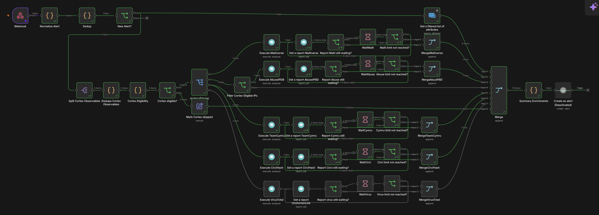

# Runbook: n8n triage workflow

How to build, test and fix every node of the  workflow. The reasons behind each choice are in ADR 0003.


<!--
How to fill in your stage:
- One subsection per node, in the order the nodes run. Copy the node template below.
- Screenshot every node's settings and one successful test. Save them as
  docs/images/n8n/<issue>-<node-name>.png and check them with scripts/check_images.py --ocr.
  No keys, tokens, webhook URLs or real usernames on screenshots.
- Settings table: write the value you typed or selected. For credentials, write only the credential name.
- "If it does not work": every problem you hit while building, with what fixed it.

Node template:

#### Node: <name in n8n>

**What it does:** one sentence.

**How to build it:**
1. ...
2. ...


| Setting | Value |
|---|---|
| | |

**How to test it:** what you send, what you should see.


**If it does not work:**

| What you see | Cause | Fix |
|---|---|---|
| | | |
-->

## 1. Webhook
**What it does:** Receives Wazuh alerts as JSON over an authenticated HTTP POST request and immediately acknowledges receipt.

**How to build it:**

1. Add a Webhook node to the n8n workflow.
2. Set **HTTP Method** to `POST`.
3. Set **Authentication** to `Header Auth` and select the existing `Wazuh webhook token` credential.
4. Set **Respond** to `Immediately`.
5. Publish the workflow and configure the Wazuh `custom-n8n` integration to send JSON alerts to the production Webhook URL.
6. Set the Wazuh integration threshold to level 12. This forwards alerts at level 12 and above.

**Wazuh manager integration:**

The Wazuh manager applies the alert-level filter before sending alerts to n8n. Its `custom-n8n` integration block selects JSON alerts at level 12 and above, then invokes the custom script to forward them to the Webhook. The n8n Webhook handles the incoming request; it does not set this threshold.

The sanitized [Wazuh integration template](../../detection/wazuh/integrations/n8n-integration.xml) shows the manager-side configuration. For the script installation, CA setup, and delivery verification steps, see the [Wazuh integrations README](../../detection/wazuh/integrations/README.md).

**Webhook node settings:**
| Setting | Value |
|---|---|
| HTTP Method | `POST` |
| Authentication | `Header Auth` |
| Credential | `Wazuh webhook token` |
| Respond | `Immediately` |
| Wazuh alert format | JSON |
| Wazuh minimum level | `12` |


**How to test it:** Generate a long-URL test request from Kali to the lab web server. Wazuh should create rule `31115` at level `13`, and n8n should record a successful execution after receiving the alert.

To generate such test - Run this on Kali with `python3`:

```python
python3 - <<'PY'
from urllib.request import urlopen

url = "http://10.10.10.100/?probe=" + "A" * 8000

with urlopen(url, timeout=10) as response:
    print(f"HTTP {response.status}")
PY
```


The test on 2026-11-02 produced the Wazuh alert at 23:36:28 and a successful n8n execution at 23:36:30, completed in 4.066 seconds.


**If it does not work:**

| What you see | Cause | Fix |
|---|---|---|
| Wazuh records the alert, but no n8n execution appears | The workflow is not published, or Wazuh is sending to the test URL | Publish the workflow and configure Wazuh to use the production Webhook URL |

## 2. Normalize

**Owner:** @84rtek

**What it does:** Converts raw Wazuh, Elasticsearch, and Shuffle-wrapper alert payloads into a common JSON structure and extracts observables for downstream processing.

**How to build it:**

1. Add a **Code** node immediately after the Webhook node in the Skeleton workflow.
2. Name the node `Normalize` (or keep the current node name if it is already referenced elsewhere in the workflow).
3. Set **Mode** to `Run Once for All Items`.
4. Set **Language** to `JavaScript`.
5. Copy the contents of [`normalize-v1.2.js`](../../soar/n8n/nodes/normalize-v1.2.js) into the Code node editor.
6. Connect the Code node output to the next workflow stage.
7. Save the workflow.

**Code node settings:**

| Setting | Value |
|---|---|
| Node type | `Code` |
| Mode | `Run Once for All Items` |
| Language | `JavaScript` |
| Implementation | Normalize v1.2 |

**Input formats:**

| Format | Recognition |
|---|---|
| Raw Wazuh | Unwrapped Wazuh alert JSON |
| Elasticsearch | Alert document containing `_source` |
| Shuffle wrapper | Payload containing `all_fields` |

**Normalized output:**

The node produces one normalized alert object per input item. Main fields include:

| Field | Purpose |
|---|---|
| `alert_id` | Original alert identifier |
| `timestamp` | Event timestamp |
| `source_format` | Detected input format: `raw`, `elasticsearch`, or `shuffle-wrapper` |
| `rule` | Rule ID, level, description, groups, and MITRE data |
| `agent` | Agent ID, name, and IP |
| `location`, `decoder` | Event source context |
| `syscheck`, `signature`, `command_line`, `full_log` | Additional event context when available |
| `observables` | Extracted observables with type, value, source field, and internal flag |
| `primary_observable` | Selected primary observable, or `-` when none is eligible |
| `dedup_key` | Key prepared for the separate Dedup stage |

**Observable types:**

| Type | Examples |
|---|---|
| `ip` | IPv4 and IPv6 addresses |
| `domain` | Domain names |
| `url` | Full URLs |
| `uri_path` | URI paths |
| `hash` | MD5, SHA1, SHA256 |
| `filename` | File names |
| `registry_key` | Windows registry paths |
| `user` | User names |
| `hostname` | Host names |
| `other` | Other retained values, including User-Agent |

Internal endpoint data, such as `agent.ip`, remains available in `observables` with `internal: true`. It is not automatically treated as an external IOC or selected as `primary_observable`. When no eligible IOC is present, the primary value is `-`.

The `dedup_key` is generated during normalization. This does not perform duplicate detection; that is the responsibility of the Dedup stage.

**How to test it:**

Use Webhook mock data (or the n8n node's pinned/mock input data) to execute the Code node against each of the six test scenarios below. These are functional tests of Normalize and do not test live Webhook delivery or Header Auth.

| Test | Input scenario | Expected result |
|---|---|---|
| 1 | Network / DNS / HTTP | Extract IP, domain, URL, filename, user, and User-Agent |
| 2 | Sysmon / hashes | Extract MD5, SHA1, SHA256, file path, command line, and user |
| 3 | Syscheck / Windows Registry | Extract registry path as `registry_key` |
| 4 | Raw Wazuh | Recognize `raw` format and extract external IP |
| 5 | Shuffle wrapper | Recognize `shuffle-wrapper` and extract SHA256 and filename |
| 6 | Alert without IOC | Preserve agent context and return `primary_observable: "-"` |

All six scenarios passed with Normalize v1.2.

Example expected output for the no-IOC scenario:

```json
{
  "source_format": "raw",
  "observables": [
    {
      "dataType": "ip",
      "data": "10.10.10.171",
      "field": "agent.ip",
      "internal": true
    },
    {
      "dataType": "other",
      "data": "SYSTEM",
      "field": "data.win.eventdata.user",
      "internal": true,
      "kind": "user"
    },
    {
      "dataType": "hostname",
      "data": "SOC-WIN11-AI",
      "internal": true
    }
  ],
  "primary_observable": "-",
  "dedup_key": "soc:dedup:100506::004:-"
}
```


**Evidence:**

The following screenshots show the Normalize configuration, its position in the workflow, and the mapping of the normalized primary observable into the MISP search node.


Only include screenshots that have actually been captured and checked into the repository.

**If it does not work:**

| What you see | Cause | Fix |
|---|---|---|
| Code node reports an error when using `$input.all()` | The node is not configured to process all input items | Set Mode to `Run Once for All Items` |
| `source_format` is unexpected | Input payload does not match the expected raw, Elasticsearch, or Shuffle-wrapper structure | Inspect the incoming JSON and confirm its wrapper/field names |
| No IOC is found | The alert does not contain an eligible external observable, or the relevant field is not covered by the extractor | Inspect the original payload; keep internal agent context distinct from external IOC data |
| Registry path is treated as a filename | The input field is not recognized as a Windows registry path | Check the source field and the registry detection logic |


## 3. Dedup

**Owner:** @arturesturemkuros

Position: `Webhook -> Normalize Alert -> Dedup -> New Alert? -> (true) -> MISP lookup + Split Cortex Observables`

| Node | Type | What it does |
|---|---|---|
| Dedup | Code (all items) | Looks up `dedup_key` in static data, adds `is_duplicate`, `duplicate_count`, and `first_seen` for duplicates; expires entries older than 3 min |
| New Alert? | If | `{{ $json.is_duplicate }}` is false -> true branch continues; false branch ends |

**Testing.** Static data is not persisted on manual runs, so put all test alerts in
one pinned Webhook output and execute once. Sample set: 7 alerts, expected
4 on true and 3 on false (see screenshots).

**Screenshots** (`docs/images/n8n/`):


- `dedup-output.png` – Dedup output with `is_duplicate: true`, `duplicate_count: 2`
- `dedup-if.png` – New Alert? showing 4 true / 3 false


## 4. MISP and Cortex

**Owner:** @MKonrad-afk

## 5. Score

**Owner:** @arturesturemkuros

## 6. Decision

**Owner:** @arturesturemkuros

## 7. Failure handling

**Owner:** @p4chatek

## 8. TheHive

**Owner:** @Solivagantaeon

## 9. Audit

**Owner:** @Maartini22

## 10. Counters

**Owner:** @Maartini22

## Full test

**Owner:** @Solivagantaeon
