# Runbook: n8n triage workflow

How to build, test and fix every node of the  workflow. The reasons behind each choice are in ADR 0003.


<!--
How to fill in your stage:
- One subsection per node, in the order the nodes run. Copy the node template below.
- Screenshot every node's settings and one successful test. Save them as
  docs/images/n8n/<issue>-<node-name>.png and check them with scripts/check_images.py --ocr.
  No keys, tokens, webhook URLs or real usernames on screenshots.
- Settings table: write the value you typed or selected. For credentials, write only the credential name.
- "If it does not work": every problem you hit while building, with what fixed it.

Node template:

#### Node: <name in n8n>

**What it does:** one sentence.

**How to build it:**
1. ...
2. ...


| Setting | Value |
|---|---|
| | |

**How to test it:** what you send, what you should see.


**If it does not work:**

| What you see | Cause | Fix |
|---|---|---|
| | | |
-->

## 1. Webhook
**What it does:** Receives Wazuh alerts as JSON over an authenticated HTTP POST request and immediately acknowledges receipt.

**How to build it:**

1. Add a Webhook node to the n8n workflow.
2. Set **HTTP Method** to `POST`.
3. Set **Authentication** to `Header Auth` and select the existing `Wazuh webhook token` credential.
4. Set **Respond** to `Immediately`.
5. Publish the workflow and configure the Wazuh `custom-n8n` integration to send JSON alerts to the production Webhook URL.
6. Set the Wazuh integration threshold to level 12. This forwards alerts at level 12 and above.

**Wazuh manager integration:**

The Wazuh manager applies the alert-level filter before sending alerts to n8n. Its `custom-n8n` integration block selects JSON alerts at level 12 and above, then invokes the custom script to forward them to the Webhook. The n8n Webhook handles the incoming request; it does not set this threshold.

The sanitized [Wazuh integration template](../../detection/wazuh/integrations/n8n-integration.xml) shows the manager-side configuration. For the script installation, CA setup, and delivery verification steps, see the [Wazuh integrations README](../../detection/wazuh/integrations/README.md).

**Webhook node settings:**
| Setting | Value |
|---|---|
| HTTP Method | `POST` |
| Authentication | `Header Auth` |
| Credential | `Wazuh webhook token` |
| Respond | `Immediately` |
| Wazuh alert format | JSON |
| Wazuh minimum level | `12` |

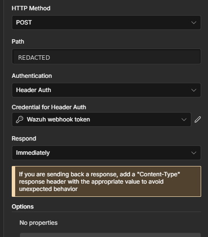


**How to test it:** Generate a long-URL test request from Kali to the lab web server. Wazuh should create rule `31115` at level `13`, and n8n should record a successful execution after receiving the alert.

To generate such test - Run this on Kali with `python3`:

```python
python3 - <<'PY'
from urllib.request import urlopen

url = "http://10.10.10.100/?probe=" + "A" * 8000

with urlopen(url, timeout=10) as response:
    print(f"HTTP {response.status}")
PY
```


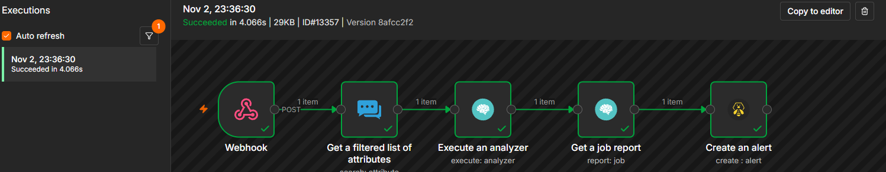

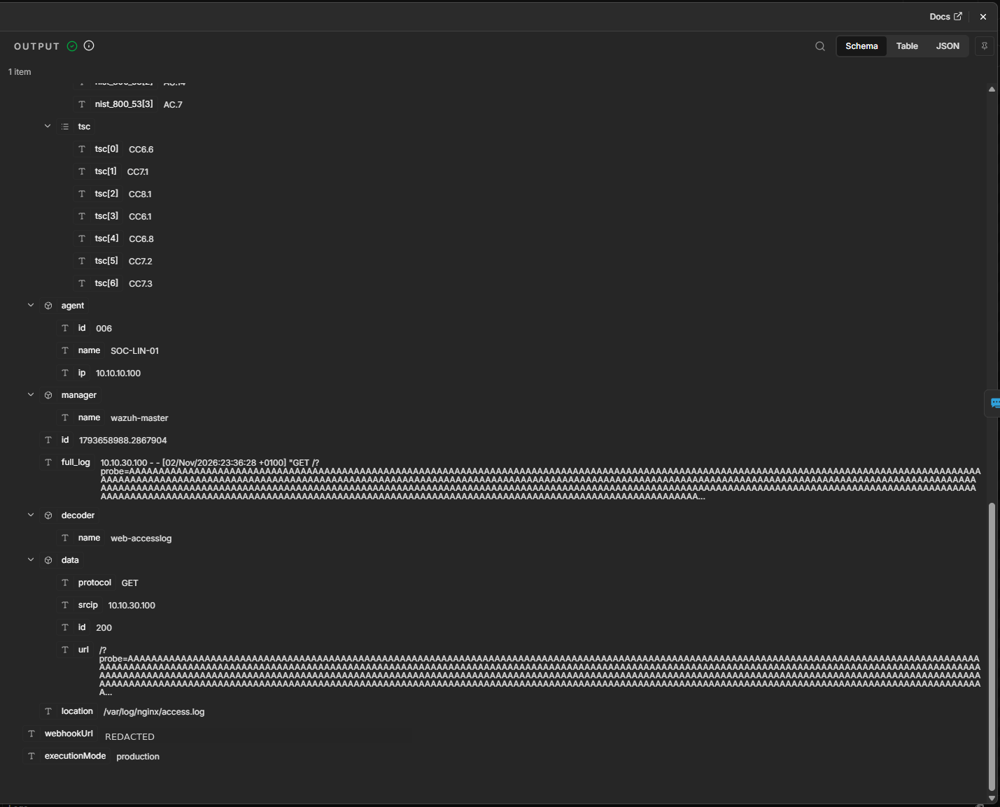


The test on 2026-11-02 produced the Wazuh alert at 23:36:28 and a successful n8n execution at 23:36:30, completed in 4.066 seconds.


**If it does not work:**

| What you see | Cause | Fix |
|---|---|---|
| Wazuh records the alert, but no n8n execution appears | The workflow is not published, or Wazuh is sending to the test URL | Publish the workflow and configure Wazuh to use the production Webhook URL |

## 2. Normalize

**Owner:** @84rtek

**What it does:** Converts raw Wazuh, Elasticsearch, and Shuffle-wrapper alert payloads into a common JSON structure and extracts observables for downstream processing.

**How to build it:**

1. Add a **Code** node immediately after the Webhook node in the Skeleton workflow.
2. Name the node `Normalize` (or keep the current node name if it is already referenced elsewhere in the workflow).
3. Set **Mode** to `Run Once for All Items`.
4. Set **Language** to `JavaScript`.
5. Copy the contents of [`normalize-v1.2.js`](../../soar/n8n/nodes/normalize-v1.2.js) into the Code node editor.
6. Connect the Code node output to the next workflow stage.
7. Save the workflow.

**Code node settings:**

| Setting | Value |
|---|---|
| Node type | `Code` |
| Mode | `Run Once for All Items` |
| Language | `JavaScript` |
| Implementation | Normalize v1.2 |

**Input formats:**

| Format | Recognition |
|---|---|
| Raw Wazuh | Unwrapped Wazuh alert JSON |
| Elasticsearch | Alert document containing `_source` |
| Shuffle wrapper | Payload containing `all_fields` |

**Normalized output:**

The node produces one normalized alert object per input item. Main fields include:

| Field | Purpose |
|---|---|
| `alert_id` | Wazuh alert ID, or Elasticsearch document ID when available |
| `timestamp` | Wazuh alert timestamp |
| `source_format` | Detected input format: `raw`, `elasticsearch`, or `shuffle-wrapper` |
| `rule` | Rule ID, level, description, groups, MITRE data, and fired count |
| `agent` | Agent ID, name, and IP |
| `location`, `decoder` | Event source and decoder context |
| `syscheck`, `signature`, `command_line`, `full_log` | Additional event context when available; `full_log` is limited to 2,000 characters |
| `observables` | Observable list. Each entry includes `dataType`, `data`, `field`, and `internal`; optional fields include `kind`, `algorithm`, or `path` |
| `primary_observable` | Selected primary observable, or `-` when none is eligible |
| `dedup_key` | Key generated for the separate Dedup stage; generating it does not detect duplicate alerts |

**Observable types:**

| Type | Examples |
|---|---|
| `ip` | IPv4 and IPv6 addresses |
| `domain` | Domain names |
| `url` | Full URLs |
| `uri_path` | URI paths |
| `hash` | MD5, SHA1, and SHA256 values |
| `filename` | File basenames; the original path is retained in `path` |
| `registry_key` | Windows Registry paths |
| `other` | User names (`kind: "user"`) |
| `hostname` | Agent host name |
| `user-agent` | User-Agent values |

Normalize v1.2 reads domains from `data.domain` and DNS, HTTP, and TLS fields; URLs from `data.url` and `data.http.url`; and hashes from event hash data and Syscheck before/after fields. File observables contain the basename and retain the original path in `path`.

Private, loopback, and link-local IP addresses are marked `internal: true`. An `agent.ip` value is marked internal only when it falls within those ranges. Domains ending in `.lab`, `.local`, `.lan`, `.internal`, or `.localdomain` are also marked internal. A URL itself is not marked internal, although its hostname may be emitted separately as a domain observable.

The primary observable is selected in this order: non-internal IP, hash, non-internal domain, filename, registry key, or URI path. Full URLs, usernames, User-Agent values, and hostnames are not eligible.

Normalize removes duplicate observables within one alert by case-insensitive type and value, retaining the first source field. The `dedup_key` prepares the alert for the separate Dedup stage; it does not itself detect duplicate alerts.

**How to test it:**

Use Webhook mock data (or the n8n node's pinned/mock input data) to execute the Code node against each of the six test scenarios below. These are functional tests of Normalize and do not test live Webhook delivery or Header Auth.

| Test | Input scenario | Expected result |
|---|---|---|
| 1 | Network / DNS / HTTP | Extract IP, domain, URL, filename, username (`other`, `kind: "user"`), and User-Agent (`user-agent`) |
| 2 | Sysmon / hashes | Extract MD5, SHA1, SHA256, file path, command line, and user |
| 3 | Syscheck / Windows Registry | Extract registry path as `registry_key` |
| 4 | Raw Wazuh | Recognize `raw` format and extract external IP |
| 5 | Shuffle wrapper | Recognize `shuffle-wrapper` and extract SHA256 and filename |
| 6 | Alert without IOC | Preserve agent context and return `primary_observable: "-"` |

All six scenarios passed with Normalize v1.2.

Example expected output for the no-IOC scenario:

```json
{
  "source_format": "raw",
  "observables": [
    {
      "dataType": "ip",
      "data": "10.10.10.171",
      "field": "agent.ip",
      "internal": true
    },
    {
      "dataType": "other",
      "data": "SYSTEM",
      "field": "data.win.eventdata.user",
      "internal": true,
      "kind": "user"
    },
    {
      "dataType": "hostname",
      "data": "SOC-WIN11-AI",
      "internal": true
    }
  ],
  "primary_observable": "-",
  "dedup_key": "soc:dedup:100506::004:-"
}
```


**Evidence:**

The following screenshots show the Normalize configuration, its position in the workflow, and the mapping of the normalized primary observable into the MISP search node.

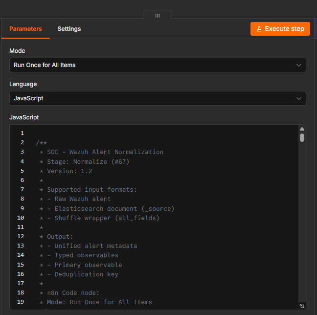

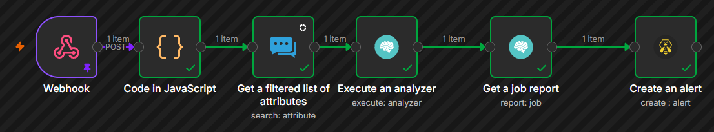

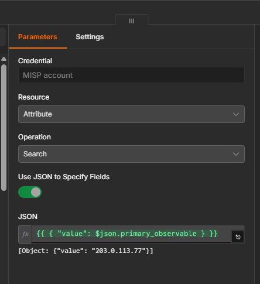


Only include screenshots that have actually been captured and checked into the repository.

**If it does not work:**

| What you see | Cause | Fix |
|---|---|---|
| Code node reports an error when using `$input.all()` | The node is not configured to process all input items | Set Mode to `Run Once for All Items` |
| `source_format` is unexpected | Input payload does not match the expected raw, Elasticsearch, or Shuffle-wrapper structure | Inspect the incoming JSON and confirm its wrapper/field names |
| No IOC is found | The alert does not contain an eligible external observable, or the relevant field is not covered by the extractor | Inspect the original payload; keep internal agent context distinct from external IOC data |
| Registry path is treated as a filename | The input field is not recognized as a Windows registry path | Check the source field and the registry detection logic |


## 3. Dedup

**Owner:** @arturesturemkuros

## 4. MISP and Cortex

**Owner:** @MKonrad-afk

**What it does:** Searches normalized alert observables in MISP and submits eligible IP, domain, URL, and hash observables to their configured Cortex analyzers. Cortex results and skipped observables are collected for the final alert summary.

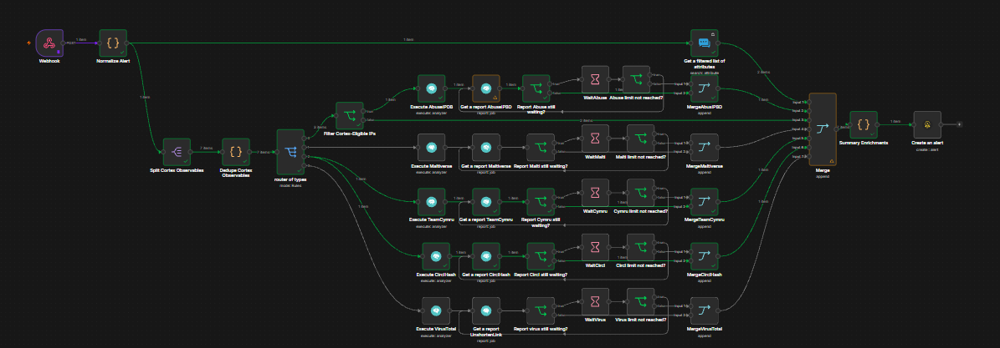

*Figure. The full workflow, including its separate MISP and Cortex enrichment branches.*

### MISP branch

#### Node: Get a filtered list of attributes

**What it does:** Searches MISP for attributes matching the normalized observables and returns matches with their event and attribute context.

**How to build it:**

1. Add the MISP **Get a filtered list of attributes** node to the branch from `Normalize Alert`.
2. Select the existing MISP credential.
3. Map the normalized observable data to the node's search input, following the current node configuration.
4. Keep the MISP branch independent of the Cortex eligibility and analyzer routes.

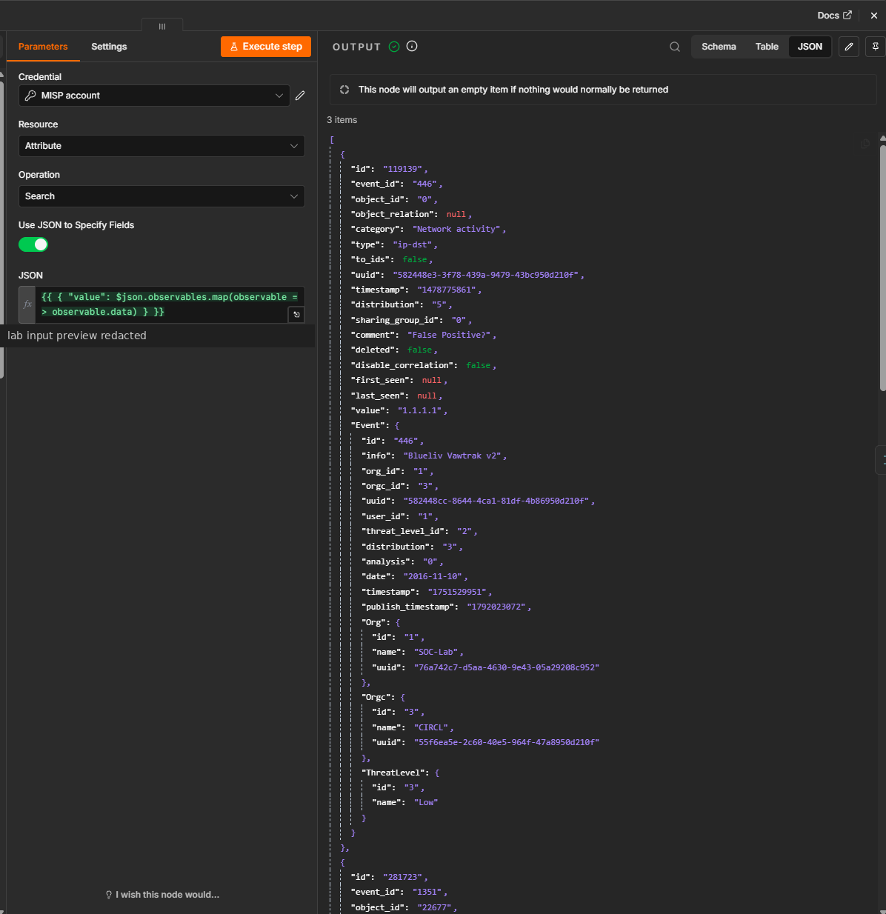

*Figure. MISP Attribute Search and example lab results for the public IP address.*

| Setting | Value |
|---|---|
| Node | `Get a filtered list of attributes` |
| Credential | Existing MISP credential |
| Search input | Normalized alert observables |
| Output used by summary | `misp.attribute_count`, `misp.unique_indicators` |

**How to test it:** Send the raw Wazuh lab alert for rule `100723`. The test returned two MISP attributes for `1.1.1.1`. Both had `to_ids: false`. One included a warninglist comment identifying the address as a known public DNS resolver. Review each attribute's comment, `to_ids`, `disable_correlation`, event, and warninglist context. A match or a `to_ids` value alone is not a malicious or benign verdict.

**If it does not work:**

| What you see | Cause | Fix |
|---|---|---|
| `attribute_count` is `0` | The search completed without matching attributes, or the search input was empty or mapped incorrectly | Inspect the normalized observable values and the MISP node's search input |
| An attribute has `to_ids: false` | IDS export is disabled for that attribute, for example by a warninglist | Preserve and review the attribute and event context. Do not treat this value as a verdict |

### Cortex branch

#### Node: Split Cortex Observables

**What it does:** Converts the normalized `observables` array into one n8n item per observable while retaining the alert context.

**How to build it:**

1. Connect the node after `Normalize Alert`.
2. Split the `observables` field into individual items.
3. Confirm that each item still contains the alert metadata and the observable fields required by downstream nodes.

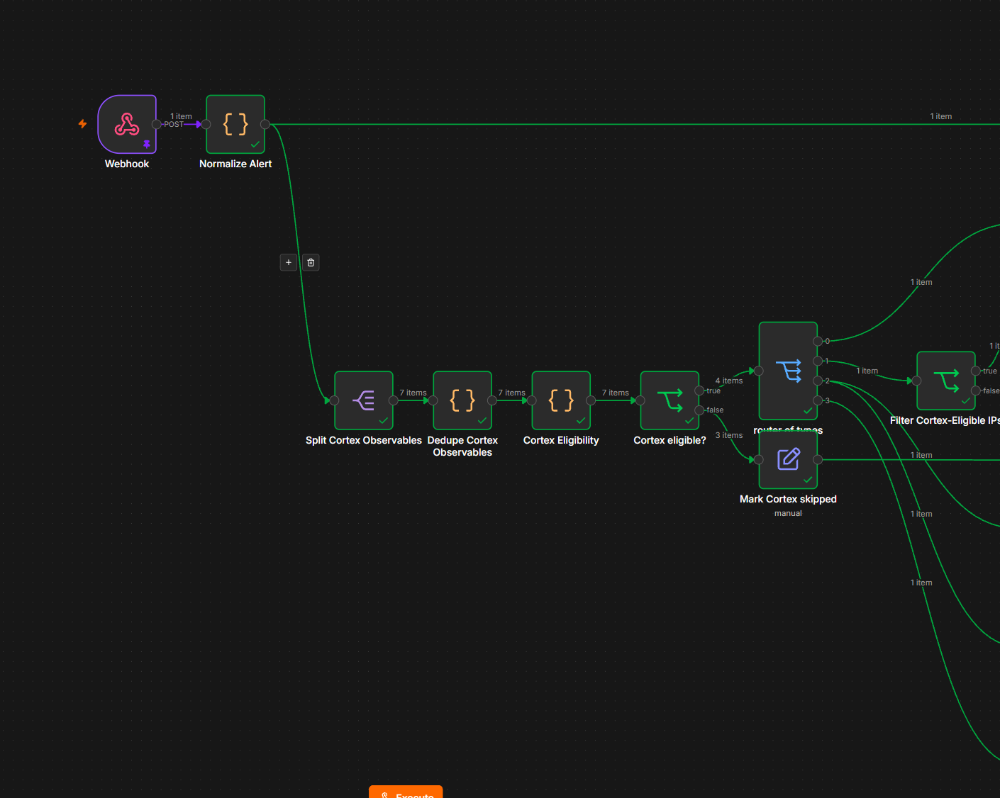

*Figure. Observable items after preparation, deduplication, and type routing.*

| Setting | Value |
|---|---|
| Node | `Split Cortex Observables` |
| Field to split | `observables` |
| Expected output | One item per observable |

**How to test it:** Use rule `100723`. Its seven observables should be available as individual items after the split.

#### Node: Dedupe Cortex Observables

**What it does:** Removes duplicate observables within the alert using the normalized observable type and value, while retaining the source fields and internal status.

**How to build it:**

1. Add a JavaScript **Code** node after `Split Cortex Observables`.
2. Set **Mode** to `Run Once for All Items`.
3. Use the implementation in [`dedupe-cortex-observadables.js`](../../soar/n8n/nodes/dedupe-cortex-observadables.js).

| Setting | Value |
|---|---|
| Mode | `Run Once for All Items` |
| Language | `JavaScript` |
| Implementation | [`dedupe-cortex-observadables.js`](../../soar/n8n/nodes/dedupe-cortex-observadables.js) |

**How to test it:** Confirm that repeated type/value pairs produce one item and that the retained item preserves its source fields and `internal` flag.

#### Node: Cortex Eligibility

**What it does:** Adds `cortex_eligible` and `cortex_skip_reason` to each observable so all Cortex routes use the same eligibility checks.

**How to build it:**

1. Add a JavaScript **Code** node after `Dedupe Cortex Observables`.
2. Evaluate each observable item individually.
3. Use the implementation in [`cortex-eligibility.js`](../../soar/n8n/nodes/cortex-eligibility.js).

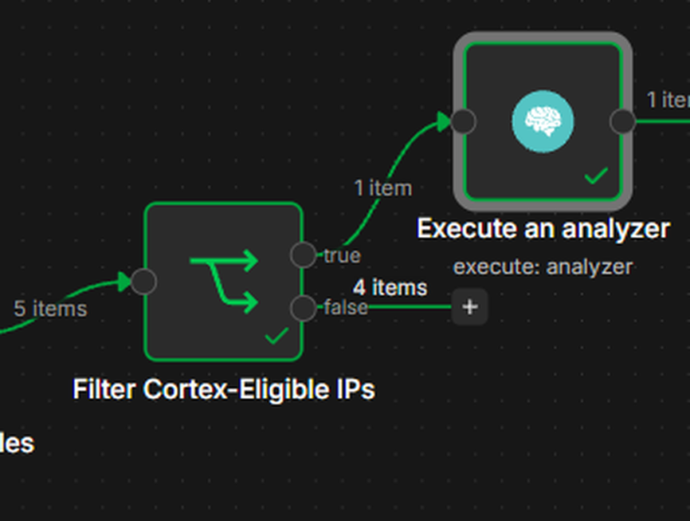

*Figure. The shared eligibility check identifies observables that can continue to Cortex.*

| Setting | Value |
|---|---|
| Mode | `Run Once for Each Item` |
| Language | `JavaScript` |
| Implementation | [`cortex-eligibility.js`](../../soar/n8n/nodes/cortex-eligibility.js) |
| Eligibility fields | `cortex_eligible`, `cortex_skip_reason` |

The current eligibility rules allow non-internal hashes and supported public IP, domain, and URL observables. Internal, invalid, or non-public values are skipped. Unsupported types such as `filename` are also skipped.

#### Node: Cortex eligible?

**What it does:** Sends eligible observables to the type router and sends ineligible observables to `Mark Cortex skipped`.

**How to build it:**

1. Add an IF node after `Cortex Eligibility`.
2. Check whether `cortex_eligible` is `true`.
3. Connect the true output to `router of types`.
4. Connect the false output to `Mark Cortex skipped`.

| Setting | Value |
|---|---|
| Condition | `{{$json.cortex_eligible}}` |
| Operator | `is true` |
| True output | `router of types` |
| False output | `Mark Cortex skipped` |

#### Node: Mark Cortex skipped

**What it does:** Records an observable that was filtered out, including its type, value, source field, internal flag, and skip reason.

**How to build it:**

1. Connect the false output of `Cortex eligible?` to this node.
2. Set `record_type` to `cortex_skipped`.
3. Map the observable fields and `cortex_skip_reason` into the skipped record.
4. Confirm that the reason is mapped once.

**How to test it:** Rule `100723` should preserve the internal source IP, agent IP, and hostname in the skipped list with a reason for each.

#### Node: router of types

**What it does:** Routes each eligible observable to the analyzer branch for its type.

| Observable type | Analyzer |
|---|---|
| `ip` | `AbuseIPDB_2_0` |
| `domain` | `Maltiverse_Report_1_0` |
| `hash` | `TeamCymruMHR_1_0` and `CIRCLHashlookup_1_1` |
| `url` | `VirusTotal_GetReport_3_1` |

The route rules use the normalized observable type. Analyzer nodes use the corresponding observable type and value from the observable item.

#### Cortex analyzer execution and report polling

**Execute** starts an analysis in Cortex for one observable. Cortex returns a job ID. Think of this ID as a tracking number for that analysis.

**Get a report** uses that same ID to check whether the analysis is ready and to collect its result. If Cortex is still working, n8n waits two seconds and checks again. It repeats this up to five times. If the analysis is still unfinished, the workflow records it as pending and continues.

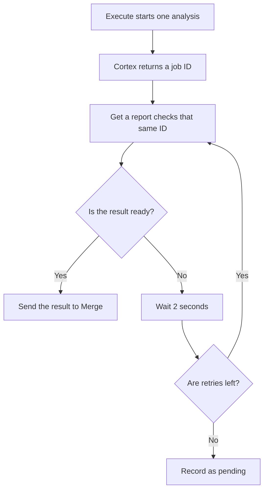

*Figure. One Cortex job is checked repeatedly using the same job ID until it finishes or reaches the retry limit.*

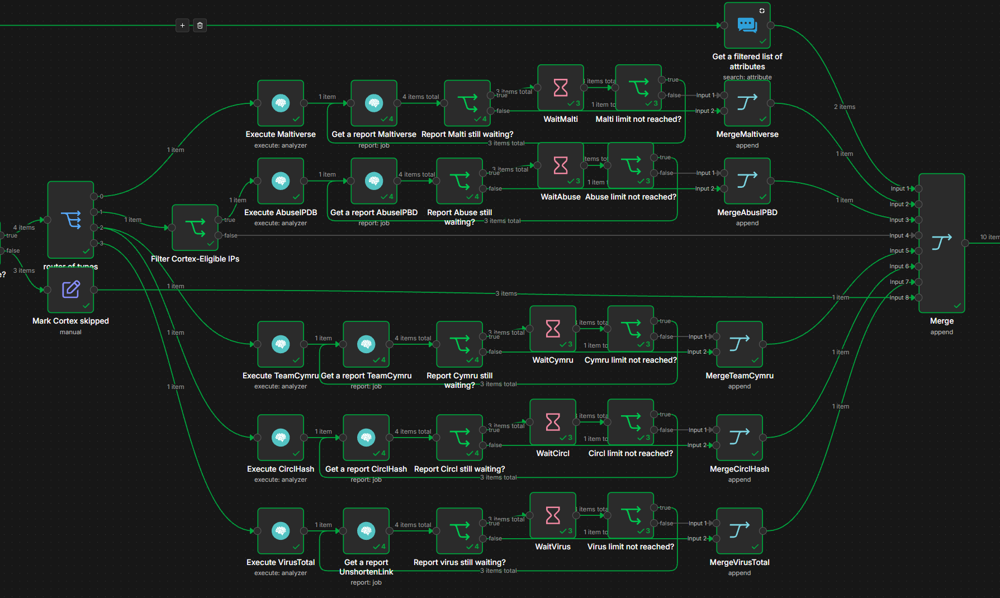

*Figure. Analyzer branches submit jobs and poll their reports before sending results to Merge.*

**How to test it:** Use rule `100723`. Open an **Execute** result and note its job ID. In the matching **Get a report** node, confirm that the same ID is used. Seeing `Waiting` on the first check is normal. The workflow should wait and check that same ID again.

#### Node: Summary Enrichments

**What it does:** Combines MISP results, Cortex results, skipped observables, and job states into the final enrichment summary.

**How to build it:**

1. Append the analyzer, MISP, and skipped-record branches through the existing `Merge` node.
2. Connect the merged items to `Summary Enrichments`.
3. Use the implementation in [`summary-enrichments.js`](../../soar/n8n/nodes/summary-enrichments.js).

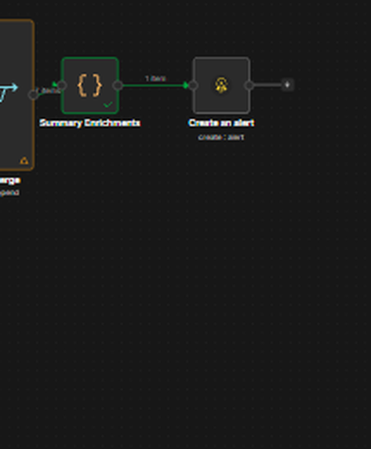

*Figure. MISP results, analyzer reports, and skipped observables flow into the final summary.*

| Setting | Value |
|---|---|
| Merge mode | `Append` |
| Summary node | `Summary Enrichments` |
| Implementation | [`summary-enrichments.js`](../../soar/n8n/nodes/summary-enrichments.js) |

**End-to-end verification:** Rule `100723` exercised all four Cortex observable routes:

| Observable | Result |
|---|---|
| `soc-lab-postdns.example.org` | Maltiverse completed. Classification `neutral`, zero historical matches |
| `1.1.1.1` | AbuseIPDB completed. Whitelisted, confidence score `0` |
| Test SHA-256 | Team Cymru returned `No record found`. CIRCL Hashlookup returned `Non existing SHA-256` |
| Test URL | VirusTotal job completed and returned `NotFoundError` for the exact URL |

The workflow returned five Cortex result entries, `processing.status: complete`, and empty `pending` and `failed` lists. The VirusTotal `NotFoundError` means the URL was not found in that lookup. It is not a clean verdict. The internal source IP, agent IP, and hostname were retained under `skipped_by_filter`.

**If it does not work:**

| What you see | Cause | Fix |
|---|---|---|
| `Invalid Wazuh alert: missing rule.id` | The webhook input does not contain the rule ID expected by `Normalize Alert` | Inspect the actual input and send an alert in the expected structure with `rule.id` present |
| An external observable is skipped | Its type, value, or `internal` flag is missing, or it failed the eligibility checks | Inspect the item after `Dedupe Cortex Observables` and the `cortex_skip_reason` value |
| A report remains `Waiting` or `InProgress` | The analyzer job has not finished yet | Continue polling with the same job ID within the configured limit |
| Cortex reports `Service parameter is missing` | The analyzer job failed before returning a usable report | Inspect the Cortex job and analyzer worker configuration. This message alone does not indicate a missing Wazuh field |
| VirusTotal returns `NotFoundError` with a completed job | The exact URL was not found in that lookup | Preserve the analyzer response. Do not interpret it as proof that the URL is benign |

## 5. Score

**Owner:** @arturesturemkuros

## 6. Decision

**Owner:** @arturesturemkuros

## 7. Failure handling

**Owner:** @p4chatek

## 8. TheHive

**Owner:** @Solivagantaeon

## 9. Audit

**Owner:** @Maartini22

## 10. Counters

**Owner:** @Maartini22

## Full test

**Owner:** @Solivagantaeon
