# Runbook: n8n triage workflow

How to build, test and fix every node of the  workflow. The reasons behind each choice are in ADR 0003.


<!--
How to fill in your stage:
- One subsection per node, in the order the nodes run. Copy the node template below.
- Screenshot every node's settings and one successful test. Save them as
  docs/images/n8n/<issue>-<node-name>.png and check them with scripts/check_images.py --ocr.
  No keys, tokens, webhook URLs or real usernames on screenshots.
- Settings table: write the value you typed or selected. For credentials, write only the credential name.
- "If it does not work": every problem you hit while building, with what fixed it.

Node template:

#### Node: <name in n8n>

**What it does:** one sentence.

**How to build it:**
1. ...
2. ...


| Setting | Value |
|---|---|
| | |

**How to test it:** what you send, what you should see.


**If it does not work:**

| What you see | Cause | Fix |
|---|---|---|
| | | |
-->

## 1. Webhook
**Owner:** @MKonrad-afk

**What it does:** Receives Wazuh alerts as JSON over an authenticated HTTP POST request and immediately acknowledges receipt.

**How to build it:**

1. Add a Webhook node to the n8n workflow.
2. Set **HTTP Method** to `POST`.
3. Set **Authentication** to `Header Auth` and select the existing `Wazuh webhook token` credential.
4. Set **Respond** to `Immediately`.
5. Publish the workflow and configure the Wazuh `custom-n8n` integration to send JSON alerts to the production Webhook URL.
6. Set the Wazuh integration threshold to level 12. This forwards alerts at level 12 and above.

**Wazuh manager integration:**

The Wazuh manager applies the alert-level filter before sending alerts to n8n. Its `custom-n8n` integration block selects JSON alerts at level 12 and above, then invokes the custom script to forward them to the Webhook. The n8n Webhook handles the incoming request; it does not set this threshold.

The sanitized [Wazuh integration template](../../detection/wazuh/integrations/n8n-integration.xml) shows the manager-side configuration. For the script installation, CA setup, and delivery verification steps, see the [Wazuh integrations README](../../detection/wazuh/integrations/README.md).

**Webhook node settings:**
| Setting | Value |
|---|---|
| HTTP Method | `POST` |
| Authentication | `Header Auth` |
| Credential | `Wazuh webhook token` |
| Respond | `Immediately` |
| Wazuh alert format | JSON |
| Wazuh minimum level | `12` |


**How to test it:** Generate a long-URL test request from Kali to the lab web server. Wazuh should create rule `31115` at level `13`, and n8n should record a successful execution after receiving the alert.

To generate such test - Run this on Kali with `python3`:

```python
python3 - <<'PY'
from urllib.request import urlopen

url = "http://10.10.10.100/?probe=" + "A" * 8000

with urlopen(url, timeout=10) as response:
    print(f"HTTP {response.status}")
PY
```


The test on 2026-11-02 produced the Wazuh alert at 23:36:28 and a successful n8n execution at 23:36:30, completed in 4.066 seconds.


**If it does not work:**

| What you see | Cause | Fix |
|---|---|---|
| Wazuh records the alert, but no n8n execution appears | The workflow is not published, or Wazuh is sending to the test URL | Publish the workflow and configure Wazuh to use the production Webhook URL |

## 2. Normalize

**Owner:** @84rtek

**What it does:** Converts raw Wazuh, Elasticsearch, and Shuffle-wrapper alert payloads into a common JSON structure and extracts observables for downstream processing.

**How to build it:**

1. Add a **Code** node immediately after the Webhook node in the Skeleton workflow.
2. Name the node `Normalize` (or keep the current node name if it is already referenced elsewhere in the workflow).
3. Set **Mode** to `Run Once for All Items`.
4. Set **Language** to `JavaScript`.
5. Copy the contents of [`normalize-v1.2.js`](../../soar/n8n/nodes/normalize-v1.2.js) into the Code node editor.
6. Connect the Code node output to the next workflow stage.
7. Save the workflow.

**Code node settings:**

| Setting | Value |
|---|---|
| Node type | `Code` |
| Mode | `Run Once for All Items` |
| Language | `JavaScript` |
| Implementation | Normalize v1.2 |

**Input formats:**

| Format | Recognition |
|---|---|
| Raw Wazuh | Unwrapped Wazuh alert JSON |
| Elasticsearch | Alert document containing `_source` |
| Shuffle wrapper | Payload containing `all_fields` |

**Normalized output:**

The node produces one normalized alert object per input item. Main fields include:

| Field | Purpose |
|---|---|
| `alert_id` | Wazuh alert ID, or Elasticsearch document ID when available |
| `timestamp` | Wazuh alert timestamp |
| `source_format` | Detected input format: `raw`, `elasticsearch`, or `shuffle-wrapper` |
| `rule` | Rule ID, level, description, groups, MITRE data, and fired count |
| `agent` | Agent ID, name, and IP |
| `location`, `decoder` | Event source and decoder context |
| `syscheck`, `signature`, `command_line`, `full_log` | Additional event context when available; `full_log` is limited to 2,000 characters |
| `observables` | Observable list. Each entry includes `dataType`, `data`, `field`, and `internal`; optional fields include `kind`, `algorithm`, or `path` |
| `primary_observable` | Selected primary observable, or `-` when none is eligible |
| `source_ip` | Source IP extracted from the supported Wazuh fields, or null if unavailable |
| `dedup_mode` | `web-source` for a web rule with a `source IP`, otherwise default |
| `dedup_key` | Key built from the rule, signature, agent, source IP, and primary observable; web rules with a source IP use * as the final component |

**Observable types:**

| Type | Examples |
|---|---|
| `ip` | IPv4 and IPv6 addresses |
| `domain` | Domain names |
| `url` | Full URLs |
| `uri_path` | URI paths |
| `hash` | MD5, SHA1, and SHA256 values |
| `filename` | File basenames; the original path is retained in `path` |
| `registry_key` | Windows Registry paths |
| `other` | User names (`kind: "user"`) |
| `hostname` | Agent host name |
| `user-agent` | User-Agent values |

Normalize v1.2 reads domains from `data.domain` and DNS, HTTP, and TLS fields; URLs from `data.url` and `data.http.url`; and hashes from event hash data and Syscheck before/after fields. File observables contain the basename and retain the original path in `path`.

Private, loopback, and link-local IP addresses are marked `internal: true`. An `agent.ip` value is marked internal only when it falls within those ranges. Domains ending in `.lab`, `.local`, `.lan`, `.internal`, or `.localdomain` are also marked internal. A URL itself is not marked internal, although its hostname may be emitted separately as a domain observable.

The primary observable is selected in this order: non-internal IP, hash, non-internal domain, filename, registry key, or URI path. Full URLs, usernames, User-Agent values, and hostnames are not eligible.

Normalize removes duplicate observables within one alert by case-insensitive type and value, retaining the first source field. The `dedup_key` prepares the alert for the separate Dedup stage; it does not itself detect duplicate alerts.

**How to test it:**

Use Webhook mock data (or the n8n node's pinned/mock input data) to execute the Code node against each of the six test scenarios below. These are functional tests of Normalize and do not test live Webhook delivery or Header Auth.

| Test | Input scenario | Expected result |
|---|---|---|
| 1 | Network / DNS / HTTP | Extract IP, domain, URL, filename, username (`other`, `kind: "user"`), and User-Agent (`user-agent`) |
| 2 | Sysmon / hashes | Extract MD5, SHA1, SHA256, file path, command line, and user |
| 3 | Syscheck / Windows Registry | Extract registry path as `registry_key` |
| 4 | Raw Wazuh | Recognize `raw` format and extract external IP |
| 5 | Shuffle wrapper | Recognize `shuffle-wrapper` and extract SHA256 and filename |
| 6 | Alert without IOC | Preserve agent context and return `primary_observable: "-"` |

All six scenarios passed with Normalize v1.2.

Example expected output for the no-IOC scenario:

```json
{
  "source_format": "raw",
  "observables": [
    {
      "dataType": "ip",
      "data": "10.10.10.171",
      "field": "agent.ip",
      "internal": true
    },
    {
      "dataType": "other",
      "data": "SYSTEM",
      "field": "data.win.eventdata.user",
      "internal": true,
      "kind": "user"
    },
    {
      "dataType": "hostname",
      "data": "SOC-WIN11-AI",
      "internal": true
    }
  ],
  "primary_observable": "-",
  "dedup_key": "soc:dedup:100506::004:-:-"
}
```


**Evidence:**

The following screenshots show the Normalize configuration, its position in the workflow, and the mapping of the normalized primary observable into the MISP search node.


Only include screenshots that have actually been captured and checked into the repository.

**If it does not work:**

| What you see | Cause | Fix |
|---|---|---|
| Code node reports an error when using `$input.all()` | The node is not configured to process all input items | Set Mode to `Run Once for All Items` |
| `source_format` is unexpected | Input payload does not match the expected raw, Elasticsearch, or Shuffle-wrapper structure | Inspect the incoming JSON and confirm its wrapper/field names |
| No IOC is found | The alert does not contain an eligible external observable, or the relevant field is not covered by the extractor | Inspect the original payload; keep internal agent context distinct from external IOC data |
| Registry path is treated as a filename | The input field is not recognized as a Windows registry path | Check the source field and the registry detection logic |


## 3. Dedup

**Owner:** @arturesturemkuros

**What it does:** Detects an alert that was already seen within the last 7 minutes and stops it before MISP and Cortex, so a repeated alert is not processed twice.

**How to build it:**

1. Open the workflow and remove the connections that leave the Normalize node (to the MISP search node and to Split Cortex Observables).
2. Add a **Code** node after Normalize and name it `Dedup`.
3. Set **Mode** to `Run Once for All Items` and **Language** to `JavaScript`.
4. Paste the code below into the editor.
5. Add an **If** node after Dedup and name it `New Alert?`.
6. In the condition, set the value to `{{ $json.is_duplicate }}` and the operator to **Boolean -> is false**.
7. Connect the **true** output to both the MISP search node and Split Cortex Observables. Leave the **false** output empty.
8. Save and publish the workflow.

```javascript
const WINDOW_MS = 7 * 60 * 1000; // dedup window, 7 minutes

const now = Date.now();
const store = $getWorkflowStaticData('global');
store.dedup = store.dedup ?? {};

// entries older than the window are removed
for (const [k, v] of Object.entries(store.dedup)) {
  if (now - v.first_seen > WINDOW_MS) delete store.dedup[k];
}

return $input.all().map(item => {
  const key = item.json.dedup_key;
  const hit = store.dedup[key]; // undefined when the key was not seen

  if (hit) {
    hit.count++;
    return { json: { ...item.json, is_duplicate: true,
      duplicate_count: hit.count, first_seen: hit.first_seen } };
  }

  store.dedup[key] = { first_seen: now, count: 1 };
  return { json: { ...item.json, is_duplicate: false, duplicate_count: 1 } };
});
```

**Dedup node settings:**

| Setting | Value |
|---|---|
| Node type | `Code` |
| Mode | `Run Once for All Items` |
| Language | `JavaScript` |
| Window (`WINDOW_MS`) | `7 * 60 * 1000` (7 minutes) |
| State | `$getWorkflowStaticData('global')`, key `dedup` |
| Input | `dedup_key` from Normalize |
| Output fields added | `is_duplicate`, `duplicate_count`, `first_seen` (duplicates only) |

**New Alert? node settings:**

| Setting | Value |
|---|---|
| Node type | `If` |
| Condition | `{{ $json.is_duplicate }}` -> Boolean -> is false |
| true output | MISP search node and Split Cortex Observables |
| false output | Not connected (duplicate, execution ends) |

**The key:**

Normalize builds the key as `soc:dedup:<rule.id>:<signature_id>:<agent.id>:<source_ip>:<primary_observable>`. The source IP includes private addresses. For web rules (groups `web`, `accesslog`, `web_scan`) with a source IP, the last element is `*`, so the path is not part of the key. Normalize also outputs `source_ip` and `dedup_mode` (`default` or `web-source`) to show which form was used.

**How to test it:**

Static data is not saved when the workflow is run manually, so a duplicate is only recognised inside one execution. Put all test alerts into one pinned Webhook output and run the workflow once.

1. Open the Webhook node, choose **Edit Output** and paste the seven test alerts (see the table).
2. Click **Execute workflow**.
3. Open the Dedup output and check `is_duplicate` and `duplicate_count` for every item.
4. Open New Alert? and check how many items went to each branch.

| Test | Input scenario | Expected result |
|---|---|---|
| 1 | New alert, public source IP | `is_duplicate: false`, `dedup_mode: default` |
| 2 | Same alert again | `is_duplicate: true`, `duplicate_count: 2` |
| 3 | Web rule, private source IP, path `/dvwa/admin` | `is_duplicate: false`, `dedup_mode: web-source` |
| 4 | Same web rule and source IP, other path | `is_duplicate: true`, same key as test 3 |
| 5 | Same web rule, different source IP | `is_duplicate: false`, different key |
| 6 | No observables, no source IP | `is_duplicate: false`, `primary_observable: "-"` |
| 7 | Same alert as test 6 again | `is_duplicate: true` |

Expected: **4 items on the true branch and 3 items on the false branch.**

The test was run on 2026-11-08 and gave this result. Window expiry was not tested, because it needs the active workflow. To test it, send the same alert twice to the production Webhook URL, wait longer than 3 minutes and send it again; the last one should pass as new.

**Evidence:**

The screenshots show the workflow with the new nodes, the Dedup output for a duplicate, and the New Alert? split.


*Figure. Dedup and New Alert? placed between Normalize Alert and the MISP and Cortex branches.*

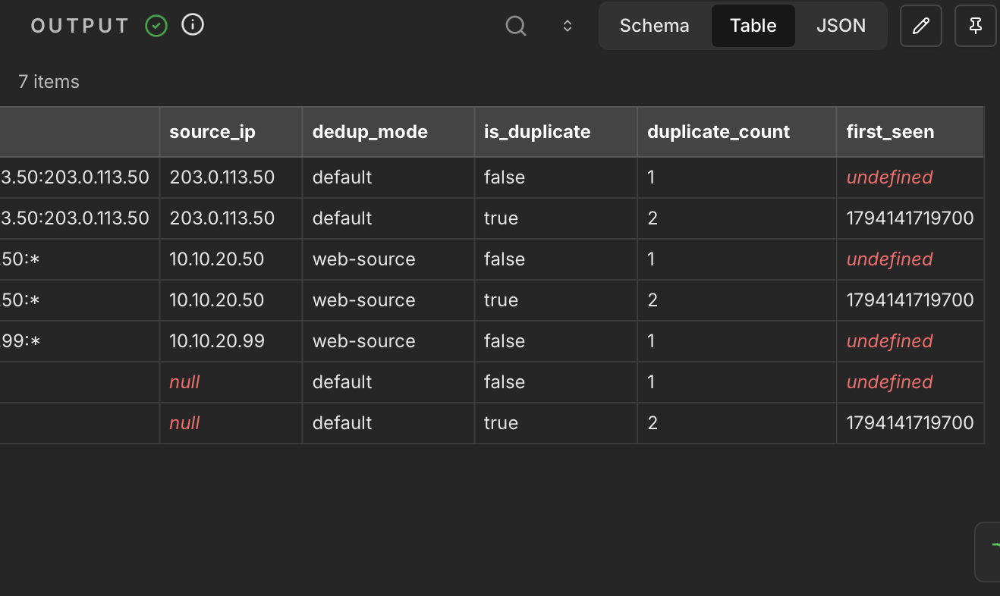

*Figure. Dedup output for a repeated alert, with `is_duplicate: true` and `duplicate_count: 2`.*

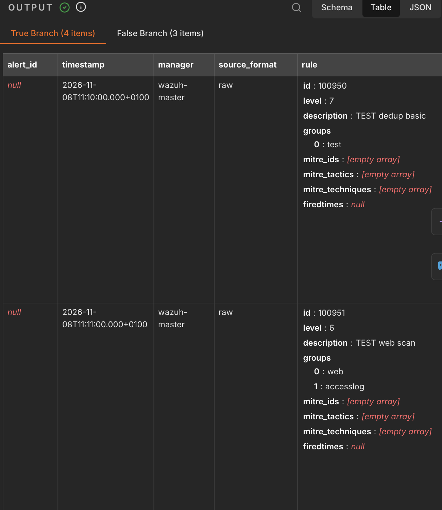

*Figure. New Alert? result for the seven test alerts: 4 items continue (true), 3 duplicates stop (false).*

**If it does not work:**

| What you see | Cause | Fix |
|---|---|---|
| Every alert is new, even an identical one sent in a separate run | Static data is not saved on manual runs | Put all test alerts into one pinned output and execute once, or test on the active workflow with the production Webhook URL |
| Duplicates are not recognised on the active workflow | The workflow is not published, or alerts are sent to the test URL | Publish the workflow and send to the production Webhook URL |
| New Alert? reports a type error | `is_duplicate` is missing, because the If node is not connected to the Dedup output | Connect Dedup to New Alert? and check the Dedup output |
| Web alerts are not merged and `dedup_mode` is `default` | The alert has no web group in `rule.groups`, or no source IP | Check `rule.groups` and `source_ip` in the Normalize output and add the group to `WEB_GROUPS` in Normalize |
| Dedup fails with a missing `dedup_key` | The node is not connected after Normalize, or Normalize failed | Check the connection and the Normalize output |
| Different events from one rule and agent are dropped | The alerts have no observables and no source IP, so they share one key | Known limitation; check the original alerts and consider adding a field to the key |
| An alert is dropped as a duplicate, but its first copy failed in a later stage | The key is stored before enrichment | Wait until the window ends and resend |

## 4. MISP and Cortex

**Owner:** @MKonrad-afk

**What it does:** Searches normalized alert observables in MISP and submits eligible IP, domain, URL, and hash observables to their configured Cortex analyzers. Cortex results and skipped observables are collected for the final alert summary.


*Figure. The full workflow, including its separate MISP and Cortex enrichment branches.*

### MISP branch

#### Node: Get a filtered list of attributes

**What it does:** Searches MISP for attributes matching the values in the normalized alert observables. Matching attributes are returned with their attribute and event context.

**How to build it:**

1. Add the MISP **Get a filtered list of attributes** node to the branch from `Normalize`.
2. Select the existing MISP credential.
3. Set **Resource** to `Attribute` and **Operation** to `Search`.
4. Turn on **Use JSON to Specify Fields**.
5. In the **JSON** field, enter this expression:

   `{{ { "value": $json.observables.map(observable => observable.data) } }}`

   This collects the `data` value from every item in the normalized `observables` array and passes the values to MISP as its `value` search filter. The expression uses the alert's observable values at runtime.

6. Keep the MISP branch connected directly to `Normalize`, independently of the Cortex eligibility and analyzer routes.


**Figure:** MISP Attribute Search configuration and matching lab results.

| Setting | Value |
|---|---|
| Credential | Existing MISP credential |
| Resource | `Attribute` |
| Operation | `Search` |
| Use JSON to Specify Fields | On |
| JSON search filter | `value` mapped from `$json.observables[].data` |
| Output used by summary | `misp.attribute_count`, `misp.unique_indicators` |

**How to test it:** Send the raw Wazuh lab alert for rule `100723`. Check that the MISP node's JSON field evaluates to the alert's observable values. In the observed test, MISP returned two attributes for `1.1.1.1`. Both had `to_ids: false`. One included a warninglist comment identifying the address as a known public DNS resolver. Review each attribute's comment, `to_ids`, `disable_correlation`, event, and warninglist context. A match or a `to_ids` value alone is not a malicious or benign verdict.

**If it does not work:**

| What you see | Cause | Fix |
|---|---|---|
| `attribute_count` is `0` | The search found no matching attributes, or the JSON expression produced an empty or incorrectly mapped value list | Inspect `$json.observables` at the MISP node input and confirm that the JSON field uses `observable.data` |
| An attribute has `to_ids: false` | IDS export is disabled for that attribute, for example by a warninglist | Preserve and review the attribute and event context. Do not treat this value as a verdict |

### Cortex branch

#### Node: Split Cortex Observables

**What it does:** Converts the normalized `observables` array into one n8n item per observable while retaining the alert context.

**How to build it:**

1. Connect the node after `Normalize`.
2. Split the `observables` field into individual items.
3. Confirm that each item still contains the alert metadata and the observable fields required by downstream nodes.


*Figure. Observable items after preparation, deduplication, and type routing.*

| Setting | Value |
|---|---|
| Node | `Split Cortex Observables` |
| Field to split | `observables` |
| Expected output | One item per observable |

**How to test it:** Use rule `100723`. Its seven observables should be available as individual items after the split.

#### Node: Dedupe Cortex Observables

**What it does:** Removes duplicate observables within the alert using the normalized observable type and value, while retaining the source fields and internal status.

**How to build it:**

1. Add a JavaScript **Code** node after `Split Cortex Observables`.
2. Set **Mode** to `Run Once for All Items`.
3. Use the implementation in [`dedupe-cortex-observadables.js`](../../soar/n8n/nodes/dedupe-cortex-observadables.js).

| Setting | Value |
|---|---|
| Mode | `Run Once for All Items` |
| Language | `JavaScript` |
| Implementation | [`dedupe-cortex-observadables.js`](../../soar/n8n/nodes/dedupe-cortex-observadables.js) |

**How to test it:** Confirm that repeated type/value pairs produce one item and that the retained item preserves its source fields and `internal` flag.

#### Node: Cortex Eligibility

**What it does:** Adds `cortex_eligible` and `cortex_skip_reason` to each observable so all Cortex routes use the same eligibility checks.

**How to build it:**

1. Add a JavaScript **Code** node after `Dedupe Cortex Observables`.
2. Evaluate each observable item individually.
3. Use the implementation in [`cortex-eligibility.js`](../../soar/n8n/nodes/cortex-eligibility.js).


*Figure. The shared eligibility check identifies observables that can continue to Cortex.*

| Setting | Value |
|---|---|
| Mode | `Run Once for Each Item` |
| Language | `JavaScript` |
| Implementation | [`cortex-eligibility.js`](../../soar/n8n/nodes/cortex-eligibility.js) |
| Eligibility fields | `cortex_eligible`, `cortex_skip_reason` |

The current eligibility rules allow non-internal hashes and supported public IP, domain, and URL observables. Internal, invalid, or non-public values are skipped. Unsupported types such as `filename` are also skipped.

#### Node: Cortex eligible?

**What it does:** Sends eligible observables to the type router and sends ineligible observables to `Mark Cortex skipped`.

**How to build it:**

1. Add an IF node after `Cortex Eligibility`.
2. Check whether `cortex_eligible` is `true`.
3. Connect the true output to `router of types`.
4. Connect the false output to `Mark Cortex skipped`.

| Setting | Value |
|---|---|
| Condition | `{{$json.cortex_eligible}}` |
| Operator | `is true` |
| True output | `router of types` |
| False output | `Mark Cortex skipped` |

#### Node: Mark Cortex skipped

**What it does:** Records an observable that was filtered out, including its type, value, source field, internal flag, and skip reason.

**How to build it:**

1. Connect the false output of `Cortex eligible?` to this node.
2. Set `record_type` to `cortex_skipped`.
3. Map the observable fields and `cortex_skip_reason` into the skipped record.
4. Confirm that the reason is mapped once.

**How to test it:** Rule `100723` should preserve the internal source IP, agent IP, and hostname in the skipped list with a reason for each.

#### Node: router of types

**What it does:** Routes each eligible observable to the analyzer branch for its type.

| Observable type | Analyzer |
|---|---|
| `ip` | `AbuseIPDB_2_0` |
| `domain` | `Maltiverse_Report_1_0` |
| `hash` | `TeamCymruMHR_1_0` and `CIRCLHashlookup_1_1` |
| `url` | `VirusTotal_GetReport_3_1` |

The route rules use the normalized observable type. Analyzer nodes use the corresponding observable type and value from the observable item.

#### Cortex analyzer execution and report polling

**Execute** starts an analysis in Cortex for one observable. Cortex returns a job ID. Think of this ID as a tracking number for that analysis.

**Get a report** uses that same ID to check whether the analysis is ready and to collect its result. If Cortex is still working, n8n waits two seconds and checks again. It repeats this up to five times. If the analysis is still unfinished, the workflow records it as pending and continues.

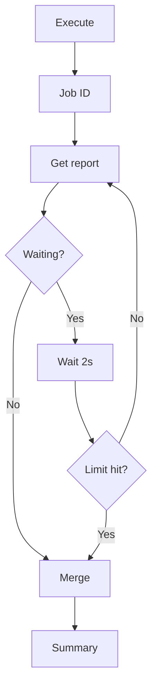

**Figure:** Cortex polling and merge flow for one job.
*Figure. One Cortex job is checked repeatedly using the same job ID until it finishes or reaches the retry limit.*


*Figure. Analyzer branches submit jobs and poll their reports before sending results to Merge.*

**How to test it:** Use rule `100723`. Open an **Execute** result and note its job ID. In the matching **Get a report** node, confirm that the same ID is used. Seeing `Waiting` on the first check is normal. The workflow should wait and check that same ID again.

#### Node: Summary Enrichments

**What it does:** Combines MISP results, Cortex results, skipped observables, and job states into the final enrichment summary.

**How to build it:**

1. Append the analyzer, MISP, and skipped-record branches through the existing `Merge` node.
2. Connect the merged items to `Summary Enrichments`.
3. Use the implementation in [`summary-enrichments.js`](../../soar/n8n/nodes/summary-enrichments.js).


*Figure. MISP results, analyzer reports, and skipped observables flow into the final summary.*

| Setting | Value |
|---|---|
| Merge mode | `Append` |
| Summary node | `Summary Enrichments` |
| Implementation | [`summary-enrichments.js`](../../soar/n8n/nodes/summary-enrichments.js) |

**End-to-end verification:** Rule `100723` exercised all four Cortex observable routes:

| Observable | Result |
|---|---|
| `soc-lab-postdns.example.org` | Maltiverse completed. Classification `neutral`, zero historical matches |
| `1.1.1.1` | AbuseIPDB completed. Whitelisted, confidence score `0` |
| Test SHA-256 | Team Cymru returned `No record found`. CIRCL Hashlookup returned `Non existing SHA-256` |
| Test URL | VirusTotal job completed and returned `NotFoundError` for the exact URL |

The workflow returned five Cortex result entries, `processing.status: complete`, and empty `pending` and `failed` lists. The VirusTotal `NotFoundError` means the URL was not found in that lookup. It is not a clean verdict. The internal source IP, agent IP, and hostname were retained under `skipped_by_filter`.

**If it does not work:**

| What you see | Cause | Fix |
|---|---|---|
| `Invalid Wazuh alert: missing rule.id` | The webhook input does not contain the rule ID expected by `Normalize Alert` | Inspect the actual input and send an alert in the expected structure with `rule.id` present |
| An external observable is skipped | Its type, value, or `internal` flag is missing, or it failed the eligibility checks | Inspect the item after `Dedupe Cortex Observables` and the `cortex_skip_reason` value |
| A report remains `Waiting` or `InProgress` | The analyzer job has not finished yet | Continue polling with the same job ID within the configured limit |
| Cortex reports `Service parameter is missing` | The analyzer job failed before returning a usable report | Inspect the Cortex job and analyzer worker configuration. This message alone does not indicate a missing Wazuh field |
| VirusTotal returns `NotFoundError` with a completed job | The exact URL was not found in that lookup | Preserve the analyzer response. Do not interpret it as proof that the URL is benign |

## 5. Score

**Owner:** @arturesturemkuros

**What it does:** Gives each enriched alert a score from 0 to 100, a verdict, a coverage value, and a list of reasons, one for every point added or removed.

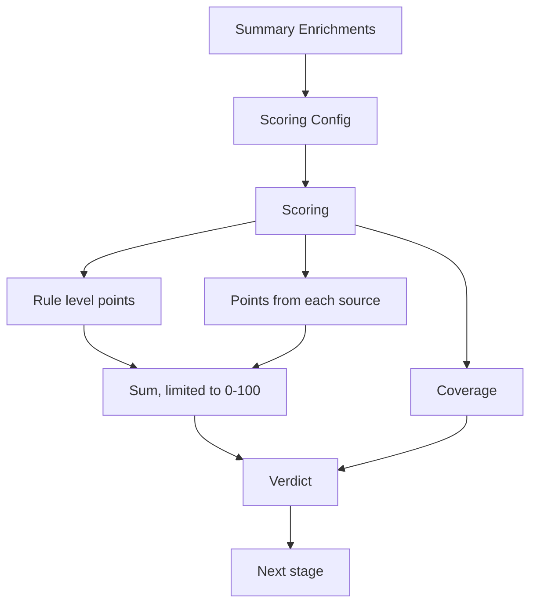

*Figure. Score flow. The score and the coverage are calculated separately, then combined into the verdict.*

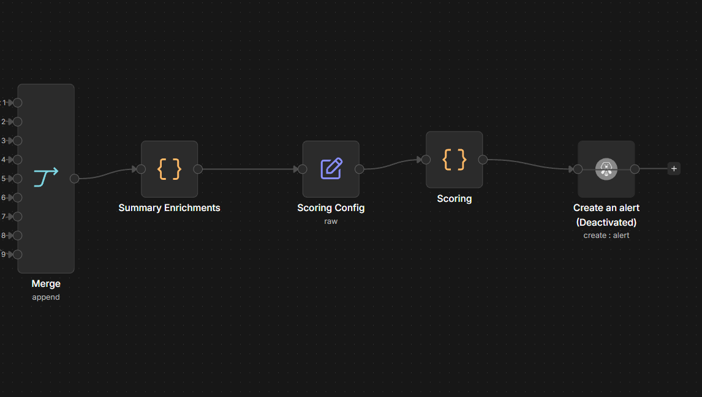

*Figure. Scoring Config and Scoring follow Summary Enrichments; the downstream Create an alert node is deactivated in this workflow view.*

### Score nodes

#### Node: Scoring Config

**What it does:** Adds the scoring rules (weights, thresholds, on/off switches) to the alert item as `scoring_config`, so they can be changed without editing code.

**How to build it:**

1. Add an **Edit Fields (Set)** node after `Summary Enrichments`.
2. Name the node `Scoring Config`.
3. Set the mode to JSON and paste the contents of [`score-config.json`](../../soar/n8n/nodes/score-config.json).
4. Keep the other input fields, so the alert data from `Summary Enrichments` passes through. The option is called **Include Other Input Fields** or **Include in Output: All Input Fields**, depending on the n8n version.
5. Connect the node output to `Scoring`.

| Setting | Value |
|---|---|
| Node type | `Edit Fields (Set)` |
| Mode | JSON |
| Added field | `scoring_config` |
| Keep other input fields | On |
| Implementation | [`score-config.json`](../../soar/n8n/nodes/score-config.json) |

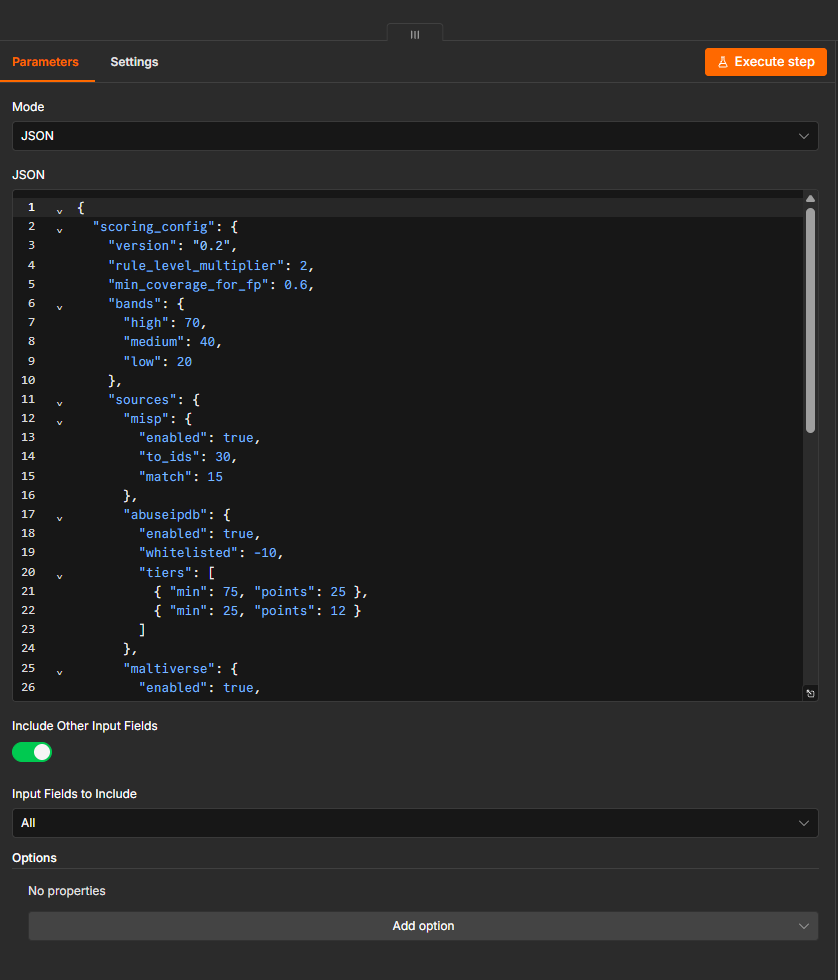

*Figure. Scoring Config holds the JSON rules and passes the existing alert fields through to Scoring.*

**Settings in `scoring_config`:**

| Setting | Meaning | Default |
|---|---|---|
| `rule_level_multiplier` | Points per Wazuh rule level (levels 0-15 give 0-30 points) | `2` |
| `bands.high`, `bands.medium`, `bands.low` | Lowest score for each verdict | `70`, `40`, `20` |
| `min_coverage_for_fp` | Lowest coverage at which a low score may be called a false positive | `0.6` |
| `sources.<name>.enabled` | Turns a source on or off. A disabled source gives no points and does not count in coverage | `true` |
| `sources.misp.to_ids`, `sources.misp.match` | Points for a MISP attribute with `to_ids: true`, and for any other match | `30`, `15` |
| `sources.abuseipdb.tiers`, `sources.abuseipdb.whitelisted` | Points by abuse confidence score, and points for a whitelisted IP | `>=75: 25`, `>=25: 12`, `-10` |
| `sources.maltiverse.malicious`, `suspicious`, `historical_only`, `whitelist` | Points by classification | `20`, `10`, `5`, `-5` |
| `sources.virustotal.tiers` | Points by number of detecting engines | `>=10: 25`, `>=3: 15`, `>=1: 8` |
| `sources.teamcymru.tiers` | Points by MHR detection percentage | `>=50: 15`, `>=20: 8` |
| `sources.teamcymru.ignore_when_circl_known` | Ignore MHR detections for a hash that CIRCL lists as known, unless the detection is strong (see `known_good_unless_mhr_pct`) | `true` |
| `sources.circl.known_good` | Points for a hash known in CIRCL Hashlookup | `-10` |
| `sources.circl.known_good_unless_mhr_pct` | A hash known in CIRCL keeps its known-good status only while its MHR detection is below this percentage. A value above 100 turns the exception off | `50` |

The `Scoring` node checks the config before using it. An unknown key, a value of the wrong type, `bands` that are not in the order high > medium > low, or a `min_coverage_for_fp` outside 0-1 does not stop the workflow. The default value is used instead and the problem is listed in `scoring.config_warnings`. Tiers are sorted automatically, and numbers written as text (`"3"`) are accepted. If the `scoring_config` field is missing, the defaults built into the code are used and no warning is written.

**How to test it:** Run the workflow with any alert. Open the `Scoring Config` output and confirm that `scoring_config` is present next to `alert`, `misp`, `cortex`, and `processing`.

#### Node: Scoring

**What it does:** Reads the `Summary Enrichments` output and the scoring config, adds the `scoring` object to the item, and removes `scoring_config` from it.

**How to build it:**

1. Add a **Code** node after `Scoring Config`.
2. Name the node `Scoring`.
3. Set **Mode** to `Run Once for All Items`.
4. Set **Language** to `JavaScript`.
5. Copy the contents of [`score-v0.2.js`](../../soar/n8n/nodes/score-v0.2.js) into the Code node editor.
6. Connect the node output to the next workflow stage.
7. Save the workflow.

| Setting | Value |
|---|---|
| Node type | `Code` |
| Mode | `Run Once for All Items` |
| Language | `JavaScript` |
| Implementation | [`score-v0.2.js`](../../soar/n8n/nodes/score-v0.2.js) |

**Input fields used:**

| Field | Used for |
|---|---|
| `alert.rule.level` | Rule level points |
| `cortex.results[]` (`analyzer`, `observable`, `status`, `summary`) | Points from AbuseIPDB, Maltiverse, VirusTotal, Team Cymru MHR, and CIRCL. Only results with status `complete` give points |
| `misp.unique_indicators[].attributes[].to_ids` | MISP points |
| `processing.failed[]`, `processing.pending[]` | Coverage |

**Points (default values):**

| Source | What is read | Points |
|---|---|---|
| Rule level | `alert.rule.level` | Level x 2, at most 30 |
| MISP | `to_ids` of the matched attributes | 30 if any attribute has `to_ids: true`, otherwise 15 for any match |
| AbuseIPDB | Abuse confidence score, `whitelisted` | 25 from score 75, 12 from score 25, -10 if whitelisted |
| Maltiverse | Classification, historical matches | `malicious` 20, `suspicious` 10, `whitelist` -5; other classifications with historical matches 5 |
| VirusTotal | `GetReport` value `detections/engines` | 25 from 10 detections, 15 from 3, 8 from 1 |
| Team Cymru MHR | `detection_pct` | 15 from 50%, 8 from 20%. Ignored when CIRCL lists the same hash as known and the detection is below 50% |
| CIRCL Hashlookup | `Result` equal to `known` | -10. Not applied to a hash whose MHR detection is 50% or more |

Each source gives one entry. When a source returned results for several observables, the entry with the most points is used. The total is rounded and limited to 0-100.

**Verdicts:**

| Verdict | Condition |
|---|---|
| `high` | Score 70 or more |
| `medium` | Score 40-69 |
| `low` | Score 20-39 |
| `likely_false_positive` | Score below 20 |
| `needs_review` | The score would give `low` or `likely_false_positive`, but coverage is below 0.6. Also used when the item has no enrichment data to score (see `input_problems`) |

A verdict is not a decision. The Decision stage chooses what happens to the alert.

**Coverage:** The share of enrichment sources that answered. A source with both a result and an error counts as half, an analyzer that is still pending counts as not answered, and a disabled source is left out. MISP counts as answered when no MISP error was recorded, also when it found nothing.

**Output:** The `scoring` object contains:

| Field | Purpose |
|---|---|
| `score` | Total points, 0-100 |
| `verdict` | One of the verdicts above |
| `coverage` | Coverage value, 0-1 |
| `sources` | Sources grouped as `ok`, `partial`, and `failed` |
| `breakdown` | One entry per point source: `source`, `points`, `reason`, and `observable` when it applies. The first entry is always the rule level |
| `config_version` | Version of the config that was used |
| `config_warnings` | Present only when the config had problems |
| `input_problems` | Present only when the item is missing `alert.rule.level`, `cortex.results`, or `processing`. The verdict is then `needs_review` and coverage is 0 |

**How to test it:**

The scoring logic was run on the `Summary Enrichments` output of two lab test alerts and on synthetic cases. Use pinned data or the `Summary Enrichments` output of a test run, then compare with the expected results:

| Test | Input scenario | Expected result |
|---|---|---|
| 1 | Rule `5710`, level 5. Hash known in CIRCL, MHR 37%. AbuseIPDB and MISP failed | Score 0, `needs_review`, coverage 0.5. MHR ignored |
| 2 | Rule `92213`, level 12. Maltiverse `malicious`, VirusTotal 2/91. Team Cymru, CIRCL, and MISP failed | Score 52, `medium`, coverage 0.4 |
| 3 | Test 1 with AbuseIPDB (confidence 0) and MISP answering | Score 0, `likely_false_positive`, coverage 1 |
| 4 | Level 12, MISP match with `to_ids: true`, AbuseIPDB confidence 100 | Score 79, `high`, coverage 1 |
| 5 | MHR 80%, no CIRCL record | Score 25, `low`, coverage 1 |
| 6 | Item that contains only `scoring_config`, without alert data | Score 0, `needs_review`, coverage 0, `input_problems` lists the three missing parts |
| 7 | Level 12, Maltiverse `malicious`, VirusTotal 2/91, two hashes known in CIRCL with MHR 93% (the EICAR test file in the lab), MISP failed | Score 67, `medium`, coverage 0.8. The CIRCL discount is not applied and the MHR detection counts |

Config tests:

| Change in `scoring_config` | Expected result |
|---|---|
| `sources.maltiverse.malicious` set to `40` | Test 2 gives score 72, `high` |
| `sources.virustotal.enabled` set to `false` | Test 2 gives score 44 and coverage 0.25 |
| `sources.teamcymru.ignore_when_circl_known` set to `false` | Test 1 gives score 8 |
| `sources.circl.known_good_unless_mhr_pct` set to `101` | Test 7 gives score 42, because the exception is off |
| Key `sources.maltivers` (typo) | Score unchanged, warning `unknown setting ignored` |
| `rule_level_multiplier` set to `"abc"` | Default used, warning in `config_warnings` |

All seven tests gave the expected results on v0.2.2. In addition, 34 automated checks passed, including a check that the shipped `score-config.json` gives the same results as the built-in defaults.

**Observed n8n output:** In the captured run for rule `92213`, Scoring returned `67` (`medium`) with coverage `0.8`; MISP was listed as failed. Both MD5 and SHA-256 were present in the alert, but the supplied `cortex.results` contained results only for the MD5. This screenshot shows the Scoring result for the enrichment data that arrived; it does not verify Cortex results for both hashes in Test 7.

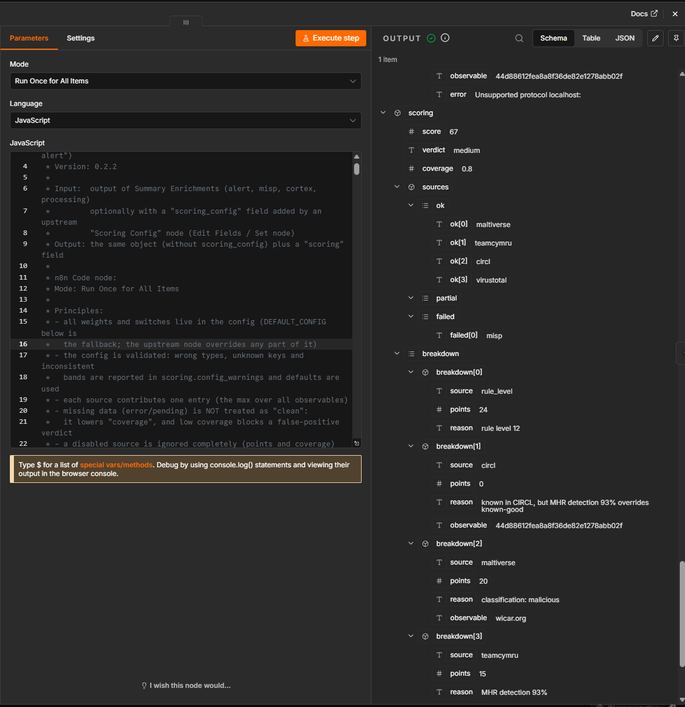

*Figure. Scoring returned 67 (`medium`) with coverage 0.8; the captured output records the MISP failure.*

**If it does not work:**

| What you see | Cause | Fix |
|---|---|---|
| Almost every alert gets `needs_review` | One or more sources failed, so coverage is below 0.6 | Check `scoring.sources.failed` and `processing.failed`, then fix the failing node. A source that is permanently unavailable can be switched off with `enabled: false` |
| `scoring.config_warnings` appears | The config contains an unknown key, a value of the wrong type, or wrong `bands` or `tiers` | Read the warning, correct the JSON in `Scoring Config`. The default value is used in the meantime |
| Changing the config has no effect | `Scoring Config` is not connected before `Scoring`, or it does not keep the input fields, so `scoring_config` is missing and the built-in defaults are used without a warning | Check the connection and the **Include Other Input Fields** option. Confirm that `scoring_config` appears in the `Scoring` input |
| Every alert gets score 0, rule level 0, verdict `needs_review`, and `input_problems` is listed | `Scoring Config` does not pass the input fields on, so `Scoring` receives only `scoring_config` | In `Scoring Config` turn on **Include Other Input Fields** (or **Include in Output: All Input Fields**). The output of `Scoring Config` must show `alert`, `misp`, `cortex`, and `processing` next to `scoring_config` |
| A hash has MHR detections but gives 0 points | CIRCL lists the hash as known, the MHR detection is below `known_good_unless_mhr_pct` (50%), and `ignore_when_circl_known` is `true` | This is expected for weak detections. Lower `known_good_unless_mhr_pct`, or set `ignore_when_circl_known` to `false`, to count the MHR detections anyway |
| Code node reports an error when using `$input.all()` | The node is not configured to process all input items | Set Mode to `Run Once for All Items` |

## 6. Decision

**Owner:** @MKonrad-afk
**What it does:** Combines the score with the asset inventory and returns `closed`, `analyst_review`, or `malicious` with a reason.

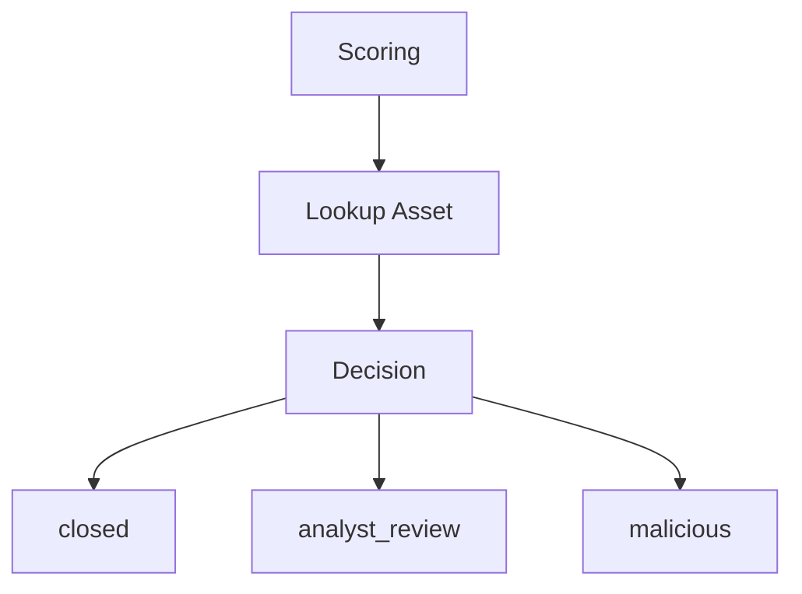

*Figure. Decision reads the score and matching asset row, then returns one outcome.*

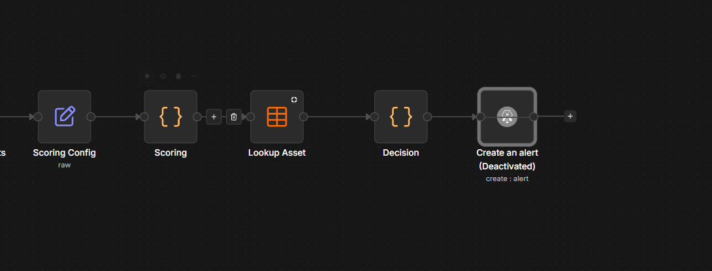

*Figure. Lookup Asset and Decision follow Scoring. Create an alert is deactivated*

### Decision nodes

#### Data Table: `soc_asset_inventory`

**What it does:** Stores one row per known agent and its closure policy. Create the persistent Data Table once, the workflow queries it through `Lookup Asset`.

| Column | Type | Purpose |
|---|---|---|
| `agent_id` | String | Wazuh agent ID, including leading zeroes |
| `agent_name` | String | Agent name |
| `asset_type` | String | For example `server`, `workstation`, or `network_infrastructure` |
| `criticality` | String | `critical` or `standard` |
| `auto_close_allowed` | Boolean | Whether the asset can be considered for auto-close |
| `reason` | String | Reason for the classification |
| `last_reviewed` | String | Review date |

Current lab rows:

| Agent ID | Agent name | Asset type | Criticality | Auto-close |
|---|---|---|---|---|
| `008` | `SOC-DC01` | `server` | `critical` | `false` |
| `005` | `opnsense` | `network_infrastructure` | `critical` | `false` |
| `004` | `SOC-WIN11-AI` | `workstation` | `standard` | `true` |
| `006` | `SOC-LIN-01` | `endpoint` | `standard` | `true` |
| `007` | `SOC-WIN10-01` | `workstation` | `standard` | `true` |

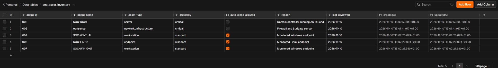

*Figure. The domain controller and firewall are marked critical and not eligible for auto-close.*

#### Node: Lookup Asset

**What it does:** Queries `soc_asset_inventory` by the Wazuh agent ID and name. It returns all matching rows so Decision can reject ambiguous matches.

**How to build it:**

1. Add a **Data Table** node after `Scoring` and name it `Lookup Asset`.
2. Set **Resource** to **Row**, **Operation** to **Get**, and select `soc_asset_inventory`.
3. Set **Must Match** to **All Conditions**.
4. Add these conditions:

| Column | Condition | Value |
|---|---|---|
| `agent_id` | Equals | `{{ $json.alert.agent.id }}` |
| `agent_name` | Equals | `{{ $json.alert.agent.name }}` |

5. Set **Return All** to `true`.
6. In **Settings**, enable **Always Output Data** so a missing row still reaches `Decision`.
7. Connect `Lookup Asset` to `Decision`.

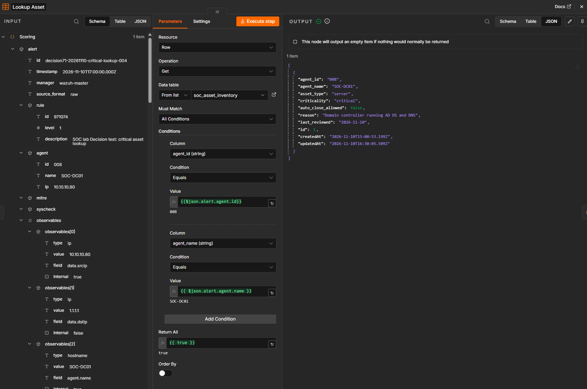

*Figure. Both conditions match the `SOC-DC01` inventory row.*

#### Node: Decision

**What it does:** Reads the output from the node named `Scoring` and the rows returned by `Lookup Asset`, applies the policy, and adds `asset_inventory` and `decision` to the item.

**How to build it:**

1. Add a **Code** node after `Lookup Asset` and name it `Decision`.
2. Set **Mode** to **Run Once for All Items** and **Language** to **JavaScript**.
3. Copy [`decision-v0.1.js`](../../soar/n8n/nodes/decision-v0.1.js) into the Code editor.
4. Keep the scoring node named exactly `Scoring`.
5. Connect the Code node output to the next stage.

| Setting | Value |
|---|---|
| Node type | `Code` |
| Mode | `Run Once for All Items` |
| Language | `JavaScript` |
| Implementation | [`decision-v0.1.js`](../../soar/n8n/nodes/decision-v0.1.js) |

**Decision rules:**

| Outcome | Conditions |
|---|---|
| `closed` | Complete valid analysis, coverage 1, an external IP/domain/URL/hash, no conflict or malicious signal, verdict `likely_false_positive`, exactly one matching asset, non-critical, auto-close allowed. |
| `analyst_review` | Missing/invalid data, no eligible observable, conflict, incomplete analysis, missing/ambiguous asset, or any verdict that does not qualify for another outcome. |
| `malicious` | Complete analysis with a configured malicious signal, or a `high` verdict. |

Incomplete analysis includes invalid scoring, coverage other than 1, processing not complete, failed/pending jobs, partial/failed sources, input/config warnings, or an unclear VirusTotal result. Malicious signals remain in output, but incomplete analysis still routes to review.

`critical` assets are never closed. `closed` is an outcome value only - this Code node does not change Wazuh or TheHive alert status.

**Output fields:**

| Field | Purpose |
|---|---|
| `asset_inventory.lookup_status` | `matched`, `not_found`, or `ambiguous` |
| `asset_inventory.agent_id` / `agent_name` | Matched agent, or alert agent if unmatched |
| `asset_inventory.asset_type` / `criticality` | Inventory classification |
| `asset_inventory.auto_close_allowed` | Inventory policy; false without one unique match |
| `asset_inventory.reason` / `last_reviewed` | Inventory context |
| `decision.outcome` | `closed`, `analyst_review`, or `malicious` |
| `decision.reason_code` / `reasons` | Machine-readable reason and explanation |
| `decision.score` / `verdict` / `coverage` | Scoring values |
| `decision.analysis_complete` | Whether analysis checks passed |
| `decision.malicious_signals` | Signals found by the Decision code |
| `decision.has_benign_misp_tag` | Whether the explicit benign tag was present |

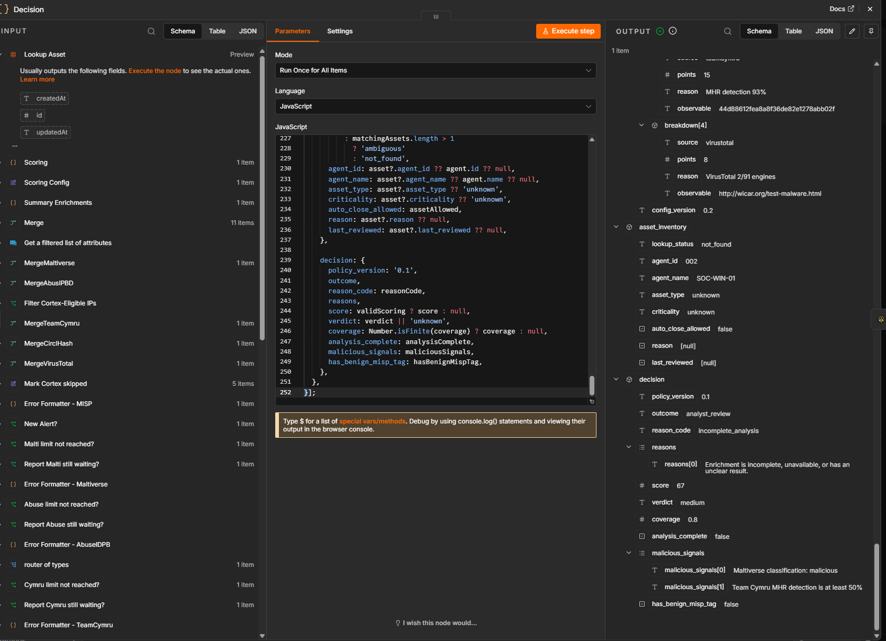

*Figure. An incomplete run remains in `analyst_review` while retaining Maltiverse and Team Cymru signals.*

#### How to test it

Run the sample alerts and inspect `asset_inventory` and `decision` in the Decision output:

| Test alert | Observed result |
|---|---|
| `decision71-20261110-critical-lookup-004` | Complete analysis; `008` matched as critical server; `analyst_review` / `critical_asset`. |
| `decision71-20261110-closed-retry-007` | Complete analysis; score 7, `likely_false_positive`; `007` matched, standard and allowed; `closed` / `complete_low_risk_analysis`. |
| `decision71-20261110-malicious-wicar-008` | Maltiverse malicious for `wicar.org`; score 22, verdict low, coverage 1; `malicious` / `malicious_evidence`. |
| `decision71-20261110-malicious-003` | MISP failure, coverage 0.8, malicious signals retained; `analyst_review` / `incomplete_analysis`. |

These are n8n lab results, not production threshold calibration. TheHive delivery remains in [Issue #73](https://github.com/Solivagantaeon/soc-automation-lab/issues/73).

**If it does not work:**

| What you see | Cause | Fix |
|---|---|---|
| `lookup_status: not_found` although the row exists | Whitespace, different row value, or wrong table | Check selected table; compare ID/name exactly, remove whitespace, rerun Lookup Asset |
| `lookup_status: ambiguous` | Duplicate matching rows | Remove duplicate ID/name rows |
| `analysis_complete: false` | Coverage below 1, failed/pending/partial data, invalid scoring/config, or unclear VT result | Check `processing.failed`, `processing.pending`, `scoring.sources`, `scoring.input_problems`, and `scoring.config_warnings` |
| Malicious signals exist but outcome is review | Analysis is incomplete or evidence conflicts with a benign MISP tag | Fix failed/pending sources or review the conflict |
| A low score does not close | Verdict is not `likely_false_positive`, asset is critical/unmatched, or auto-close is false | Check `decision.verdict` and `asset_inventory` |
| A high-risk complete alert does not become malicious | Benign MISP tag conflicts with malicious evidence or score >= 40 | Review the conflict; review is the configured result |


## 7. Failure handling

**Owner:** @p4chatek

**What it does:** Makes sure that a MISP or Cortex service that is down does not stop the workflow, and that every lookup that failed is recorded in the alert, so the alert never looks cleaner than it is.

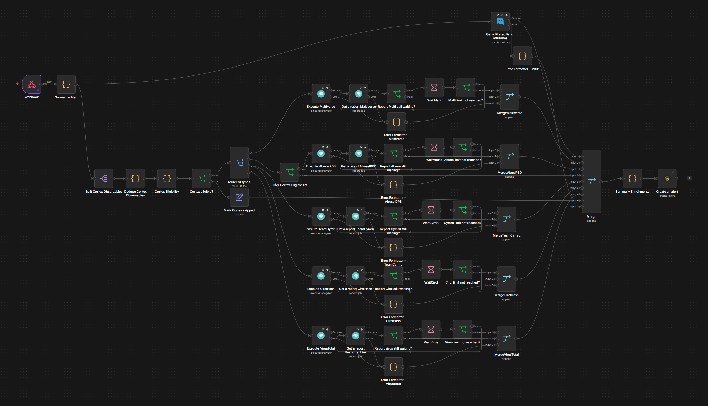

*Figure. The workflow with one Error Formatter per service, connected to the error outputs of the MISP and Cortex nodes.*

#### Node: Retry On Fail and On Error (all MISP and Cortex nodes)

**What it does:** Retries a failed request a few times. If the last try also fails, sends the failed items to the error output instead of stopping the workflow.

**How to build it:**

1. Open each node listed in the table below.
2. Go to the **Settings** tab.
3. Turn on **Retry On Fail** and set **Max. Tries** and **Wait Between Tries** as shown in the table.
4. Set **On Error** to **Continue (using error output)**. A second, red output appears on the node.

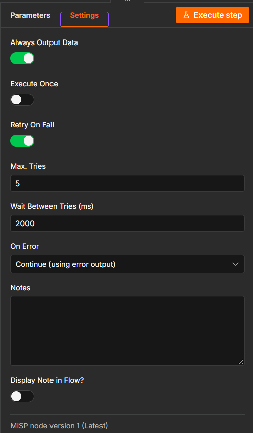

*Figure. Retry On Fail and On Error settings on an Execute node.*

| Node | Max. Tries | Wait Between Tries | On Error |
|---|---|---|---|
| Execute Maltiverse | 3 | 2 000 ms | Continue (using error output) |
| Get a report Maltiverse | 3 | 3 000 ms | Continue (using error output) |
| Execute AbuseIPDB | 3 | 2 000 ms | Continue (using error output) |
| Get a report AbuseIPDB | 3 | 3 000 ms | Continue (using error output) |
| Execute TeamCymru | 3 | 2 000 ms | Continue (using error output) |
| Get a report TeamCymru | 3 | 3 000 ms | Continue (using error output) |
| Execute CirclHash | 3 | 2 000 ms | Continue (using error output) |
| Get a report CirclHash | 3 | 3 000 ms | Continue (using error output) |
| Execute VirusTotal | 3 | 2 000 ms | Continue (using error output) |
| Get a report UnshortenLink | 3 | 3 000 ms | Continue (using error output) |
| Get a filtered list of attributes (MISP) | 5 | 2 000 ms | Continue (using error output) |

**How to test it:** Run the test in [How to test the stage](#how-to-test-the-stage). The execution must finish, and the failed node must show items on its red error output.

#### Node: Get a report … (Job ID)

**What it does:** Reads the Cortex job ID from the item that arrives at the node, so polling works for any number of observables and any number of polling rounds.

**How to build it:**

1. Open each `Get a report …` node.
2. Set **Job ID** to `{{ $json._id ?? $json.id }}`.
3. Do not use `{{ $('Execute …').item.json._id }}`. That lookup fails when a service gets more than one observable, or on the second polling round.

| Setting | Value |
|---|---|
| Job ID | `{{ $json._id ?? $json.id }}` |

**How to test it:** Not covered by the stage test, because in that test no Cortex job is created. With working credentials, an alert with two hashes must return a Team Cymru and a CIRCL result for both, without a `Paired item data … is unavailable` error.

#### Node: Error Formatter - \<service\> (one per service)

**What it does:** Receives the failed items of one service and turns each of them into one record: `{service, node, observable, error, timestamp}`. The records go to the main Merge and from there to `Summary Enrichments`.

**How to build it:**

1. Add a **Code** node for each service and name it `Error Formatter - <service>`, for example `Error Formatter - CirclHash`.
2. Set **Mode** to **Run Once for All Items** and **Language** to **JavaScript**.
3. Connect the red error output of the service's `Execute …` node **and** of its `Get a report …` node to this one formatter.
4. Paste the code:
   - Cortex services: [`error-formatter-cortex.js`](../../soar/n8n/nodes/error-formatter-cortex.js). Change only the five constants at the top, using the table below.
   - MISP: [`error-formatter-misp.js`](../../soar/n8n/nodes/error-formatter-misp.js). No changes are needed.
5. Connect the formatter output to the service's Merge node as an extra input (`Append` mode). For MISP, connect it to the main `Merge` before `Summary Enrichments`.

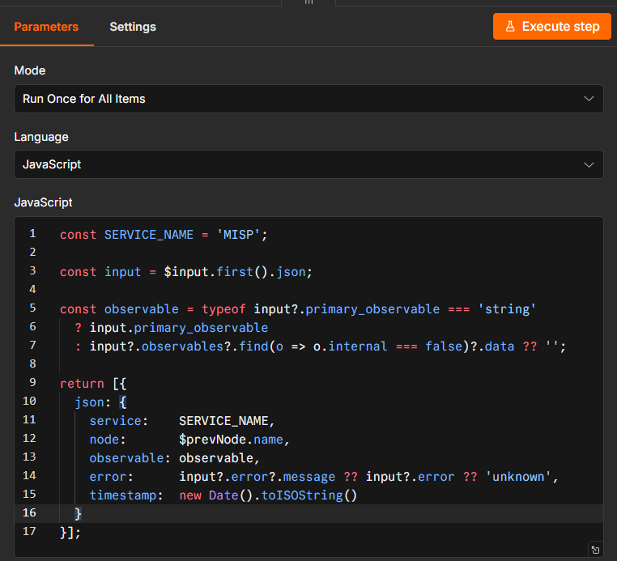

*Figure. Error Formatter - CirclHash with its constants and the Run Once for All Items mode.*

| Formatter | `SERVICE_NAME` | `EXECUTE_NODE` | `REPORT_NODE` | `SOURCE_NODES` | `TYPES` |
|---|---|---|---|---|---|
| Error Formatter - Maltiverse | `Maltiverse` | `Execute Maltiverse` | `Get a report Maltiverse` | `Normalize Alert`, `Dedupe Cortex Observables` | `domain` |
| Error Formatter - AbuseIPDB | `AbuseIPDB` | `Execute AbuseIPDB` | `Get a report AbuseIPDB` | `Filter Cortex-Eligible IPs` | `ip` |
| Error Formatter - TeamCymru | `TeamCymru` | `Execute TeamCymru` | `Get a report TeamCymru` | `Normalize Alert`, `Dedupe Cortex Observables` | `hash` |
| Error Formatter - CirclHash | `CirclHash` | `Execute CirclHash` | `Get a report CirclHash` | `Normalize Alert`, `Dedupe Cortex Observables` | `hash` |
| Error Formatter - VirusTotal | `VirusTotal` | `Execute VirusTotal` | `Get a report UnshortenLink` | `Normalize Alert`, `Dedupe Cortex Observables` | `url` |
| Error Formatter - MISP | `MISP` | - | - | `Normalize Alert`, `Dedupe Cortex Observables` | all types |

`TYPES` must match the `router of types` rule that sends observables to that branch. `SERVICE_NAME` must contain the name the Score stage uses for the service (`abuseipdb`, `maltiverse`, `teamcymru`, `circl`, `virustotal`, `misp`, case-insensitive).

**How it finds the observable:** an error item contains only the error message. The formatter compares values instead:

- error from `Execute …`: observables of `TYPES` read from `SOURCE_NODES`, minus those for which a job was created;
- error from `Get a report …`: jobs created by `Execute …`, minus jobs that already finished or are still in the current polling round;
- MISP: one record that lists every observable of the alert.

**How to test it:** Run the test in [How to test the stage](#how-to-test-the-stage). Each failed observable must appear as its own record with the correct value. `observable` must never be `unknown`.

#### Node: Summary Enrichments (failure records)

**What it does:** Adds every Error Formatter record to `processing.failed` and sets `processing.status` to `complete_with_errors` when at least one lookup failed. An observable whose lookup failed is not listed in `cortex.skipped_by_filter`, so it cannot look like "checked, nothing found".

**How to build it:** Use the current implementation in [`summary-enrichments.js`](../../soar/n8n/nodes/summary-enrichments.js). The relevant parts are:

- `errorRows`: every merged item with a `service` and an `error` field;
- `failedValues`: the observables of failed Cortex lookups, used to keep them out of `skipped_by_filter`;
- `failed`: failed Cortex jobs plus all `errorRows`.

| Setting | Value |
|---|---|
| Mode | `Run Once for All Items` |
| Implementation | [`summary-enrichments.js`](../../soar/n8n/nodes/summary-enrichments.js) |
| Output used by Score | `processing.failed`, `processing.pending`, `processing.status` |

**How to test it:** See [How to test the stage](#how-to-test-the-stage).

#### How to test the stage

1. Create a Cortex credential and a MISP credential, both named `TEST FAILED`, with an invalid URL (for example `localhost:9999`, without `http://`) and any API key.
2. Pin this test alert in the Webhook node. All values are safe to publish: the IPs are documentation ranges (RFC 5737), the domains are reserved (RFC 2606) and the hashes belong to the EICAR test file.

   ```json
   [
     {
       "timestamp": "2026-11-10T10:00:00.000Z",
       "rule": { "level": 12, "description": "Test alert IP + hash + domain + url", "id": "100002" },
       "agent": { "id": "001", "name": "test-agent", "ip": "10.0.0.1" },
       "manager": { "name": "wazuh-manager" },
       "data": {
         "srcip": "203.0.113.10",
         "dstip": "198.51.100.20",
         "url": "http://example.com/download/payload.exe",
         "domain": "example.org",
         "win": {
           "eventdata": {
             "hashes": "MD5=44d88612fea8a8f36de82e1278abb02f,SHA256=275a021bbfb6489e54d471899f7db9d1663fc695ec2fe2a2c4538aabf651fd0f",
             "queryName": "test-c2.example.net"
           }
         }
       }
     }
   ]
   ```

3. Set the `TEST FAILED` credential on every Cortex `Execute …` node and on `Get a filtered list of attributes` (MISP).
4. Run the workflow and open the output of `Summary Enrichments`.
5. Put the original credentials back.

| Check | Expected result |
|---|---|
| Workflow | The execution finishes. No node stops it |
| `processing.failed` | 8 records, one per observable: Maltiverse ×2 (both domains), TeamCymru ×2 and CirclHash ×2 (both hashes), VirusTotal ×1 (the URL) and MISP ×1 (all seven external observables). No `observable` is `unknown` |
| `processing.status` | `complete_with_errors` |
| `cortex.skipped_by_filter` | Only the two documentation-range IPs (`Non-public IPv4 address`) and the internal agent IP and hostname |

The documentation-range IPs are correctly filtered out as `Non-public IPv4 address`, so this test does not reach AbuseIPDB.

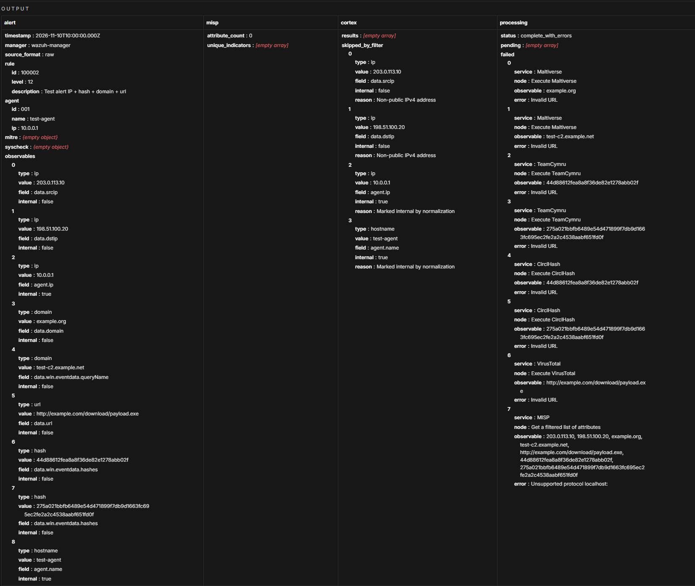

*Figure. Test result: eight records in `processing.failed` and `processing.status: complete_with_errors`.*

**If it does not work:**

| What you see | Cause | Fix |
|---|---|---|
| The workflow stops at a failed node | **On Error** is still `Stop Workflow` | Set **On Error** to **Continue (using error output)** on that node |
| `processing.failed` is empty although a service failed | The Error Formatter is not connected to a Merge input, or the red error output is not connected to the formatter | Check both connections |
| `Paired item data for item from node 'Get a report …' is unavailable` | The Job ID uses `$('Execute …').item`, which loses track with more than one observable or on a second polling round | Set Job ID to `{{ $json._id ?? $json.id }}` |
| `observable` is `unknown` | A name in the formatter constants does not match the node name exactly, or `TYPES` does not match the router rule | Compare the constants with the node names, including spaces. A node named `Get a report  Maltiverse` (two spaces) is not found |
| The MISP record shows `unknown` | The MISP formatter runs before `Dedupe Cortex Observables`, and the observables in `Normalize Alert` use `dataType` and `data` | Use the current [`error-formatter-misp.js`](../../soar/n8n/nodes/error-formatter-misp.js), which reads both formats |
| Two different hashes get the same observable, usually the alert IP | An old formatter version reads `primary_observable`, which every item inherits from the alert | Use the current [`error-formatter-cortex.js`](../../soar/n8n/nodes/error-formatter-cortex.js) |
| Cortex receives the text `json.data` instead of the observable | **Observable Type** and **Observable Value** contain the literal text `json.data` | Set them to `{{ $json.observables.dataType }}` and `{{ $json.observables.data }}` |
| A failed IP is also listed in `skipped_by_filter` as `No Cortex result for this IP` | Old `Summary Enrichments` code | Use the current [`summary-enrichments.js`](../../soar/n8n/nodes/summary-enrichments.js) |
| Python syntax error in the formatter | The Code node language is Python | Set **Language** to **JavaScript** |

## 8. TheHive

**Owner:** @MKonrad-afk

**Purpose:** Create a TheHive alert for `analyst_review` and `malicious` decisions, then attach each eligible external IOC as a TheHive observable. A `closed` decision bypasses TheHive and continues to Audit/Counters.

### Workflow path

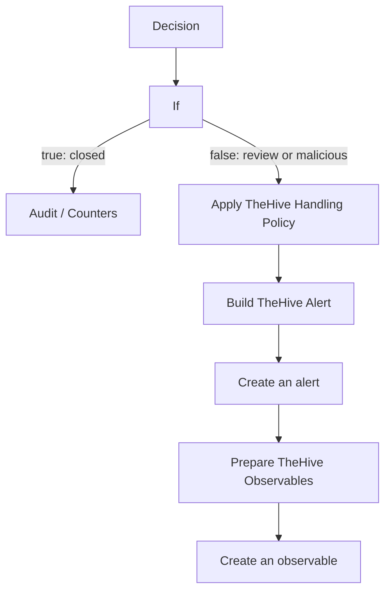

### Node: If

**Purpose:** Keep automatically closed alerts out of TheHive and route decisions that need analyst attention to the alert branch.

Configure the Boolean condition:

```text
{{ $json.decision.outcome === 'closed' }}
```

| Output | Connect to | Expected outcomes |
|---|---|---|
| True | Audit/Counters | `closed` only |
| False | `Apply TheHive Handling Policy` | `analyst_review` or `malicious` |

The builder validates the outcome and fails visibly if the false route receives an unsupported value.

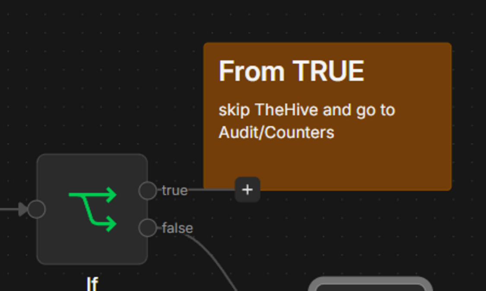

*Figure. The If node sends closed outcomes to Audit/Counters through the true output and routes other outcomes toward TheHive.*

### Node: Apply TheHive Handling Policy

**Purpose:** Add independent TLP and PAP values to the alert data before it is sent to TheHive.

1. Add a **Code** node to the false output of `If`, before `Build TheHive Alert`.
2. Name it exactly `Apply TheHive Handling Policy`.
3. Set **Mode** to **Run Once for All Items** and **Language** to **JavaScript**.
4. Paste [`thehive-handling-policy-v0.1.js`](../../soar/n8n/nodes/thehive-handling-policy-v0.1.js).
5. Keep the upstream node named exactly `Webhook`. the policy reads the original `rule.groups` and source markings there because `Normalize Alert` does not preserve `rule.groups`.

The policy uses the most restrictive explicit source marking. If no source markings are available, the exact rule group `soc-lab-test` gets TLP CLEAR (`0`). other or unclassified alerts default to TLP AMBER (`2`). PAP defaults independently to AMBER (`2`) in the current implementation. The SOC owner must approve this default for the intended environment. Neither value is derived from severity.

This node runs after MISP/Cortex enrichment. It sets the markings that TheHive records but does not block external Cortex requests that already ran earlier in the execution. Production policy enforcement for external submissions needs a separate gate before the Cortex route.

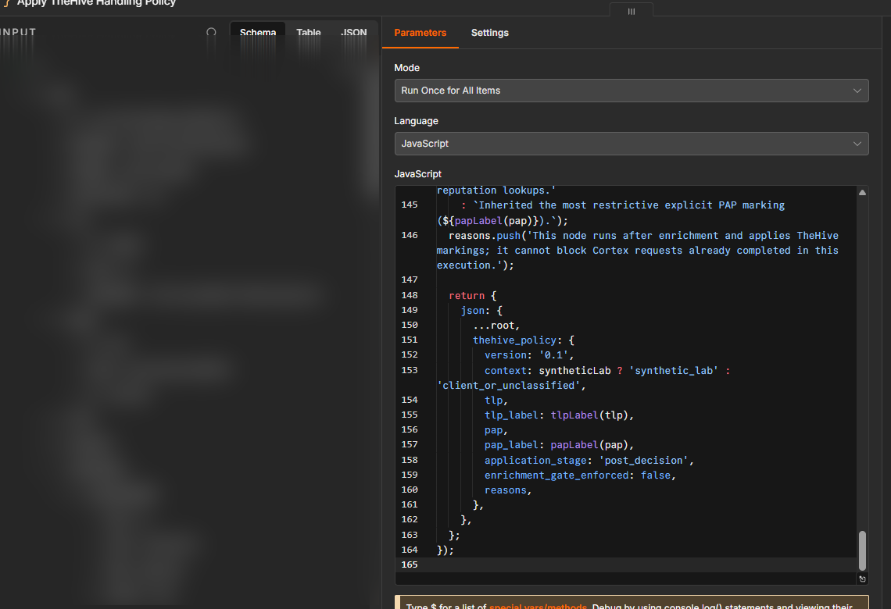

*Figure. The policy Code node reads the upstream event and prepares TLP and PAP markings for the alert.*

### Node: Build TheHive Alert

**Purpose:** Convert Decision, asset, and enrichment results into TheHive alert fields and a separate list of eligible observables.

1. Add a **Code** node after `Apply TheHive Handling Policy` and name it `Build TheHive Alert`.
2. Set **Mode** to **Run Once for All Items** and **Language** to **JavaScript**.
3. Paste [`thehive-alert-v0.3.js`](../../soar/n8n/nodes/thehive-alert-v0.3.js).
4. Keep the node names `Normalize Alert`, `Dedup`, and `Apply TheHive Handling Policy` unchanged. The code reads data from those nodes by name.
5. Confirm the output has top-level alert fields and `thehive_observables` before connecting the TheHive node.

| Output | Purpose |
|---|---|
| Top-level `type`, `source`, `sourceRef`, `title`, `description`, `severity`, `tlp`, `pap`, `tags`, `date`, and related fields | Mapped automatically by the native TheHive Alert node |
| `thehive_observables` | Eligible external IP, domain, URL, and hash values. sent to a separate observable creation path |

The alert description records the Decision outcome, reason, score, verdict, coverage, analysis status, asset and source event context, IOC verdicts, enrichment summaries, and unavailable or pending sources. Internal IPs and hostnames are excluded from TheHive observables. The severity mapping is documented in ADR 0003, section 8.

The builder uses the Wazuh alert ID as `sourceRef`. it fails if the ID is missing or longer than 128 characters. TheHive rejects another alert with the same `(type, source, sourceRef)` tuple in the same organization, so use a fresh source alert ID for each test run.

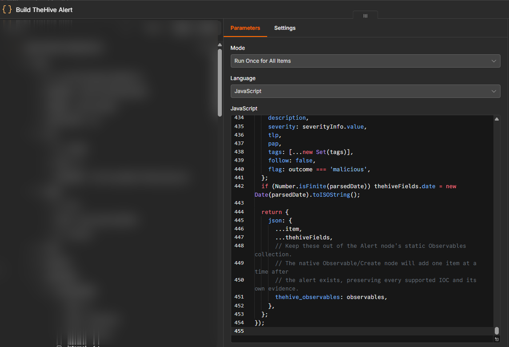

*Figure. The builder Code node assembles the TheHive alert fields and the eligible observable list.*

### Node: Create an alert

**Purpose:** Create the alert using the native TheHive 5 integration node.

1. Add a **TheHive 5** node after `Build TheHive Alert` and name it `Create an alert`.
2. Select the saved **The Hive 5 account** credential.
3. Set **Resource** to **Alert**, **Operation** to **Create**, and **Mapping Column Mode** to **Map Automatically**.
4. Do not configure static observables here. the following nodes add the dynamic observable list after alert creation.
5. Execute the node and confirm its response contains the created alert ID (`_id`).

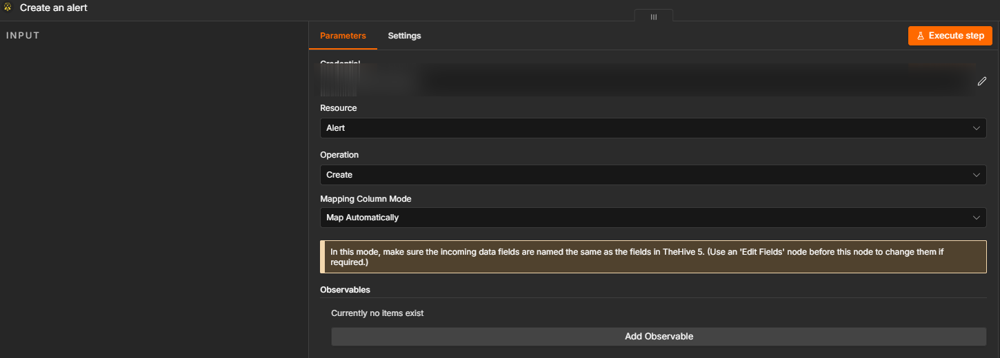

*Figure. The native TheHive 5 node is configured to create an alert with automatic field mapping.*

### Node: Prepare TheHive Observables

**Purpose:** Take `thehive_observables` from the builder, attach the `_id` returned by `Create an alert`, and emit one item per observable.

1. Add a **Code** node after `Create an alert` and name it `Prepare TheHive Observables`.
2. Set **Mode** to **Run Once for All Items** and **Language** to **JavaScript**.
3. Paste [`prepare-thehive-observables-v0.1.js`](../../soar/n8n/nodes/prepare-thehive-observables-v0.1.js).
4. Keep the nodes named exactly `Build TheHive Alert` and `Create an alert`. The code reads `thehive_observables` from the builder and the created alert `_id` from `Create an alert`.
5. Confirm that the node emits one item per eligible observable with `alertId`, `dataType`, `data`, `message`, `tags`, `tlp`, `pap`, and `ioc`.

The output item must include `alertId`, `dataType`, and `data`. Preserve `message`, `tags`, `tlp`, `pap`, and `ioc` so the native observable node can map the evidence and markings. For the verified synthetic sample this node emitted four items.

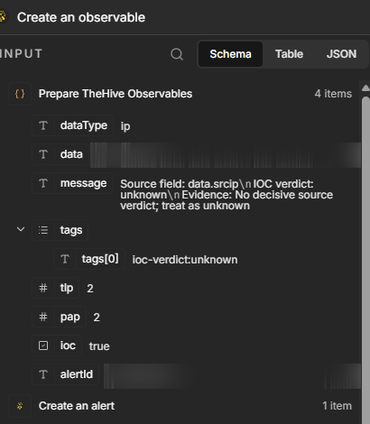

*Figure. The Code node emits four separate observable items with their data and evidence fields.*

### Node: Create an observable

**Purpose:** Attach each prepared IOC to the alert identified by `alertId`.

Configure the native **TheHive 5** node:

| Setting | Value |
|---|---|
| Credential | The Hive 5 account |
| Resource | Observable |
| Operation | Create |
| Create in | Alert |
| Alert selection | By ID: `{{ $json.alertId }}` |
| Data Type | `{{ $json.dataType }}` |
| Data | `{{ $json.data }}` |
| Mapping Column Mode | Map Automatically |

Confirm that the output contains one created observable per input item and that TheHive shows them under **Observables** on the created alert.

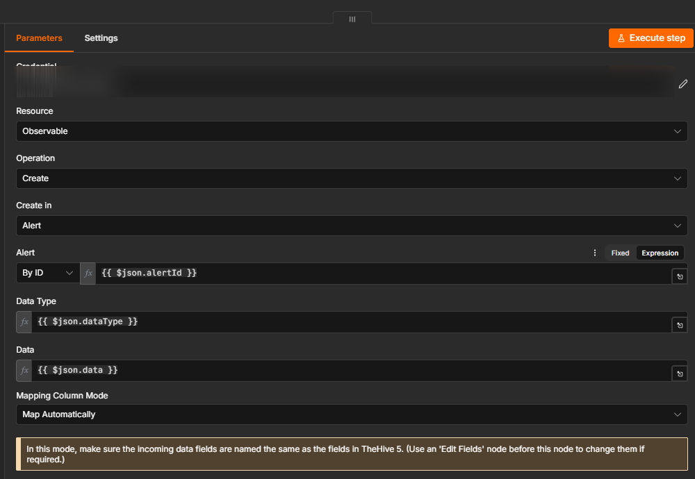

*Figure. The native TheHive 5 node maps each observable to the created alert by ID, data type, and value.*

### Live verification

The synthetic run `soc-hive73-fasttest-20261110-05` completed successfully. Decision returned `analyst_review` / `incomplete_analysis`, score `39`, verdict `low`, coverage `1`, and `analysis_complete=false`. TheHive created an alert with severity **Medium**, TLP **CLEAR**, PAP **AMBER**, and four observables.

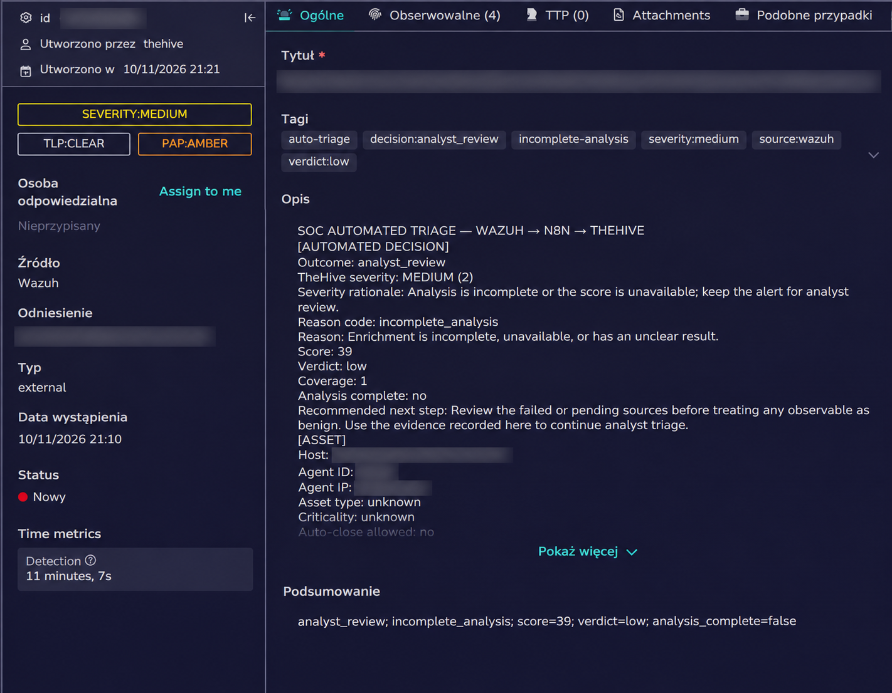

*Figure. The created alert shows Medium severity, TLP CLEAR, PAP AMBER, and four observables.*

| Scenario | Expected result | Live status |
|---|---|---|
| Synthetic `soc-lab-test`, incomplete analysis | Alert with TLP CLEAR, PAP AMBER, Medium severity, and eligible observables | Verified in the live lab |
| WICAR / malicious decision | Alert route with actual Decision and evidence recorded | Pending live run |
| `closed` decision | True output bypasses all TheHive nodes | Pending live run |

The synthetic test used a new Wazuh alert ID, rule ID, and agent ID. The existing `sourceRef` must not be reused for another Create Alert test.

### Troubleshooting

| Symptom | Check |
|---|---|
| `Build TheHive Alert` rejects the outcome | Confirm only the false output of `If` reaches the policy and builder nodes. |
| Policy reports `client_or_unclassified` for a synthetic test | Confirm `Webhook` retains `rule.groups` and includes the exact `soc-lab-test` group. preserve the node name `Webhook`. |
| Alert has no observables | Inspect `thehive_observables` in the builder, the alert `_id`, and the items emitted by `Prepare TheHive Observables`. |
| TheHive rejects a duplicate | Use a fresh Wazuh alert ID for testing. the current stage does not update an existing alert. |
| Observable cannot be attached | Confirm `alertId` is the `_id` from `Create an alert`, and that `Create in` is set to `Alert`. |

### Production boundary

This runbook documents the tested lab behavior. TLP/PAP are assigned after enrichment and do not control earlier Cortex requests. Before production use, the SOC owner must approve the default markings, severity thresholds, and which data may be submitted to external enrichment services. A policy that must prevent those submissions needs a gate before Cortex.


### References

- [TheHive 5 API documentation](https://docs.strangebee.com/thehive/api-docs/) for alert and observable fields.
- [Change case or alert classification settings](https://docs.strangebee.com/thehive/user-guides/analyst-corner/cases/change-case-alert-classification-settings/) for severity, TLP, and PAP meanings.
- [Add an observable](https://docs.strangebee.com/thehive/user-guides/analyst-corner/cases/observables/add-an-observable/) for observable fields and markings.
- [Run analyzers on an observable](https://docs.strangebee.com/thehive/user-guides/analyst-corner/cases/observables/run-analyzers-on-an-observable/) for analyzer compatibility with observable type, TLP, and PAP.


## 9. Audit

**Owner:** @84rtek

**What it does:** Records the reason and supporting context for every alert that the Decision stage closes automatically, so the decision can be reviewed later.

Only decisions with `decision.outcome = closed` are inserted into `SOC_Audit`. Decisions routed to `analyst_review` or `malicious` are not recorded in this table.

### Data Table: `SOC_Audit`

Create a Data Table named `SOC_Audit` with the following columns:

| Column | Type | Purpose |
|---|---|---|
| `execution_id` | String | n8n execution identifier |
| `alert_id` | String | Alert identifier |
| `decision_outcome` | String | Decision outcome; expected value is `closed` |
| `reason_code` | String | Machine-readable reason for the decision |
| `reasons` | String | JSON-serialized explanation list |
| `score` | Number | Score used by Decision |
| `verdict` | String | Scoring verdict |
| `coverage` | Number | Enrichment coverage |
| `analysis_complete` | Boolean | Whether the analysis was complete |
| `malicious_signals` | String | JSON-serialized malicious signal list |
| `asset_inventory` | String | JSON-serialized asset inventory context |
| `policy_version` | String | Decision policy version |
| `recorded_at` | Date | Time when the audit record was inserted |

### Node: `IF1`

**What it does:** Filters the Decision output so that only automatically closed alerts reach the Audit insert node.

**How to build it:**

1. Add an **If** node as a parallel branch from the output of `Decision`.
2. Name the node `IF1`.
3. Configure the condition:
   - Value 1: `{{ $json.decision.outcome }}`
   - Operator: **is equal to**
   - Value 2: `closed`
4. Connect the **true** output to `Audit - Record Decision`.
5. Leave the **false** output unconnected.
6. Keep the original direct connection from `Decision` to the existing `If` node. The Audit branch must not replace or interrupt the main workflow path.

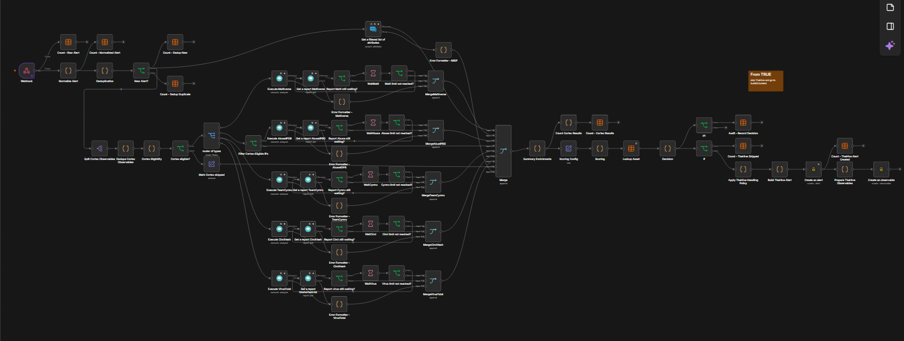

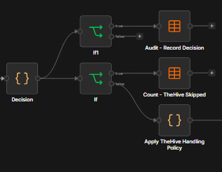

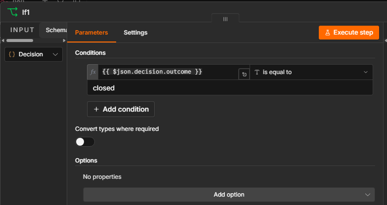

### Node: `Audit - Record Decision`

**What it does:** Inserts one audit row for each item that passes the true output of `IF1`.

**How to build it:**

1. Add a **Data Table** node to the true output of `IF1`.
2. Name the node `Audit - Record Decision`.
3. Set **Resource** to `Row`.
4. Set **Operation** to `Insert`.
5. Select the `SOC_Audit` Data Table.
6. Set **Mapping Column Mode** to **Map Each Column Manually**.
7. Map the fields as follows:

| Column | Expression |
|---|---|
| `execution_id` | `{{ $execution.id }}` |
| `alert_id` | `{{ $json.alert_id }}` |
| `decision_outcome` | `{{ $json.decision.outcome }}` |
| `reason_code` | `{{ $json.decision.reason_code }}` |
| `reasons` | `{{ JSON.stringify($json.decision.reasons) }}` |
| `score` | `{{ $json.decision.score }}` |
| `verdict` | `{{ $json.decision.verdict }}` |
| `coverage` | `{{ $json.decision.coverage }}` |
| `analysis_complete` | `{{ $json.decision.analysis_complete }}` |
| `malicious_signals` | `{{ JSON.stringify($json.decision.malicious_signals) }}` |
| `asset_inventory` | `{{ JSON.stringify($json.asset_inventory) }}` |
| `policy_version` | `{{ $json.decision.policy_version }}` |
| `recorded_at` | `{{ $now.toISO() }}` |

The `reasons`, `malicious_signals`, and `asset_inventory` values are serialized as JSON strings because their Data Table columns use the String type.

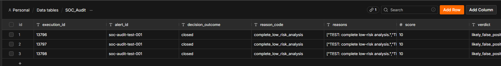

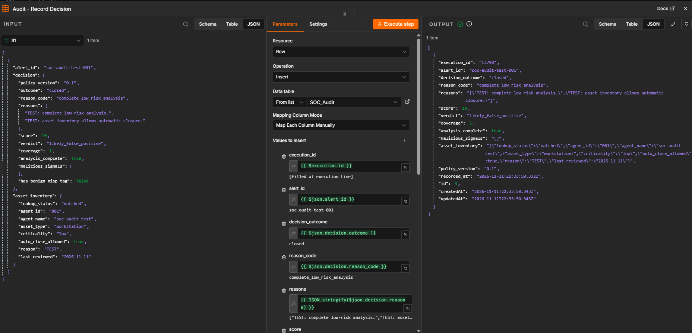

### How to test it

The Audit branch was tested using a temporary Code node named `TEST - Audit Data`. It generated a synthetic item with the following values:

| Field | Test value |
|---|---|
| `alert_id` | `soc-audit-test-001` |
| `decision.outcome` | `closed` |
| `decision.reason_code` | `complete_low_risk_analysis` |
| `decision.score` | `10` |
| `decision.verdict` | `likely_false_positive` |
| `decision.coverage` | `1` |
| `decision.analysis_complete` | `true` |
| `asset_inventory.criticality` | `low` |
| `asset_inventory.auto_close_allowed` | `true` |

The test item passed the true output of `IF1`. The `Audit - Record Decision` node completed successfully and inserted a row into `SOC_Audit`.

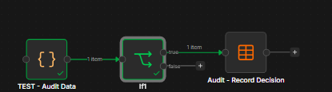

The Data Table view shows three inserted rows with the same synthetic alert ID. These records demonstrate that the filter, field mapping, and Data Table insertion work. They are synthetic test records, not three real alerts automatically closed by the workflow.

The temporary `TEST - Audit Data` node and its test-only connections were removed after testing.

### Verification limits

The synthetic test verifies:

- The `IF1` condition for the `closed` outcome.
- The connection from the true output to the Insert node.
- The mapping of Decision and asset inventory fields.
- Successful persistence of the audit record in `SOC_Audit`.

An end-to-end test with a real alert automatically closed by the live Decision stage has not yet been demonstrated.

### If it does not work

| What you see | Cause | Fix |
|---|---|---|
| No row is inserted | The outcome is not `closed`, or the true output is not connected to the Insert node | Inspect `decision.outcome` at `IF1` and check the true connection |
| A non-closed outcome is inserted | The IF condition is missing or incorrect | Set `{{ $json.decision.outcome }}` to **is equal to** `closed` |
| `analysis_complete` is empty or incorrect | The field is mapped from the wrong object | Use `{{ $json.decision.analysis_complete }}` |
| Object or array fields are not stored as readable text | Values are mapped directly to String columns | Use `JSON.stringify(...)` for `reasons`, `malicious_signals`, and `asset_inventory` |
| The main workflow payload is disrupted | Audit Insert was placed in series with the main path | Keep the original `Decision` → `If` connection and use a separate parallel Audit branch |


## 10. Counters

**Owner:** @84rtek

### What it does

Records how many alerts reach each selected workflow stage. Counter records can be correlated by execution ID and alert ID to show how alerts progress through the workflow.

The Counters stage only records metrics. It does not change the existing triage, scoring, deduplication, enrichment, or decision logic.


### 10.1. Data Table: SOC_Counters

Create one n8n Data Table named `SOC_Counters`.

The table contains the following columns:

| Column | Type | Purpose |
|:---|:---|:---|
| `execution_id` | String | Identifies the n8n execution |
| `alert_id` | String | Identifies the alert |
| `stage` | String | Identifies the workflow stage |
| `outcome` | String | Records the stage outcome |
| `counted_at` | Date | Records when the counter event occurred |

All counter Insert nodes use the following settings:

| Setting | Value |
|:---|:---|
| Resource | `Row` |
| Operation | `Insert` |
| Data table | `SOC_Counters` |
| Mapping Column Mode | `Map Each Column Manually` |


### 10.2. Counter-node placement

Counter nodes use separate parallel branches. Do not connect a counter node's output back into the original workflow path.

A Data Table Insert node returns the inserted row, which must not replace the alert data used by downstream nodes.

### 10.3. Node: Count - Raw Alert

**What it does:** Records that the Webhook received an alert.

**How to build it:**

1. Add a Data Table node on a separate branch from `Webhook`.
2. Name the node `Count - Raw Alert`.
3. Set Resource to `Row` and Operation to `Insert`.
4. Select the `SOC_Counters` table.
5. Set Mapping Column Mode to `Map Each Column Manually`.
6. Map the columns:

| Column | Value |
|:---|:---|
| `execution_id` | `{{ $execution.id }}` |
| `alert_id` | `{{ $json.body?.id ?? $json.id }}` |
| `stage` | `raw` |
| `outcome` | `received` |
| `counted_at` | `{{ $now.toISO() }}` |

**How to test it:** Execute the workflow with a sample Wazuh alert. Check that a new row appears in `SOC_Counters` with `stage = raw` and `outcome = received`.

**Screenshot evidence:**


### 10.4. Node: Count - Normalized Alert

**What it does:** Records that an alert successfully reached the output of `Normalize Alert`.

**How to build it:**

1. Add a Data Table node on a separate parallel branch from `Normalize Alert`.
2. Name the node `Count - Normalized Alert`.
3. Set Resource to `Row` and Operation to `Insert`.
4. Select the `SOC_Counters` table.
5. Map the columns:

| Column | Value |
|:---|:---|
| `execution_id` | `{{ $execution.id }}` |
| `alert_id` | `{{ $json.alert_id }}` |
| `stage` | `normalized` |
| `outcome` | `success` |
| `counted_at` | `{{ $now.toISO() }}` |

**How to test it:** Execute a sample alert. Check that a row with `stage = normalized` and `outcome = success` appears. Its `execution_id` should match the raw counter record from the same execution.

**Screenshot evidence:**


### 10.5. Node: Count - Dedup New

**What it does:** Records alerts classified as new by the existing `New Alert?` node.

**How to build it:**

1. Add a Data Table Insert node on a separate branch from the TRUE output of `New Alert?`.
2. Name the node `Count - Dedup New`.
3. Select the `SOC_Counters` table.
4. Map the columns:

| Column | Value |
|:---|:---|
| `execution_id` | `{{ $execution.id }}` |
| `alert_id` | `{{ $('Normalize Alert').first().json.alert_id }}` |
| `stage` | `deduplication` |
| `outcome` | `new` |
| `counted_at` | `{{ $now.toISO() }}` |

**How to test it:** Send a sample alert that is classified as new. Check that the TRUE branch executes and a `deduplication / new` record appears in the table.

### 10.6. Node: Count - Dedup Duplicate

**What it does:** Records alerts classified as duplicates by the existing `New Alert?` node.

**How to build it:**

1. Add a Data Table Insert node on a separate branch from the FALSE output of `New Alert?`.
2. Name the node `Count - Dedup Duplicate`.
3. Select the `SOC_Counters` table.
4. Map the columns:

| Column | Value |
|:---|:---|
| `execution_id` | `{{ $execution.id }}` |
| `alert_id` | `{{ $('Normalize Alert').first().json.alert_id }}` |
| `stage` | `deduplication` |
| `outcome` | `duplicate` |
| `counted_at` | `{{ $now.toISO() }}` |

**How to test it:** Send an alert that is classified as a duplicate. Check that the FALSE branch executes and a `deduplication / duplicate` record appears in the table.

**Screenshot evidence for both deduplication counters:**


### 10.7. Node: Count Cortex Results

**What it does:** Calculates aggregate Cortex execution statistics and adds a `cortex_summary` object to the incoming alert data. It does not write to the Data Table.

**How to build it:**

1. Add a Code node immediately after `Summary Enrichments`.
2. Name the node `Count Cortex Results`.
3. Set Mode to `Run Once for All Items`.
4. Set Language to `JavaScript`.
5. Use the following code:

```javascript
const items = $input.all();

return items.map(item => {
  const data = item.json ?? {};

  const cortexResults = data.cortex?.results ?? [];
  const skipped = data.cortex?.skipped_by_filter ?? [];
  const processing = data.processing ?? {};

  const total = cortexResults.length;

  const completed = cortexResults.filter(
    result => result.status === 'complete'
  ).length;

  const failed = cortexResults.filter(
    result => result.status === 'failed' || result.status === 'error'
  ).length;

  const pending = processing.pending?.length ?? 0;
  const skippedCount = skipped.length;

  const analyzerCounts = {};

  for (const result of cortexResults) {
    const name = result.analyzer ?? 'unknown';
    analyzerCounts[name] = (analyzerCounts[name] ?? 0) + 1;
  }

  return {
    json: {
      ...data,
      cortex_summary: {
        total,
        completed,
        failed,
        pending,
        skipped: skippedCount,
        analyzer_counts: analyzerCounts,
        processing_status: processing.status ?? 'unknown'
      }
    }
  };
});
```

Node settings:

| Setting | Value |
|:---|:---|
| Node type | `Code` |
| Mode | `Run Once for All Items` |
| Language | `JavaScript` |

**How to test it:** Execute the node using the output of `Summary Enrichments`. Check that the original alert data is preserved and that `cortex_summary` contains the expected counts and processing status.

**Screenshot evidence:**


### 10.8. Node: Count - Cortex Results

**What it does:** Saves a Cortex counter record in `SOC_Counters`.

**How to build it:**

1. Add a Data Table Insert node on a separate parallel branch from `Count Cortex Results`.
2. Name it `Count - Cortex Results`.
3. Select the `SOC_Counters` table.
4. Map the columns:

| Column | Value |
|:---|:---|
| `execution_id` | `{{ $execution.id }}` |
| `alert_id` | `{{ $json.alert?.id ?? $json.alert_id ?? $json.id }}` |
| `stage` | `cortex` |
| `outcome` | `{{ $json.cortex_summary.pending > 0 ? 'pending' : $json.cortex_summary.failed > 0 ? ($json.cortex_summary.completed > 0 ? 'partial' : 'failed') : ($json.cortex_summary.completed > 0 ? 'completed' : 'skipped') }}` |
| `counted_at` | `{{ $now.toISO() }}` |

Cortex outcomes describe analyzer execution status, not whether an observable is malicious or benign.

**How to test it:** Execute the Insert node using the output of `Count Cortex Results`. Check that a row with `stage = cortex` and the expected outcome appears in the Data Table.

**Screenshot evidence:**


### 10.9. Node: Count - TheHive Alert Created

**What it does:** Records successful creation of an alert in TheHive.

**How to build it:**

1. Add a Data Table Insert node on a separate parallel branch from the successful output of `Create an alert`.
2. Name the node `Count - TheHive Alert Created`.
3. Select the `SOC_Counters` table.
4. Map the columns:

| Column | Value |
|:---|:---|
| `execution_id` | `{{ $execution.id }}` |
| `alert_id` | `{{ $('Normalize Alert').first().json.alert_id }}` |
| `stage` | `thehive_alert_created` |
| `outcome` | `created` |
| `counted_at` | `{{ $now.toISO() }}` |

**How to test it:** Execute an alert through the TheHive creation path. Check that a `thehive_alert_created / created` record appears in the table.

This counter records alert creation. It does not prove that an analyst opened or reviewed the alert.

### 10.10. Node: Count - TheHive Skipped

**What it does:** Records that the TRUE output of the existing `If` node follows the branch that skips TheHive.

**How to build it:**

1. Add a Data Table Insert node on a separate parallel branch from the TRUE output of `If`.
2. Name the node `Count - TheHive Skipped`.
3. Select the `SOC_Counters` table.
4. Map the columns:

| Column | Value |
|:---|:---|
| `execution_id` | `{{ $execution.id }}` |
| `alert_id` | `{{ $('Normalize Alert').first().json.alert_id }}` |
| `stage` | `thehive_skipped` |
| `outcome` | `skipped` |
| `counted_at` | `{{ $now.toISO() }}` |

**How to test it:** Execute an alert that follows the TRUE branch of `If`. Check that a `thehive_skipped / skipped` record appears in the table.

This counter records the branch taken. It does not mean that the alert was classified as benign.

**Screenshot evidence for TheHive counters:**

.png)

### 10.11. How to verify a complete counter execution

1. Open the `SOC_Counters` Data Table.
2. Inspect records with the same `execution_id`.
3. Check that the `alert_id` is consistent across the records.
4. Confirm that the recorded stages and outcomes match the path taken by the alert.
5. Remember that `thehive_alert_created` records creation, not analyst review.

A synthetic test alert was processed:

`soc-n8n-countertest-20261111-08`

The observed execution ID was `13629`.

The following records were visible in `SOC_Counters`:

| Stage | Outcome |
|:---|:---|
| `raw` | `received` |
| `normalized` | `success` |
| `deduplication` | `new` |
| `cortex` | `completed` |
| `thehive_alert_created` | `created` |

The duplicate and TheHive-skipped branch tests are treated as PASS for this task based on the assumed test results. Separate captured execution evidence is still required before describing those paths as independently evidenced tests.

### 10.12. If it does not work

| What you see | Cause | Fix |
|:---|:---|:---|
| The main workflow loses alert fields after a counter node | The counter output is connected back into the main path | Keep the counter as a parallel branch and do not connect its output to downstream processing |
| A counter row is missing | The relevant branch did not execute, or the Insert node is connected to the wrong output | Check the execution path and node connection |
| `alert_id` is empty | The expression does not match the input data structure | Inspect the node input and use the correct alert ID field |
| Cortex outcome is unexpected | `cortex_summary` contains different counts or processing status than expected | Inspect the output of `Count Cortex Results` |
| TheHive-created counter is missing | The TheHive creation node failed, or its successful output is not connected to the counter branch | Inspect the `Create an alert` execution and parallel connection |
| TheHive-skipped counter is missing | The TRUE output of `If` did not execute, or it is not connected to the counter branch | Inspect the `If` output and counter connection |


## Full test

**Owner:** @Solivagantaeon
