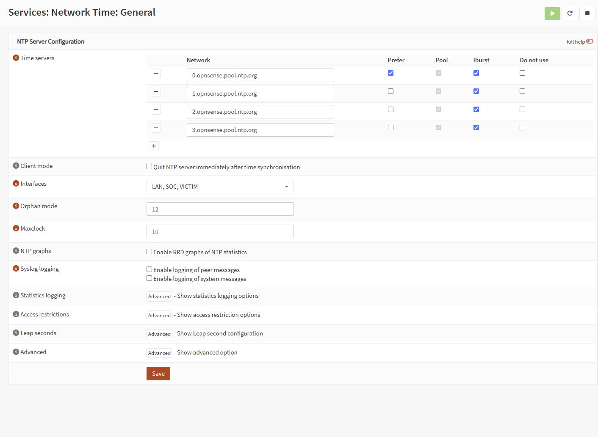
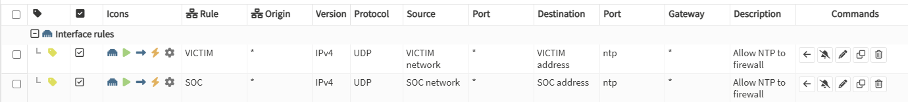
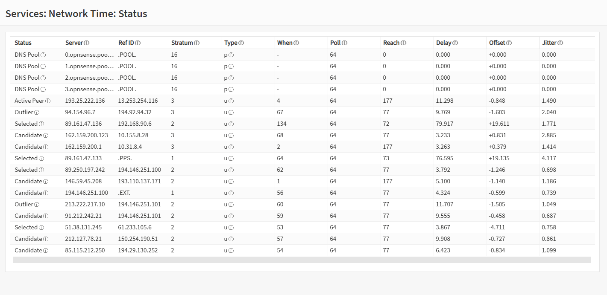

# Time synchronisation across the lab

Issue: #5 [Z1] Time synchronisation across the lab
Date of change: 2026-10-18

## Why it matters

Correlation and deduplication within a time window, first/last seen in incidents and Kerberos authentication all depend on hosts agreeing on the time. Before this change the Windows hosts were 6 hours ahead in UTC, and the Linux hosts were not synchronised at all.

## Target setup

```
public NTP pool (opnsense.pool.ntp.org)
        │
   OPNsense (ntpd) ── listens on LAN, VICTIM 10.10.10.1, SOC 10.10.20.1
        │
        ├── SOC-DC01 (PDC emulator, manual peer 10.10.10.1)
        │       └── SOC-WIN10-01, SOC-WIN11-AI (domain hierarchy, NT5DS – no manual config)
        ├── SOC-LIN-01 (VICTIM)        → 10.10.10.1
        └── Wazuh, MISP, Shuffle, TheHive/Cortex (SOC) → 10.10.20.1
```

- Time zone on every host: `Europe/Warsaw`.
- Docker containers (MISP, Shuffle, TheHive/Cortex) use the host clock, so nothing is configured inside them.
- Out of scope: Kali (ATTACK VLAN), powered-off VMs (Splunk, Wazuh 5 test VMs).

## Root cause (diagnosis)

| Finding | Evidence |
|---|---|
| SOC-DC01 time zone was `Eastern Standard Time` (UTC−4) | `tzutil /g` |
| SOC-DC01 UTC clock was +6 h (17:13 UTC instead of 11:13 UTC) | `(Get-Date).ToUniversalTime()` |
| SOC-DC01 had no time source | `w32tm /query /source` → `Free-running System Clock`, ReferenceId `LOCL` |
| Domain members copied the wrong time from the DC | SOC-WIN11-AI: source `SOC-DC01`, offset to DC +0.0015 s |
| Offset of the DC hierarchy to OPNsense | `w32tm /stripchart /computer:10.10.10.1` on SOC-WIN11-AI → `-21603.32 s` |

The wall clock on the DC looked correct, because 17:13 UTC in the Eastern time zone shows 13:13, which matches local time in Warsaw. The clock had been set by hand with the wrong time zone, so the error was in UTC: +2 h (CEST) − (−4 h) = 6 h.

The Linux hosts had the correct time only by chance. `systemd-timesyncd` pointed at `ntp.ubuntu.com` over IPv6 with `Packet count: 0`, and Wazuh used `chrony` with the Ubuntu pools. Both reported `System clock synchronized: no`.

### Before (key output)

SOC-DC01:
```
> w32tm /query /status
Stratum: 1 (primary reference - syncd by radio clock)
Root Dispersion: 10.0000000s
ReferenceId: 0x4C4F434C (source name:  "LOCL")
Source: Free-running System Clock
> tzutil /g
Eastern Standard Time
```

SOC-WIN11-AI:
```
> w32tm /query /source
SOC-DC01.soclab.local
> w32tm /stripchart /computer:10.10.10.1 /samples:3 /dataonly
19:22:38, -21603.3200725s
```

SOC-LIN-01:
```
$ timedatectl timesync-status
       Server: <IPv6 address> (ntp.ubuntu.com)
 Packet count: 0
$ timedatectl
                Time zone: Etc/UTC (UTC, +0000)
System clock synchronized: no
```

Wazuh, MISP, Shuffle, TheHive/Cortex: `System clock synchronized: no`; MISP and Shuffle in `Etc/UTC`.

## 1. OPNsense – NTP server

1. **Services → Network Time → General**
   - Time servers: `0–3.opnsense.pool.ntp.org` (default).
   - Interfaces: `LAN`, `VICTIM`, `SOC`. NTP is not exposed on WAN.
2. **Firewall → Rules → VICTIM** and **SOC**: one pass rule each, placed above the block rules:
   - Protocol `UDP`, source `<interface> net`, destination `<interface> address`, port `NTP (123)`.
3. **Services → Network Time → Status**: wait until one peer is shown as *Active Peer*.







Test from a client before changing any host:
```
w32tm /stripchart /computer:10.10.10.1 /samples:3 /dataonly
```

## 2. Domain controller (PDC emulator)

Take a VM snapshot first (`pre-time-sync`). Then, in PowerShell as administrator:
```
tzutil /s "W. Europe Standard Time"
w32tm /config /manualpeerlist:"10.10.10.1,0x8" /syncfromflags:manual /reliable:yes /update
reg add HKLM\SYSTEM\CurrentControlSet\Services\W32Time\TimeProviders\VMICTimeProvider /v Enabled /t REG_DWORD /d 0 /f
net stop w32time; net start w32time
w32tm /resync /rediscover
klist purge
```
- `VMICTimeProvider` is the Hyper-V time provider. It has no source on Proxmox/KVM, so it is disabled.
- The default `MaxNegPhaseCorrection` on a DC is 172800 s (48 h), so the 6 h correction is accepted.
- Do the domain members right after the DC. Until they resync, they differ from the DC by 6 h and Kerberos fails (maximum skew is 5 min).

## 3. Domain members (Windows 10/11)

No manual NTP configuration is needed; the members keep using the domain hierarchy (`NT5DS`).
```
w32tm /resync /rediscover
klist purge
w32tm /query /status
```
Right after a large correction, `w32tm /query /status` can show `Leap Indicator: 3 (not synchronized)` / `Stratum: 0`, and `/resync` can return *no time data was available*. The clock is already corrected at that point; run `w32tm /resync` again after a few seconds.

## 4. Linux – systemd-timesyncd

Used on SOC-LIN-01, MISP, Shuffle, TheHive/Cortex. Check first which daemon is active:
```
systemctl is-active systemd-timesyncd chrony
```
As root (`sudo -i` on its own first, then paste the rest):
```
cp /etc/systemd/timesyncd.conf /root/timesyncd.conf.bak-20261018
mkdir -p /etc/systemd/timesyncd.conf.d
printf '# Lab NTP: OPNsense SOC interface (issue #5)\n[Time]\nNTP=10.10.20.1\nFallbackNTP=\n' > /etc/systemd/timesyncd.conf.d/lab.conf
timedatectl set-timezone Europe/Warsaw
systemctl restart systemd-timesyncd
timedatectl timesync-status
```
Use `NTP=10.10.10.1` on hosts in VLAN 10 (SOC-LIN-01). `FallbackNTP=` (empty) stops falling back to public servers.

## 5. Linux – chrony

Used on the Wazuh manager.
```
cp /etc/chrony/chrony.conf /root/chrony.conf.bak-20261018
sed -i -E 's/^(pool|server) /#&/' /etc/chrony/chrony.conf
for f in /etc/chrony/sources.d/*.sources; do [ -f "$f" ] && sed -i -E 's/^(pool|server) /#&/' "$f"; done
printf '\n# Lab NTP: OPNsense SOC interface (issue #5)\nserver 10.10.20.1 iburst\n' >> /etc/chrony/chrony.conf
systemctl restart chrony
chronyc sources
chronyc tracking
```
`chronyc sources` shows `^* _gateway` – `_gateway` is the name systemd-resolved gives the default gateway (10.10.20.1).

## 6. Verification

### After (key output)

SOC-DC01:
```
> w32tm /query /status
Stratum: 5 (secondary reference - syncd by (S)NTP)
ReferenceId: 0x0A0A0A01 (source IP:  10.10.10.1)
Source: 10.10.10.1,0x8
> tzutil /g
W. Europe Standard Time
```

SOC-WIN10-01 (after reboot):
```
Leap Indicator: 0(no warning)
Stratum: 6 (secondary reference - syncd by (S)NTP)
ReferenceId: 0x0A0A0AC8 (source IP:  10.10.10.200)
Source: SOC-DC01.soclab.local
```

SOC-LIN-01:
```
                Time zone: Europe/Warsaw (CEST, +0200)
System clock synchronized: yes
       Server: 10.10.10.1 (10.10.10.1)
```

Wazuh:
```
MS Name/IP address         Stratum Poll Reach LastRx Last sample
^* _gateway                      3   6    17     4   +912ns[ +370ns] +/-   12ms
Leap status     : Normal
System clock synchronized: yes
```

MISP, Shuffle, TheHive/Cortex:
```
                Time zone: Europe/Warsaw (CEST, +0200)
System clock synchronized: yes
       Server: 10.10.20.1 (10.10.20.1)
```

### Domain login after the change

On SOC-WIN10-01, after logging in with a domain account:
```
> klist
Server: krbtgt/SOCLAB.LOCAL @ SOCLAB.LOCAL
Ticket Flags 0x40e10000 -> forwardable renewable initial pre_authent name_canonicalize
Start Time: 10/18/2026 13:31:57 (local)
Kdc Called: SOC-DC01.soclab.local
> nltest /sc_verify:soclab.local
Trusted DC Connection Status Status = 0 0x0 NERR_Success
Trust Verification Status = 0 0x0 NERR_Success
```

### Result

Measured 2026-10-18, 13:40–13:56 CEST. Offset = difference to the time source.

| Host | Daemon | Time source | Offset after the change |
|---|---|---|---|
| OPNsense | ntpd | public pool (`opnsense.pool.ntp.org`) | < 1 ms |
| SOC-DC01 | w32time | OPNsense 10.10.10.1 | −4.0 ms |
| SOC-WIN10-01 | w32time | SOC-DC01 | −0.6 ms |
| SOC-WIN11-AI | w32time | SOC-DC01 | −1.0 ms (−3.3 ms to OPNsense) |
| SOC-LIN-01 | timesyncd | OPNsense 10.10.10.1 | −10.6 ms |
| Wazuh | chrony | OPNsense 10.10.20.1 | < 0.01 ms |
| MISP | timesyncd | OPNsense 10.10.20.1 | −28.9 ms |
| Shuffle | timesyncd | OPNsense 10.10.20.1 | −1.7 ms |
| TheHive/Cortex | timesyncd | OPNsense 10.10.20.1 | −32.8 ms |

All hosts are within 35 ms of each other (before: 6 h). timesyncd keeps reducing the offset over the next polls.

Commands used for the measurement:
```
w32tm /stripchart /computer:<source> /samples:3 /dataonly      # Windows
timedatectl timesync-status | grep -E 'Server|Offset|Packet'   # timesyncd
chronyc tracking | grep -E 'Reference|System time'             # chrony
```

## Impact on data

- Windows events collected before 2026-10-18 13:28 CEST carry host timestamps that are 6 h ahead (e.g. `data.win.system.systemTime`). This applies to SOC-DC01, SOC-WIN10-01 and SOC-WIN11-AI. For correlation of older data use the Wazuh manager `timestamp`, which was correct.
- From the change onwards, host and manager timestamps agree within milliseconds.

## Rollback

- SOC-DC01: VM snapshot `pre-time-sync`, or `w32tm /config /syncfromflags:domhier /update` and restart `w32time`.
- Linux (timesyncd): `rm /etc/systemd/timesyncd.conf.d/lab.conf && systemctl restart systemd-timesyncd`.
- Linux (chrony): `cp /root/chrony.conf.bak-20261018 /etc/chrony/chrony.conf && systemctl restart chrony`.
- OPNsense: disable the two NTP pass rules and clear the interfaces in *Services → Network Time → General*.
