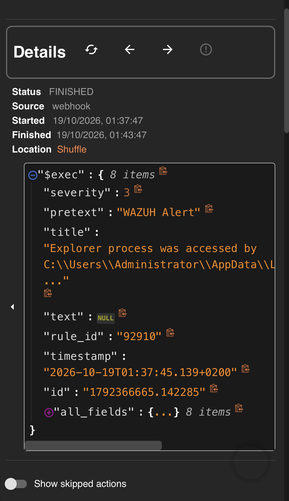
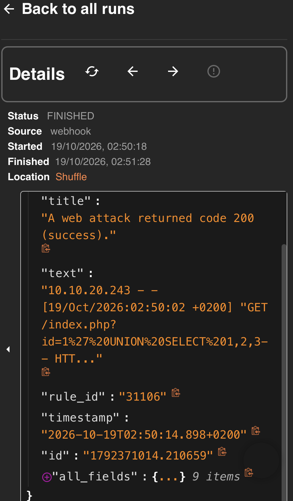

# Runbook – Wazuh → Shuffle integration

Sends every Wazuh alert (level ≥ 3), including Suricata IDS alerts, to a Shuffle workflow over HTTPS.
Background and rationale: [ADR 0001](../decisions/0001-wazuh-integration-shuffle.md).

| Component | Value |
|---|---|
| Wazuh manager | `wazuh-master`, 10.10.20.243, Wazuh 4.14.9 |
| Shuffle | `https://shuffle.lab:3443` (10.10.20.245), self-signed certificate |
| IDS | Suricata on OPNsense (`vlan01`), shipped by the Wazuh agent `opnsense` → rule 86601 |
| Config file | `detection/wazuh/integrations/shuffle-integration.xml` |

All commands run as `root` on the manager unless stated otherwise.

---

## Setup

### 1. Shuffle – webhook

1. Open the workflow, click the **Webhook** trigger node, copy its URL (`https://shuffle.lab:3443/api/v1/hooks/webhook_<id>`).
2. Make sure the webhook is **started** (Start button in the node panel) and save the workflow.
   A stopped or unregistered webhook answers `{"success": false}`.
3. Check from the manager (`-k` only for this reachability test):

   ```bash
   curl -sk -X POST "https://shuffle.lab:3443/api/v1/hooks/webhook_<id>" \
     -H 'Content-Type: application/json' -d '{"test":"reachability"}'
   # expected: {"success": true, "execution_id": "..."}
   ```

### 2. Manager – trust the Shuffle certificate

The integration uses Wazuh's bundled Python, which trusts only its own `certifi` bundle.

```bash
CA=$(/var/ossec/framework/python/bin/python3 -c "import certifi; print(certifi.where())")

# Fetch the certificate and compare the fingerprint with the one shown on the Shuffle host / in ADR 0001
openssl s_client -connect shuffle.lab:3443 -servername shuffle.lab </dev/null 2>/dev/null \
  | openssl x509 -outform PEM > /root/shuffle.lab.pem
openssl x509 -in /root/shuffle.lab.pem -noout -fingerprint -sha256 -subject -ext subjectAltName

# Append (with backup)
cp "$CA" "$CA.bak-$(date +%F)"
printf '\n# shuffle.lab (self-signed, SOC lab)\n' >> "$CA"
cat /root/shuffle.lab.pem >> "$CA"
```

Verify – both must pass:

```bash
openssl s_client -connect shuffle.lab:3443 -servername shuffle.lab -CAfile "$CA" </dev/null 2>/dev/null \
  | grep "Verify return code"            # expected: 0 (ok)

/var/ossec/framework/python/bin/python3 -c "import requests; print(requests.post('https://shuffle.lab:3443/api/v1/hooks/webhook_<id>', json={'test':'tls'}).text)"
                                          # expected: {"success": true, ...}  (no -k / verify=False)
```

### 3. Manager – integration block

```bash
cp /var/ossec/etc/ossec.conf /var/ossec/etc/ossec.conf.bak-$(date +%F)
```

In `/var/ossec/etc/ossec.conf` keep **exactly one** `shuffle` block – the content of
`detection/wazuh/integrations/shuffle-integration.xml`, with `__SHUFFLE_WEBHOOK_URL__` replaced by the real URL from step 1:

```xml
<integration>
  <name>shuffle</name>
  <hook_url>__SHUFFLE_WEBHOOK_URL__</hook_url>
  <level>3</level>
  <alert_format>json</alert_format>
</integration>
```

Do not combine `<level>` with `<rule_id>` – Wazuh ANDs the filters.

```bash
grep -B2 -A6 '<name>shuffle' /var/ossec/etc/ossec.conf    # one block, correct webhook id
systemctl restart wazuh-manager
grep -i integrat /var/ossec/logs/ossec.log | tail -5      # "Enabling integration for: 'shuffle'", no ERROR after restart
```

---

## Test

For every test check three places in order: **alert in Wazuh → no integratord error → execution in Shuffle** (Workflow → Executions, compare timestamps; the input shows `rule_id`).

Generic checks:

```bash
# last alerts
jq -r '[.timestamp, .agent.name, .rule.id, .rule.level, .rule.description] | @tsv' \
  /var/ossec/logs/alerts/alerts.json | tail -5
# integration errors (empty = OK)
grep -i 'integratord.*error' /var/ossec/logs/ossec.log | tail -3
```

### T1 – Real agent alert (Windows / Sysmon)

Wait for any alert from a Windows agent (e.g. 92910 on SOC-WIN10-01) or generate one on the endpoint, then find its execution in Shuffle.

Result 2026-10-19: rule **92910** (level 12, SOC-WIN10-01) at 01:37:45 → execution 01:37:47, FINISHED.
Evidence: `docs/images/07-shuffle-execution.png`,



### T2 – Real IDS alert (Suricata → Wazuh 86601)

Any Suricata alert on `vlan01` is enough. Check that the sensor delivers:

```bash
jq -r 'select(.rule.id=="86601") | [.timestamp, .agent.name, .data.in_iface, .data.src_ip, .data.dest_ip, .data.alert.signature] | @tsv' \
  /var/ossec/logs/alerts/alerts.json | tail -5
```

Result 2026-10-19: rule **86601** from agent `opnsense`, `ET INFO Packed Executable Download`, 02:33:12 → execution in Shuffle.
Evidence: `samples/alerts/suricata-86601.json`.

Note: Suricata only inspects `vlan01` (10.10.10.0/24). Traffic between hosts in 10.10.20.0/24 (manager, Shuffle) does not cross the sensor and produces no IDS alert.

### T3 – Web attack rules (synthetic access-log events)

Used because the web server host (SOC-LIN-01) was down. The events are injected into Wazuh's analysis queue as if read from an Apache access log, so they go through the normal decoder → rules → integratord path; only the web server itself is skipped. Alerts carry agent `wazuh-master`.

```bash
NOW=$(LC_ALL=C date '+%d/%b/%Y:%H:%M:%S %z')
URL='/index.php?id=1%27%20UNION%20SELECT%201,2,3--'
printf '%s\n' \
  "10.10.20.243 - - [$NOW] \"GET $URL HTTP/1.1\" 404 196 \"-\" \"curl/8.5.0\"" \
  "10.10.20.243 - - [$NOW] \"GET $URL HTTP/1.1\" 200 512 \"-\" \"curl/8.5.0\"" \
  > /root/sqli-sample.log

# 1) dry run – must show 31103 for the 404 line and 31106 for the 200 line
/var/ossec/bin/wazuh-logtest < /root/sqli-sample.log

# 2) inject (creates 2 alerts → Shuffle; workflow must be enabled)
/var/ossec/framework/python/bin/python3 - <<'EOF'
import socket
s = socket.socket(socket.AF_UNIX, socket.SOCK_DGRAM)
s.connect('/var/ossec/queue/sockets/queue')
for line in open('/root/sqli-sample.log'):
    if line.strip():
        s.send(f'1:/var/log/apache2/access.log:{line.strip()}'.encode())
s.close()
EOF
```

Result 2026-10-19: **31103** (level 7, SQL injection attempt) and **31106** (level 6, web attack returned 200) at 02:50:14.
Evidence: `samples/alerts/web-31103-sqli.json`, `samples/alerts/web-31106-attack-200.json`.

The same injection method replays a Suricata event (`eve.json` line, location `/var/log/suricata/eve.json`). The JSON decoder needs the line to start with `{`, so `logger`/journald (which add a syslog header) cannot be used for this.

### Samples

`samples/alerts/*.json` are built from `alerts.json` with the integration's own `generate_msg()` from `shuffle.py`, i.e. the same envelope Shuffle receives (`severity`, `pretext`, `title`, `rule_id`, `timestamp`, `id`, `all_fields`). Real lab alerts. They contain only lab hostnames, private addresses and the built-in Administrator account; the external IP in the Suricata sample was replaced with 203.0.113.10 (RFC 5737).
FIM samples (550, 554) come from alerts at 00:29, before the TLS fix – same format, but those particular alerts were not delivered to Shuffle.

---

## Troubleshooting

| Symptom | Cause | Check / fix |
|---|---|---|
| `ossec.log`: `CERTIFICATE_VERIFY_FAILED: self-signed certificate` | Shuffle cert not in Wazuh Python's `certifi` bundle (e.g. after Wazuh upgrade, or Shuffle cert replaced) | Setup step 2; verify with `-CAfile "$CA"` → `0 (ok)` |
| `curl -k` works but Wazuh alerts don't arrive | `-k` skips TLS verification – not a valid test | Use the Python test from step 2 |
| No executions, no errors in `ossec.log` | `hook_url` points to a different webhook than the workflow, or filter excludes the alerts | Compare webhook id in the Shuffle node with `grep -A6 '<name>shuffle' ossec.conf`; check `<level>`/`<rule_id>` |
| Webhook answers `{"success": false}` | Webhook stopped/not registered (common after copying a workflow), or wrong port (3001) | Start the webhook node, save; use `https://shuffle.lab:3443` |
| Execution exists but workflow stops | Workflow logic (dedup marked it DUPLICATE, arrow condition false) | Open the execution, enable *Show skipped actions* |
| Some rule never arrives | Listed in `SKIP_RULE_IDS` in `shuffle.py` | `grep -n -A20 SKIP_RULE_IDS /var/ossec/integrations/shuffle.py` |

Detailed integration logging (temporary): add `integrator.debug=2` to `/var/ossec/etc/local_internal_options.conf`, restart, read `/var/ossec/logs/integrations.log`; remove the line and restart afterwards.

## Maintenance

- **After every Wazuh upgrade:** run the verify commands from Setup step 2. If verification fails, append the certificate again.
- **If Shuffle's certificate changes** (or before 2029-01-12 expiry): repeat Setup step 2 with the new certificate.
- **If the workflow is recreated or copied:** the webhook id changes – update `hook_url` and restart the manager.
- Never commit the real webhook URL; redact it from `ossec.log` excerpts and screenshots.
