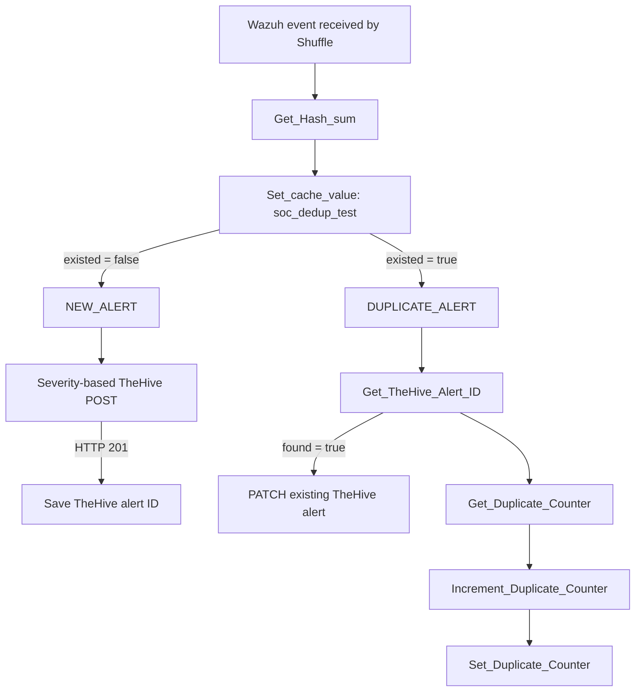
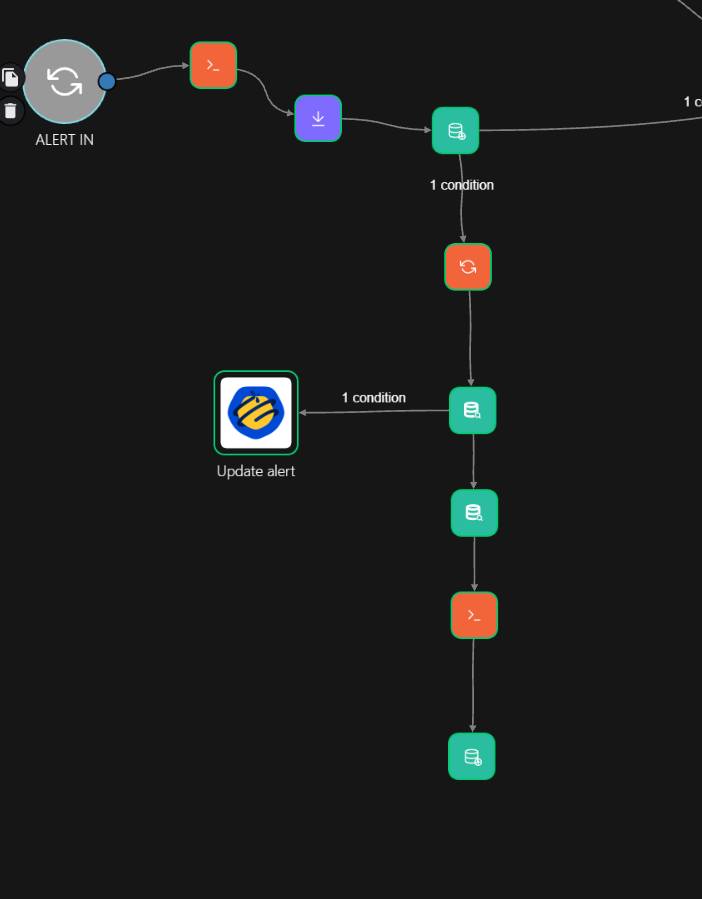
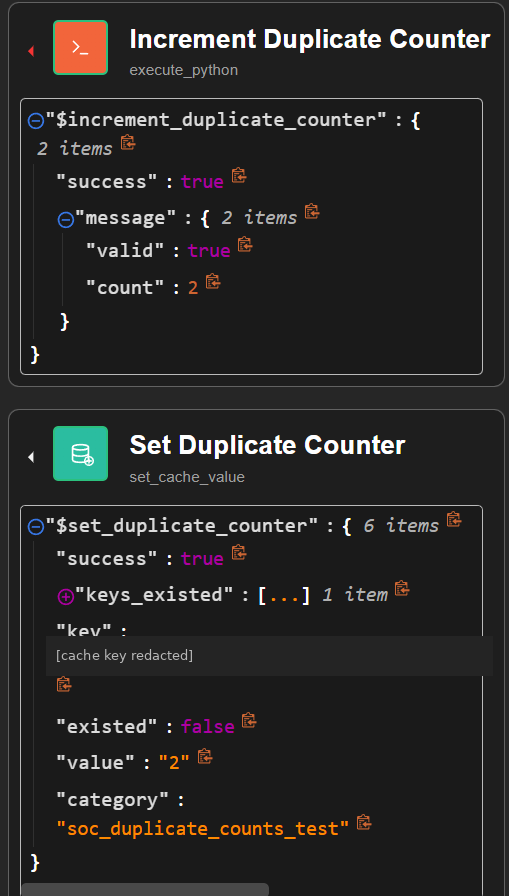

# Shuffle SOAR — Alert Deduplication and Correlation Key

**Related issue:** [#16 — Deduplication and alert correlation](https://github.com/Solivagantaeon/soc-automation-lab/issues/16)  
**Evidence:** Exported Shuffle workflow `Wazuh_copy.json` (17 October 2026 snapshot) and synthetic execution results.  
**Status:** Initial alert deduplication and occurrence-counter storage implemented; multi-source incident correlation not complete.

## Purpose and scope

The initial Shuffle flow prevents repeated Wazuh alerts with an identical correlation key from creating a fresh TheHive **alert** on each occurrence. This is not yet the full requirement of grouping multiple Wazuh/IDS alerts into one TheHive **incident/case**. The latter requires an explicit correlation time window, persistent related-event records, and multi-source testing.

## Current processing flow




*Figure 1. Shuffle SOAR duplicate alert handling, including correlation, TheHive alert ID lookup, and PATCH updates.*


**Important:** The PATCH and the counter branches currently execute independently. There is no guaranteed completion ordering between them, and the counter is not included in the PATCH body.

## Correlation key

The `Get_Hash_sum` action hashes a composite value assembled from these Wazuh fields:

```text
$exec.all_fields.agent.id
|$exec.all_fields.rule.id
|$exec.all_fields.data.srcip
|$exec.all_fields.data.win.eventdata.hashes
|$exec.all_fields.data.win.eventdata.queryName
```

The SHA-256 digest (`$get_hash_sum.sha256`) is used as the primary lookup key. Missing fields may resolve to empty segments. Review normalization and null-handling before treating the digest as a stable cross-source incident identifier.

A new event may differ from an existing one by source IP, process hash, DNS query, or other included fields; this leads to a different key. Conversely, identical keys do not by themselves prove that distinct alerts belong to the same security incident. No configurable correlation time window is present in this snapshot.

## Datastore categories

| Shuffle category | Key | Stored value | Role |
|---|---|---|---|
| `soc_dedup_test` | `$get_hash_sum.sha256` | `$get_hash_sum.original_value` | Indicates if the correlation key has been encountered |
| `soc_thehive_ids_test` | `$get_hash_sum.sha256` | TheHive alert `_id` | Maps a repeated event to an existing TheHive alert |
| `soc_duplicate_counts_test` | `dupcount_$get_hash_sum.sha256` | Decimal count as text | Tracks occurrences (currently written on the duplicate path) |

The separate `dupcount_` prefix prevents confusion with the original deduplication value (e.g. `agent|rule|...`). Both the prefix and the category must be the same for counter reads and writes.

### Occurrence counting

The `Increment_Duplicate_Counter` Python action:

- uses `found = false` to initialize the first duplicate to **2**, accounting for the initial alert as occurrence **1**;
- otherwise converts the stored numeric value and adds one;
- emits `message.valid` and `message.count`;
- passes a valid result to `Set_Duplicate_Counter`.

**Observed evidence:** The workflow emitted `count: 2`, and `Set_Duplicate_Counter` successfully stored `value: "2"` in `soc_duplicate_counts_test`. A subsequent `2 → 3` increment has not yet been verified.



*Figure 2. Shuffle Debug results confirming successful counter initialization and persistence of occurrence count 2.*

## Existing TheHive alert mapping

The initial successful TheHive POST returns HTTP `201` and `body._id`. A dedicated cache action stores that ID in `soc_thehive_ids_test`. On a repeat, `Get_TheHive_Alert_ID` returns `found: true` and the previously stored ID, enabling PATCH instead of another POST. The observed duplicate PATCH returned HTTP `204`.

## Operational limitations and required acceptance checks

1. **Windowing:** implement configurable time-bounded correlation; cache existence alone has no explicit incident window.
2. **Cross-source grouping:** correlate Wazuh and IDS events into one incident with N associated alerts; current mechanism primarily suppresses repeated identical-key TheHive alerts.
3. **Concurrency:** cache read-modify-write is not demonstrated to be atomic. Parallel copies can lose increments or race during initial alert creation.
4. **Recovery:** a dedup key can be stored before an alert ID is successfully saved. Handle missing TheHive ID and failed POST/PATCH without permanently suppressing an event.
5. **TheHive context:** propagate count, `first_seen`, `last_seen`, and related alert details to the case/alert; currently the PATCH tests add only a diagnostic tag.
6. **Performance:** test a series of 1,000 repeated alerts per issue #16; no such scale test is claimed.
7. **Persistence and retention:** verify Datastore expiry, backup, and intended life cycle before deploying beyond the lab.

## Verification record

| Scenario | Evidence | Result |
|---|---|---|
| New LOW alert | TheHive returned HTTP 201 | Confirmed with synthetic runtime input |
| Repeated LOW alert | Cached TheHive ID read; PATCH returned HTTP 204 | Confirmed with synthetic runtime input |
| Repeated MID alert | Cached alert ID and PATCH execution | Confirmed with synthetic runtime input |
| First duplicate counter value | `message.count = 2`, cache `value = "2"` | Confirmed |
| Next count value = 3 | Not run | Pending |
| Wazuh + IDS correlation to a single incident | Not run | Pending |
| 1,000 repeated alerts | Not run | Pending |

This document describes the contribution and current technical state; it does not close issue #16.
