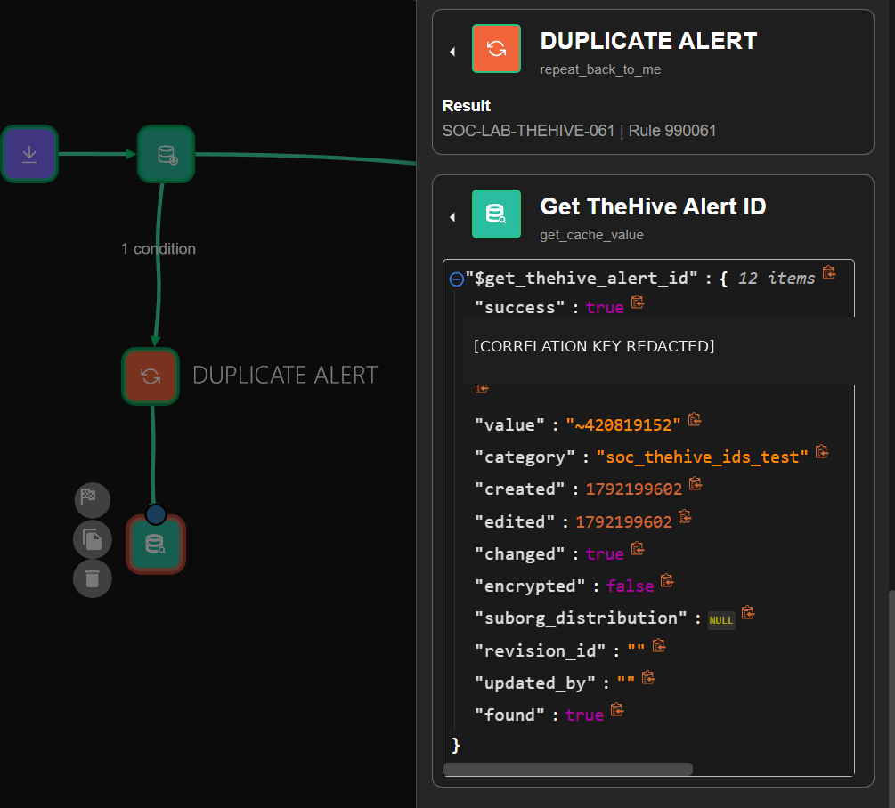

# Wazuh alert deduplication and TheHive updates

**Related issue:** [#16 — Deduplication and alert correlation](https://github.com/Solivagantaeon/soc-automation-lab/issues/16)

The Shuffle workflow fingerprints Wazuh events, creates a TheHive alert for a new fingerprint, and updates the same alert when that fingerprint appears again. It also records the duplicate occurrence count.

## Flow

The SHA-256 fingerprint is built from the agent ID, rule ID, source IP, destination IP, domain, and file hash. The first lookup in the `soc_dedup_test` category selects the path:

- A new fingerprint creates a TheHive alert. The successful response ID is saved under the fingerprint.
- A repeated fingerprint reads that ID, updates the same alert with `PATCH`, and increments the duplicate counter.

*Figure 1. Duplicate detection, cached TheHive ID lookup, and update path.*

## Datastore mapping

| Category | Key | Value | Purpose |
|---|---|---|---|
| `soc_dedup_test` | SHA-256 fingerprint | Original fingerprint | Detects a repeated event |
| `soc_thehive_ids_test` | SHA-256 fingerprint | One successful TheHive `body._id` | Targets the existing alert |
| `soc_duplicate_counts_test` | `dupcount-prefixed SHA-256 fingerprint` | Decimal count as text | Tracks duplicate occurrences |

The ID extractor scans `Create Alert` output for responses with `status 201` and `body._id`. If the output contains a list, it saves an ID only when there is exactly one unique successful ID. The cache therefore stores one dynamically extracted value, not a fixed ID or a response list.

## Verified results

| Check | Observed result |
|---|---|
| New event fingerprint | Cache entry created with a computed SHA-256 key |
| TheHive ID mapping | One ID from the successful `Create Alert` response was stored; a later lookup returned `found=true` |
| Duplicate update | `PATCH` targeted the cached alert ID and returned `HTTP 204` |
| Duplicate counter | The first repeated event produced `count 2` and stored `value "2"` |

*Figure 2. Successful lookup of the cached TheHive alert ID for the repeated fingerprint.*

*Figure 3. Shuffle returned `count 2` and persisted the value in the duplicate counter category.*
