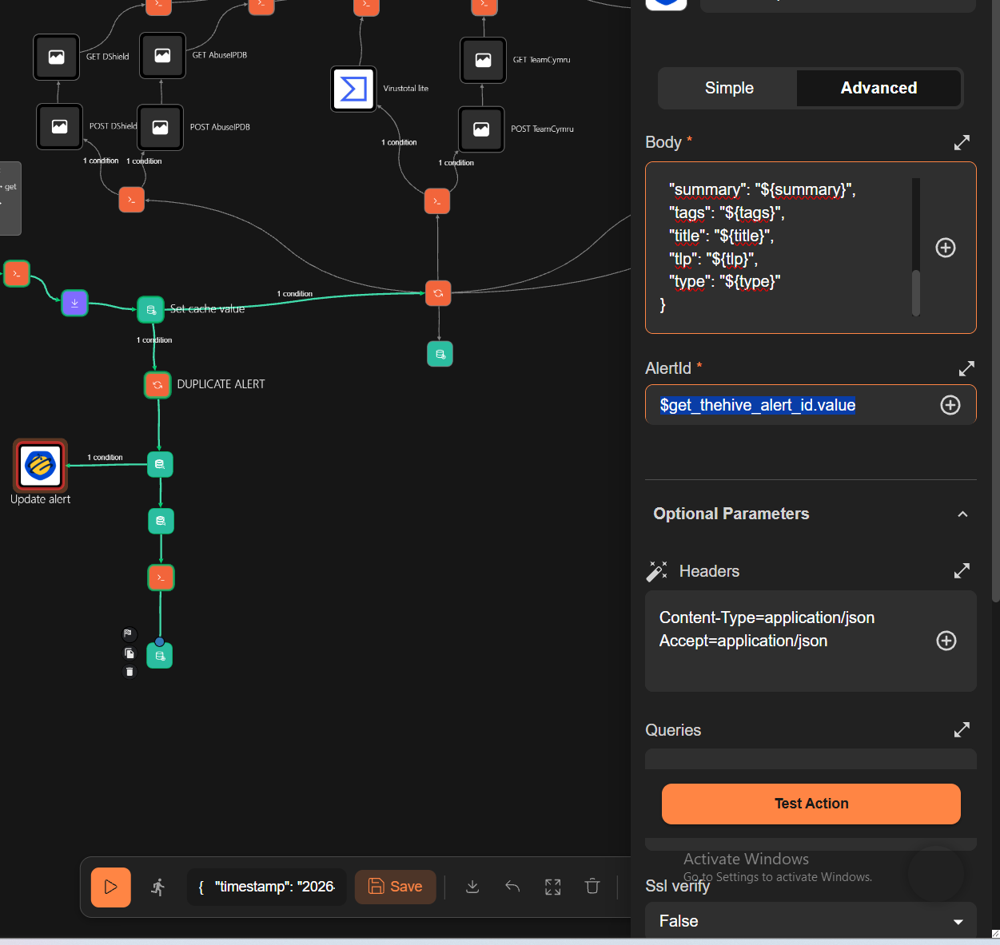

# Wazuh alert deduplication with TheHive Update Alert

**Related issue:** [#16 — Deduplication and alert correlation](https://github.com/Solivagantaeon/soc-automation-lab/issues/16)

Shuffle fingerprints incoming Wazuh events. A new fingerprint creates a TheHive alert; a repeat finds that alert, updates it through the TheHive app, and increments the duplicate count.

## Flow

The SHA-256 fingerprint uses the agent ID, rule ID, source IP, destination IP, domain, and file hash. The first lookup in `soc_dedup_test` selects the new-event or duplicate path.

- For a new fingerprint, `Create Alert` returns the alert ID. The workflow extracts one successful `body._id` and stores it under the fingerprint.
- For a repeated fingerprint, `Get TheHive Alert ID` reads that cached scalar and the TheHive app's `Update Alert` action updates the same alert. Its `AlertId` input is mapped to `$get_thehive_alert_id.value`.
- The duplicate counter is incremented for the repeated event.

*Figure 1. Current Shuffle path, including the TheHive app Update Alert node.*

*Figure 2. The TheHive app action uses the ID returned by the cache lookup.*

## Datastore mapping

| Category | Key | Value | Purpose |
|---|---|---|---|
| `soc_dedup_test` | SHA-256 fingerprint | Original fingerprint | Detects a repeated event |
| `soc_thehive_ids_test` | SHA-256 fingerprint | One successful TheHive `body._id` | Targets the existing alert |
| `soc_duplicate_counts_test` | `dupcount-prefixed SHA-256 fingerprint` | Decimal count as text | Tracks duplicate occurrences |

The ID extractor accepts a Create Alert response or a list of responses, keeps successful responses with status `201`, and stores the ID only when there is one unique `body._id`. This keeps the cache value to one ID instead of a response list or a fixed test ID.

## Verified results

| Check | Observed result |
|---|---|
| New event fingerprint | Cache entry created with a computed SHA-256 key |
| TheHive ID mapping | One ID from the successful Create Alert response was stored; lookup returned `found=true` |
| Duplicate update | The TheHive app update targeted the cached alert ID and returned HTTP `204` |
| Duplicate counter | The first repeated event produced `count 2` and stored value `"2"` |

*Figure 3. Lookup returns the cached TheHive alert ID for the repeated fingerprint.*

*Figure 4. Shuffle returned count 2 and persisted it in the duplicate counter category.*

## Cortex enrichment

The related [Issue #9 Cortex enrichment](../enrichment/cortex/README.md) work routes validated IP, domain, and file-hash observables to Cortex analyzers, normalizes their reports, and calculates risk and routing fields. Its screenshots and route summary are kept with the Cortex documentation. The duplicate-alert datastore described above is used for alert deduplication.
