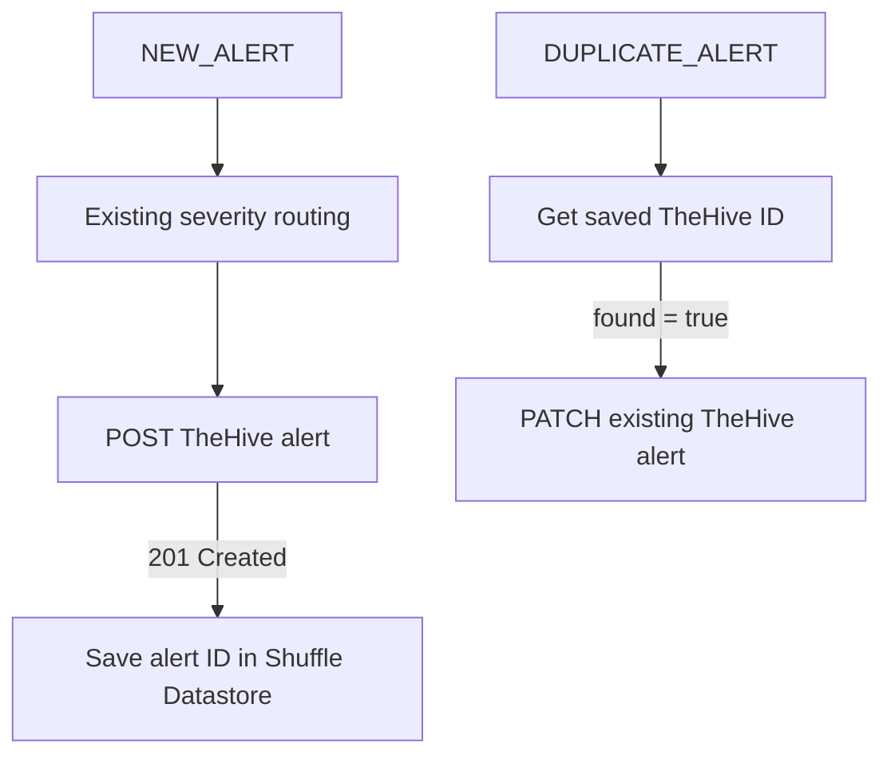

# TheHive — Duplicate Alert Update Extension

**Related issues:** [#11 — Minimal TheHive alert](https://github.com/Solivagantaeon/soc-automation-lab/issues/11), [#16 — Correlation](https://github.com/Solivagantaeon/soc-automation-lab/issues/16)  
**Scope:** The incremental duplicate-handling extension to an **existing team-maintained** Shuffle → TheHive alert-creation integration. This document does not claim authorship of the original alert-creation actions.

## Integration overview

The pre-existing workflow creates TheHive alerts from new Wazuh events. Severity is routed by Wazuh rule level (LOW 0–4, MID 5–8, HIGH 9–11, CRITICAL 12+ in the exported rules). The four existing POST actions use severity values 1, 2, 3, and 4 respectively.

The extension adds a persistent mapping from a Wazuh correlation digest to `body._id`, and a duplicate path that looks up that ID and updates the existing TheHive alert.



## TheHive API interaction

### Create and remember the alert identifier

Existing POST requests target the TheHive alert collection endpoint:

```http
POST /api/v1/alert
Content-Type: application/json
Authorization: Bearer <SECRET>
```

The existing alert payload carries a Wazuh source reference, Wazuh rule description, agent name, rule ID and severity. A successful create returns HTTP `201` with an alert identifier under `body._id`.

The extension records `body._id` in Shuffle Datastore under category `soc_thehive_ids_test` keyed by `$get_hash_sum.sha256`.

### Update a repeated alert

After `Get_TheHive_Alert_ID` reports `found: true`, the dynamic path uses that value:

```http
PATCH /api/v1/alert/{thehive_alert_id}
Content-Type: application/json
Authorization: Bearer <SECRET>
```

The **current test payload** is deliberately limited to a diagnostic tag:

```json
{
  "addTags": ["soc-lab-duplicate-verified"]
}
```

An observed response was **HTTP 204 No Content**. This proves the server accepted the update; verify the tag visually in TheHive when documenting its effect.

**Not implemented yet:** inclusion of occurrence count, first/last seen timestamps, Cortex/MISP summaries, or automatic severity changes in this PATCH action.

## Data and authorization

- API keys belong in protected application authentication, not a JSON export or GitHub.
- Hostnames/IPs in this document are intentionally omitted; use approved environment-specific configuration.
- The exported HTTP actions use disabled TLS verification in this lab. Replace this with trusted certificates before production use.
- The raw Shuffle workflow export contains literal bearer authorization material; never publish it without the repository's sanitization process and an independent review.

## Test evidence (synthetic data)

| Test | Observed result |
|---|---|
| LOW alert creation | HTTP 201, TheHive returned an alert `_id` |
| MID alert creation | HTTP 201, TheHive returned an alert `_id` |
| TheHive ID lookup | `found: true` for previously stored correlation key |
| Repeat detection | `DUPLICATE_ALERT` path selected |
| Existing alert update | HTTP 204 on PATCH of the existing `_id` |

## Known export-specific configuration concern

In the provided 17 October export, incoming connections to `Save_ID_MID`, `Save_ID_HIGH`, and `Save_ID_CRITICAL` check `$http_low.status == 201` rather than their respective POST action status. This is an **export finding**, not an assertion about the latest live version. Review those branches in Shuffle before considering all four mapping paths fully verified.

## Remaining criteria from issue #11

- One enriched TheHive alert in the intended organization including normalized IOC observables and Cortex/MISP summaries.
- Decision gate before creation.
- Safe exported workflow under the repository's expected `soar/shuffle/workflows/` path.
- Screenshot/evidence of a genuine end-to-end Alert → Enrichment → TheHive flow.

The team owns the broader end-to-end issue; this document covers only the duplicate-update extension.
