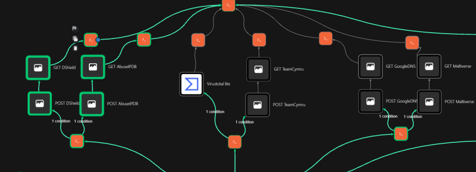
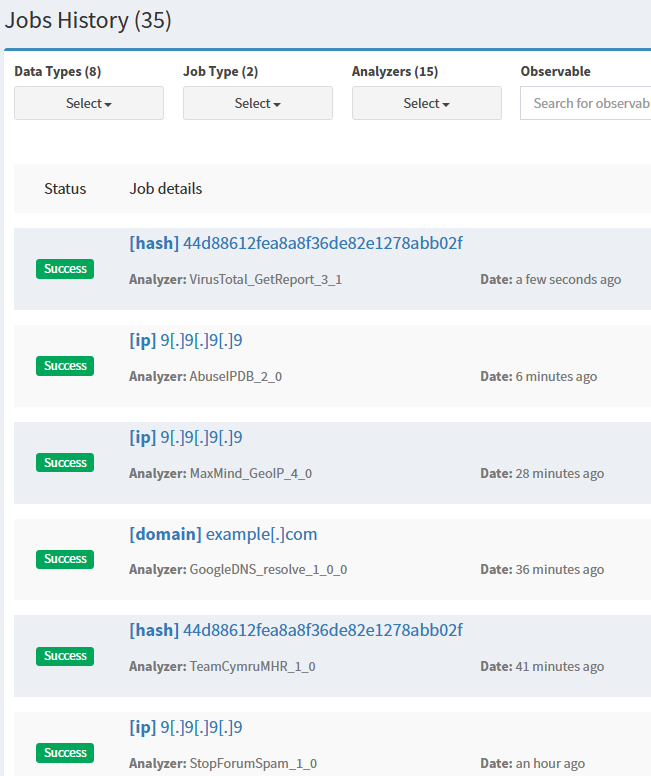

# Cortex IOC enrichment

**Related issues:** [#1 — Cortex analyzers](https://github.com/Solivagantaeon/soc-automation-lab/issues/1), [#9 — IOC enrichment](https://github.com/Solivagantaeon/soc-automation-lab/issues/9)

This page documents the Cortex-related paths present in the Shuffle workflow export on `main`. The repository secret checker passes on the export, but internal endpoint strings still need a manual publication review. This page distinguishes configured paths from end-to-end acceptance evidence. A configured node or successful individual Cortex job does not prove that every required analyzer was called for every observable type or that results were combined into one alert-level object.

## Components and flow

The lab uses Cortex 4.1, integrated with TheHive. Shuffle invokes Cortex through the custom `Cortex_SOC` app referenced by the workflow export. The app source is not currently committed under `soar/shuffle/apps/`.

The enrichment path is:

1. `Normalize Alert` extracts typed observables from the incoming alert.
2. Validation nodes check public IPv4 addresses, file hashes, and domains.
3. Conditional branches start analyzer jobs for accepted observables.
4. Cortex job IDs are passed to report retrieval actions.
5. Normalizer actions extract analyzer-specific fields, and `Aggregate_Score` calculates the current score and decision fields.
6. The workflow routes the alert to TheHive.

The current workflow has analyzer/report actions for DShield, AbuseIPDB, Team Cymru, Google DNS, Maltiverse, and a VirusTotal hash lookup. MISP is a separate lookup path documented with Issue #10.

## Observable routing in the current workflow export

| Observable | Configured paths in the export | Issue #9 acceptance gap |
|---|---|---|
| Public IPv4 | Public-IP validation, DShield, AbuseIPDB | Required VirusTotal coverage is not wired to the IP route. The optional MaxMind path is also not present in this export. |
| Domain | Domain validation, Google DNS, Maltiverse | VirusTotal is not wired to the domain route. Confirm that the selected reputation analyzer set matches the intended requirement. |
| File hash | Hash validation, VirusTotal hash report, Team Cymru | This is the configured route matching the required VirusTotal plus a second source. Complete the sample-alert end-to-end evidence. |

The `Validate_Public_IP` node checks that an address is a globally routable IPv4 address before the public-IP analyzer branch. This excludes private, loopback, reserved, and non-IPv4 values from that branch. It does not establish that an accepted public address is malicious.

The Cortex submission actions have `to_file` set to `False`; the VirusTotal action is a hash-report lookup. The exported workflow therefore shows lookup actions rather than file-upload/submission actions. Confirm this again if the workflow or app actions are changed.

## Analyzer jobs and result handling

Cortex analyzer execution is asynchronous: the workflow starts a job, receives a job ID, then retrieves the report. Three report actions in the export specify `atMost=20second`; the DShield and AbuseIPDB report actions do not show this setting. The timeout configuration is therefore inconsistent and needs to be made explicit for every analyzer path.

The normalizers expose source-specific fields and some source-specific completeness values. For example, the current `Aggregate_Score` output includes `vt_status`, `cymru_status`, Google DNS analysis fields, and Maltiverse status. AbuseIPDB and DShield do not have equivalent explicit per-analyzer `ok` / `timeout` / `error` fields in that aggregate result. A `null` score or an overall `partial` result should not be interpreted as a clean reputation verdict.

`Aggregate_Score` currently emits one execution result per observable path in the all-observable test. The latest supplied test evidence contains five Aggregate Score outputs for one alert. This is useful for per-observable scoring, but it does not satisfy Issue #9's requirement for one combined JSON object per alert with a status for every analyzer.

Alert deduplication is a separate feature from caching analyzer results by IOC. The earlier deduplication implementation, documented in Issue [#16](https://github.com/Solivagantaeon/soc-automation-lab/issues/16), used `soc_dedup_test` for a SHA-256 correlation key, `soc_thehive_ids_test` to map that key to a TheHive alert ID, and `soc_duplicate_counts_test` for occurrence counts. The historical workflow created a new alert for a new key and updated the existing TheHive alert for a repeat. Synthetic creation and duplicate-update tests were recorded on the `cortex-misp-dedup-thehive` branch.

The duplicate counter logic initializes the first repeat at `2`; if a counter value exists, it parses that decimal value and adds one. The submitted screenshots confirm the configured cache key/category and the `Get Duplicate Counter` → increment action → `Set Duplicate Counter` wiring. The earlier verification record confirms that `2` was persisted. Neither the new screenshots nor the supplied code output demonstrate a subsequent persisted value of `3`.

That earlier path used HTTP actions. The current live workflow has since moved TheHive operations to the Shuffle TheHive app, and the duplicate path was bypassed temporarily during enrichment testing. The newly supplied screenshot set still shows a `PATCH` HTTP node, so it appears to predate or omit that migration. The committed workflow snapshot on `main` and these screenshots do not confirm the current app-based duplicate-update path. Re-test it before claiming that the current configuration still deduplicates correctly. Regardless of the TheHive integration, the deduplication cache is not an IOC-keyed analyzer-result cache: the current export and result evidence do not demonstrate cached Cortex results with a defined expiry window.

## Existing repository evidence

The following files document individual normalized analyzer results and test inputs:

- [`samples/alerts/`](../../samples/alerts/README.md) — alert inputs, including Wazuh, Sysmon, Suricata, web, and the Issue #10 multi-observable test alert.
- [`samples/normalized/abuseipdb-normalized-example.json`](../../samples/normalized/abuseipdb-normalized-example.json)
- [`samples/normalized/dshield-normalized-example.json`](../../samples/normalized/dshield-normalized-example.json)
- [`samples/normalized/teamcymru-normalized-example.json`](../../samples/normalized/teamcymru-normalized-example.json)
- [`samples/normalized/virustotal-normalized-example.json`](../../samples/normalized/virustotal-normalized-example.json)
- [`samples/normalized/googledns-normalized-example.json`](../../samples/normalized/googledns-normalized-example.json)
- [`samples/normalized/maltiverse-normalized-example.json`](../../samples/normalized/maltiverse-normalized-example.json)
- [`samples/results/enrichment/issue9-cortex-job-evidence.json`](../../samples/results/enrichment/issue9-cortex-job-evidence.json) — sanitized partial evidence from an earlier run; it is not an alert-level aggregate.

The latest supplied run has usable normalized results from all six configured analyzer paths: AbuseIPDB and DShield for an IP, VirusTotal and Team Cymru for a hash, and Maltiverse and Google DNS for a domain. VirusTotal returned 0 malicious detections from 60 engines; Maltiverse returned a whitelist classification and 21 resolved IPs. Google DNS returned `No Error` with HINFO and RRSIG records but no A or AAAA records. These results supersede the earlier oversized VirusTotal response and placeholder-only Maltiverse response recorded in the first run. The sanitized result sample is [`samples/results/enrichment/issue9-cortex-job-evidence.json`](../../samples/results/enrichment/issue9-cortex-job-evidence.json).

The same run produced three `Aggregate_Score` outputs, one per observable type, each with `analysis_status: complete`. It is stronger evidence that the configured branches and normalizers work for this test input, but it still is not a single combined alert-level enrichment object. The IP result also contains conflicting source signals: AbuseIPDB marked the address whitelisted with score 0, while DShield returned score 80 and `Suspicious` despite zero attacks/count/maxrisk. The workflow should preserve source-specific fields and avoid treating that label alone as a malicious verdict.

The screenshots show two different things: the Shuffle route wiring and completed Cortex jobs. Neither is the final Shuffle aggregate result.

*Figure 1. Shuffle route wiring for IP, hash, and domain analyzer branches. The screenshot contains no IOC values or credentials.*

*Figure 2. Cortex job history for selected hash, public-IP, and domain lookups. This is job-level evidence only; it does not establish full workflow routing or alert-level aggregation.*

## Issue #9 acceptance status against the current repository

| Acceptance criterion | Current evidence/status |
|---|---|
| Required analyzer coverage by observable type | **Partial.** The tested configured paths returned usable results: IP has AbuseIPDB and DShield; hash has VirusTotal and Team Cymru; domain has Google DNS and Maltiverse. VirusTotal was only evidenced for the hash. IP and domain VirusTotal routes required by the issue are not shown in the workflow export; optional MaxMind is also absent. |
| Do not send private or loopback addresses to external IP analyzers | **Configured.** `Validate_Public_IP` gates the public-IP branch. Keep a saved runtime result for both a public test IP and a private/loopback rejection. |
| Lookup-only; no file submission | **Configured in the export.** Cortex POST actions use `to_file: false`; VirusTotal uses a hash-report lookup. |
| One JSON result per alert, including per-analyzer `ok` / `timeout` / `error` | **Not met.** Current evidence shows five Aggregate Score executions for one alert, and the aggregate does not expose a consistent status for every analyzer. |
| Explicit timeout; one slow analyzer does not block others | **Partial.** `atMost=20second` is set on three report actions, not all. Capture a run where one analyzer is delayed or fails while the others complete. |
| Same IOC uses a cached result within a defined window | **Not evidenced.** Existing cache actions are for alert deduplication; no IOC-result cache behavior/window is demonstrated. |
| Test with sample alerts, one per observable type | **Partial.** The latest sanitized all-observable run confirms all six configured analyzer normalizers and three per-observable aggregates for IP, domain, and hash. Separate sample-alert runs for each type are still not evidenced. |
| Custom app source, workflow export, and result evidence | **Partial.** The workflow export is present, but `soar/shuffle/apps/cortex-soc/` and combined enrichment result samples are absent. |
| Shuffle enrichment-result screenshot | **Missing.** The added Shuffle screenshot shows route wiring and the other screenshot shows Cortex job history; neither shows the final Shuffle enrichment object. |

## Remaining work to close Issue #9

1. Add or confirm the required VirusTotal routes for IP and domain, including the selected additional IP analyzer.
2. Normalize all analyzer outputs into one alert-level object with a distinct `ok`, `timeout`, or `error` status for each analyzer. The current run emits three per-observable aggregates and does not expose a consistent explicit status for every analyzer.
3. Set and verify a bounded wait/timeout for every analyzer, and prove that a failure does not discard other results.
4. Implement and test an IOC-result cache with a documented key and expiry window, separate from alert deduplication.
5. Run one sample alert for each observable type and save complete sanitized per-alert results under `samples/results/enrichment/`; the current all-observable run is useful evidence but does not replace the requested per-type test matrix.
6. Add the sanitized custom app source under `soar/shuffle/apps/cortex-soc/` if this is still required by the issue, and describe the enrichment object in `docs/alert-schema.md`.
7. Capture the Shuffle result view at `docs/images/cortex/09-enrichment-results.png`. Before committing, ensure the screenshot contains no API keys, credentials, webhook URLs, or unredacted public IPs.

## Credentials and safe exports

Do not commit Cortex or third-party API keys, webhook URLs, session cookies, or real credentials. Keep credentials in protected Shuffle/Cortex authentication settings. Run `python scripts/sanitize_export.py --check` against exports and inspect the diff manually; the sanitizer cannot determine whether internal endpoint strings or screenshot details are appropriate for publication.

Do not click **Renew** on the Cortex API key used by TheHive unless the integration is being deliberately rotated and retested.
