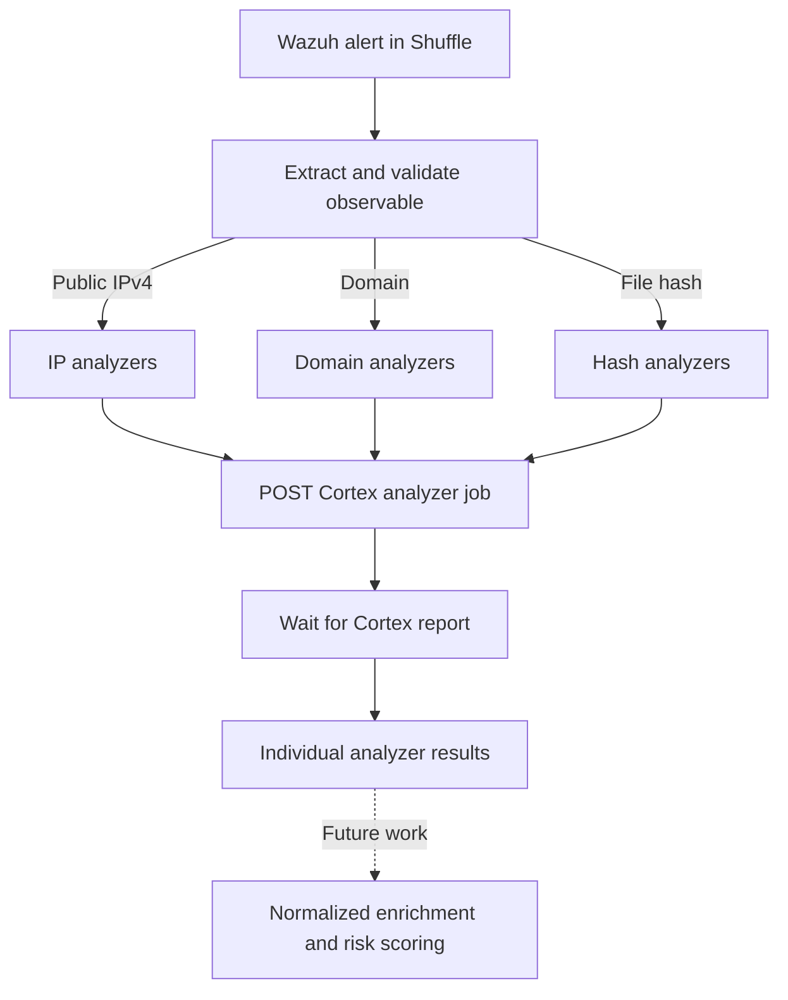

# Cortex — Analyzer Configuration and Shuffle Enrichment

> **Project:** SOC Alert Triage Automation Lab  
> **Related issues:** [#1 — Cortex analyzers](https://github.com/Solivagantaeon/soc-automation-lab/issues/1), [#9 — IOC enrichment](https://github.com/Solivagantaeon/soc-automation-lab/issues/9)  
> **Status:** Individual analyzer execution and conditional routing tested in the lab; full enrichment aggregation and end-to-end acceptance are pending.  

## 1. Deployment and integration

The lab uses **Cortex 4.1** (StrangeBee Docker deployment, `testing` profile), integrated with **TheHive**. Cortex provides observable analysis; **Shuffle SOAR** invokes selected analyzers through a custom `Cortex_SOC` application.

The Cortex organization used for Shuffle integration is `demo`. A dedicated `shuffle-cortex` service account was used for API access during lab tests. TheHive-to-Cortex integration credentials are separate from the Shuffle account.

**Critical operational note:** Do **not** click **Renew** on the Cortex API key currently used by TheHive. It invalidates that key and may interrupt the integration. Any key rotation must be coordinated, with the dependent service updated and tested afterward.

### Data flow



The workflow currently creates **separate analyzer results**. It does not yet produce a single normalized enrichment record per Wazuh alert.

## 2. Observable routing in Shuffle

The routing below reflects the **exported workflow configuration**, not a claim that every route passed a complete end-to-end test.

| Observable | Validation node | Configured analyzer paths | Notes |
|---|---|---|---|
| Public IPv4 | `Validate_Public_IP` | `POST_DShield` → `GET_DShield`; `POST_AbuseIPDB` → `GET_AbuseIPDB` | Validator rejects non-global IPv4, including private and loopback addresses. AbuseIPDB analyzer ID needs correction (see Known issues). |
| Domain | `validate_domain` | `POST_GoogleDNS` → `GET_GoogleDNS`; `POST_Maltiverse` → `GET_Maltiverse` | Both POST bodies use `$validate_domain.message.domain`. |
| File hash | `Validate_Hash` | `POST_VirusTotal` → `GET_VirusTotal`; `POST_TeamCymru` → `GET_TeamCymru` | TeamCymru uses the validated hash. VirusTotal still uses a hard-coded test hash in the snapshot. |

Other analyzers, including MaxMind GeoIP and StopForumSpam, were run in the Cortex environment during testing, but are **not represented as additional branches** in the exported main workflow.

### Public-IP validation

`Validate_Public_IP` checks that an extracted address is syntactically valid, IPv4, and global/public. A valid result exposes:

```json
{"valid": true, "ip": "1.1.1.1", "reason": "public_ipv4"}
```

This prevents lab/private addresses from being sent down the external IP reputation path. It does **not** determine whether a public IP is malicious.

Hash and domain validation use separate `Validate_Hash` and `validate_domain` nodes. Their successful validation is a formatting/routing result, not a threat verdict.

## 3. Cortex API workflow

The custom Shuffle app uses the following Cortex operations:

| Operation | Method and path | Purpose |
|---|---|---|
| List enabled analyzers | `GET /api/analyzer` | Discover analyzers available to the service account. |
| Run analyzer | `POST /api/analyzer/{analyzerId}/run` | Submit an observable for analysis. |
| Wait for report | `GET /api/job/{jobId}/waitreport` | Retrieve a completed report, or handle a pending/incomplete job. |

A representative analyzer submission (illustrative, **not a live credential**) is:

```json
{
  "data": "1.1.1.1",
  "dataType": "ip",
  "message": "SOC-IP-ENRICHMENT",
  "tlp": 0
}
```

`POST` requests use `Content-Type: application/json` and `Accept: application/json`. The job ID returned from a POST is passed to the matching GET action, for example `$post_dshield.body.id`.

The `waitreport` operation can use `atMost=20second`. The exported GoogleDNS and Maltiverse wait actions specify this query parameter; not every wait action in the snapshot has it explicitly configured. A wait timeout should not be interpreted as a negative threat result.

### Response handling

The Shuffle HTTP-action wrapper has fields such as `status`, `success`, and `body`. A wrapper-level HTTP `200` or `success: true` only confirms the API request completed. It is **not sufficient** to classify an observable as safe or malicious.

Before consuming enrichment results, check Cortex's job status and the analyzer report content. Handle incomplete jobs, analyzer errors, empty reports, and unavailable external services as distinct states.

## 4. Analyzer execution evidence

Individual analyzer jobs were successfully executed in the lab. The following image shows the Cortex Jobs History for selected IP, domain, and hash analyzers.


*Figure 1. Cortex Jobs History showing completed analyzer jobs. Manual and API-triggered jobs must not be confused with full end-to-end workflow coverage.*

The screenshot demonstrates that analyzers can run; it does **not** demonstrate aggregated scoring, correct automatic routing for all alert schemas, or malicious IOC detection accuracy.

## 5. API credentials and external-service quotas

Some analyzers rely on third-party services, and usage limits depend on the provider, plan, account, and API-key configuration. **Exact daily/monthly quota figures have not been verified for this lab** and must not be assumed from generic public-plan descriptions.

| Provider/analyzer | Credential or usage consideration | 
|---|---|
| AbuseIPDB | Provider API key; check account-specific limits and applicable endpoint policy. |
| VirusTotal | Provider API key; request limits and permitted usage depend on the account/plan. |
| Maltiverse | Availability and rate limits depend on provider configuration/access. |
| DShield | Review applicable public service usage guidelines. |
| Team Cymru | Review lookup service terms and throttling guidance. |
| GoogleDNS | Review public DNS service usage guidance. |

**Secrets policy:** Keep service keys in Cortex/Shuffle protected authentication configuration, never in Markdown, workflow exports, screenshots, sample alerts, GitHub Issues, or commit history. Sanitize Shuffle exports using `scripts/sanitize_export.py` before publishing them, then inspect the output manually.

**Lab-only TLS configuration:** Some exported Cortex actions have SSL verification disabled. Replace that with trusted certificates/CA verification before production use.

## 6. Known issues and limitations

1. **AbuseIPDB analyzer mapping:** In the 17 October export, `POST_AbuseIPDB` and `POST_DShield` reference the **same Cortex analyzer ID**. The AbuseIPDB action must be mapped to its actual analyzer ID and retested; its label alone does not prove the intended analyzer ran.
2. **VirusTotal hash input:** `POST_VirusTotal` contains a fixed demonstration hash (`44d88612...`) instead of `$validate_hash.message.hash`. This must be made dynamic and verified.
3. **Acceptance routing coverage:** Issue #9 specifies additional VirusTotal coverage for IP/domain analysis. The exported main workflow currently places VirusTotal on the hash path only.
4. **Result aggregation:** Independent analyzer reports are not yet combined into a common per-alert JSON object with source attribution, verdict, confidence, and error state.
5. **Failure and timeout handling:** InProgress, Failed, timed-out and rate-limited analyses require explicit fallback behavior. HTTP success is not a threat verdict.
6. **Input and end-to-end tests:** Full coverage with files from `samples/alerts/` and a live Wazuh → Shuffle → Cortex → TheHive execution remains pending.
7. **Request limits:** Account-specific quotas and backoff/retry behavior must be documented before deploying this workflow beyond the lab.
8. **Threat interpretation:** Reputation labels such as `Suspicious` must be interpreted in context; a DNS resolver or other common benign service must not automatically trigger an incident.

## 7. Acceptance-criteria tracking

| Related issue | Acceptance item | Status |
|---|---|---|
| #1 | Enable AbuseIPDB and VirusTotal, with secrets outside the repository | Enabled and tested individually; secret storage requires final audit |
| #1 | At least one additional analyzer for domains and file hashes | Analyzer jobs tested; verify exact required coverage |
| #1 | Manual test against a known malicious IP | **Pending documented evidence** |
| #1 | Record free API request limits in this README | **Pending provider/account-specific verification** |
| #9 | Route observables to appropriate analyzers | Partially implemented; mapping issues remain |
| #9 | Do not send private lab IP addresses to external analyzers | Public IPv4 validator implemented and tested with synthetic inputs |
| #9 | Aggregate all analyzer results into one JSON object | **Pending** |
| #9 | Test using `samples/alerts/` | **Pending** |

This document reflects the observed laboratory implementation as of 17 October 2026. It does not claim completion of issues #1 or #9.
