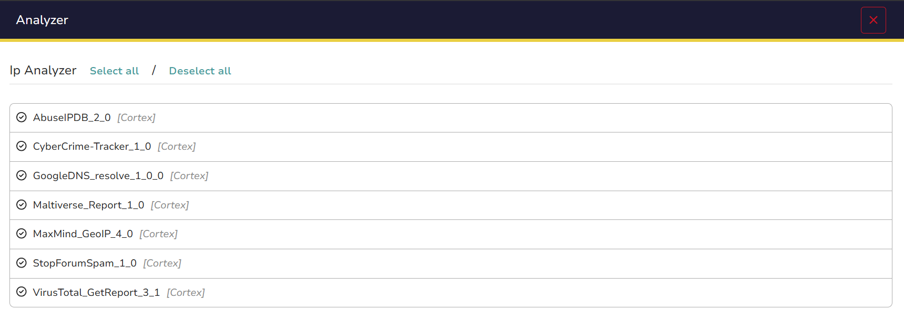
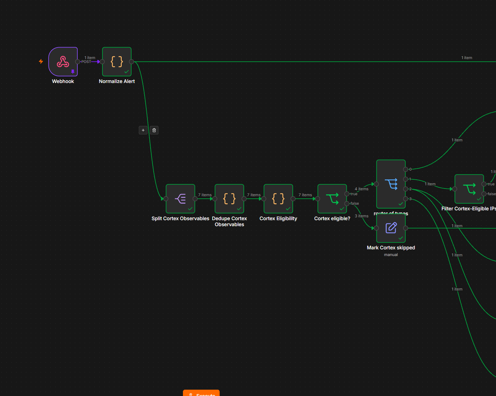
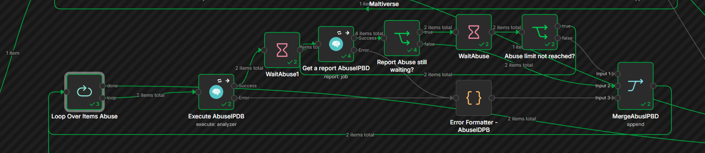
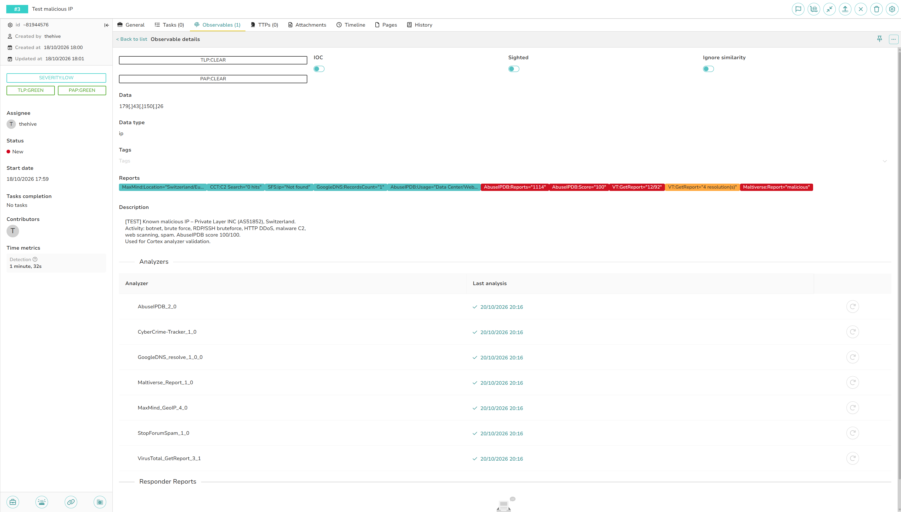

# Cortex – observable analysis and enrichment

> **Warning:** Do not click **Renew** on the Cortex API key used by TheHive — it invalidates the integration and requires reconfiguring the TheHive connector in Cortex.

## Role in the pipeline

Cortex runs analyzers against observables extracted from an alert – IP addresses, domains, URLs and file hashes – and returns one report per analyzer. The n8n triage workflow submits eligible observables to Cortex and uses the reports for scoring; analysts can also run analyzers on observables in TheHive cases. Lookups to external services depend on each analyzer's own provider.

Wazuh → n8n → **Cortex** (+ MISP) → n8n scoring → TheHive

In v0.1, Shuffle called the Cortex analyzers instead of n8n; that flow (issue #9) is archived in [`soar/shuffle/docs/cortex-enrichment.md`](../../soar/shuffle/docs/cortex-enrichment.md).

## What is in this folder

| File | Purpose |
|---|---|
| `README.md` | Deployment, enabled analyzers, n8n integration, verification and test evidence |

Related files elsewhere:

| Path | Content |
|---|---|
| [`samples/results/cortex/`](../../samples/results/cortex/) | Raw analyzer reports from the manual test (2026-10-20) |
| [`soar/n8n/nodes/cortex-eligibility.js`](../../soar/n8n/nodes/cortex-eligibility.js) | n8n: which observables may be sent to Cortex |
| [`soar/n8n/nodes/dedupe-cortex-observables.js`](../../soar/n8n/nodes/dedupe-cortex-observables.js) | n8n: removes duplicate observables before the analyzers |
| [`soar/n8n/nodes/error-formatter-cortex.js`](../../soar/n8n/nodes/error-formatter-cortex.js) | n8n: formats failed Cortex jobs for the alert summary |

## Deployment in the lab

| Property | Configuration |
|---|---|
| Version | Cortex **4.1.0** |
| Installation | StrangeBee Docker deployment, `testing` profile |
| VM | Proxmox VM **207** (`thehive-cortex`), shared with TheHive |
| Private IP | `10.10.20.247` (VLAN 20, SOC) |
| Access | HTTPS `443/TCP`, path `/cortex` (self-signed certificate, CN `thehive-cortex`); the API is also served over HTTP on `9001/TCP` (`/cortex`) inside the SOC network |
| Authentication | Cortex users and organizations; API keys for API consumers (the TheHive connector, the n8n credential) |
| Consumers | n8n triage workflow, TheHive 5.8 (Cortex connector) |

API keys are stored only in the Cortex organization settings and in the consumers' credential stores – never in this repository, in GitHub issues or in screenshots.

A deployment runbook for TheHive and Cortex is not written yet (see the [runbook index](../../docs/runbooks/README.md)).

## Configuration

### Enabled analyzers



An API listing on 2026-10-16 returned **15 enabled analyzers**. The tables below describe the analyzers selected for the pipeline.

#### IP reputation

| Analyzer | Version | Purpose | API Key | Daily Limit | Cache TTL |
|---|---|---|---|---|---|
| AbuseIPDB | 2.0 | Community-reported abuse score (0–100), report count, abuse categories | Yes | 1,000 req/day | 24 h |
| VirusTotal_GetReport | 3.1 | 70+ AV engine verdicts, passive DNS, detection ratio | Yes | 500 req/day | 1 h |
| Maltiverse_Report | 1.0 | Threat intelligence aggregator — verdict: malicious / suspicious / neutral | Yes | 25 req/day (Community) | 12 h |
| StopForumSpam | 1.0 | Spammer and botnet IP lookup | No | 5,000 req/day | 24 h |
| MaxMind_GeoIP | 4.0 | Geolocation, city, country, ASN — runs against local GeoLite2 .mmdb | No | unlimited (local) | 24 h |

#### Domain / FQDN

| Analyzer | Version | Purpose | API Key | Daily Limit | Cache TTL |
|---|---|---|---|---|---|
| VirusTotal_GetReport | 3.1 | Domain reputation, category, detection ratio | Yes | shared with IP quota | 1 h |
| Maltiverse_Report | 1.0 | Domain threat classification | Yes | shared with IP/domain/hash quota (25/day) | 12 h |
| CyberCrime-Tracker | 1.0 | C2 server lookup (botnet command & control) | No | undocumented | 24 h |
| GoogleDNS_resolve | 1.0.0 | DNS resolution via 8.8.8.8 over DoH — useful for fast-flux / DGA detection | No | undocumented (fair use) | 6 h |

#### File hash (MD5 / SHA-1 / SHA-256)

| Analyzer | Version | Purpose | API Key | Daily Limit | Cache TTL |
|---|---|---|---|---|---|
| VirusTotal_GetReport | 3.1 | Hash lookup across 70+ AV engines | Yes | shared with IP/domain quota | 1 h |
| Maltiverse_Report | 1.0 | Hash threat classification | Yes | shared with IP/domain/hash quota (25/day) | 12 h |

The n8n workflow also uses `TeamCymruMHR_1_0` and `CIRCLHashlookup_1_1` for hashes (see below); they are not described in the tables yet.

### Outbound connections

```
TheHive / n8n
    └─► Cortex 4.1  (REST API, SOC network)
            ├─► AbuseIPDB          (HTTPS, api.abuseipdb.com)
            ├─► VirusTotal         (HTTPS, www.virustotal.com)
            ├─► Maltiverse         (HTTPS, api.maltiverse.com)
            ├─► CyberCrime-Tracker (HTTPS, cybercrime-tracker.net)
            ├─► Google DNS         (HTTPS, dns.google)
            ├─► StopForumSpam      (HTTPS, api.stopforumspam.org)
            └─► MaxMind GeoLite2   (local .mmdb file, no outbound call)
```

### n8n triage workflow (issue #69)

After splitting and deduplicating the alert observables, one shared eligibility check runs before `router of types`. Eligible observables go to the analyzer for their type. Ineligible observables are preserved through `Mark Cortex skipped` with their source field, internal flag, and skip reason.

| Observable type | Analyzer |
|---|---|
| `ip` | `AbuseIPDB_2_0` |
| `domain` | `Maltiverse_Report_1_0` |
| `hash` | `TeamCymruMHR_1_0` and `CIRCLHashlookup_1_1` |
| `url` | `VirusTotal_GetReport_3_1` |

Each branch processes one observable at a time. It starts the analyzer once per eligible observable and polls the returned job ID after a two-second wait. Reports and error records return through the branch merge to the same loop. Its done output releases the collected items to the final merge. The [polling runbook](../../docs/runbooks/n8n-triage.md#cortex-analyzer-execution-and-report-polling) describes the retry limit.





For the node configuration, eligibility rules, and complete test evidence, see the [n8n triage runbook](../../docs/runbooks/n8n-triage.md#4-misp-and-cortex).

## Verify it works

**1. Containers are running.** On VM 207:

```bash
sudo docker ps --format 'table {{.Names}}\t{{.Image}}\t{{.Status}}\t{{.Ports}}'
# Use the actual Cortex container name reported by the command:
sudo docker logs --tail 50 <CORTEX_CONTAINER>
```

**2. The API answers** (no key needed for the status endpoint):

```bash
curl -sk https://10.10.20.247/cortex/api/status
```

Expected: HTTP 200 with the Cortex version (`4.1.0`).

**3. Analyzers are enabled** (authenticated, independent of Wazuh, n8n, MISP and TheHive):

```bash
curl -sk -H "Authorization: Bearer <CORTEX_API_KEY>" \
  "https://10.10.20.247/cortex/api/analyzer?range=0-30"
```

Expected: a JSON list of the enabled analyzers (15 on 2026-10-16). A successful listing proves the API and the organization configuration; whether a particular analyzer job completes also depends on its external provider.

**4. An analyzer runs.** In TheHive, open an observable in a case and run an analyzer (for example AbuseIPDB on a known malicious IP). Expected: a report with a verdict, as in the [manual test](#decisions-and-evidence).

## Troubleshooting

- **TheHive can no longer run analyzers after the API key was renewed.** Cause: **Renew** invalidates the key stored in the TheHive connector. Fix: put the new key into the Cortex connector settings in TheHive. Do not renew the key unless it was exposed.
- **An analyzer is missing from the list.** Cause: after deployment, analyzers must be configured and enabled for the organization. Fix: enable the analyzer definition in the organization, then check the API listing again.
- **A job fails or returns no result.** Cause: analyzers that depend on external services need valid provider credentials and outbound network access. Fix: check the provider settings in the organization. Test the API listing separately from provider verdicts, so a failing dependency can be isolated.
- **`NotFoundError` from VirusTotal.** The lookup completed, but the provider has no record of the exact value (seen for a test URL). It is not a clean verdict.

## Decisions and evidence

### Why these sources

| Source | Why it was chosen |
|---|---|
| **AbuseIPDB** | Largest community IP reputation database; industry standard in SOC triage for scanners, brute-force sources, and botnets |
| **VirusTotal** | Aggregates 70+ AV engines — essential for hash analysis; free public API covers lab-scale volume |
| **Maltiverse** | Open-source threat intel aggregator with a clear machine-readable verdict; complements AbuseIPDB with campaign and malware context |
| **CyberCrime-Tracker** | Specialised C2 database; adds coverage for malware infrastructure beyond generic reputation sources |
| **GoogleDNS** | Passive DNS over HTTPS — no dependency on the local resolver; validates fast-flux and DGA-generated domains |
| **StopForumSpam** | Zero-cost spammer/botnet IP list; provides an additional signal for IP observables with a generous rate limit |
| **MaxMind GeoLite2** | Geolocation and ASN data with no external calls; zero latency, no rate limit, refreshed monthly |

### Manual test from TheHive (2026-10-20)

**Observable:** `192.0.2.10` (type `ip`), TheHive Case #3 — *Test malicious IP*.
**Context:** Private Layer INC (AS51852), Switzerland (registered: Panama) — hostname: `swe1.tohou.io` — AbuseIPDB score 100/100, activity: botnet, brute force, RDP/SSH bruteforce, HTTP DDoS, malware C2, web scanning, spam.

| Analyzer | Result | Key Fields |
|---|---|---|
| AbuseIPDB_2_0 | **malicious** | score=100, reports=1,114 from 626 distinct users, usageType=Data Center/Web Hosting/Transit, categories: Port Scan, Hacking, Brute Force, Web App Attack, SSH, Bad Web Bot, DDoS, IoT, SQL Injection, Email Spam |
| VirusTotal_GetReport_3_1 | **malicious** | 8 malicious + 4 suspicious / 92 engines, reputation=-9; malicious: BitDefender, Certego, Fortinet, G-Data, GreyNoise, Lionic, SOCRadar, VIPRE |
| Maltiverse_Report_1_0 | **malicious** | classification=malicious, 32 blacklist entries; tags: ssh, bruteforce, bot, sip, ddos, spam, attacker; sources: Blocklist.de, Emerging Threats, HoneyDB, CIArmy, Barracuda, AbuseIPDB |
| CyberCrime-Tracker_1_0 | clean | C2 hits=0 |
| GoogleDNS_resolve_1_0_0 | info | PTR → `swe1.tohou.io` (TTL=7200s), status=No Error |
| StopForumSpam_1_0 | clean | not found in database (appears=false, frequency=0) |
| MaxMind_GeoIP_4_0 | info | city=Zurich, country=CH (Switzerland), registered_country=PA (Panama), continent=EU, timezone=Europe/Zurich; ASN/ISP not available in GeoLite2 free tier |



Raw JSON: [`samples/results/cortex/`](../../samples/results/cortex/)

### n8n lab test (rule 100723)

The rule `100723` lab test exercised all four observable routes and returned five Cortex results. Maltiverse classified `soc-lab-postdns.example.org` as `neutral`; AbuseIPDB returned a whitelist indication and confidence score `0` for `1.1.1.1`; Team Cymru and CIRCL Hashlookup returned no known record for the test hash. VirusTotal completed its lookup but returned `NotFoundError` for the exact test URL. This is a completed lookup with no record, not a clean verdict.

The workflow summary reported `processing.status: complete`, with no pending or failed jobs. The internal source IP, agent IP, and hostname were retained under `skipped_by_filter`.

### Related

- Issues: [#9 — IOC enrichment](https://github.com/Solivagantaeon/soc-automation-lab/issues/9) (v0.1, archived), [#69](https://github.com/Solivagantaeon/soc-automation-lab/issues/69) (n8n)
- ADR: [0003 – n8n triage workflow](../../docs/decisions/0003-n8n-triage-workflow.md)
- Lab hosts: [lab setup](../../infrastructure/lab-setup.md)
