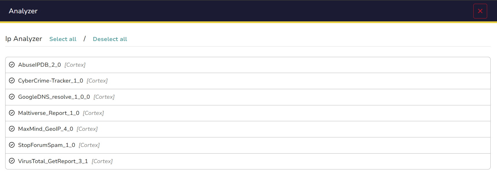
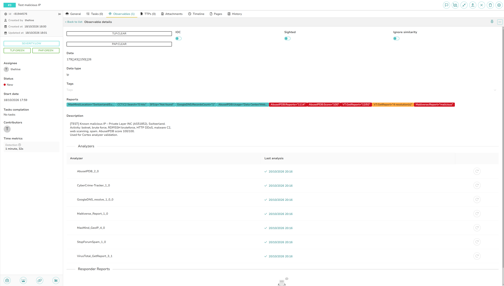

# Cortex IOC enrichment

Cortex 4.1 (StrangeBee Docker image, `testing` profile), integrated with TheHive 5.x as the enrichment engine.
Analyzers run per observable in TheHive cases and via the Shuffle SOAR workflow.

> **Warning:** Do not click **Renew** on the Cortex API key used by TheHive — it invalidates the integration and requires reconfiguring the TheHive connector in Cortex.


## Architecture

```
TheHive
    └─► Cortex 4.1  (REST API, internal network)
            ├─► AbuseIPDB        (HTTPS, api.abuseipdb.com)
            ├─► VirusTotal       (HTTPS, www.virustotal.com)
            ├─► Maltiverse       (HTTPS, api.maltiverse.com)
            ├─► CyberCrime-Tracker (HTTPS, cybercrime-tracker.net)
            ├─► Google DNS       (HTTPS, dns.google)
            ├─► StopForumSpam   (HTTPS, api.stopforumspam.org)
            └─► MaxMind GeoLite2 (local .mmdb file, no outbound call)
```

API keys are stored exclusively in Cortex organization settings - never in this repository or in GitHub Issues.

---

## Enabled Analyzers



### IP Reputation

| Analyzer | Version | Purpose | API Key | Daily Limit | Cache TTL |
|---|---|---|---|---|---|
| AbuseIPDB | 2.0 | Community-reported abuse score (0–100), report count, abuse categories | Yes | 1,000 req/day | 24 h |
| VirusTotal_GetReport | 3.1 | 70+ AV engine verdicts, passive DNS, detection ratio | Yes | 500 req/day | 1 h |
| Maltiverse_Report | 1.0 | Threat intelligence aggregator — verdict: malicious / suspicious / neutral | Yes | 25 req/day (Community) | 12 h |
| StopForumSpam | 1.0 | Spammer and botnet IP lookup | No | 5,000 req/day | 24 h |
| MaxMind_GeoIP | 4.0 | Geolocation, city, country, ASN — runs against local GeoLite2 .mmdb | No | unlimited (local) | 24 h |

### Domain / FQDN

| Analyzer | Version | Purpose | API Key | Daily Limit | Cache TTL |
|---|---|---|---|---|---|
| VirusTotal_GetReport | 3.1 | Domain reputation, category, detection ratio | Yes | shared with IP quota | 1 h |
| Maltiverse_Report | 1.0 | Domain threat classification | Yes | shared with IP/domain/hash quota (25/day) | 12 h |
| CyberCrime-Tracker | 1.0 | C2 server lookup (botnet command & control) | No | undocumented | 24 h |
| GoogleDNS_resolve | 1.0.0 | DNS resolution via 8.8.8.8 over DoH — useful for fast-flux / DGA detection | No | undocumented (fair use) | 6 h |

### File Hash (MD5 / SHA-1 / SHA-256)

| Analyzer | Version | Purpose | API Key | Daily Limit | Cache TTL |
|---|---|---|---|---|---|
| VirusTotal_GetReport | 3.1 | Hash lookup across 70+ AV engines | Yes | shared with IP/domain quota | 1 h |
| Maltiverse_Report | 1.0 | Hash threat classification | Yes | shared with IP/domain/hash quota (25/day) | 12 h |


### Rationale

| Source | Why it was chosen |
|---|---|
| **AbuseIPDB** | Largest community IP reputation database; industry standard in SOC triage for scanners, brute-force sources, and botnets |
| **VirusTotal** | Aggregates 70+ AV engines — essential for hash analysis; free public API covers lab-scale volume |
| **Maltiverse** | Open-source threat intel aggregator with a clear machine-readable verdict; complements AbuseIPDB with campaign and malware context |
| **CyberCrime-Tracker** | Specialised C2 database; adds coverage for malware infrastructure beyond generic reputation sources |
| **GoogleDNS** | Passive DNS over HTTPS — no dependency on the local resolver; validates fast-flux and DGA-generated domains |
| **StopForumSpam** | Zero-cost spammer/botnet IP list; provides an additional signal for IP observables with a generous rate limit |
| **MaxMind GeoLite2** | Geolocation and ASN data with no external calls; zero latency, no rate limit, refreshed monthly |

---

## Shuffle Workflow Mapping

Analyzers triggered automatically by the Shuffle SOAR workflow per IOC type:

| IOC Type | Analyzers |
|---|---|
| `ip` | AbuseIPDB_2_0 · VirusTotal_GetReport_3_1 · Maltiverse_Report_1_0 · StopForumSpam_1_0 · MaxMind_GeoIP_4_0 |
| `domain` / `fqdn` | VirusTotal_GetReport_3_1 · Maltiverse_Report_1_0 · CyberCrime-Tracker_1_0 · GoogleDNS_resolve_1_0_0 |
| `hash` | VirusTotal_GetReport_3_1 · Maltiverse_Report_1_0 |

---

## Manual Test Results

**Observable:** `192.0.2.10`
**Type:** ip
**Case:** TheHive Case #3 — *Test malicious IP*
**Date:** 2026-10-20
**Context:** Private Layer INC (AS51852), Switzerland (registered: Panama) — hostname: `swe1.tohou.io` — AbuseIPDB score 100/100, activity: botnet, brute force, RDP/SSH bruteforce, HTTP DDoS, malware C2, web scanning, spam.

| Analyzer | Result | Key Fields |
|---|---|---|
| AbuseIPDB_2_0 | **malicious** | score=100, reports=1,114 from 626 distinct users, usageType=Data Center/Web Hosting/Transit, categories: Port Scan, Hacking, Brute Force, Web App Attack, SSH, Bad Web Bot, DDoS, IoT, SQL Injection, Email Spam |
| VirusTotal_GetReport_3_1 | **malicious** | 8 malicious + 4 suspicious / 92 engines, reputation=-9; malicious: BitDefender, Certego, Fortinet, G-Data, GreyNoise, Lionic, SOCRadar, VIPRE |
| Maltiverse_Report_1_0 | **malicious** | classification=malicious, 32 blacklist entries; tags: ssh, bruteforce, bot, sip, ddos, spam, attacker; sources: Blocklist.de, Emerging Threats, HoneyDB, CIArmy, Barracuda, AbuseIPDB |
| CyberCrime-Tracker_1_0 | clean | C2 hits=0 |
| GoogleDNS_resolve_1_0_0 | info | PTR → `swe1.tohou.io` (TTL=7200s), status=No Error |
| StopForumSpam_1_0 | clean | not found in database (appears=false, frequency=0) |
| MaxMind_GeoIP_4_0 | info | city=Zurich, country=CH (Switzerland), registered_country=PA (Panama), continent=EU, timezone=Europe/Zurich; ASN/ISP not available in GeoLite2 free tier |


Raw JSON: [`samples/results/cortex/`](../../samples/results/cortex/)


# Cortex Enrichment flow

**Related issue:** [#9 — IOC enrichment](https://github.com/Solivagantaeon/soc-automation-lab/issues/9)

This section describes the Cortex enrichment work from the separate Issue #9 workflow contribution, including observable routing, analyzer results, scoring, alert-level aggregation, and lab evidence.

## Enrichment flow

1. `Normalize_Alert` extracts typed IP, domain, and file-hash observables from the incoming Wazuh alert.
2. Validation nodes check the observable format. `Validate_Public_IP` permits the external IP lookup path only for globally routable IPv4 addresses; the hash validator checks supported hash formats; the domain validator gates domain lookups.
3. Shuffle starts the analyzer jobs for each validated observable and retrieves their reports.
4. Normalizer actions preserve useful source fields, and `Aggregate_Score` adds the per-observable `risk_score`, `risk_level`, `decision`, and `analysis_status` fields.
5. `Collect_Alert_Enrichment` gathers the per-observable results into one alert-level JSON object. `Decision_Router` uses the resulting decision to select incident, analyst-review, or suppress handling.

## Observable routes

| Observable | Lookup sources | Normalized information |
|---|---|---|
| Public IPv4 | AbuseIPDB and DShield | Confidence/reports, reputation, attack counters, maximum risk, threat-feed counts, and network context |
| File hash | VirusTotal hash report and Team Cymru MHR | Detection counts, reputation, record status, detection percentage, and last-seen value |
| Domain | Google DNS and Maltiverse | DNS status and records, classification, score, and resolved IP count |

The Cortex analyzer actions use lookup requests with `to_file` disabled. VirusTotal uses a hash-report lookup. The workflow therefore enriches observable values without submitting files for analysis.

## Normalization and scoring

Each analyzer normalizer keeps source-specific fields so analysts can review the original evidence alongside the score. For example, the IP result retains AbuseIPDB confidence and whitelist fields as well as DShield reputation, attack counters, and maximum-risk values. Hash and domain results retain provider detection, DNS, classification, and availability details.

`Aggregate_Score` combines the available Wazuh and reputation signals for one observable. It emits a risk score, risk level, routing decision, and analysis status with the normalized provider fields. The workflow keeps the provider results visible so one source label is not treated as a verdict on its own.

The recorded IP test illustrates why the source details matter: AbuseIPDB reported confidence score `0` and a whitelist indication, while DShield returned score `80` and the label `Suspicious` despite zero attack count, zero attacks, and maximum risk `0`. The combined record retains both sets of values for review.

## Alert-level result

`Collect_Alert_Enrichment` receives the `Aggregate_Score` messages and the normalized alert. It returns one object containing alert metadata and an `observables` array. Each array item contains the typed observable and its analysis result. The collector keys records by normalized observable type and value, preserves the input observable order, and avoids repeating an observable when multiple workflow branches return it.

The alert-level status is `complete` when every collected observable has a complete analysis, `partial` when one or more results are incomplete, and `unavailable` when no usable result was collected. A shortened example of the output shape is:

```json
{
  "schema_version": "1.0",
  "status": "complete",
  "alert": {
    "source": "wazuh",
    "source_alert_id": "<sanitized-alert-id>"
  },
  "observable_count": 3,
  "observables": [
    {
      "observable": {
        "type": "ip",
        "value": "<sanitized-ip>"
      },
      "analysis": {
        "risk_score": "<per-observable score>",
        "risk_level": "<risk level>",
        "decision": "<routing decision>",
        "analysis_status": "complete"
      }
    }
  ]
}
```

## Lab evidence

The all-observable test exercised an IP address, a domain, and a file hash through the configured lookup paths. The sanitized run contains normalized results from all six sources:

| Source | Recorded result |
|---|---|
| VirusTotal | 0 malicious detections from 60 engines for the test hash |
| Team Cymru MHR | A hash record with a 90% detection value |
| AbuseIPDB | Confidence score 0, whitelist indication, and report context |
| DShield | Source score and reputation together with attack counters and maximum risk |
| Google DNS | `No Error`; HINFO and RRSIG answer records |
| Maltiverse | Whitelist classification and 21 resolved IPs for the test domain |

The collector tests cover one alert object containing distinct observables, duplicate branch results for the same observable, and a partial result when one observable is incomplete. The Shuffle route and Cortex job screenshots show the configured branches and analyzer execution:


*Figure 1. Shuffle routing for public IP, file-hash, and domain lookups.*


*Figure 2. Cortex analyzer jobs for the test observables.*

Sanitized individual normalizer examples are available for [AbuseIPDB](../../samples/normalized/abuseipdb-normalized-example.json), [DShield](../../samples/normalized/dshield-normalized-example.json), [Team Cymru](../../samples/normalized/teamcymru-normalized-example.json), [VirusTotal](../../samples/normalized/virustotal-normalized-example.json), [Google DNS](../../samples/normalized/googledns-normalized-example.json), and [Maltiverse](../../samples/normalized/maltiverse-normalized-example.json).

## Alert deduplication and TheHive updates

The Wazuh alert deduplication flow fingerprints the incoming event and keeps three separate cache values: `soc_dedup_test` records the fingerprint, `soc_thehive_ids_test` maps that fingerprint to one TheHive alert ID, and `soc_duplicate_counts_test` stores the occurrence count under a `dupcount_`-prefixed fingerprint.

For a new alert, the workflow extracts the single successful `body._id` from the Create Alert response and stores it as a scalar under the fingerprint. For a repeated alert, it reads that cached ID and passes it to the TheHive app's `Update Alert` action through `$get_thehive_alert_id.value`. The first repeat is counted as occurrence `2`; later repeats increment the stored count. This alert-level deduplication cache is separate from any cache of enrichment results by IOC.

The workflow mapping, screenshots, and test evidence are documented in [Shuffle alert deduplication](../../docs/shuffle-deduplication.md).

## Safe exports

Keep API keys, webhook URLs, session cookies, and credentials in protected Shuffle and Cortex settings. Run `python scripts/sanitize_export.py --check` on workflow exports before sharing them.
