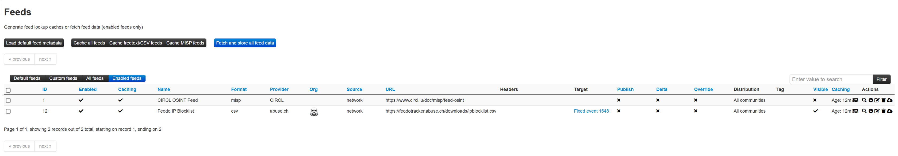
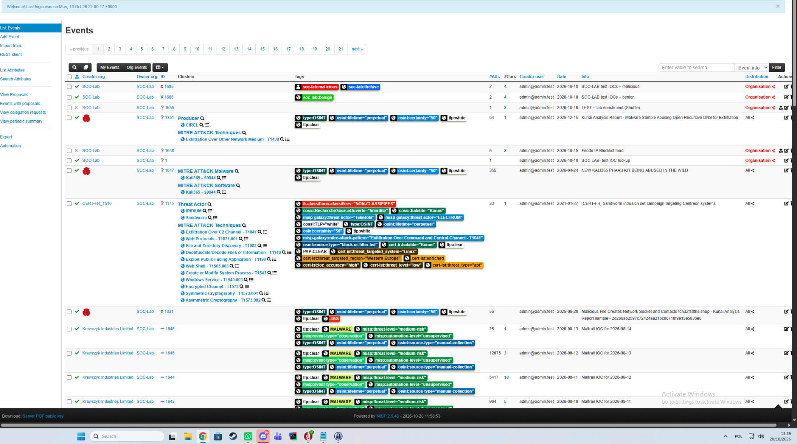
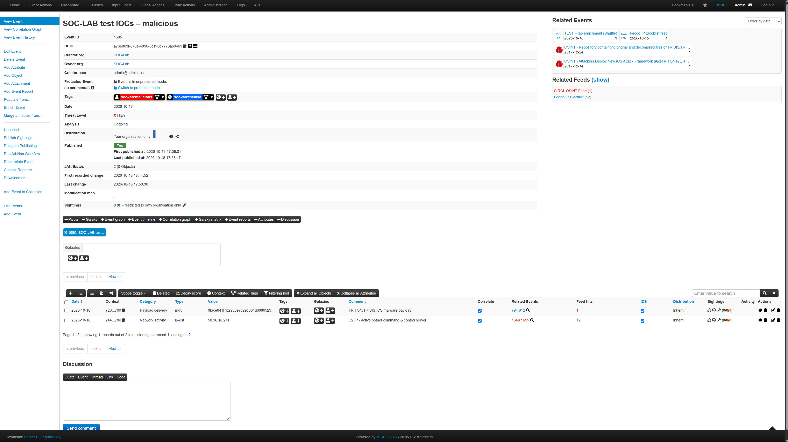
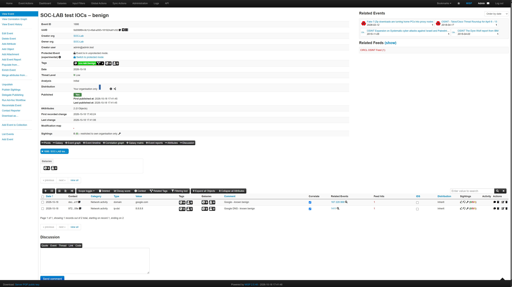
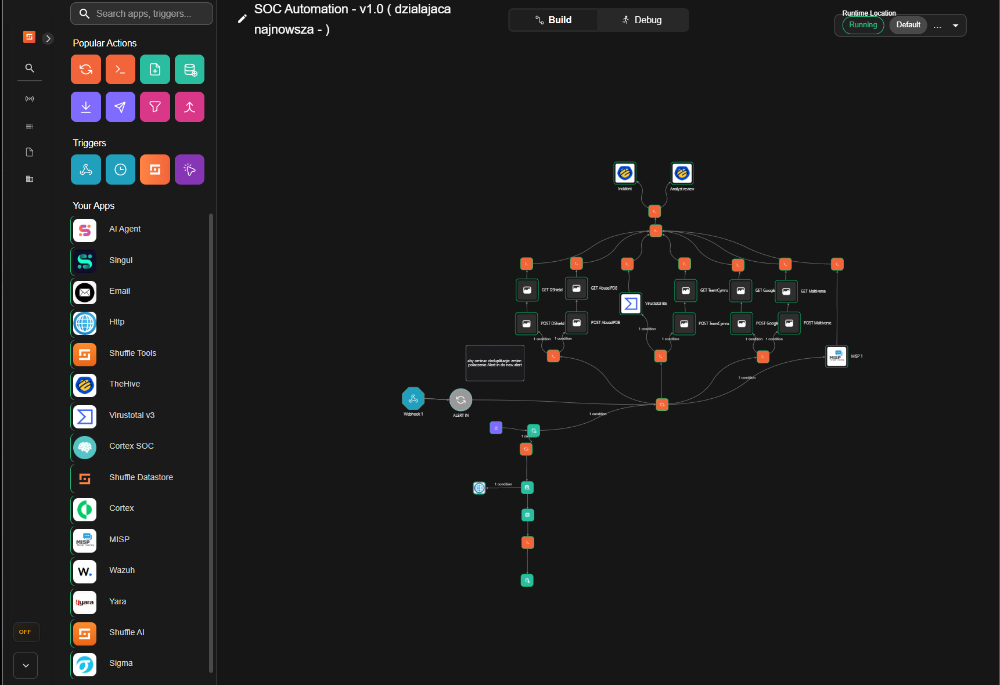
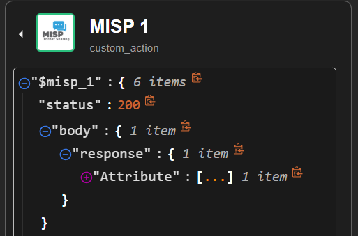

# MISP

MISP (misp-docker) used for threat-intel lookups from Shuffle and as an external source in TheHive.

This page documents the enabled feeds, Shuffle attribute lookups, interpretation of MISP results and their use by the triage workflow.

## Feeds

Two public OSINT feeds are enabled. Both are free, require no authentication, and are widely used in production SOC environments.

| Feed | Provider | Format | Why enabled |
|------|----------|--------|-------------|
| **CIRCL OSINT Feed** | CIRCL (Computer Incident Response Center Luxembourg) | MISP JSON | Rich, structured threat intelligence — full MISP events with IOC context, MITRE ATT\&CK mappings, TLP tags, and campaign descriptions. Covers IPs, domains, URLs, file hashes, and more. |
| **Feodo IP Blocklist** | abuse.ch | CSV | Focused list of active botnet C2 IP addresses (Emotet, QakBot, Dridex, etc.). Lightweight, updated frequently, high signal-to-noise ratio. |

### Fetch and store vs cache only

Both feeds are configured with **Fetch and store** (not *Cache only*):

| Mode | What it does | API searchable? |
|------|-------------|-----------------|
| **Fetch and store** | Downloads feed content and saves it as MISP events | ✅ Yes — via `/attributes/restSearch` |
| Cache only | Downloads and hashes IOC values locally for fast lookup | ❌ No — not visible through REST API |

**Fetch and store** is required so that Shuffle can query IOCs via the standard REST API and receive full event context (tags, related events, campaign info).

### Why only two feeds

In a test lab environment, feed selection is driven by coverage quality rather than quantity. Large feeds with hundreds of thousands of entries introduce unnecessary resource overhead and noise without improving detection accuracy for the test scenarios in scope.

CIRCL and Feodo together provide full IOC coverage for lab purposes:

- **CIRCL** covers diverse IOC types (IP, domain, hash) with contextual metadata
- **Feodo** covers active C2 infrastructure with near-real-time updates
Both feeds have **caching enabled** and are set to **Fetch and store**, so all fetched IOCs are saved as MISP events and are searchable via the REST API (`/attributes/restSearch`).

## `soc-lab:*` tag convention

Custom tags are used to label events by expected outcome and downstream routing:

| Tag | Meaning |
|-----|---------|
| `soc-lab:malicious` | SOC-Lab event is labelled as a malicious test case; inspect matching attributes and their evidence separately |
| `soc-lab:benign` | SOC-Lab event is labelled as a benign test case; inspect matching attributes and their evidence separately |
| `soc-lab:thehive` | Event should be imported into TheHive (malicious events only) |

The MISP event list screenshot shows the malicious test event tagged with `soc-lab:malicious` and `soc-lab:thehive`, and the benign test event tagged with `soc-lab:benign`:

Sanitized MISP event fixtures are available for the [malicious](events/soc-lab-test-iocs-malicious.json) and [benign](events/soc-lab-test-iocs-benign.json) test cases.

The event pages are also captured separately:

`to_ids` is an attribute-level setting that indicates whether the attribute is suitable for IDS export. It is not a standalone malicious/benign verdict. A search can return several attributes for the same IOC, including conflicting `to_ids` values, and warninglist matches can disable IDS export. Interpret each matching attribute together with its comment, event context, tags and warninglist information. An event-level `soc-lab:benign` tag is separate from the attribute's `to_ids` value.

## Shuffle attribute lookup

Shuffle submits each observable to MISP using `POST /attributes/restSearch`. The Issue #10 test covered two IPs, a domain, an MD5 and a SHA-256. The five raw MISP actions returned HTTP 200. The request was not filtered by `to_ids`, so attributes with both `to_ids: true` and `to_ids: false` were returned.

The existing Shuffle screenshot shows the workflow layout and the MISP node. It is an overview, not a screenshot of the five Issue #10 execution results; those results are recorded in the sanitized JSON sample below.

The normalized per-IOC result contains an explicit status, the queried observable, matching attributes, event IDs and counts, tags, comments, event context, warninglist/benign/malicious flags, and an error field when applicable:

The sanitized input alert is available at [`../../samples/alerts/misp-issue10-all-observable-types.json`](../../samples/alerts/misp-issue10-all-observable-types.json). Its two IP values use RFC 5737 documentation ranges; hashes, domain, alert structure and test ID are retained. The five observed lookup and scoring results are in [`../../samples/results/misp/all-observable-types-issue10.json`](../../samples/results/misp/all-observable-types-issue10.json).

The earlier Shuffle Debug capture shows the MISP action returning HTTP 200 with an `Attribute` collection. The attribute contents are collapsed in the screenshot; refer to the JSON result sample for the values, tags and interpretations.

| Status | Meaning |
|---|---|
| `hit` | The request completed and returned one or more matching attributes |
| `no_hit` | The request completed and returned no matching attributes |
| `unavailable` | The request failed, timed out or returned a response that could not be used |

### Latest all-observable test

The sanitized evidence is in [`../../samples/results/misp/all-observable-types-issue10.json`](../../samples/results/misp/all-observable-types-issue10.json). The alert `misp-issue10-20261020-1425-a8e2` contained two IPs, `google.com`, MD5 `0face841f7b2953e7c29c064d6886523`, and SHA-256 `bdf252bed33416f0b28efdf3ce750c54db59709bf25e7d41739cf62e760c7fe8`. IP values are replaced with documentation ranges in the committed sample.

| Observable | MISP matches | Aggregate status | Interpretation |
|---|---:|---|---|
| Malicious test IP (redacted) | 3 attributes across events `1648`, `1655`, `1685` | `hit` | Event `1685` carries `soc-lab:malicious` and `soc-lab:thehive`; preserve the `to_ids` value on each attribute |
| Public DNS warninglist test IP (redacted) | 1 attribute in event `1351`, `to_ids: false` | `hit` | Warninglist explanation is preserved; this is not a malicious verdict by itself |
| `google.com` | 4 attributes across events `167`, `228`, `868`, `1686` | `hit` | Event `1686` carries `soc-lab:benign`; this tag is event context, as other matching events exist |
| MD5 `0face…6523` | 4 attributes across events `794`, `812`, `1685` | `hit` | Event `1685` carries `soc-lab:malicious`; matched `to_ids` attributes are present |
| SHA-256 `bdf2…c7fe8` | 0 attributes | `no_hit` | Successful search with an empty attribute list |

The latest Aggregate Score capture contains five separate executions, one per observable. Every execution reports `misp_available: true`; four results are `hit` and one is `no_hit`. The MISP score is `100` for the malicious IP and MD5 because matched attributes have `to_ids: true`; warninglist and benign matches stay visible and do not receive a MISP score under the current rule. AbuseIPDB, VirusTotal and Maltiverse values are also present in all five executions.

MISP returned `first_seen` and `last_seen` as null. Event dates are context, not sightings.

The corresponding TheHive alert was created with HTTP 201. Its summary reported MISP score `100`, risk score `45`, `medium` and `analyst_review`. The workflow currently emits separate scoring outputs per observable; do not treat one execution as a combined verdict for every IOC in the alert.

### Earlier IP-only tests

The prior multi-IP evidence is in [`../../samples/results/misp/multi-ip-wazuh-test.json`](../../samples/results/misp/multi-ip-wazuh-test.json); the malicious/warninglist IP evidence is in [`../../samples/results/misp/malicious-and-warninglist-ip-test.json`](../../samples/results/misp/malicious-and-warninglist-ip-test.json). Those captures established that searches include `to_ids: false` records and warninglist comments. The latest all-observable test supersedes their earlier limitation about domain/hash lookup coverage.

## TheHive import filter

The TheHive MISP integration is configured to import MISP events carrying the tag `soc-lab:thehive`.

The Issue #10 lookup evidence shows that event `1685` already has this tag and that the normalizer preserves it. The Issue #10 test does not demonstrate Shuffle writing the tag back to MISP or TheHive automatically importing an event, so those actions are not claimed here.

The tag filter limits which MISP events are eligible for TheHive import. It does not, by itself, establish that every tagged event is malicious.

## How to add an IOC to MISP

1. Open MISP → **Event Actions → Add Event**
2. Give it a title, set the organisation to **SOC-Lab**, add tags (`soc-lab:malicious` or `soc-lab:benign`)
3. Click **Add Attribute**
4. Set the correct type (`ip-dst`, `domain`, `md5`, etc.)
5. Set `to_ids` according to whether the attribute should be exported to IDS systems; use `soc-lab:malicious` or `soc-lab:benign` to label the test event's expected outcome. These fields have different meanings.
6. Save — the IOC is now searchable via `/attributes/restSearch`
