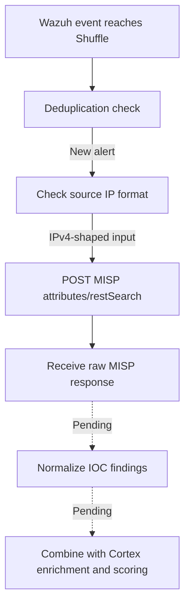

# MISP — IOC Lookup Integration with Shuffle SOAR

> **Project:** SOC Alert Triage Automation Lab  
> **Related issues:** [#2 — MISP threat intelligence sources](https://github.com/Solivagantaeon/soc-automation-lab/issues/2), [#10 — IOC lookup in MISP](https://github.com/Solivagantaeon/soc-automation-lab/issues/10)  


## 1. Purpose and integration context

MISP (Malware Information Sharing Platform) provides threat-intelligence context for observables extracted from Wazuh alerts. In the current Shuffle workflow, a MISP lookup helps answer whether an IP address appears in available intelligence and what metadata accompanies the match.

A MISP hit is **not automatically a malicious verdict**. Attribution, reliability, `to_ids`, warninglists, tags, and event context must be considered before any scoring, escalation, or containment decision.

### Current processing flow



The exported MISP action is attached to `NEW_ALERT`. The current IP-shape check is a regex, **not** the same public-IP validator used for the Cortex IP-analysis path.

## 2. Current Shuffle implementation

| Property | Exported configuration | Notes |
|---|---|---|
| Shuffle action | `MISP_1` (`custom_action`) | MISP application integration |
| API operation | `POST /attributes/restSearch` | MISP REST API |
| Request content type | `application/json` | Response requested as JSON |
| Observable source | `$exec.all_fields.data.srcip` | Source IPv4 field of the incoming alert |
| Result limit | `10` | Maximum requested records; not a confidence threshold |
| Workflow trigger | `NEW_ALERT` branch | Duplicate events do not necessarily repeat enrichment |
| Input condition | IPv4-shaped regular expression | Does not prove a syntactically valid or public address |
| TLS verification | Disabled in the lab export | Use a trusted CA for production |

The exported request body is:

```json
{
  "returnFormat": "json",
  "value": "$exec.all_fields.data.srcip",
  "limit": 10
}
```

The source value is resolved by Shuffle at execution time. The REST endpoint and authentication material must come from protected application settings, not committed configuration.

### Input-validation limitation

The current branch checks a pattern equivalent to:

```regex
^[0-9]{1,3}(\.[0-9]{1,3}){3}$
```

This accepts some malformed addresses and permits private or loopback addresses. Whether to query MISP for private IPs is a policy decision, but their meaning differs from public threat-intelligence indicators. Before broad deployment, introduce proper address parsing, IOC type normalization, and explicit rules for internal addresses.

## 3. Response structure and interpretation

The Shuffle action returns an HTTP wrapper containing a MISP response. Matching records are normally found under:

```text
$misp_1.body.response.Attribute
```

An attribute may include:

| Field | Interpretation |
|---|---|
| `value` | The IOC value; must match the requested observable |
| `type` / `category` | Indicator type and MISP classification |
| `to_ids` | Whether the attribute is intended for detection use; **not** a standalone maliciousness verdict |
| `comment` | Analyst notes and possible warninglist explanations |
| `Event.id` / `Event.info` | Associated intelligence event or campaign context |
| `Event.threat_level_id` | Event-level severity context, when supplied |
| `Tag` / event tags | Classification and threat-context metadata, when present |
| `first_seen` / `last_seen` | Temporal context, if populated |

**Important:** HTTP 200 only shows that the lookup request was handled. An empty `Attribute` collection indicates no match *in the queried data*, not proof of safety. A timeout, authentication error, or server outage must remain an error/unknown state rather than a clean result.

## 4. Observed lab evidence: public DNS resolver

A lookup for `9.9.9.9` returned a matching MISP attribute. The captured response showed:

| Evidence | Observed value |
|---|---|
| Request outcome | HTTP `200` |
| Returned attribute value | `9.9.9.9` |
| Attribute relation / type | Destination IP / `ip-dst` |
| `to_ids` | `false` |
| Attribute comment | Matched a warninglist for known public IPv4 DNS resolvers |
| Associated event | Event information was returned |

The associated intelligence event discussed malware use of an open recursive DNS resolver; **that does not make the resolver itself a malicious IP**. The observed `to_ids: false` value and warninglist explanation are especially important to avoid a false-positive escalation.


*Figure 1. Shuffle Debug shows a successful MISP API request and one returned attribute. The screenshot is cropped to exclude private endpoint and header details. The `9.9.9.9` interpretation is based on the recorded JSON response, not on fields expanded in this screenshot.*

## 5. Proposed normalized lookup record — not yet implemented

Downstream correlation and scoring should consume a consistent object instead of raw MISP API responses. The following is **an illustrative target schema**, not output currently generated by the workflow:

```json
{
  "observable": "9.9.9.9",
  "observable_type": "ip",
  "lookup_status": "ok",
  "known_in_misp": true,
  "matching_attribute_count": 1,
  "event_ids": ["<event-id>"],
  "tags": [],
  "to_ids": false,
  "warninglist_match": true,
  "malicious_verdict": "undetermined"
}
```

The production design should retain the original MISP attribute/event references and distinguish `known_in_misp`, `malicious_verdict`, and `lookup_status`. It should avoid implying that an empty list of tags means no tags were present unless the full response was inspected.

## 6. Acceptance criteria — issue #10

| Required outcome | Current evidence | Status |
|---|---|---|
| Determine whether an IOC is already known | Successful matching lookup for `9.9.9.9` | **Partially verified** |
| Return relevant attributes and tags | Raw response contains attribute metadata; tag normalization not implemented | **In progress** |
| Identify related event/campaign | Associated event metadata observed in the response | **Partially verified** |
| Determine whether an IOC is marked malicious | `to_ids` and warninglist can be inspected; no standardized decision is produced | **Pending** |
| Test a known test-event IOC and a definite no-match IOC | No complete paired positive/negative acceptance test documented | **Pending** |

Coverage is currently centered on `data.srcip`. Support and testing for domains, hashes, destination IPs, and other observable types remain separate work.

## 7. Error handling and remaining engineering work

1. **No results:** Return `known_in_misp: false` only after a successful query and an explicitly empty matching collection.
2. **API unavailable or unauthorized:** Preserve `lookup_status: error` and the relevant reason; never classify the IOC as benign by default.
3. **IOC validation:** Parse IPv4 addresses and normalize domains/hashes; avoid accidental private address lookups where not appropriate.
4. **Exact matching:** Verify returned attribute `value` and type against the intended lookup input, including multi-record responses.
5. **Warninglists / `to_ids`:** Treat benign infrastructure matches as context, not automatic malicious detections.
6. **Multiple results:** Retain meaningful attributes, event IDs, tags and timestamps while respecting lookup limits.
7. **Aggregation:** Produce one normalized MISP result that can be combined with Cortex results in the planned scoring stage.
8. **Rate limits and resilience:** Confirm lab/provider limits, then document backoff, retries, and timeout behavior.
9. **End-to-end coverage:** Test Wazuh → Shuffle → MISP, negative matches, and the final decision flow with saved evidence.

## 8. Security and maintenance

- Do not commit MISP API keys, bearer tokens, cookies, internal hostnames/IPs, or the unredacted Shuffle export.
- Use the team's `scripts/sanitize_export.py` process on workflow exports, inspect the sanitized file manually, and ensure secret-scanning checks pass before any PR.
- The exported MISP action has TLS certificate verification disabled for the lab. Use an appropriate trusted CA and enable verification for a hardened environment.
- Keep MISP lookup permissions as narrow as practical and rotate keys through an agreed maintenance process.
- Use synthetic or approved non-sensitive indicators in committed examples and screenshots.

---

**Documentation scope:** This page describes MISP lookup work evidenced by the 17 October 2026 lab export and recorded synthetic tests. It does **not** claim full implementation of issue #10 or completion of the final SOC scoring pipeline.
