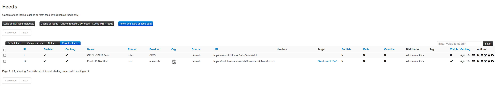
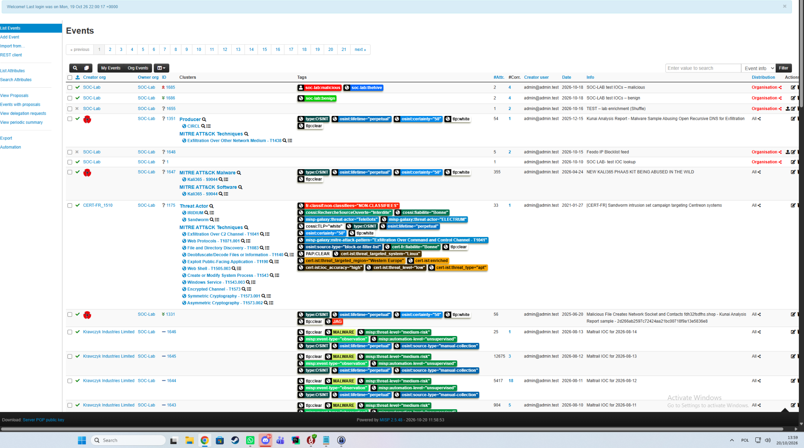
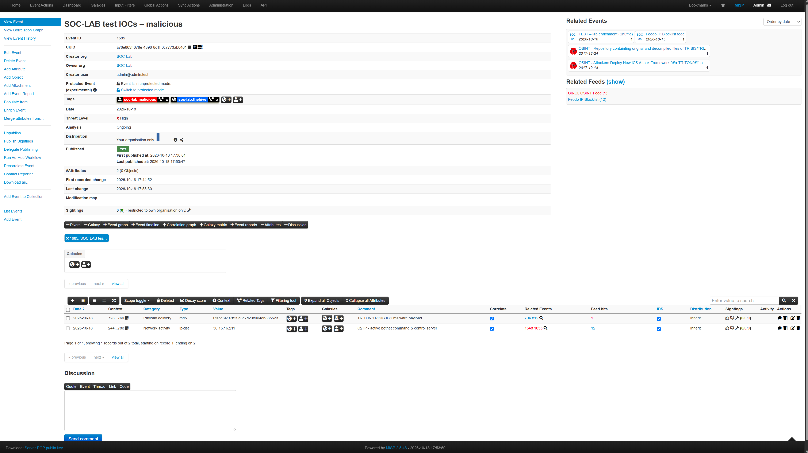
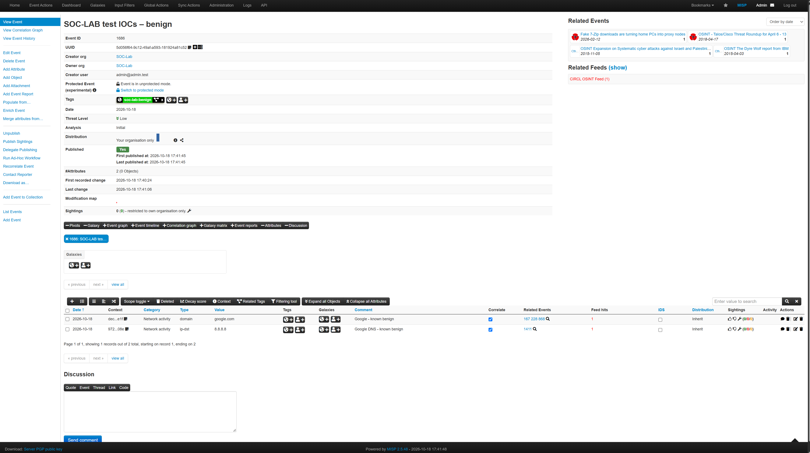
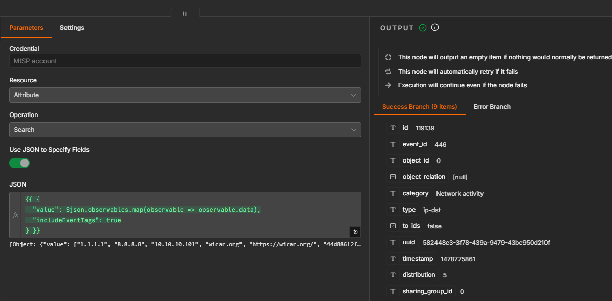
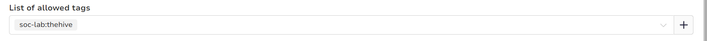

# MISP – threat-intelligence lookups

## Role in the pipeline

MISP stores threat-intelligence events and their attributes (IPs, domains, URLs, hashes). The n8n triage workflow searches the normalized alert observables in MISP and adds the matching attributes to the alert summary used for scoring. TheHive uses MISP as an external source for importing tagged events.

Wazuh → n8n → **MISP** (+ Cortex) → n8n scoring → TheHive

In v0.1, Shuffle ran the MISP lookups instead of n8n; that work (issue #10) is archived in [`soar/shuffle/docs/misp-lookup.md`](../../soar/shuffle/docs/misp-lookup.md).

## What is in this folder

| File | Purpose |
|---|---|
| `README.md` | Deployment, feeds, tag convention, n8n integration, verification |
| [`events/soc-lab-test-iocs-malicious.json`](events/soc-lab-test-iocs-malicious.json) | Sanitized MISP event fixture – malicious test case |
| [`events/soc-lab-test-iocs-benign.json`](events/soc-lab-test-iocs-benign.json) | Sanitized MISP event fixture – benign test case |

Related: [`soar/n8n/nodes/error-formatter-misp.js`](../../soar/n8n/nodes/error-formatter-misp.js) – n8n: formats a failed MISP search for the alert summary.

## Deployment in the lab

| Property | Configuration |
|---|---|
| VM | Proxmox VM **204** |
| Private IP | `10.10.20.50` (VLAN 20, SOC) |
| Operating system | Ubuntu 24.04 |
| Installation | `misp-docker` self-hosted stack (Docker Compose) |
| User interface | HTTPS `443/TCP` (self-signed certificate) |
| API authentication | Authorization API key, associated with an authorized MISP user |
| Relevant REST operations | `POST /attributes/restSearch`, `POST /events/restSearch` |
| Consumers | n8n triage workflow, TheHive (MISP connector) |

API keys are stored only in MISP and in the consumers' credential stores – never in this repository, in GitHub issues or in screenshots.

A deployment runbook for MISP is not written yet (see the [runbook index](../../docs/runbooks/README.md)). API reference: [MISP OpenAPI](https://www.misp.software/openapi/).

## Configuration

### Feeds

Two public OSINT feeds are enabled. Both are free, require no authentication, and are widely used in production SOC environments.

| Feed | Provider | Format | Why enabled |
|------|----------|--------|-------------|
| **CIRCL OSINT Feed** | CIRCL (Computer Incident Response Center Luxembourg) | MISP JSON | Rich, structured threat intelligence — full MISP events with IOC context, MITRE ATT\&CK mappings, TLP tags, and campaign descriptions. Covers IPs, domains, URLs, file hashes, and more. |
| **Feodo IP Blocklist** | abuse.ch | CSV | Focused list of active botnet C2 IP addresses (Emotet, QakBot, Dridex, etc.). Lightweight, updated frequently, high signal-to-noise ratio. |

Both feeds have **caching enabled** and are set to **Fetch and store** (not *Cache only*):

| Mode | What it does | API searchable? |
|------|-------------|-----------------|
| **Fetch and store** | Downloads feed content and saves it as MISP events | ✅ Yes — via `/attributes/restSearch` |
| Cache only | Downloads and hashes IOC values locally for fast lookup | ❌ No — not visible through REST API |

**Fetch and store** is required so that the SOAR workflow can query IOCs via the standard REST API and receive full event context (tags, related events, campaign info).



### `soc-lab:*` tag convention

Custom tags are used to label events by expected outcome and downstream routing:

| Tag | Meaning |
|-----|---------|
| `soc-lab:malicious` | SOC-Lab event is labelled as a malicious test case; inspect matching attributes and their evidence separately |
| `soc-lab:benign` | SOC-Lab event is labelled as a benign test case; inspect matching attributes and their evidence separately |
| `soc-lab:thehive` | Event should be imported into TheHive (malicious events only) |

The MISP event list screenshot shows the malicious test event tagged with `soc-lab:malicious` and `soc-lab:thehive`, and the benign test event tagged with `soc-lab:benign`:



The event pages are also captured separately:





### How to read a match: `to_ids`, tags and warninglists

`to_ids` is an attribute-level setting that indicates whether the attribute is suitable for IDS export. It is not a standalone malicious/benign verdict. A search can return several attributes for the same IOC, including conflicting `to_ids` values, and warninglist matches can disable IDS export. Interpret each matching attribute together with its comment, event context, tags and warninglist information. An event-level `soc-lab:benign` tag is separate from the attribute's `to_ids` value.

### n8n triage workflow (issue #69)

The MISP branch of the n8n triage workflow searches the normalized alert observables and returns matching attributes in `misp.unique_indicators`, together with `misp.attribute_count`. It runs alongside the Cortex enrichment branch. The n8n query requests event tags with `includeEventTags: true`. The summary merges event and attribute tags and counts each attribute identity once. Multiple attributes in the same event may legitimately have the same value. The [regression results](../../docs/validation/regression-after-bug-fixes.md) show how Decision and TheHive used these fields.



The workflow configuration and end-to-end test are documented in the [n8n triage runbook](../../docs/runbooks/n8n-triage.md#4-misp-and-cortex).

### TheHive import filter

The TheHive MISP integration is configured to import MISP events carrying the tag `soc-lab:thehive`. The tag filter limits which MISP events are eligible for TheHive import. It does not, by itself, establish that every tagged event is malicious. Automatic import of a tagged event has not been demonstrated in a test yet.



### How to add an IOC to MISP

1. Open MISP → **Event Actions → Add Event**
2. Give it a title, set the organisation to **SOC-Lab**, add tags (`soc-lab:malicious` or `soc-lab:benign`)
3. Click **Add Attribute**
4. Set the correct type (`ip-dst`, `domain`, `md5`, etc.)
5. Set `to_ids` according to whether the attribute should be exported to IDS systems; use `soc-lab:malicious` or `soc-lab:benign` to label the test event's expected outcome. These fields have different meanings.
6. Save — the IOC is now searchable via `/attributes/restSearch`

## Verify it works

**1. Containers are running.** On VM 204, from the deployed Compose project:

```bash
sudo docker compose ps
sudo docker compose up -d   # only if a container is stopped
```

**2. The web interface answers** (no key needed):

```bash
curl -sk -o /dev/null -w '%{http_code}\n' https://10.10.20.50/users/login
```

Expected: `200`. Then sign in and check that the administration/status pages load.

**3. A search returns attributes** (authenticated, independent of n8n):

```bash
curl -sk -X POST https://10.10.20.50/attributes/restSearch \
  -H "Authorization: <MISP_API_KEY>" \
  -H "Accept: application/json" -H "Content-Type: application/json" \
  -d '{"value": "1.1.1.1", "includeEventTags": true}'
```

Expected: a JSON `response.Attribute` list. For `1.1.1.1` it contains attributes with `to_ids: false` and a warninglist comment (public DNS resolver), as in the [n8n test](#decisions-and-evidence). Keep the key in a protected secret store, not in a committed command or its output.

## Troubleshooting

- **A running MISP is not the same as working enrichment.** Starting the containers and adding a MISP node to the workflow are separate steps from getting usable results. Test a search in MISP itself (step 3 above) before interpreting downstream workflow scores.
- **No match is not a failure.** Distinguish authentication errors, connectivity problems, empty datasets and legitimate zero-hit responses. A search that completes with an empty attribute list is a valid `no_hit`.
- **A feed's IOCs are not found through the API.** Cause: the feed is set to *Cache only*. Fix: switch it to **Fetch and store** and fetch the feed again.

## Decisions and evidence

### Why only two feeds

In a test lab environment, feed selection is driven by coverage quality rather than quantity. Large feeds with hundreds of thousands of entries introduce unnecessary resource overhead and noise without improving detection accuracy for the test scenarios in scope. CIRCL and Feodo together provide full IOC coverage for lab purposes:

- **CIRCL** covers diverse IOC types (IP, domain, hash) with contextual metadata
- **Feodo** covers active C2 infrastructure with near-real-time updates

### n8n all-routes test (issue #69)

MISP returned two attributes for `1.1.1.1`. Both had `to_ids: false`; one carried a warninglist comment identifying the address as a known public DNS resolver. Review the attribute comments, `to_ids`, `disable_correlation`, event context, and warninglist information together. A MISP match or `to_ids` value alone does not establish a malicious or benign verdict.

### Related

- v0.1 lookup tests with all observable types (issue #10): [`soar/shuffle/docs/misp-lookup.md`](../../soar/shuffle/docs/misp-lookup.md)
- Issues: [#10](https://github.com/Solivagantaeon/soc-automation-lab/issues/10) (v0.1, archived), [#69](https://github.com/Solivagantaeon/soc-automation-lab/issues/69) (n8n)
- ADR: [0003 – n8n triage workflow](../../docs/decisions/0003-n8n-triage-workflow.md)
- Lab hosts: [lab setup](../../infrastructure/lab-setup.md)
