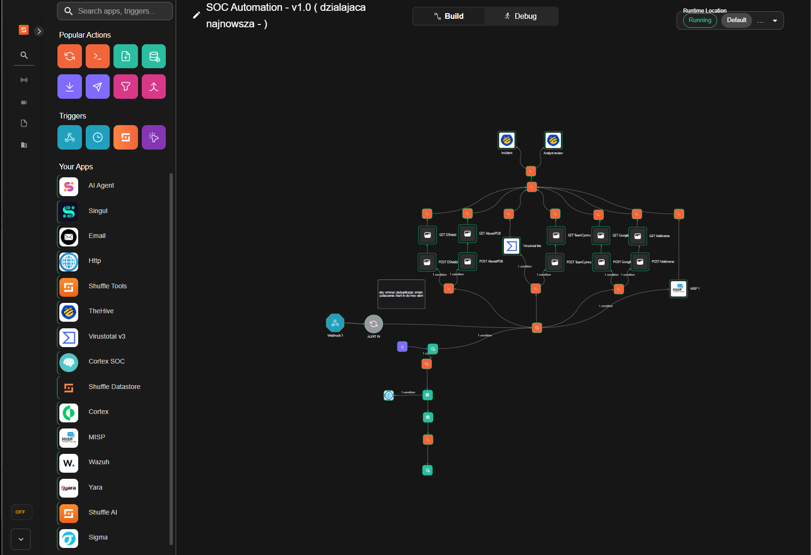

## 5. Shuffle — security orchestration and triage

### 5.1 Purpose and deployment

Shuffle receives selected Wazuh alert JSON payloads through a webhook and orchestrates normalisation, IOC extraction, deduplication, external enrichment, scoring and creation of analyst-facing records in TheHive. Its active workflow is labelled **SOC Automation v1.0** in the captured editor.

| Property | Configuration |
|---|---|
| Role | SOAR and triage workflow engine |
| VM | Proxmox VM **205** (`shuffle-soar`) |
| SOC address | `10.10.20.245` |
| Installation | Self-hosted Docker Compose deployment |
| UI | HTTPS `3443/TCP` |
| Typical backend API | `5001/TCP` in the Shuffle deployment, kept within the private environment |
| Workflow access | Authenticated Shuffle user and API/application credentials stored in the platform |

### 5.2 Ports, authentication and APIs

- **Inbound:** authenticated Shuffle UI uses HTTPS on port `3443`; the Wazuh integration targets a protected workflow webhook through the Shuffle endpoint. The full webhook URL is a secret and is never committed.
- **Backend:** Shuffle provides an HTTP REST API on its backend service (commonly port `5001` internally).
- **Outbound integrations:** Cortex analyzer/report API, MISP lookup API and TheHive alert/case API use component-specific credentials managed in Shuffle. API keys and session secrets are kept out of repository exports.
- **Runtime execution:** an enabled/runtime-running location schedules the workflow and its apps.

### 5.3 Startup and standalone verification

On the Shuffle Docker host, from the deployment directory:

```bash
sudo docker compose ps
sudo docker compose up -d
```

Open the Shuffle UI over HTTPS and inspect the workflow editor and **Runtime Location** state. A running runtime and accessible authenticated UI establish basic Shuffle service health without triggering Wazuh, Cortex, MISP or TheHive. To test the orchestration engine in isolation, use a synthetic manual runtime argument in an otherwise non-integrated test workflow. Do not store the webhook URL in the example.

### 5.4 Problems and solutions

- **Webhook handoff:** the Wazuh-to-Shuffle link was established with test alert payloads; the workflow receives alerts through its webhook trigger. Use `rule_id`-based filtering rather than a severity-only condition.
- **Repeated test alerts:** workflow development uses unique synthetic alert/rule/agent identifiers for successive tests, preventing deduplication from masking expected outputs.
- **Enrichment availability:** the workflow separates observable extraction, scoring and downstream enrichment paths. External analyzer failures should be handled independently, without presenting an enrichment API timeout as proof of malicious activity.

### 5.5 Evidence and references

- 
- Shuffle workflow documentation: [`../soar/shuffle/README.md`](../soar/shuffle/README.md)
- Architecture workflow: [architecture](architecture.md)

---
