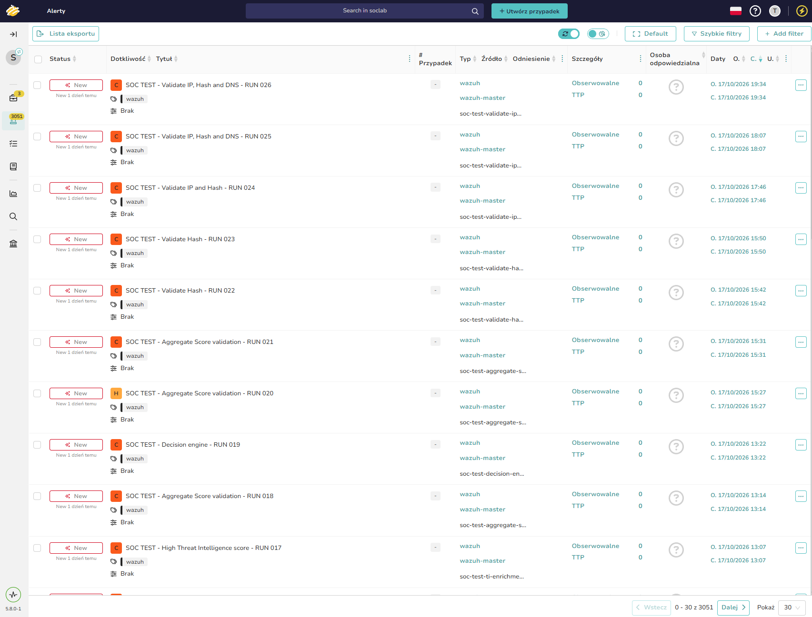

## 8. TheHive — alert and case management

### 8.1 Purpose and deployment

TheHive is the analyst-facing case-management component selected for the lab. Shuffle's workflow can create or update alerts and cases based on the triage outcome; human analysts retain responsibility for the final judgment.

| Property | Configuration |
|---|---|
| Version | **5.8.0** (UI build `5.8.0-1`) |
| Private IP | `10.10.20.247` |
| Deployment | Docker, shared host with Cortex; StrangeBee `testing` profile |
| Lab organization | `demo` |
| Application convention | TheHive internal HTTP application on `9000/TCP`, with HTTPS/reverse-proxy exposure as configured |
| Authentication | TheHive authenticated UI sessions and scoped API keys for integrations |
| API | TheHive REST API (`/api/v1/` namespace) for alerts and case operations |

### 8.2 Startup and standalone verification

On the shared Docker host:

```bash
sudo docker ps --format 'table {{.Names}}\t{{.Image}}\t{{.Status}}\t{{.Ports}}'
# Use the actual TheHive container name from docker ps:
sudo docker logs --tail 50 <THEHIVE_CONTAINER>
```

Log into TheHive, select the lab organization, then open **Alerts**. A successful authenticated login and readable alert listing demonstrate local application availability without requiring new Wazuh events, Shuffle workflow executions or Cortex analyzer runs.

### 8.3 Observed result and troubleshooting

On **17 October 2026**, the TheHive UI displayed numerous test records with the `wazuh` type and `wazuh-master` source, including synthetic tests for IP/hash/DNS validation and scoring. These records demonstrate that the lab's case-management interface stores and displays the test alerts. They do not by themselves confirm that every separate enrichment integration completed successfully.

- **Case/alert mapping:** preserve the Wazuh source and a useful triage title in each TheHive record.
- **Duplicate handling:** use unique synthetic identifiers in repeated functional tests and inspect Shuffle deduplication behaviour separately.
- **Organization consistency:** check the selected TheHive organization before comparing alert counts or testing an API key.

### 8.4 Evidence and references

- 
- TheHive configuration notes: [`../../../case-management/thehive/README.md`](../../../case-management/thehive/README.md)

