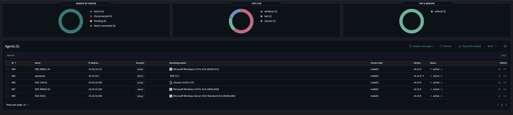

## Wazuh — SIEM and event collector

### 2.1 Purpose and deployment

Wazuh acts as the central security-event collection and detection platform. It receives events from Windows and Linux agents and an OPNsense-hosted agent that forwards Suricata events. The manager applies rules and produces alerts used by the SOAR workflow.

| Property | Configuration |
|---|---|
| Version | `4.14.9` — manager, indexer and dashboard |
| Supporting shipper | Filebeat `7.10.2-2` |
| VM | Proxmox VM **203** (`wazuh-master`) |
| Host operating system | Ubuntu 24.04.4 LTS |
| Private IP | `10.10.20.243` |
| Installation | Native packages managed through `dpkg`/APT; all-in-one manager, indexer, dashboard and Filebeat; no Docker containers on this VM |
| Role | SIEM, agent enrollment, event collection, alert indexing and dashboard |

### 2.2 Ports, authentication and APIs

| Interface | Port / protocol | Authentication / purpose |
|---|---|---|
| Dashboard | `443/TCP` (HTTPS) | Authenticated analyst session |
| Agent event ingestion | `1514/TCP` | Wazuh agent-to-manager encrypted/authenticated transport |
| Agent enrollment | `1515/TCP` | Agent registration / key provisioning |
| Manager API | `55000/TCP` (HTTPS) | User authentication followed by JWT bearer authorization; status and agent APIs |
| Indexer API | `9200/TCP` (HTTP(S) as configured) | Authenticated index/search API; restrict to the SOC network |
| Indexer transport | `9300/TCP` | Local transport observed bound to `127.0.0.1` |
| Administrative SSH | `22/TCP` | Host administration via SSH credentials/keys |

The Wazuh REST API supports `POST /security/user/authenticate` and `GET /manager/status`; after login, authorized callers use JWT bearer tokens. Do not paste tokens into PR comments or screenshots.

### 2.3 Installation and startup procedure

The running system is a package-based all-in-one deployment. To inspect and start individual services on VM 203:

```bash
# Installed versions
dpkg-query -W wazuh-manager wazuh-indexer wazuh-dashboard filebeat

# Start existing services if stopped
sudo systemctl start wazuh-indexer wazuh-manager filebeat wazuh-dashboard

# Enable start on boot (administrative configuration action)
sudo systemctl enable wazuh-indexer wazuh-manager filebeat wazuh-dashboard
```

Configuration entry points include `/var/ossec/etc/ossec.conf` and the sanitized agent-group configuration in [`../../../detection/wazuh/agent-config/agent.conf`](../../../detection/wazuh/agent-config/agent.conf). The runbook index and operational instructions are described in [`runbooks/README.md`](../../../docs/runbooks/README.md).

### 2.4 Standalone verification

These checks verify Wazuh's own services without Shuffle or TheHive:

```bash
sudo systemctl is-active wazuh-manager wazuh-indexer wazuh-dashboard filebeat
sudo /var/ossec/bin/wazuh-control status
sudo /var/ossec/bin/agent_control -l
sudo ss -lntup
```

**Observed:** all four systemd services were active. Core Wazuh daemons, including `wazuh-analysisd`, `wazuh-remoted`, `wazuh-apid` and `wazuh-db`, were running. Five external agents were active and none disconnected. The local manager appears as agent `000`. The intentionally unused `wazuh-clusterd`, `wazuh-agentlessd`, `wazuh-maild` and `wazuh-csyslogd` daemons were not running, consistent with the reported single-node setup.

Alternatively, open **Wazuh Dashboard → Server management → Dev Tools** and submit:

```http
GET /manager/status
```

Expected result: a JSON response listing manager daemon statuses (authenticated API request).

| Agent ID | Host | Private IP | OS | Agent version | Status |
|---|---|---|---|---|---|
| `004` | `SOC-WIN11-AI` | `10.10.10.171` | Windows 11 | `4.14.9` | Active |
| `005` | `opnsense` | `10.10.20.1` | BSD / OPNsense | `4.14.8` | Active |
| `006` | `SOC-LIN-01` | `10.10.10.100` | Ubuntu 24.04.5 LTS | `4.14.9` | Active |
| `007` | `SOC-WIN10-01` | `10.10.10.150` | Windows 10 | `4.14.9` | Active |
| `008` | `SOC-DC01` | `10.10.10.200` | Windows Server 2022 | `4.14.9` | Active |

### 2.5 Problems, resolutions and operational notes

- **Time synchronization:** a domain-controller time-zone/clock offset was addressed by making OPNsense the NTP source, synchronizing the DC and its domain members, and updating Linux time sources. See [Issue #5](https://github.com/Solivagantaeon/soc-automation-lab/issues/5) and its runbook. Correct timestamps are required for reliable cross-platform correlation.
- **Indexer/API troubleshooting:** previous test environments exhibited indexer authorization/shard and dashboard-API connectivity symptoms. The documented operational baseline is the clean single-node installation on VM 203, with its services active.
- **Rule-based forwarding:** Wazuh-to-Shuffle filtering uses rule IDs rather than severity alone; this preserves low-level Suricata alerts such as rule `86601` for the intended workflows. See the [architecture decisions](../../architecture/architecture.md#key-design-decisions).

### 2.6 Evidence and related files

- 
- Agent configuration: [`../../../detection/wazuh/agent-config/agent.conf`](../../../detection/wazuh/agent-config/agent.conf)
- Related ingestion issue: [#4 — Wazuh agents, Sysmon and Suricata](https://github.com/Solivagantaeon/soc-automation-lab/issues/4)

---
