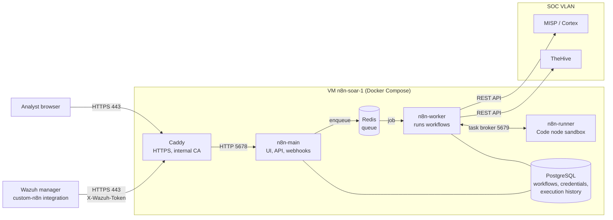

# SOAR: n8n (v0.2)

n8n is the SOAR engine of the pipeline: Wazuh pushes selected alerts to an n8n webhook, and n8n normalizes them,
removes duplicates, enriches observables with MISP and Cortex, scores the result and creates alerts in TheHive.
It replaced Shuffle in October 2026 - the Shuffle workflow is archived as v0.1 in [`soar/shuffle/`](../shuffle/),
and the trade-offs behind the switch are compared in the [SOAR engine comparison](../../docs/research/soar-engine-comparison.md#72-findings).

n8n runs self-hosted in queue mode on a dedicated VM in the SOC VLAN, behind an HTTPS reverse proxy, so a burst of
alerts is queued and processed by a worker instead of slowing down the web interface.

## Architecture



| Docker network | Members | Access outside the VM |
|---|---|---|
| `edge` | caddy, n8n-main, n8n-worker | yes - Caddy publishes 80/443, the worker calls MISP, Cortex and TheHive |
| `data` | n8n-main, n8n-worker, postgres, redis | none (`internal`) |
| `sandbox` | n8n-worker, n8n-runner | none (`internal`) |

Only Caddy publishes ports. PostgreSQL, Redis and n8n itself are not reachable from the network.

## Layout

| Path | Content |
|---|---|
| [`deploy/`](deploy/) | `compose.yml`, `Caddyfile` and `make-env.sh` (generates `.env` on the VM) |
| [`nodes/`](nodes/) | Code node scripts and [`score-config.json`](nodes/score-config.json). Script names omit version numbers. The headers identify the nodes and Git records earlier versions. |
| [`workflows/`](workflows/) | [SOC alert triage](workflows/soc-wazuh-alert-triage.json) and [queue smoke test](workflows/soc-queue-smoke-test.json) |

## Deployment

Step-by-step runbook, with a test after every step: [`docs/runbooks/n8n-deploy.md`](../../docs/runbooks/n8n-deploy.md).

First working end-to-end test (Wazuh → n8n → MISP/Cortex → TheHive): [`docs/validation/e2e-first-run.md`](../../docs/validation/e2e-first-run.md).

| Component | Tested version |
|---|---|
| Proxmox VE | 9.2 |
| Ubuntu | 24.04.5 LTS (cloud image), kernel 6.8.0-147 |
| Docker Engine / Compose | 29.9.2 / v5.6.1 |
| n8n (`n8nio/n8n`, `n8nio/runners`) | 2.44.6 |
| PostgreSQL / Redis / Caddy | 17.11 / 7.4.11-alpine / 2.11.7-alpine |

## Import the triage workflow

[`workflows/soc-wazuh-alert-triage.json`](workflows/soc-wazuh-alert-triage.json) is the export of `SOC - Wazuh alert triage`.
How each node works and why: [`docs/runbooks/n8n-triage.md`](../../docs/runbooks/n8n-triage.md).

> **No dry-run mode.** Once published, the workflow creates real alerts in TheHive and sends external observables
> to online Cortex analyzers (AbuseIPDB, Maltiverse, VirusTotal, Team Cymru, CIRCL). Test it with the test URL
> (step 6) before you publish it.

The export contains no credentials, pinned data or instance ID, and it is imported inactive.
Data table IDs and Cortex analyzer IDs belong to the lab instance, so steps 3 and 4 select them again.

**1. Create the credentials** (*Overview → Credentials → Create*). The names are the ones used in the lab;
any name works, as long as you select it in step 2.

| Credential type | Lab name | Used by |
|---|---|---|
| Header Auth (header name `X-Wazuh-Token`, value = the token from the Wazuh `<api_key>`) | `Wazuh webhook token` | `Webhook` |
| MISP API | `MISP API (n8n)` | `Get a filtered list of attributes` |
| Cortex API | `Cortex API (n8n)` | the 5 `Execute …` and 5 `Get a report …` nodes |
| TheHive 5 API (Service account in the analysts' organisation) | `TheHive API (n8n)` | `Create an alert`, `Create an observable` |

**2. Import the workflow.** *Overview → Create workflow → ⋯ → Import from File* and select the JSON file,
or on the n8n VM:

```bash
docker compose cp soc-wazuh-alert-triage.json n8n-main:/tmp/
docker compose exec -T n8n-main n8n import:workflow --input=/tmp/soc-wazuh-alert-triage.json
docker compose exec -T n8n-main rm /tmp/soc-wazuh-alert-triage.json
```

Open every node marked with a warning and select the credential from step 1.

**3. Create the Data tables** (*Overview → Data tables*) and select them again in the nodes that use them.

| Data table | Columns (type) | Used by |
|---|---|---|
| `soc_asset_inventory` | `agent_id`, `agent_name`, `asset_type`, `criticality`, `reason`, `last_reviewed` (String), `auto_close_allowed` (Boolean) - one row per Wazuh agent, see the [runbook](../../docs/runbooks/n8n-triage.md#data-table-soc_asset_inventory) | `Lookup Asset` |
| `SOC_Counters` | `execution_id`, `alert_id`, `stage`, `outcome` (String), `counted_at` (Date) | the 7 `Count - …` nodes |
| `SOC_Audit` | `execution_id`, `alert_id`, `decision_outcome`, `reason_code`, `reasons`, `verdict`, `malicious_signals`, `asset_inventory`, `policy_version` (String), `score`, `coverage` (Number), `analysis_complete` (Boolean), `recorded_at` (Date) | `Audit - Record Decision` |

An agent missing from `soc_asset_inventory` is never closed automatically - its alerts go to an analyst.

**4. Select the Cortex analyzers again** in the `Execute …` nodes. Enable them first in Cortex
(*Organization → Analyzers*):

| Node | Analyzer |
|---|---|
| `Execute AbuseIPDB` | `AbuseIPDB_2_0` |
| `Execute Maltiverse` | `Maltiverse_Report_1_0` |
| `Execute TeamCymru` | `TeamCymruMHR_1_0` |
| `Execute CirclHash` | `CIRCLHashlookup_1_1` |
| `Execute VirusTotal` | `VirusTotal_GetReport_3_1` |

**5. Point Wazuh at the webhook.** Copy the **production URL** from the `Webhook` node into `<hook_url>` of the
`custom-n8n` integration on the Wazuh manager (`ossec.conf`), restart the manager.

**6. Test before publishing.** In the `Webhook` node click *Listen for test event* and send a sample alert to the
**test URL** (`/webhook-test/…`). Keep the token out of the shell history - read it from a file:

```bash
curl -sk -X POST "https://<n8n-host>/webhook-test/<webhook-path>" \
  -H "Content-Type: application/json" \
  -H @wazuh-webhook-header \
  --data @samples/alerts/wazuh/suricata-86601-nmap-user-agent.json
```

`wazuh-webhook-header` is a local, git-ignored file with one line: `X-Wazuh-Token: <token>`.
Without the header n8n answers `403`.

✅ Expected: the execution finishes without a red node, `Decision` shows an `outcome`, and a row appears in
`SOC_Counters`.

**7. Publish** the workflow (*Publish* in the editor). From now on Wazuh alerts start executions on their own.

## Export after changes

Change a node in n8n, then update the repository in the same pull request:

1. Code node: copy its code into the matching file in [`nodes/`](nodes/) and keep the first line of the file
   (it names the node). `Scoring Config` node: copy its JSON into [`nodes/score-config.json`](nodes/score-config.json).
2. Export the workflow: *⋯ → Download*, or on the VM
   `docker compose exec -T n8n-main n8n export:workflow --id=<id> --pretty --output=/tmp/triage.json`.
3. Keep the raw export outside the repository (e.g. `~/triage.json`), then clean it and save it over the old one
   (run from the repository root):

   ```bash
   python3 -c "import json,sys;d=json.load(open(sys.argv[1],encoding='utf-8'));d.get('meta',{}).pop('instanceId',None);d.pop('staticData',None);d['pinData']={};d['active']=False;json.dump(d,open(sys.argv[2],'w',encoding='utf-8',newline='\n'),indent=2,ensure_ascii=False)" ~/triage.json soar/n8n/workflows/soc-wazuh-alert-triage.json
   ```

4. Check it:

   ```bash
   python3 scripts/validate_syntax.py
   python3 scripts/sanitize_export.py --check soar/n8n/
   ```

5. Code nodes are stored twice - in the export and in [`nodes/`](nodes/). Change both in the same pull request,
   otherwise the repository no longer matches the deployed workflow.
