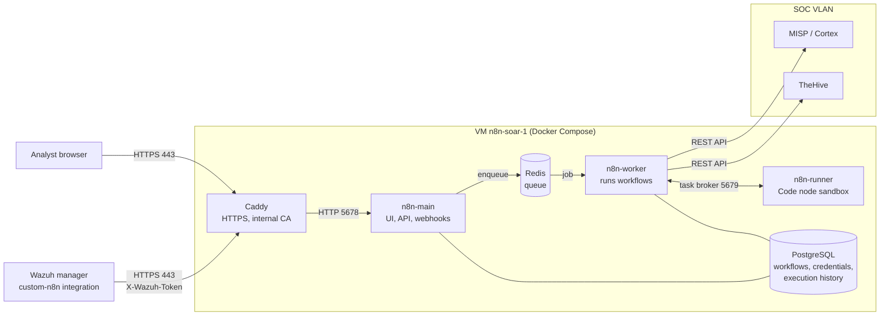

# SOAR: n8n (v0.2)

n8n is the SOAR engine of the pipeline: Wazuh pushes selected alerts to an n8n webhook, and n8n normalizes them,
removes duplicates, enriches observables with MISP and Cortex, scores the result and creates alerts in TheHive.
It replaced Shuffle in October 2026 - the Shuffle workflow is archived as v0.1 in [`soar/shuffle/`](../shuffle/),
and the reasons are recorded in [ADR 0002](../../docs/decisions/0002-soar-n8n.md).

n8n runs self-hosted in queue mode on a dedicated VM in the SOC VLAN, behind an HTTPS reverse proxy, so a burst of
alerts is queued and processed by a worker instead of slowing down the web interface.

## Architecture

| Docker network | Members | Access outside the VM |
|---|---|---|
| `edge` | caddy, n8n-main, n8n-worker | yes - Caddy publishes 80/443, the worker calls MISP, Cortex and TheHive |
| `data` | n8n-main, n8n-worker, postgres, redis | none (`internal`) |
| `sandbox` | n8n-worker, n8n-runner | none (`internal`) |

Only Caddy publishes ports. PostgreSQL, Redis and n8n itself are not reachable from the network.

## Layout

| Path | Content |
|---|---|
| [`deploy/`](deploy/) | `compose.yml`, `Caddyfile`, `make-env.sh` (generates `.env` on the VM) and the queue smoke test workflow `soc-queue-smoke-test.json` |
| `triage/` | triage workflow `SOC - Wazuh alert triage` (normalization, deduplication, MISP/Cortex enrichment, scoring, TheHive) - added in a separate PR |

## Deployment

Step-by-step runbook, with a test after every step: [`docs/runbooks/n8n-deploy.md`](../../docs/runbooks/n8n-deploy.md).

First working end-to-end test (Wazuh → n8n → MISP/Cortex → TheHive): [`docs/e2e-test.md`](../../docs/e2e-test.md).

| Component | Tested version |
|---|---|
| Proxmox VE | 9.2 |
| Ubuntu | 24.04.5 LTS (cloud image), kernel 6.8.0-147 |
| Docker Engine / Compose | 29.9.2 / v5.6.1 |
| n8n (`n8nio/n8n`, `n8nio/runners`) | 2.44.6 |
| PostgreSQL / Redis / Caddy | 17.11 / 7.4.11-alpine / 2.11.7-alpine |

