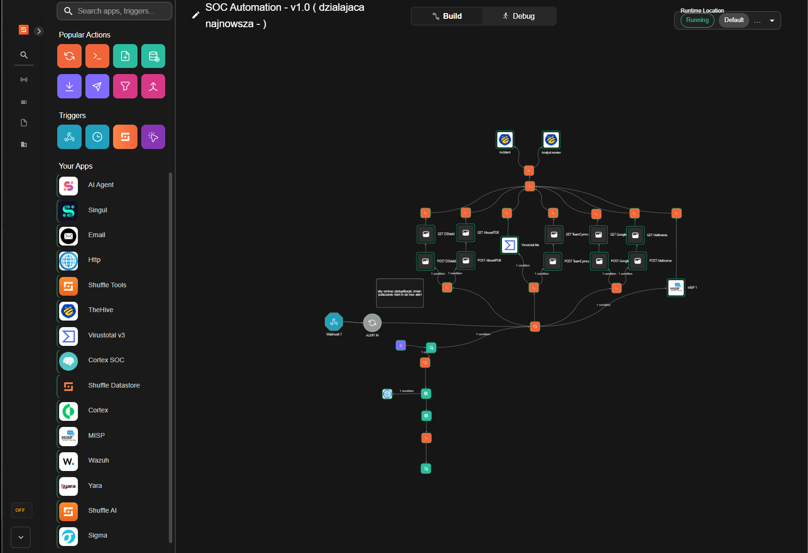
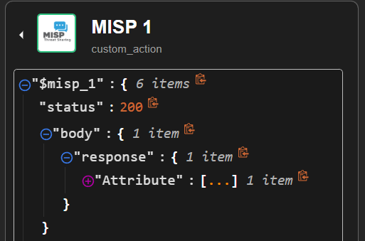

# MISP attribute lookup in the Shuffle workflow

> **Archived (v0.1).** Shuffle was replaced by n8n on 2026-10-22 and this page is no longer maintained.
> Current pipeline: [`soar/n8n/`](../../n8n/). Current MISP setup: [`enrichment/misp/`](../../../enrichment/misp/README.md). About the archive: [`soar/shuffle/`](../README.md).

**Related issue:** [#10](https://github.com/Solivagantaeon/soc-automation-lab/issues/10)

## Shuffle attribute lookup

Shuffle submits each observable to MISP using `POST /attributes/restSearch`. The Issue #10 test covered two IPs, a domain, an MD5 and a SHA-256. The five raw MISP actions returned HTTP 200. The request was not filtered by `to_ids`, so attributes with both `to_ids: true` and `to_ids: false` were returned.

The existing Shuffle screenshot shows the workflow layout and the MISP node. It is an overview, not a screenshot of the five Issue #10 execution results; those results are recorded in the sanitized JSON sample below.

The normalized per-IOC result contains an explicit status, the queried observable, matching attributes, event IDs and counts, tags, comments, event context, warninglist/benign/malicious flags, and an error field when applicable:

The sanitized input alert is available at [`samples/alerts/wazuh/misp-all-observable-types.json`](../../../samples/alerts/wazuh/misp-all-observable-types.json). Its two IP values use RFC 5737 documentation ranges; hashes, domain, alert structure and test ID are retained. The five observed lookup and scoring results are in [`samples/results/misp/all-observable-types-issue10.json`](../../../samples/results/misp/all-observable-types-issue10.json).

The earlier Shuffle Debug capture shows the MISP action returning HTTP 200 with an `Attribute` collection. The attribute contents are collapsed in the screenshot; refer to the JSON result sample for the values, tags and interpretations.

| Status | Meaning |
|---|---|
| `hit` | The request completed and returned one or more matching attributes |
| `no_hit` | The request completed and returned no matching attributes |
| `unavailable` | The request failed, timed out or returned a response that could not be used |

### Latest all-observable test

The sanitized evidence is in [`samples/results/misp/all-observable-types-issue10.json`](../../../samples/results/misp/all-observable-types-issue10.json). The alert `misp-issue10-20261020-1425-a8e2` contained two IPs, `google.com`, MD5 `0face841f7b2953e7c29c064d6886523`, and SHA-256 `bdf252bed33416f0b28efdf3ce750c54db59709bf25e7d41739cf62e760c7fe8`. IP values are replaced with documentation ranges in the committed sample.

| Observable | MISP matches | Aggregate status | Interpretation |
|---|---:|---|---|
| Malicious test IP (redacted) | 3 attributes across events `1648`, `1655`, `1685` | `hit` | Event `1685` carries `soc-lab:malicious` and `soc-lab:thehive`; preserve the `to_ids` value on each attribute |
| Public DNS warninglist test IP (redacted) | 1 attribute in event `1351`, `to_ids: false` | `hit` | Warninglist explanation is preserved; this is not a malicious verdict by itself |
| `google.com` | 4 attributes across events `167`, `228`, `868`, `1686` | `hit` | Event `1686` carries `soc-lab:benign`; this tag is event context, as other matching events exist |
| MD5 `0face…6523` | 4 attributes across events `794`, `812`, `1685` | `hit` | Event `1685` carries `soc-lab:malicious`; matched `to_ids` attributes are present |
| SHA-256 `bdf2…c7fe8` | 0 attributes | `no_hit` | Successful search with an empty attribute list |

The latest Aggregate Score capture contains five separate executions, one per observable. Every execution reports `misp_available: true`; four results are `hit` and one is `no_hit`. The MISP score is `100` for the malicious IP and MD5 because matched attributes have `to_ids: true`; warninglist and benign matches stay visible and do not receive a MISP score under the current rule. AbuseIPDB, VirusTotal and Maltiverse values are also present in all five executions.

MISP returned `first_seen` and `last_seen` as null. Event dates are context, not sightings.

The corresponding TheHive alert was created with HTTP 201. Its summary reported MISP score `100`, risk score `45`, `medium` and `analyst_review`. The workflow emitted separate scoring outputs per observable; do not treat one execution as a combined verdict for every IOC in the alert.

The Issue #10 test does not demonstrate Shuffle writing the `soc-lab:thehive` tag back to MISP or TheHive automatically importing an event, so those actions are not claimed here.

### Earlier IP-only tests

The prior multi-IP evidence is in [`samples/results/misp/multi-ip-wazuh-test.json`](../../../samples/results/misp/multi-ip-wazuh-test.json); the malicious/warninglist IP evidence is in [`samples/results/misp/malicious-and-warninglist-ip-test.json`](../../../samples/results/misp/malicious-and-warninglist-ip-test.json). Those captures established that searches include `to_ids: false` records and warninglist comments. The all-observable test supersedes their earlier limitation about domain/hash lookup coverage.
